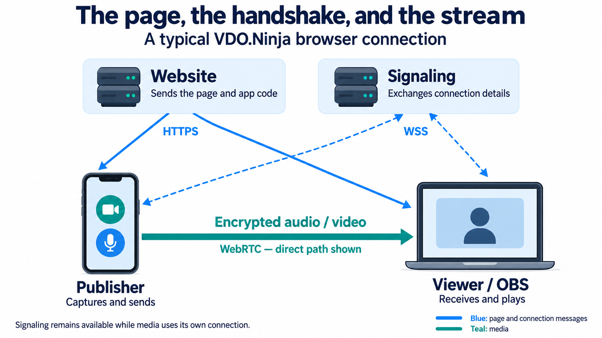
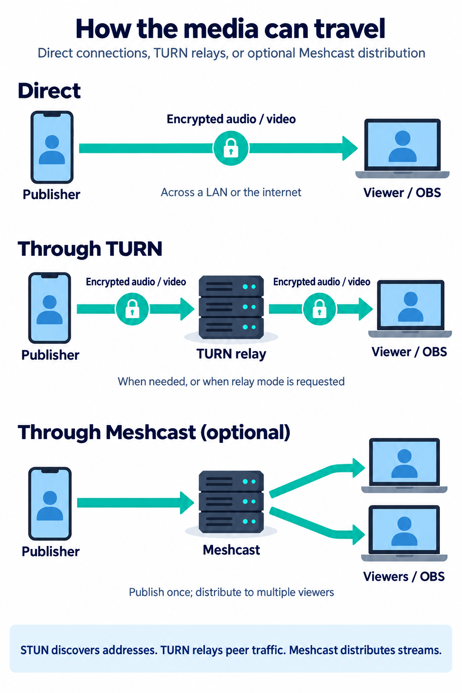

[](https://github.com/steveseguin/vdo.ninja)
[](https://github.com/steveseguin/vdo.ninja/fork)
[](https://github.com/steveseguin/vdo.ninja/releases)
[](https://discord.vdo.ninja)
[](https://twitter.com/intent/tweet?text=Check%20out%20VDO.Ninja%20-%20Peer-to-peer%20video%20streaming%20for%20OBS%20and%20more!&url=https%3A%2F%2Fgithub.com%2Fsteveseguin%2Fvdo.ninja)
[](https://scorecard.dev/viewer/?uri=github.com/steveseguin/vdo.ninja)

#### ⚠ Notice! We've rebranded from OBS.Ninja to VDO.Ninja - all else is staying the same ✨


## What is VDO.Ninja? 🚀

VDO.Ninja brings peer-to-peer video to OBS and other studio software, for remote cameras and guests:

* 🔒 Direct peer-to-peer video transfer in most cases
* ⚡ High-quality video with low latency
* 💪 Director control room with group chat
* 📱 Use a smartphone as a wireless webcam
* 🌐 Supports WHIP/WHEP and self-hosted SFUs (media servers)
* 🆓 Free software. Free managed services. Free support.


## Get started 📝

Open [VDO.Ninja](https://vdo.ninja/) in your browser and select *Add your Camera to OBS*.

* 🎥 [Basic Intro Video](https://www.youtube.com/watch?v=QaA_6aOP9z8&list=PLWodc2tCfAH1l_LDvEyxEqFf42hOBKqQM&index=1)
* 📺 [YouTube Video Tutorials](https://www.youtube.com/watch?v=mQ1Jdhf5aYg&list=PL8VJWj2-XLFpFu3G35Hdm1nKZ2xn9_0_8)
* 📖 [Getting Started Documentation](https://docs.vdo.ninja/getting-started)
* 📚 [Documentation and FAQ](https://docs.vdo.ninja)
* 📰 [Recent product updates](https://updates.vdo.ninja)
* 🧯 [Backup Deployment](https://backup.vdo.ninja)

## Support

* 💬 [Discord](https://discord.vdo.ninja): live support, discussions, community exhibitions and feature updates. This is the best place for in-depth help.
* 🎯 [Subreddit](https://reddit.com/r/vdoninja): Steve often gives a single-message answer to questions posted there.
* ✉️ Email steve@seguin.email for urgent support or other inquiries.
* 📺 Steve's [VDO.Ninja YouTube playlist](https://www.youtube.com/watch?v=vLpRzMjUDaE&list=PLWodc2tCfAH1WHjl4WAOOoRSscJ8CHACe). YouTube also has many community-made guides.

## Alternative versions of VDO.Ninja

* 📱 [Native iOS app — Apple App Store](https://apps.apple.com/us/app/vdo-ninja/id1607609685)
* 📱 [Native Android app — Google Play](https://play.google.com/store/apps/details?id=flutter.vdo.ninja)
* 🪟 [Mixer App with custom layouts](https://vdo.ninja/mixer)
* 🏹 [WHIP/WHEP client](https://vdo.ninja/whip)
* 📈 [Sharable Whiteboard](https://vdo.ninja/whiteboard)
* 🕹️ [ESports Feed Manager](https://versus.cam)
* 🌃 [Alpha version, updated nightly](https://vdo.ninja/alpha)

## Related Projects

Steve maintains these apps and services for VDO.Ninja and live production. The [helper-app catalog](https://docs.vdo.ninja/steves-helper-apps) has setup guides and more tools.

### Capture and native integrations

| Project | What it adds |
| --- | --- |
| [Game Capture](https://vdo.ninja/gamecapture) | Windows app that publishes games, app windows and Spout2 sources, with hardware encoding and window audio. |
| [Ninja OBS Plugin](https://steveseguin.github.io/ninja-obs-plugin/) | Publish from OBS, receive streams, and add room participants as OBS sources. OBS 32 on Windows, macOS and Linux; the native receiver and transparent Game Capture workflow are experimental. |
| [Custom OBS builds with improved WHIP support](https://github.com/steveseguin/obs-studio/releases) | OBS fork with WHIP trickle ICE and better TURN connectivity. Builds of OBS 32.2.2 and OBS 33 beta for Windows, macOS and Linux; check each release's limitations. |
| [Electron Capture](https://github.com/steveseguin/electroncapture) | Desktop app for frameless playback and window capture of VDO.Ninja feeds and other web pages, as an alternative to an OBS Browser Source. |
| [VDO.Ninja Video Capture Extension](https://github.com/steveseguin/video_capture_extension) | Publish web videos, or a browser tab with audio. Needs Chrome or Chromium 116+; DRM-protected video cannot be captured. |
| [Ninja VST3 Plugin](https://steveseguin.github.io/Ninja-VST3-Plugin/) | Send and receive VDO.Ninja audio in a DAW. Audio only; Windows-only and tested with Reaper. |
| [Raspberry.Ninja](https://github.com/steveseguin/raspberry_ninja) | Publish or receive without a browser, using Python and GStreamer on Raspberry Pi, Linux, Jetson, macOS or WSL. Hardware encoding, WHIP output and computer-vision workflows. |

### Production services and overlays

| Project | What it adds |
| --- | --- |
| [Meshcast](https://meshcast.io) / [Meshcast app](https://app.meshcast.io) | Server-assisted distribution for larger rooms and one-to-many streams, so the publisher uploads less. The newer app supports WHIP, RTMP and SRT; RTMP and SRT need an account. |
| [Comms](https://comms.cam/) | Browser-based intercom and talkback with separate audio groups for hosts, crew and backstage. |
| [app.invite.cam](https://app.invite.cam) | Managed lobby with reusable invitations, waiting lists and host controls for admitting guests. Hosts sign in with Discord. |
| [Social Stream Ninja](https://socialstream.ninja) | Combine live chat from YouTube, Twitch and more into OBS or vMix overlays, with featured comments, text-to-speech and bots. |
| [Caption.Ninja](https://caption.ninja/) | Live captions and translation overlays for OBS and vMix. [Caption Local](https://github.com/steveseguin/caption-local) runs speech recognition on your own computer. |
| [Ninja Backer](https://ninjabacker.com) | Creator tipping pages and OBS alerts, linked to VDO.Ninja's built-in tipping options. |

### Controls and browser utilities

| Project | What it adds |
| --- | --- |
| [VDO.Ninja Stream Deck Plugin](https://github.com/steveseguin/vdo-streamdeck) | Control mics, cameras, guests, scenes, mixer layouts and PTZ from Stream Deck keys and dials. Beta; not yet in the marketplace. |
| [Companion-Ninja](https://github.com/steveseguin/Companion-Ninja) | Remote-control tools and HTTP/WebSocket API examples, including Bitfocus Companion workflows. |
| [Screen Recorder](https://vdo.ninja/screenrecorder/) | Record tutorials in a desktop browser with screen, webcam, microphone and supported system audio, saved locally. |
| [Icecast / AzuraCast helper](https://vdo.ninja/icecast) | Publish local audio, or a received VDO.Ninja stream, to an Icecast-compatible radio server. |
| [Teleprompter Tool](https://vdo.ninja/teleprompter) | Flip, mirror or rotate websites, chat overlays and VDO.Ninja feeds for teleprompter displays. |

## What's in this repo

The VDO.Ninja web frontend and sample apps that use its [IFRAME API](IFRAME.md). Production backends and operational scripts live in separate repositories. User documentation is at [docs.vdo.ninja](https://docs.vdo.ninja).

## Hosting and local development

To host the frontend, serve this repository from an HTTPS-enabled static web server. There is no build step.

| What you want to host | Guide | What it provides |
| --- | --- | --- |
| The website on your own web server or GitHub Pages | [install.md](install.md) | Static website files. Public VDO.Ninja connection services stay enabled by default. |
| The website with Docker on a VPS, home server or Raspberry Pi | [docker-vdon](https://github.com/steveseguin/docker-vdon) | An HTTPS website container. Public connection services stay enabled by default. |
| A local setup that works without internet | [offline_deployment](https://github.com/steveseguin/offline_deployment) | The website, a local secure handshake server and certificate instructions. Docker is optional. |

For a local preview, run this from the repository root and open `http://localhost:8080/`:

```sh
python -m http.server 8080 --bind 127.0.0.1
```

This server does not map addresses without `.html`, so open other pages with the extension (for example `/mixer.html`). Other devices need HTTPS. The preview serves only the frontend; rooms still use the configured signaling and relay services.

Before you open a pull request, run the translation checks (they need Node.js), then test the flows you changed in a browser:

```sh
node .github/ci-validateTranslations.js
node .github/ci-checkTranslationKeys.js
```

### Develop and release versions

- **`develop` branch:** the preview version, for code contributions. It may be less tested or have unfinished features. It is close to https://vdo.ninja/alpha/ and is hosted at https://steveseguin.github.io/vdo.ninja/.
- **Release branches:** each release has its [own branch](https://github.com/steveseguin/vdo.ninja/branches), which gets only bug and critical fixes.
- **https://vdo.ninja/:** updated infrequently, because surprise changes are unwelcome in live production and make support harder. For newer features, use https://vdo.ninja/alpha/.

## Backend services and self-hosting

The browser uses a signaling server to set up rooms and peer connections. STUN helps peers find their network addresses, and TURN relays traffic when a direct connection fails. Hosting the frontend does not deploy these, or the authentication and call-in backends.

- **Signaling:** [websocket_server](https://github.com/steveseguin/websocket_server) provides standalone handshake servers. Use **`&wss2=`** for its advanced routing server (`vdoninja_advanced.js`) and **`&wss=`** for the older fanout servers, on both publisher and viewer links.
- **TURN:** [turnserver.md](turnserver.md) and the `turnserver_basic.conf` and `.sample` files are self-hosting examples that the website does not run. Replace their placeholders before use.
- **Call-in:** SIP call-in uses the provider settings you enter. Twilio call-in needs a Worker backend whose code is not in this repository; it defaults to a hosted Worker (`vdo-callin-alpha.vdo.workers.dev`), and `&callinapi=` (alias `&twilioapi=`) sets your own.
- **Live translation:** uses your own API key or a separately deployed token broker, such as the included [token broker example](examples/realtime-translation-broker/README.md).
- **Offline:** [offline_deployment](https://github.com/steveseguin/offline_deployment) pairs the website with a local advanced routing server and turns off automatic public STUN/TURN. Its guide covers setup, connection checks and optional internet-assisted connections.

Phones and other remote clients need HTTPS even on a private LAN. With a private certificate authority, trust its root certificate on each client device; see the [certificate guide for browsers, OBS and native apps](https://github.com/steveseguin/offline_deployment/blob/main/docs/certificates.md).

Self-hosting the frontend does not by itself make a deployment independent of hosted services, so review the endpoints your features use. [LICENCE.md](LICENCE.md) explains the difference between the software license and access to hosted services.

## How VDO.Ninja works

VDO.Ninja sends audio and video directly between devices using WebRTC. The website only delivers the app, and the signaling (handshake) server only helps devices find each other and exchange connection details; neither carries the live stream. Devices on the same local network usually keep the stream on that network, but loading the page and the handshake still need internet unless you run the [offline deployment](https://github.com/steveseguin/offline_deployment).

<picture>
  <source media="(prefers-color-scheme: dark)" srcset="images/how-vdoninja-connects-dark.png" />
  <source media="(prefers-color-scheme: light)" srcset="images/how-vdoninja-connects.png" />
  
</picture>

When a direct route is not possible, a TURN server relays the encrypted packets without decoding them. With optional [Meshcast](https://meshcast.io), or another SFU (a media server that receives one upload and forwards it to many viewers), the publisher sends one stream and the server distributes it.

<picture>
  <source media="(prefers-color-scheme: dark)" srcset="images/how-vdoninja-media-travels-dark.png" />
  <source media="(prefers-color-scheme: light)" srcset="images/how-vdoninja-media-travels.png" />
  
</picture>

See [How does it work](https://docs.vdo.ninja/master/how-does-it-work) for details, and the [hosting guides](#hosting-and-local-development) for your own or a fully local setup.

## Privacy

VDO.Ninja avoids data collection where possible, and streams are designed to be private, but use it at your own risk and share links only with people you trust. To keep your IP address private, use your own TURN server with forced relaying; see [turnserver.md](turnserver.md).

https://vdo.ninja may use cookies that the service needs to work, which are exempt from EU cookie-notice rules. Cloudflare caches the site and provides denial-of-service protection. If you need extra security or privacy features, ask; many have been added on request.

See the [Terms of Service](https://docs.vdo.ninja/help/privacy-and-security-details/vdo.ninja-terms-of-service), [Privacy Policy](https://docs.vdo.ninja/help/privacy-and-security-details/vdo.ninja-privacy-policy) and [privacy and security details](https://docs.vdo.ninja/help/privacy-and-security-details). To report a vulnerability, see [SECURITY.md](SECURITY.md).

## Feedback
Ideas, feedback and bug reports are all welcome, by email or on Discord. Many of Steve's ideas are tracked as GitHub issues.

## Licence
See [LICENCE.md](LICENCE.md) for licensing and ownership details, [LICENSE](LICENSE) for the full core license, and [examples/LICENSE](examples/LICENSE) for the example-code license. Contributions are covered by [CONTRIBUTING.md](CONTRIBUTING.md).

## Credit
Thank you to everyone who has supported this project: the moderators, support volunteers, media contributors, sponsors, and everyone who has reported issues, offered feedback or submitted code.

## Contributors of this repo
<a href="https://github.com/steveseguin/vdo.ninja/graphs/contributors">
  
</a>
