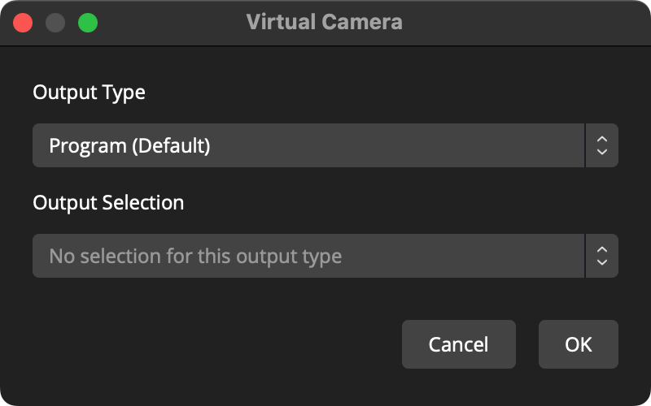

# Virtual camera not working on Mac

Start **OBS Virtual Camera** before selecting it in VDO.Ninja. If OBS says the camera is not installed, enable its **camera extension** in macOS.

## 1. Allow the OBS camera extension

Follow **Open System Settings** in OBS's extension prompt, or open the matching location:

| macOS | Where to enable OBS |
| --- | --- |
| 13 Ventura / 14 Sonoma | **System Settings → Privacy & Security → Security**; allow the blocked OBS system software |
| 15 Sequoia and later | **System Settings → General → Login Items & Extensions**; open the camera/media extension entry for OBS and enable it |

Authenticate if macOS asks, then restart OBS. See [OBS's official virtual-camera troubleshooting](https://obsproject.com/kb/virtual-camera-troubleshooting) for installation and compatibility details.

**Screen Recording permission is separate:** it lets OBS capture your screen. It does not replace approval of the virtual-camera extension.

## 2. Start the camera

Click **Start Virtual Camera** in OBS. The gear beside it chooses the picture to send.

<figure><figcaption>
Program sends the main OBS output. Choose Scene or Source for a fixed picture. Image: <a href="https://obsproject.com/kb/virtual-camera-guide">OBS Project</a>.
</figcaption></figure>

## 3. Select it in VDO.Ninja

Reopen the publishing page and choose **OBS Virtual Camera** under **Video Source**. Allow camera access when the browser asks.

If it is still missing, fully quit and reopen the browser. On macOS 14 or newer, use OBS 30 or newer; OBS 29.1 and earlier use an incompatible camera component. Older macOS versions may need Chrome or Edge for compatibility with the legacy camera.

For the complete video and audio setup, see [Publish from OBS into VDO.Ninja](../guides/publish-from-obs-into-vdo.ninja.md).
