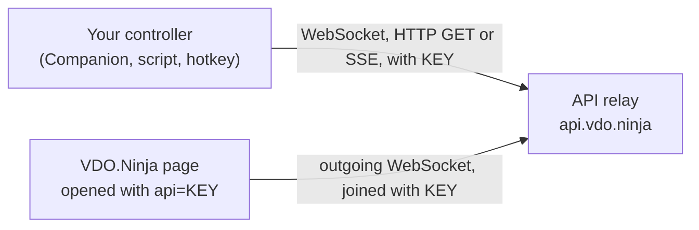

# VDO.Ninja Remote Control API Documentation

Control a VDO.Ninja page from stream decks, scripts and automation tools. The page connects out to the API relay and runs the commands sent for its key.



## Enable the API

Add `&api` (alias `&osc`) with a private key you choose:

```
https://vdo.ninja/?webcam&api=YOUR_UNIQUE_API_KEY
```

Anyone who knows the key has full control of that page. Treat it like a password and use a different key for each production.

## Connect

| Method | Best for | Address |
|--------|----------|---------|
| WebSocket | Two-way control and live state updates | `wss://api.vdo.ninja:443` |
| HTTP GET | Hotkey tools and simple buttons | `https://api.vdo.ninja/{apiKey}/{action}/{target}/{value}` |
| Server-Sent Events | Listening only | `https://api.vdo.ninja/sse/{apiKey}` |

### WebSocket

Send `{"join": "YOUR_UNIQUE_API_KEY"}` first. Then send JSON commands with `action` and, where needed, `target`, `value` and `value2`:

```javascript
const socket = new WebSocket("wss://api.vdo.ninja:443");
socket.onopen = () => {
    socket.send(JSON.stringify({ join: "YOUR_UNIQUE_API_KEY" }));
    socket.send(JSON.stringify({ action: "mic", value: false })); // mute your mic
};
socket.onmessage = (event) => console.log(JSON.parse(event.data));
```

The connection can time out after about a minute. Reconnect and send `join` again when it closes.

### HTTP GET

```
https://api.vdo.ninja/YOUR_UNIQUE_API_KEY/mic/null/false      // mute your mic
https://api.vdo.ninja/YOUR_UNIQUE_API_KEY/camera/null/toggle  // toggle your camera
https://api.vdo.ninja/YOUR_UNIQUE_API_KEY/mic/1/toggle        // director: toggle guest 1's mic
```

- Put `null` in any field you do not use, and avoid empty segments (`//`).
- The shorter forms `/{apiKey}/{action}/{value}` and `/{apiKey}/{action}` also work for commands without a target.
- `value2` cannot be sent this way. Use the WebSocket for commands that need it.
- The reply is the command's result as text or JSON, for example `true` after `mic/null/toggle` mutes the mic. `timeout` means no page with that key answered.

### Server-Sent Events

```javascript
const events = new EventSource("https://api.vdo.ninja/sse/YOUR_UNIQUE_API_KEY");
events.onmessage = (event) => console.log(JSON.parse(event.data));
```

## Replies and state updates

Each command gets a `callback` that echoes your whole request and adds `result`:

```javascript
{
  "callback": {
    "action": "mic",
    "value": "toggle",
    "result": false // the mic is now unmuted
  }
}
```

- For `mic`, `camera` and `speaker`, `result` is the muted state: `true` means muted.
- Extra fields you add to a WebSocket request, such as `"cid": 3124`, come back in the callback, so you can match replies to requests.
- The page also pushes changes as `{"update": {"streamID": ..., "action": ..., "value": ...}}`. Examples include `details` (sent on connect), `muted`, `videoMuted`, `chat` and `newViewConnection`.

## Commands for your own page

Leave out `target`, or set it to `null`. For on/off commands, `true` means on (unmuted) and `false` means off.

| Action | Value | Effect |
|--------|-------|--------|
| `mic`, `camera` (alias `video`), `speaker` | `true`, `false`, `toggle` | Turn your mic, camera or speaker on or off |
| `volume` | `0` to `100` | Playback volume of all incoming streams, in percent |
| `bitrate` | kbps; `-1` or `true` resets; `0` or `false` stops video | Requested bitrate for all incoming video |
| `record` | `true`, `false` | Start or stop local recording |
| `hangup`, `reload` | none | Leave the session, or reload the page |
| `togglehand` (alias `raisehand`) | none | Toggle your raised hand |
| `togglescreenshare` | none | Toggle screen sharing |
| `chat` | none | Show or hide the chat panel |
| `sendChat` | text | Send a chat message to everyone |
| `forceKeyframe` | none | Request keyframes to clear smeared video ("rainbow puke") |
| `zoom`, `focus`, `pan`, `tilt`, `exposure` | Relative step such as `0.1` or `-0.1`; with `value2: "abs"`, an absolute position (`0` to `1`, or `-1` to `1` for pan and tilt) | Adjust your camera, if it supports the control |
| `layout` | see [Layouts](#layouts) | Change the mixer layout |
| `nextSlide`, `prevSlide` | none | Send the MIDI slide-change command used by the PowerPoint integration |
| `getDetails`, `getGuestList`, `getStats`, `requestStats` | none | Return page state, guest slots and stream IDs, or stats |

Also available: `width`, `height`, `aspectRatio`, `videoConstraint`, `tallylight` (`onair`, `active`, `standby`, `off`), `setBufferDelay` (milliseconds), `activeSpeaker`, `sendChatMessage`, `showChatOverlay` and `panning`.

### Director page commands without a target

| Action | Value | Effect |
|--------|-------|--------|
| `muteAllGuests` | `true` (mute), `false`, or omit to toggle | Mute or unmute all guests |
| `group`, `joinGroup`, `leaveGroup` | group `1` to `8` | Toggle, join or leave a group |
| `viewGroup`, `joinViewGroup`, `leaveViewGroup` | group `1` to `8` | Toggle, start or stop viewing a group |
| `startRoomTimer` | seconds | Start the room countdown |
| `pauseRoomTimer`, `stopRoomTimer` | none | Pause or stop the room countdown |
| `soloVideo` (alias `highlight`) | `toggle`, `true`, `false` | Highlight the director's video for everyone |

## Director commands for one guest

These work from the director's page. Set `target` to one of:

- a slot number starting at `1` (slots can change as guests come and go);
- the guest's stream ID (more reliable);
- the guest's connection UUID.

```javascript
{"action": "mic", "target": 1, "value": false}            // mute the guest in slot 1
{"action": "mic", "target": "abc123xyz", "value": false}  // mute stream ID abc123xyz
```

| Action | Value | Effect |
|--------|-------|--------|
| `mic` (alias `audio`), `camera` (alias `video`), `speaker`, `display` | `true`, `false`, `toggle` | Turn the guest's mic, camera, speaker or display on or off |
| `muteScene` | `true`, `false`, `toggle` | Turn the guest's audio in scenes on or off |
| `addScene` | scene `1` to `8` | Toggle the guest in that scene |
| `setScene` | scene, with `value2` `true` or `false` | Add the guest to, or remove them from, a scene |
| `volume` | `0` to `200` | Slider position: `100` is normal; higher values boost on a curve, up to about 8x |
| `group` | group number | Toggle the guest's group |
| `setslot` | slot number | Move the guest to a mixer slot |
| `mixorder` | `-1` or `1` | Move the guest earlier or later in the mixer |
| `forward` (alias `transfer`) | room name | Transfer the guest to another room |
| `hangup` | none | Disconnect the guest |
| `soloChat`, `soloChatBidirectional` | none | Toggle private one-way or two-way talk with the guest |
| `soloVideo` | `toggle` | Highlight the guest's video |
| `sendChat` | text | Send a chat message to the guest |
| `forceKeyframe` | none | Fix smeared video from the guest |
| `rotate` | `true` (+90 degrees), `false` (reset), `90`, `180`, `270` | Rotate the guest's video |
| `ptzZoom`, `ptzPan`, `ptzTilt`, `ptzFocus` | relative step; with `value2: "abs"`, an absolute position | Adjust the guest's camera |
| `startRoomTimer`, `pauseRoomTimer`, `stopRoomTimer` | seconds for start | Control the guest's countdown timer |

`rotate` is only a targeted command. A guest page with `&push=...&api=...` has no untargeted `rotate`.

Other targeted actions include `mirror`, `requestResolution` (`WIDTHxHEIGHT`), `setWidth`, `setHeight`, `setAspectRatio`, `refreshVideo`, `refreshConnection`, `refreshAll`, `sendDirectorChat`, `ptzAutofocus`, `activateQueuedGuest`, `setCameraDevice`, `setBackgroundImage` and `setVideoEffect`.

## Layouts

Send `0` or `false` for the automatic mixer, `1`, `2`, ... for that layout from the `&layouts` URL parameter (1 is the first), or a custom layout object or array:

```javascript
{
  "action": "layout",
  "value": [
    {"x": 0, "y": 0, "w": 50, "h": 100, "slot": 0},
    {"x": 50, "y": 0, "w": 50, "h": 100, "slot": 1}
  ]
}
```

Each item takes:

- `x`, `y`, `w`, `h`: position and size, as a percentage of the canvas;
- `slot`: which video slot to show, starting at `0`;
- `z`: stacking order (optional);
- `c`: `true` to crop the video to fill the box (optional);
- `rounded`: corner radius (optional).

Over HTTP, send a custom layout as URL-encoded JSON or base64-encoded JSON.

## Python example

```python
import asyncio
import json
import websockets

async def control_camera():
    async with websockets.connect("wss://api.vdo.ninja:443") as websocket:
        await websocket.send(json.dumps({"join": "YOUR_API_KEY"}))
        # Zoom to the middle of the camera's range
        await websocket.send(json.dumps({"action": "zoom", "value": 0.5, "value2": "abs"}))
        print("Response:", await websocket.recv())

asyncio.run(control_camera())
```

## Tools and examples

- [Bitfocus Companion module](https://github.com/bitfocus/companion-module-vdo-ninja), for Stream Deck and similar controllers. Any tool that sends HTTP requests, such as Node-RED or Home Assistant, also works.
- [Stream Deck guide](../streamdeck.html), with ready-made HTTP URLs.
- [remoteapi.html](remoteapi.html) and [sandbox.html](sandbox.html) in this folder, for trying commands.
- Full API notes: [github.com/steveseguin/Companion-Ninja](https://github.com/steveseguin/Companion-Ninja). Interactive demo: [companion.vdo.ninja](https://companion.vdo.ninja).

If nothing happens, check that the key matches exactly on the page and in your requests.

## Self-hosting the API relay

The relay server is not part of this repository, and support for self-hosting it is limited. If you run your own over SSL, point VDO.Ninja at it with `&apiserver`:

```
https://vdo.ninja/?webcam&api=YOUR_UNIQUE_API_KEY&apiserver=wss://your-domain:443
```

If you self-host VDO.Ninja, you can instead change the default `session.apiserver` value in `webrtc.js`.
