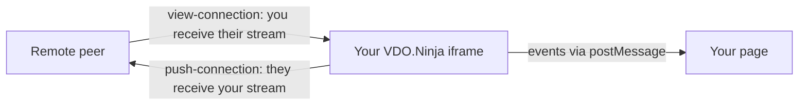

# Understanding the VDO.Ninja IFRAME API: Detecting User Joins and Disconnects

Your page sends commands to an embedded VDO.Ninja iframe with `postMessage`, and the iframe posts events back, including when peers connect and disconnect. This page covers those events, then lists every inbound command.

## Event format

Listen for `message` events on `window` and accept only those whose `e.source` is your iframe's `contentWindow` (see the [example](#complete-working-example)). Events have the form `{ action, value, UUID, streamID }`. `UUID` identifies the peer connection. `streamID` is only included when the iframe knows the peer's stream ID, so do not depend on it for every event.

By default the iframe posts to any parent origin. Add `&iframetarget=https://your-site.com` to the iframe URL to restrict which origin receives events.

## Connection events

"Push" means someone receives your stream. "View" means you receive theirs.



| `action` | Fires when | `value` |
|---|---|---|
| `view-connection` | You start or stop receiving a remote stream | `true` on connect, `false` on disconnect. Includes `streamID`. |
| `view-connection-info` | The remote publisher sends its details | Info object, including `label` if set |
| `push-connection` | A peer starts or stops receiving your stream | `true` on connect, `false` on disconnect |
| `push-connection-info` | A peer receiving your stream sends its details | Info object, including `label` if set |
| `guest-connected` | A room guest connects to receive your stream | Not used |
| `director-connected` | A director connects to receive your stream | Director flag |
| `scene-connected` | A scene (for example an OBS view) connects to your stream | The scene ID |
| `director-share` | Your own director page starts or stops publishing | `true` or `false` |
| `slot-updated` | A stream is assigned to a slot (`&slotmode`) | Slot number; `streamID` is the stream |
| `joining-room` | You begin joining a room | Room name |
| `joined-room-complete` | Room join finished | None |

`new-view-connection`, `new-push-connection` and `end-view-connection` are older duplicates. Use the events above.

## Complete working example

This tracks connected peers by UUID and shows a count.

```javascript
var iframe = document.createElement("iframe");
iframe.allow = "camera;microphone;fullscreen;display-capture;autoplay;";
iframe.src = "https://vdo.ninja/?room=your-room-name&cleanoutput";
iframe.style.width = "100%";
iframe.style.height = "100%";
document.body.appendChild(iframe);

var statusDiv = document.createElement("div");
document.body.appendChild(statusDiv);
var connectedUsers = {}; // UUID -> label and active push/view directions

window.addEventListener("message", function (e) {
    if (e.source != iframe.contentWindow) return; // only accept our iframe
    if (!e.data || typeof e.data !== "object" || !e.data.action || !e.data.UUID) return;
    var data = e.data;
    var isConnection = data.action === "view-connection" || data.action === "push-connection";

    var peer = connectedUsers[data.UUID];
    var direction = data.action === "view-connection" ? "view" : "push";

    if (isConnection && data.value === true) {
        if (!peer) {
            peer = { label: data.streamID || data.UUID, view: false, push: false };
            connectedUsers[data.UUID] = peer;
        }
        peer[direction] = true;
        updateStatus("Connected: " + peer.label);
    } else if (isConnection && data.value === false && peer) {
        peer[direction] = false;
        if (!peer.view && !peer.push) {
            delete connectedUsers[data.UUID];
        }
        updateStatus(data.action + " closed: " + peer.label);
    } else if (data.action.endsWith("-connection-info") && peer && data.value && data.value.label) {
        peer.label = data.value.label;
    } else if (data.action === "director-connected") {
        updateStatus("Director connected");
    }
});

function updateStatus(message) {
    var line = document.createElement("p");
    line.textContent = message + " (" + Object.keys(connectedUsers).length + " connected)";
    statusDiv.appendChild(line);
}
```

In a room, each pair of guests usually has both a view and a push connection with the same UUID. The example counts that peer once and removes them only after both directions close. Connection-info events update the label of an already connected peer.

For a waiting room, show "Waiting for the director" after `joining-room` and hide it on `director-connected`. [waitingroom.html](waitingroom.html) is a full example.

To list current connections at any time, send `getStreamIDs` or `getDetailedState` (see [Statistics and state](#statistics-and-state)).

# VDO.Ninja IFRAME API - Complete Inbound Control Reference

Every command is a property on the object you post to the iframe. You can combine several in one message.

```javascript
iframe.contentWindow.postMessage({ command: value /*, optional fields */ }, "*");
```

You can replace the `"*"` target origin with the iframe's origin.

The bitrate commands (`bitrate`, `targetBitrate`, `manualBitrate`, `audiobitrate`, `targetAudioBitrate`) accept one of these optional fields to pick streams. Without one, they apply to every stream.

- `target`: a stream ID, or `"*"` for all
- `streamID`: a stream ID
- `UUID`: a connection ID

Commands that return data accept an optional `cib` (callback ID). It is copied into the reply, so you can match replies to requests: `{ getStats: true, cib: "stats-1" }` is answered with `{ stats, cib: "stats-1" }`.

## Audio

| Command | Values | Notes |
|---|---|---|
| `mic` | `true` (unmute), `false` (mute), `"toggle"` | Your microphone |
| `mute` | `true` (mute), `false` (unmute), `"toggle"` | Incoming audio (speaker) |
| `speaker` | `true` (unmute), `false` (mute), `"toggle"` | Same as `mute` with reversed logic. Ignored if `mute` is in the same message. |
| `volume` | `0` to `1.0` | Playback volume. Optional `target` (stream ID or `"*"`). Values above 1 are treated as a percentage. |
| `panning` | `0` (left) to `180` (right), `90` is center | Stereo pan of incoming audio. Needs `&panning` in the iframe URL. `true` picks a random position; `false` centers. |
| `targetAudioBitrate` | kbps | Asks the publisher to target this audio bitrate. |
| `audiobitrate` | kbps | Limits inbound audio bitrate. `lock` defaults to `true`. |
| `PPT` | `true` (unmute), `false` (mute), `"toggle"` | Push-to-talk for your microphone |

## Video

| Command | Values | Notes |
|---|---|---|
| `camera` | `true` (on), `false` (off), `"toggle"` | Your camera |
| `pauseinvisible` | `true`, `false`, `"toggle"` | Pause videos the mixer is not showing |
| `keyframe` | `true` | Sends a keyframe to all scene connections |
| `bitrate` | kbps | Requests a video bitrate from publishers you view. `lock` defaults to `true` so the automixer does not override it. `-1` restores the default. |
| `targetBitrate` | kbps | Sets the publisher's target bitrate without locking it. |
| `manualBitrate` | kbps | Sets a manual bandwidth limit. |
| `scale` | Percent, or `false` | Requests a resolution scale from publishers. `false` returns to dynamic scaling. Use `target` (stream ID or `"*"`) to pick streams. |
| `targetWidth`, `targetHeight` | Pixels | Requests a resolution from one connection. `UUID` is required. |

```javascript
iframe.contentWindow.postMessage({ bitrate: 2500, lock: true, target: "streamID123" }, "*");
```

## Streams, recording and groups

| Command | Values | Notes |
|---|---|---|
| `requestStream` | Stream ID | Loads a stream, including one outside your room |
| `close` or `hangup` | `true`, `"estop"`, `"reload"` | Hang up. `"estop"` stops at once, even mid-recording; `"reload"` hangs up and reloads. |
| `record` | `true`, `false`, or a video element ID | Start or stop local recording, or record a specific `<video>` element |
| `groups` | Array of group names | Sets your groups. `[]` clears them. Use an array; a comma-separated string currently clears your groups instead. |
| `groupView` | Array, or comma-separated string | Sets which groups you see. `[]` shows all. |

## Devices

| Command | Values | Reply |
|---|---|---|
| `changeVideoDevice` | Device ID | |
| `changeAudioDevice` | Device ID | |
| `changeAudioOutputDevice` | Device ID | |
| `getDeviceList` | `true` | `{ deviceList: [...], cib }` |
| `setBackgroundImage` | Image URL (must allow CORS) | `{ backgroundImageChanged: { ok, backgroundImage or error }, cib }`. Replaces your virtual background image. |

## Layout and display

| Command | Values | Notes |
|---|---|---|
| `layout` | Layout object, array of layout objects, or `false` | Sets a custom layout. `false` returns to the automixer. Posts a `layout-updated` event. A director can add `scene` and `UUID` to send the layout to a scene. |
| `previewMode` | Mode number | Switches preview mode |
| `slotmode` | Number | Changes the slot mode. Only works if the iframe was loaded with `&slotmode`. |
| `slotReservationsEnabled`, `reservedSlots` | `true`/`false`; object such as `{ "1": "streamA" }` | Director with `&slotmode` only. Posts a `slot-reservations` event. |
| `advancedMode` | `true`, `false` | Shows or hides advanced UI elements |
| `toggleSettings` | `"toggle"`, `false` | Toggles or closes the settings panel. `true` currently also toggles. |
| `style` | CSS text | Adds a style sheet to the iframe |

A layout object positions videos in percent of the canvas:

```javascript
iframe.contentWindow.postMessage({
    layout: [
        { x: 0, y: 0, w: 50, h: 100, slot: 0 },
        { x: 50, y: 0, w: 50, h: 100, slot: 1 }
    ]
}, "*");
```

### Moving video elements

Send `target` (stream ID or `"*"`) without `action` to change that stream's `<video>` element:

```javascript
iframe.contentWindow.postMessage({ target: "streamID123", add: true }, "*");     // add to the grid
iframe.contentWindow.postMessage({ target: "streamID123", remove: true }, "*");  // remove from the page
iframe.contentWindow.postMessage({ target: "streamID123", replace: true }, "*"); // show only this video
iframe.contentWindow.postMessage({
    target: "streamID123",
    settings: { style: "transform: scale(1.5);", muted: true } // set properties on the video element
}, "*");
```

## Data and messaging

| Command | Sends to | Notes |
|---|---|---|
| `sendData` | Peers, over the data channel | Arrives at the other iframe as `{ dataReceived, UUID }`. See [dataiframes.md](dataiframes.md). |
| `sendChat` | All peers | A chat message string |
| `sendMessage` | Peers viewing you | Raw WebRTC message object |
| `sendRequest` | Publishers you view | Raw WebRTC request object |
| `sendPeers` | Every connected peer | Raw message object |
| `sendRawMIDI` | All peers, or one `UUID` or `streamID` | `{ data: [144, 60, 127], channel, timestamp }` |

## Statistics and state

| Command | Reply |
|---|---|
| `getStats` | `{ stats, cib }`. With `streamID`, only that stream's inbound stats (or `null`). |
| `getFreshStats` | `{ stats, cib }` after about 1 second, with refreshed outbound stats and connection counts |
| `getRemoteStats` | Remote peers answer with `{ remoteStats, streamID, UUID }` |
| `requestStatsContinuous` | `true` or `false`; remote peers keep sending `remoteStats` |
| `getLoudness` | `true` starts loudness messages; `false` stops them |
| `getStreamIDs` | `{ streamIDs: { streamID: label }, cib }` |
| `getStreamInfo` | `{ streamInfo: { UUID: { label, streamID, tally, info } }, tally, cib }` |
| `getDetailedState` | `{ detailedState, cib }` |
| `getGuestList` | `{ guestList: { "1": { streamID, label }, ... }, cib }`. Director only. |

Loudness messages look like `{ action: "loudness", mode, loudness: { streamID: level }, cib }`. The first reply has `mode: "snapshot"`; later updates have `mode: "update"`. Updates carry the `cib` from your last `getLoudness: true` request. Handle any message that contains `loudness`.

For chunked-mode sync tools, each remote stream in `getDetailedState` includes `chunkedBufferDefault`, `chunkedBufferOverride`, `chunkedBufferRequested`, `chunkedBufferCeil` and `chunkedBufferAdaptive`.

## Snapshots

| Command | Reply |
|---|---|
| `saveVideoFrameToDisk` | Downloads a frame. Optional `filename` (`.png` is added if there is no extension), `streamID`, or `UUID` (`"*"` saves every stream). Without either, saves your own video. |
| `copyVideoFrameToClipboard` | Copies a frame. Optional `streamID` or `UUID`. |
| `getVideoFrame` | An `image-frame-capture` event: `{ action: "image-frame-capture", value: { imageData, imageType: "png", streamID, UUID, cib, videoID } }`. `imageData` is a PNG `Blob`. |
| `getSnapshotBySlot`, `getSnapshotByStreamID` | `{ type: "frame", frame, UUID, streamID, trackID, kind, format, slot, cib }`. `frame` is a data URL. |

Slots are numbered from 1, so `getSnapshotBySlot: 0` does nothing.

## Buffer delay

`setBufferDelay` sets the playout delay in milliseconds. Without a target it changes the default for all streams. Add `streamID`, `label`, or `UUID` (`"*"` for all) to target streams.

```javascript
iframe.contentWindow.postMessage({ setBufferDelay: 300, streamID: "streamID123" }, "*");
```

For fixed delay against external audio, load the viewer with:

```text
?noaudio&chunkbufferadaptive=0&chunkbufferceil=180000
```

`chunkbufferadaptive=0` stops the viewer from raising your requested delay. `chunkbufferceil=180000` allows up to 3 minutes of chunked video delay. `noaudio` helps when the music audio is handled in OBS, NINJAM or another app. [music-sync-buffer-demo.html](music-sync-buffer-demo.html) calculates a delay from BPM and bars, then sends `setBufferDelay` over this API.

## Other commands

| Command | Values | Notes |
|---|---|---|
| `reload` | `true` | Reloads the page without a prompt |
| `automixer` | `true`, `false` | `false` stops the automixer so you control layout and bitrate yourself |
| `sceneState` | `true`, `false` | Tells connected publishers whether this scene is live (tally light) |
| `layouts` | Array of layouts | Sends a layout list to peers; optional `obsSceneTriggers` |
| `obsCommand` | Command | Sends an OBS command to peers; optional `remote`, `UUID`, `streamID`. Ignored if the message also has `layout` or `previewMode`. |
| `enableYouTube` | API key string, or `true` to reuse a stored key | Starts the YouTube chat integration |
| `nextSlide`, `prevSlide` | `true` | Slide control |
| `getFaces` | `true` with `faceTrack: true` or `false` | Turns face tracking data on or off |
| `getEffectsData` | Effect name, or `false` | Requests data from an effect's ML pipeline |

### `function` calls

| `function` | Extra fields | Does |
|---|---|---|
| `previewWebcam` | | Opens the camera preview |
| `publishScreen` | | Starts a screen share |
| `changeHTML` | `target` (element ID), `value` (HTML) | Replaces an element's HTML |
| `routeMessage` | `value` | Passes a message to the signaling handler |
| `eval` | `value` (code) | Runs code in the iframe. Use with caution. |
| `targetGuest`, `commands`, `getGuestMediaDevices`, `setGuestMediaDevice`, `activateQueuedGuest` | | Director tools; see [iframe_api_enhanced.md](iframe_api_enhanced.md) |

### `action` (HTTP/WSS API commands)

Any command from the [HTTP/WSS API](httpwssapi.md) works with `action`, `value`, optional `value2` and optional `target`. For example, a director can rotate the guest in slot 1 by 90 degrees:

```javascript
iframe.contentWindow.postMessage({ action: "rotate", target: "1", value: true }, "*");
```

Guest-targeted actions need director or co-director rights in the room. See [iframe_api_enhanced.md](iframe_api_enhanced.md) for more examples and the reply format.
