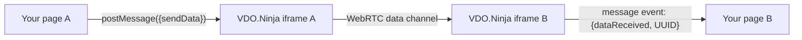

# VDO.Ninja IFRAME API: Transmitting Drawing Data Between Clients

Use the IFRAME API's `sendData` command to send drawing strokes, or any other JSON data, to the peers your embedded VDO.Ninja page is connected to. The data travels over the existing peer-to-peer WebRTC data channel, not through a server.



## 1. Embed VDO.Ninja

```javascript
const iframe = document.createElement("iframe");
iframe.allow = "camera;microphone;fullscreen;display-capture;autoplay;";
iframe.src = "https://vdo.ninja/?room=your-room-name&cleanoutput";
document.getElementById("container").appendChild(iframe);
```

## 2. Send data

Post a `sendData` message to the iframe. Wrap your payload in your own key, here `overlayNinja`:

```javascript
iframe.contentWindow.postMessage({
    sendData: { overlayNinja: { drawingData: data } }
}, "*");
```

Add fields to choose who receives it:

| Field | Sends to |
|-------|----------|
| none | Every connected peer, once each |
| `UUID: "..."` | That one connection. Takes priority over `streamID`. |
| `streamID: "..."` | The peer publishing that stream ID, if you are viewing it |
| `type: "pcs"` | Only peers viewing your stream |
| `type: "rpcs"` | Only peers whose streams you are viewing |

`type` can be combined with `UUID` or `streamID`. Leave it out unless you need it: a director who is not sending video has no viewers, so `type: "pcs"` would reach nobody.

`overlayNinja` is the key Social Stream Ninja uses. A VDO.Ninja page that is not inside an iframe treats `overlayNinja.chatmessage` as a chat message. Any other top-level key also works.

## 3. Receive data and track peers

The iframe posts these messages to your page:

| Message | Meaning |
|---------|---------|
| `{dataReceived: {...}, UUID}` | A peer sent you data. `UUID` identifies the sender's connection. |
| `{action: "push-connection", value: true or false, UUID}` | A peer started or stopped viewing your stream |
| `{action: "view-connection", value: true or false, UUID}` | You started or stopped viewing a peer's stream |
| `{action: "remote-label-changed", value: label, UUID}` | The label of a stream you view, when it is set or changes |

The connection and label messages also carry `streamID` when it is known.

```javascript
window.addEventListener("message", (e) => {
    if (e.source !== iframe.contentWindow || !e.data) return; // only our iframe
    if (e.data.dataReceived && e.data.dataReceived.overlayNinja) {
        handleData(e.data.dataReceived.overlayNinja, e.data.UUID);
    }
});
```

A UUID identifies one connection and is new each time a peer reconnects. A stream ID set with `&push` stays the same, so use it when you need a stable target.

## Complete drawing example

This page draws on a canvas, sends each finished stroke to all peers, supports clear and undo, and sends the current drawing to each peer that connects. Coordinates are stored in the 0 to 1 range, so drawings line up on canvases of different sizes.

```javascript
// VDO.Ninja iframe
const iframe = document.createElement("iframe");
iframe.allow = "camera;microphone;fullscreen;display-capture;autoplay;";
iframe.src = "https://vdo.ninja/?room=drawing-demo&cleanoutput";
iframe.style.width = "640px";
iframe.style.height = "360px";
document.body.appendChild(iframe);

// Drawing canvas
const canvas = document.createElement("canvas");
canvas.width = 640;
canvas.height = 360;
canvas.style.border = "1px solid black";
document.body.appendChild(canvas);
const ctx = canvas.getContext("2d");
ctx.strokeStyle = "red";
ctx.lineWidth = 3;
ctx.lineCap = "round";

// Clear and Undo buttons
[["Clear", clearDrawing], ["Undo", undoLastDrawing]].forEach(([label, handler]) => {
    const button = document.createElement("button");
    button.textContent = label;
    button.onclick = handler;
    document.body.appendChild(button);
});

const drawingHistory = []; // finished paths: arrays of {x, y}
let currentPath = [];
let isDrawing = false;

function send(payload, UUID) {
    const message = { sendData: { overlayNinja: payload } };
    if (UUID) message.UUID = UUID;
    iframe.contentWindow.postMessage(message, "*");
}

function drawPath(path) {
    if (!path || path.length < 2) return;
    ctx.beginPath();
    ctx.moveTo(path[0].x * canvas.width, path[0].y * canvas.height);
    for (let i = 1; i < path.length; i++) {
        ctx.lineTo(path[i].x * canvas.width, path[i].y * canvas.height);
    }
    ctx.stroke();
}

function redraw() {
    ctx.clearRect(0, 0, canvas.width, canvas.height);
    drawingHistory.forEach(drawPath);
}

function point(e) {
    return { x: e.offsetX / canvas.width, y: e.offsetY / canvas.height };
}

// Local drawing
canvas.addEventListener("mousedown", (e) => {
    isDrawing = true;
    currentPath = [point(e)];
});

canvas.addEventListener("mousemove", (e) => {
    if (!isDrawing) return;
    currentPath.push(point(e));
    drawPath(currentPath.slice(-2)); // draw the newest segment
});

function endDrawing() {
    if (!isDrawing) return;
    isDrawing = false;
    if (currentPath.length > 1) {
        drawingHistory.push(currentPath);
        send({ drawingData: { t: "path", p: currentPath } });
    }
    currentPath = [];
}
canvas.addEventListener("mouseup", endDrawing);
canvas.addEventListener("mouseout", endDrawing);

function clearDrawing() {
    drawingHistory.length = 0;
    redraw();
    send({ drawingData: "clear" });
}

function undoLastDrawing() {
    if (!drawingHistory.length) return;
    drawingHistory.pop();
    redraw();
    send({ drawingData: "undo" });
}

// Messages from the iframe
window.addEventListener("message", (e) => {
    if (e.source !== iframe.contentWindow || !e.data) return;

    // When a peer connects, send it the current drawing
    if ((e.data.action === "push-connection" || e.data.action === "view-connection") && e.data.value === true) {
        if (drawingHistory.length) send({ drawingHistory: drawingHistory }, e.data.UUID);
        return;
    }

    if (!e.data.dataReceived || !e.data.dataReceived.overlayNinja) return;
    const data = e.data.dataReceived.overlayNinja;

    if (data.drawingData === "clear") {
        drawingHistory.length = 0;
        redraw();
    } else if (data.drawingData === "undo") {
        drawingHistory.pop();
        redraw();
    } else if (data.drawingData && data.drawingData.t === "path") {
        drawingHistory.push(data.drawingData.p);
        drawPath(data.drawingData.p);
    }

    // Initial state from a peer replaces the local drawing
    if (Array.isArray(data.drawingHistory)) {
        drawingHistory.length = 0;
        drawingHistory.push(...data.drawingHistory);
        redraw();
    }
});
```

In a room, two guests usually both view each other, so a new peer can receive the history twice. Replacing the local history, as above, makes that harmless.

## Tips

- Send finished strokes, or throttle mouse-move updates, to keep traffic low.
- Data channel messages have a size limit. Split very large payloads, such as a long history, into smaller messages.
- Wait until the iframe has loaded and a peer has connected before sending. `sendData` sends nothing if no peer is connected.
- Wrap your own processing of received data in `try`/`catch`, since any peer can send anything.
- Commands such as clear, undo, color or brush size are plain values in your payload. The same pattern works for annotations, control signals or sensor data.

VDO.Ninja's own draw-on-video feature (the `&drawing` URL parameter) uses internal peer messages. The IFRAME API has no `draw` command, so use `sendData` as shown here.
