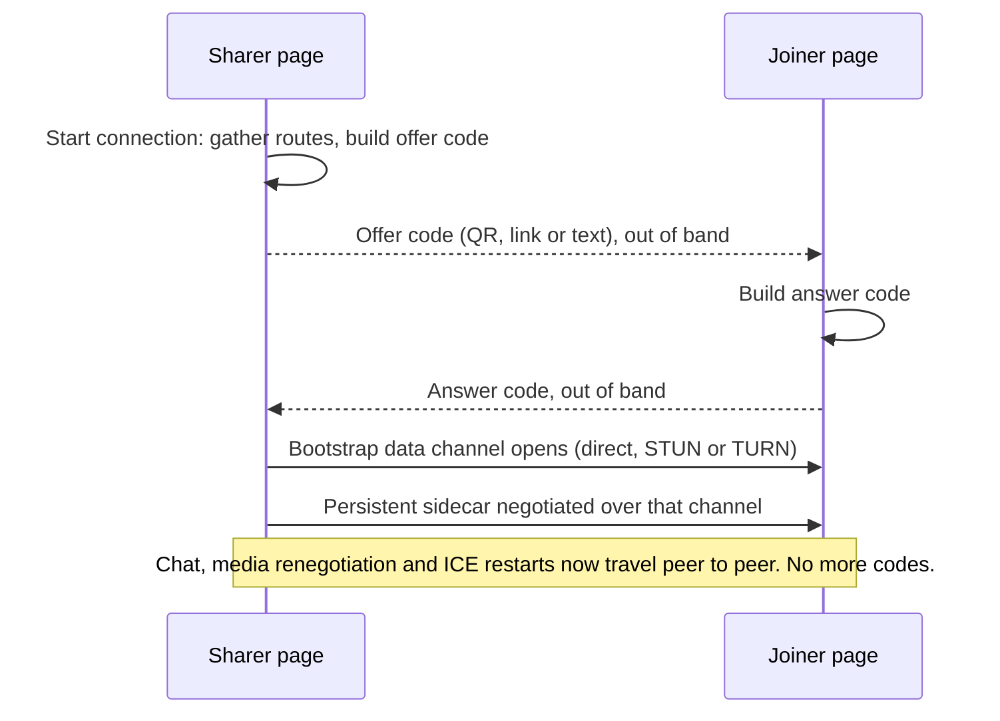

# Serverless Connect (`/qr.html`)

Serverless Connect links two VDO.Ninja peers by passing one small code each
way over any out-of-band channel, such as a QR code held up to a camera, an IRC
line, a DM or a sticky note. The handshake server is not used.

VDO.Ninja itself is unchanged. The page loads it in an iframe and drives it
with existing URL parameters and the IFRAME API.



## Using it

1. Alice opens the page and selects **Start connection**. She gets a QR code,
   which is a link back to this page with the offer in the URL hash.
2. Bob points his phone's camera app at it. The page opens with the offer
   loaded and shows him a reply code.
3. Alice reads Bob's code with **Scan with camera**, or pastes it.
4. They are connected and can chat. Either person can then start a camera,
   microphone or screen share. Scanning a code never shares your camera.

For text channels such as IRC, Twitch or DMs, use **Copy code** or **Copy link**.
Pasted text is checked as you type, and **Use pasted code** stays disabled until
it decodes. You can paste a bare code, a full link, or a chat message that
contains the code.

If an answer link opens in a second tab of the same browser while exactly one
offer tab is waiting, the tabs pass the answer across `BroadcastChannel`, with a
short-lived `localStorage` fallback. Nothing is sent to a server. If no waiting
tab, or more than one, is found, the page shows the answer for you to copy.

Neither side contacts the handshake server (`wss.vdo.ninja`). STUN and TURN are
still used for NAT traversal. An integrator can restrict the iframe to LAN
routes by passing `&lanonly` through `extraParams`; the public page does not
offer that option.

## Trickle mode (LoRa / mesh compatible)

Tick **Trickle mode (LoRa / mesh compatible)** before starting, or open
`qr.html?lora`. Messages are at most **140 ASCII characters** by default,
including header and checksum. You can lower **Maximum characters per message**
to 40. The answering page adopts the offer's limit.

Trickle mode works over any text transport. It splits the connection details
into small messages and sends extra routes as they appear; it does not
necessarily send less text in total. Radio apps differ: Meshtastic's
[Android composer](https://github.com/meshtastic/meshtastic/blob/master/docs/software/android/user/messages-and-channels.md#message-limits)
allows 200 bytes, while MeshCore
[counts the sender name](https://github.com/meshcore-dev/MeshCore/blob/main/src/helpers/BaseChatMesh.cpp)
against its limit. Set the limit to fit your app and anything your transport
adds.

1. Start the connection. Copy the selected **Outgoing message** into your radio
   app. If the list has more messages, send each one.
2. On the other device, choose **Scan or paste a code** and paste each message.
   LoRa messages are recognized automatically.
3. Send that device's outgoing messages back and paste them into the original
   tab. Repeat until the pages connect.

- The first message carries the connection description and as many routes as
  fit, server-reflexive first, then relay, then local. Later messages carry the
  rest. No route is dropped to meet the limit.
- Anything too large for one message is split into numbered parts (up to 32).
  Duplicates are ignored and out-of-order parts wait for the missing ones.
  Select an earlier message in the list to resend it.
- **Show QR** shows the selected message as a QR code. **Start over** clears
  the exchange.
- Messages use uppercase Base32 (`A`–`Z`, `2`–`7`) with an `L1O` (offer) or
  `L1A` (answer) prefix. The 21-character header holds the version and role, an
  eight-character exchange ID, the limit, the record and part numbers, and a
  CRC-16. Damaged messages, conflicting parts and other exchanges' messages are
  rejected. Peers are still authenticated by the DTLS fingerprint.

LoRa carries only the setup. Chat and media still need an IP path between the
devices, directly or through TURN. The page does not talk to radio hardware.
Keep both pages open; long delays or a suspended tab can force a fresh start.

## Offline use

On HTTPS, the page registers a service worker (`qr-sw.js`) that caches the page,
its scripts and VDO.Ninja's core files, then shows **Available offline on this
device.** Offline, the peers still need a network path between them, such as the
same LAN or hotspot.

## How it works

### Bypassing the handshake server

`&bypass` (`main.js`) replaces VDO.Ninja's WebSocket with a postMessage stub
(`webrtc.js`, `session.connect`). Everything VDO.Ninja would send to the server
reaches the parent page as `{bypass: "<json>"}`. The parent sends signalling
back with the IFRAME API's `routeMessage` function (`main.js`), which passes it
to `ws.onmessage`.

With no value, `&bypass` also sets `customWSS`, so every message carries `from`
and `UUID` and VDO.Ninja filters on them locally. `&bypasssignaling` keeps SDP
and ICE on the parent path after the data channel opens, so the wrapper can
translate IDs.

### Making the sharer offer first

Normally the viewer asks and the publisher answers. Here the sharer must offer
with no peer present, so the page sends its own iframe a viewer's play request:

```js
{ request: "play", streamID: <sid>, from: <answer slot> }
```

### UUID slots

Session UUIDs change on every page load, so each side swaps its own UUID for a
fixed slot name on the way out and back on the way in:

|               | sharer                 | joiner                 |
| ------------- | ---------------------- | ---------------------- |
| own UUID →    | `qrconnect0000000000a` | `qrconnect0000000000b` |
| peer keyed as | `qrconnect0000000000b` | `qrconnect0000000000a` |

### The persistent sidecar

When the bootstrap data channel opens, the wrapper uses it to negotiate a
second, data-only `RTCPeerConnection` with an ordered `qrconnect-sidecar`
channel. It uses VDO.Ninja's ICE servers and transport policy. Its offer and
answer travel over the bootstrap channel, never as codes. With TURN, it needs
its own relay allocation.

VDO.Ninja may replace its bootstrap connection when the first camera or
microphone is added. The wrapper moves later signalling and application data
onto the sidecar, so renegotiation, ICE restarts and chat survive that.

### Chat and return media

Chat uses the `qrchat` namespace over the sidecar. Each message is limited to
2,000 UTF-16 characters and shown as plain text. The page keeps the newest 100
messages in memory only.

The sharer publishes the stream `qrc`, which the joiner views. The joiner
publishes its own stream, `qrc` plus a random ID, and offers it to the sharer
once the sidecar opens. That carries media the other way.

## Code format

A code is `Y` plus a base-30,000 encoding of a binary record. The alphabet is a
letters-and-numbers subset of the transport-safe repertoires of
[`qntm/base2048`](https://github.com/qntm/base2048) and
[`qntm/base32768`](https://github.com/qntm/base32768) (MIT): 2,048 Base2048
symbols, 464 Canadian Aboriginal syllabics and 27,488 CJK ideographs. Each glyph
is one UTF-16 code unit carrying about 14.87 bits. There is no emoji,
punctuation, whitespace, combining mark or control character, and codes survive
NFC, NFD, NFKC and NFKD normalization.

Offers and answers both have a **118-character hard limit**. Older `Z`
(Base2048), `VQ` (Base512) and `VN` (base64url) codes still decode.

| Channel           | Fit at 118 characters                                                                         |
| ----------------- | --------------------------------------------------------------------------------------------- |
| X                 | Wide letters count as two, so at most 235 of 280.                                             |
| YouTube Live Chat | Under the 200-character limit. Paste the raw code, not the link; URLs can be rejected.        |
| IRC               | At most 352 UTF-8 bytes, inside the 510 octets left for command and parameters.               |
| SMS               | 16-bit encoding, so two concatenated parts of 67 characters.                                  |
| Text files        | UTF-8 with or without a BOM round-trips exactly.                                              |

References: [YouTube](https://support.google.com/youtube/answer/15270973),
[RFC 2812](https://www.rfc-editor.org/rfc/rfc2812#section-2.3),
[3GPP/ETSI SMS](https://www.etsi.org/deliver/etsi_TS/123000_123099/123040/06.05.00_60/ts_123040v060500p.pdf),
[Notepad's UTF-8 default](https://blogs.windows.com/windows-insider/2018/12/10/announcing-windows-10-insider-preview-build-18298/).
YouTube moderation of these characters is untested.

### Record layout

```
u8     header: role | SDP mode | has-streamID | fast-known-fields |
               has-session-token | 2-bit skeleton/setup value
       line list | varint length + deflated skeleton/SDP
[u8    generic packing descriptor]
[u64   literal o= session id]       omitted on the fast path
[str   literal o= username]         omitted on the fast path
bytes  ice-ufrag
bytes  ice-pwd
32B    DTLS fingerprint
[str   session token]               normally derived, not sent
[str   streamID]                    only when not the default "qrc"
varint tagged candidate count, then a packed candidate bitstream:
       type | transport | [tcptype] | literal/reference/prefix address |
       absolute/+1/same/delta port
```

On a recognized browser shape (the fast path), the ICE field encodings and
lengths follow from the two-bit skeleton ID. The `o=` session ID and session
token are derived from the DTLS fingerprint, and later renegotiations are
normalized to the same values. Chrome's ice-ufrag and ice-pwd pack at six bits
per character ([RFC 5245](https://www.rfc-editor.org/rfc/rfc5245#section-15.1)
`ice-char`); Firefox's are hex and pack at four. The fingerprint, password and
ufrag, 52–53 random bytes, are most of a route-free code.

### Compressing the SDP

A data-channel-only SDP is mostly boilerplate. Lifting out six values (origin
username, session ID, ice-ufrag, ice-pwd, fingerprint and setup) leaves a
skeleton that is the same for every connection a browser makes. The username is
one of the six because Firefox puts its version in it
(`mozilla...THIS_IS_SDPARTA-142.0`); the fast path normalizes it to `-`.

| Mode     | When                                     | Cost              |
| -------- | ---------------------------------------- | ----------------- |
| known    | the skeleton is in the `SKELETONS` table | 2 header bits     |
| lines    | the six values were extracted            | 6 bits per line   |
| skeleton | the six values were extracted            | deflated skeleton |
| raw      | the six values could not be extracted    | deflated SDP      |

`lines` mode indexes each line in the `SDP_LINES` dictionary and carries
unknown lines verbatim. For an unknown skeleton the encoder tries `lines` and
`skeleton` and keeps the shorter. A table miss therefore costs bytes, never
correctness. Firefox's skeleton deflates to about 260 bytes but line-encodes to
about 20.

`SKELETONS` has four captured entries. The tested Safari produces the same SDP
shape as Chrome.

| Entry | Shape                                   |
| ----- | --------------------------------------- |
| 0     | Chrome-shaped offer and matching answer |
| 1     | Gecko offer, and Gecko answering Gecko  |
| 2     | Gecko answering a Chrome-shaped offer   |
| 3     | Chrome/Safari-shaped answer to Gecko    |

When adding entries:

- Capture SDP from the running app. VDO.Ninja's Firefox offer has a
  session-level `a=sendrecv` that a bare `RTCPeerConnection` lacks.
- Treat each answer as its own shape. Chrome answering Firefox drops
  `a=extmap-allow-mixed`; Firefox answering Chrome adds a second one.
- **Only append** to `SKELETONS` and `SDP_LINES`. They are positional, so
  reordering or removing entries breaks codes already issued.

### Candidates

Only address, port, transport and type are sent. Foundation and priority are
regenerated, with priority taken from list position. `raddr 0.0.0.0 rport 0` is
added to non-host candidates, as RFC 5245 requires: without it, Firefox accepted
candidates in testing but failed to connect across a real network.

Addresses pack as IPv4 (4 bytes), IPv6 (16 bytes), an mDNS `.local` UUID, or
verbatim text. A repeated address is sent as a reference, and a new address can
reuse an earlier one's hexadecimal prefix. Ports are coded in two bits as
absolute, `+1`, same, or a one-byte delta.

### Measured lengths

In the author's tests between separate browsers, all nine Chrome, Firefox and
Safari (iPhone) pairings connected and chatted both ways. Codes were 44–70
characters. A ten-route IPv4/IPv6, UDP/TCP fixture encoded to 89 characters
(Chrome-shaped SDP) and 96 (Firefox-shaped). Relay-only tests connected over
TURN, with the sidecar inheriting that policy. Normal runs use
`iceTransportPolicy: "all"`, so TURN is a fallback, not forced.

## Gathering and compaction

Outside Trickle mode, every route must be in the one code. The collector
finishes after 1.5 seconds with no new candidates. If no relay candidate has
arrived, it waits up to 5 seconds from the start, because on cellular the TURN
route can arrive late and may be the only one that works. It stops at 9 seconds
regardless, and skips the relay wait once the peer is connected.

If VDO.Ninja has not started in the iframe after 12 seconds, the page shows
**Still starting up...**; at 60 seconds it reports an error.

Before each encode, the compactor removes:

1. Peer-reflexive candidates, which ICE learns from connectivity checks
   ([RFC 8445](https://www.rfc-editor.org/rfc/rfc8445#section-5.1.3)).
2. All but the highest-priority host candidate per transport and address family.
   Firefox's two preferred mDNS names are both kept, as their family is hidden.
3. All but the best relay candidate per transport and family.
4. All but the best server-reflexive candidate per transport and family.

At least one gathered `host`, `srflx` and `relay` candidate always survives,
and UDP and TCP are kept separately, so a TCP relay for UDP-blocked networks is
not lost. If the result still exceeds 118 characters, encoding fails visibly.
`Session` clamps a larger `qrBudget` to 118, and `encodeBlob` enforces it too.

Copy and paste carry the raw code. QR codes hold the page URL plus the code, so
a phone camera app can open them.

## Parameters

The wrapper loads VDO.Ninja with:

| Parameter                              | Why                                                                     |
| -------------------------------------- | ----------------------------------------------------------------------- |
| `?push=qrc` (sharer)                   | publishes the shared stream                                             |
| `?view=qrc&push=qrc<random>` (joiner)  | views the sharer and publishes the return stream                        |
| `&bypass`                              | swaps the WebSocket for postMessage                                     |
| `&bypasssignaling`                     | keeps later SDP and ICE on the parent path for ID translation           |
| `&password=false`                      | otherwise SDP is encrypted with a default key, and ciphertext won't pack |
| `&vd=0&ad=0&autostart`                 | publishes nothing at first, so the offer is data-channel only           |
| `&cleanoutput&minipreview`             | hides VDO.Ninja's controls; keeps incoming video visible                |
| `&keepsw&facing=` (added by `qr.html`) | keeps the offline service worker and passes the chosen camera           |

Add other parameters through `extraParams`, for example `"&lanonly"`. The
public page does not pass its own URL parameters into the iframe.

The wrapper page accepts:

| Parameter                 | Behavior                                                       |
| ------------------------- | -------------------------------------------------------------- |
| `#CODE`                   | preferred invite and reply form; applied automatically         |
| `?c=CODE` or `?code=CODE` | fallback for services that strip URL fragments                 |
| `?autostart`              | starts an offer without selecting **Start connection**         |
| `?lora`                   | turns on Trickle mode                                          |
| `?camera=front\|rear`     | publishing camera (default front); `?facing=` is an alias      |
| `?scan=front\|rear`       | first camera for the in-page scanner (default rear)            |
| `?api=1`                  | enables the embedding API                                      |

`camera`, `facing` and `scan` also accept `user`, `back` and `environment`.
Fragments are preferred because they are not sent in the HTTP request.
Generated links omit wrapper parameters.

## Embedding API (version 1)

Another application can control the page with `postMessage`. Enable it with
`api=1` and the parent's exact origin:

```html
<iframe src="https://vdo.ninja/qr?api=1&parentOrigin=https%3A%2F%2Fapp.example" allow="camera; microphone; autoplay; display-capture; fullscreen" title="QR Connect"></iframe>
```

- `parentOrigin` must be an `https:` or `http:` origin, including any
  non-default port, with no path, query or credentials (for example,
  `http://localhost:8080` for development). `file:` and other opaque origins,
  and sandboxed frames without `allow-same-origin`, are not supported.
- The page checks the origin and the parent window and replies only to that
  origin. Its inner VDO.Ninja iframe cannot use the API. The parent should
  likewise verify the QR page's origin and window, and never forward messages
  from other windows or unverified radio senders.
- The parent owns contact selection, sender verification, permissions, radio
  credentials, pacing, queues and retries. Only a LoRa packet's exact `text`
  goes on the radio. No radio driver or server is needed, so the page works on
  static hosts.

### Initialization and request identity

Register your message listener before loading the iframe. The page emits
`ready` with its `instanceId` and capabilities, and no handshake text before
`init`. If you missed `ready`, send `init` without `instanceId`. `init` is safe
to repeat and does not start a call.

```js
qrFrame.contentWindow.postMessage(
	{
		api: "qrconnect",
		version: 1,
		type: "command",
		id: "request-1",
		command: "init",
		data: {}
	},
	"https://vdo.ninja"
);
```

Responses have `type: "response"`, echo `id`, include `instanceId` and
`sessionId`, and carry `{ ok: true, result }` or
`{ ok: false, error: { code, message, retryable, requestId } }`. `init` returns
`{ capabilities, state }`.

Every later command must include `instanceId` and the current `sessionId`
(initially `null`). `start` returns a session ID immediately; an incoming offer
creates one on its first accepted fragment. Use the session ID from each
response. It is separate from the exchange ID inside L1 packets. If you lose
it, send `init` again.

```js
qrFrame.contentWindow.postMessage(
	{
		api: "qrconnect",
		version: 1,
		type: "command",
		id: "request-2",
		instanceId: currentInstanceId,
		sessionId: currentSessionId,
		command: "configure",
		data: { mode: "lora", maxBytes: 140, embedded: true }
	},
	"https://vdo.ninja"
);
```

- Request IDs are 1–80 characters from letters, digits, `.`, `_`, `:` and `-`.
- Repeating an ID with the same command, session and data returns the original
  response, even while pending; it never repeats the action. Different contents
  return `ID_CONFLICT`. Use new IDs for fresh reads.
- An iframe instance accepts 4,096 requests in total, including across
  `reset`, then returns `REQUEST_LIMIT`. Reload and initialize a new iframe.
- Commands are limited to 16,384 UTF-8 bytes (`TOO_LARGE`).
- Reloading changes `instanceId` and ends the connection.

### Commands

| Command              | `data` and result                                                                                                                                                    |
| -------------------- | -------------------------------------------------------------------------------------------------------------------------------------------------------------------- |
| `init`               | Returns capabilities, limits and state.                                                                                                                              |
| `configure`          | Optional `mode` (`"lora"`/`"qr"`), `maxBytes` (40–140), `theme` (`"system"`/`"light"`/`"dark"`), and booleans `embedded`, `showInstructions`, `showChat`. Mode and limit need an idle attempt. |
| `start`              | Creates an offer; returns `{ sessionId, state }` before gathering finishes.                                                                                         |
| `receive`            | `{ text }`. Returns acceptance and progress. A LoRa offer above the configured limit returns `PACKET_LIMIT`. Never enables camera or microphone.                   |
| `getState`           | Returns the state.                                                                                                                                                   |
| `getOutgoing`        | Returns `{ packets, finalPacketCount: null }` to recover missed events.                                                                                              |
| `setPacketStatus`    | `{ packetId, status }`; records the parent's report and sends nothing.                                                                                               |
| `sendChat`           | `{ text }`, 1–2,000 UTF-16 characters; returns `{ messageId }`.                                                                                                      |
| `setMedia`           | `{ camera, microphone }` booleans, either optional. Returns state, possibly `starting`. Enabling needs media readiness.                                              |
| `getDevices`         | Returns `{ devices: [{ kind, deviceId, label }] }` without requesting permission, so fields may be empty.                                                            |
| `selectDevice`       | `{ kind: "camera" \| "microphone", deviceId }`. Sets the next device, or switches an active input.                                                                  |
| `requestScreenShare` | Emits `interactionRequired` and shows an in-frame button for the user to click. `UNSUPPORTED` where unavailable.                                                     |
| `stopScreenShare`    | Stops screen sharing.                                                                                                                                                |
| `getStats`           | Direct or relay transport, timing, received audio bytes, decoded video frames and packet totals; unknown values are `null`. No SDP, credentials, addresses or labels. |
| `hangup`             | Releases media and connections; keeps the session ID and outgoing history.                                                                                           |
| `reset`              | Releases everything and returns to idle with `sessionId: null`; keeps initialization and configuration.                                                              |

`setMedia` with `false` mutes the input but may not release the hardware;
`hangup` and `reset` unload the media iframe. A media command's success only
acknowledges the request. Watch `media` or `state` for the result and `error`
for failure.

### Events and state

Events are `{ api, version, type: "event", instanceId, sessionId, event, data }`.
Only `ready` is sent before `init`.

| Event                 | Contents                                                                                                                                                                         |
| --------------------- | -------------------------------------------------------------------------------------------------------------------------------------------------------------------------------- |
| `ready`               | Capabilities and limits.                                                                                                                                                         |
| `state`               | The state and a readable status.                                                                                                                                                 |
| `outgoing`            | One packet: `packetId`, `format`, exact `text`, `bytes`, `budget`, `role`, `status`, `needed`. LoRa adds `sequence`, `part` and `count`; QR adds `code` and `link` (`budget: null`). |
| `receiveProgress`     | `accepted`, `duplicate`, completed and next record, known missing records, and missing fragments as `{ sequence, count, parts }`.                                                |
| `chat`                | `{ messageId, text, direction: "sent" \| "received" }`.                                                                                                                          |
| `media`               | Local inputs, screen sharing, remote tracks and return-media readiness.                                                                                                          |
| `devicesChanged`      | Current device choices.                                                                                                                                                          |
| `interactionRequired` | The operation, reason and in-frame control that needs a click.                                                                                                                   |
| `error`               | Code, message, retryability and request ID.                                                                                                                                      |
| `closed`              | `local-hangup`, `reset` or `failure`. A remote interruption shows as state `disconnected`.                                                                                       |
| `resize`              | Content width and height.                                                                                                                                                        |

A connected session still preparing return media:

```json
{
	"connection": "connected",
	"chat": "ready",
	"returnMedia": "starting",
	"camera": "off",
	"microphone": "off",
	"screen": "off",
	"signalingNeeded": false
}
```

State also has `sessionId`, `remoteTracks`, `mode`, `maxBytes`, `role`,
`outgoingCount`, `receive` and `status`.

- `connection`: `idle`, `preparing`, `exchanging`, `connecting`, `connected`,
  `disconnected`, `failed` or `closed`. `camera` and `microphone`: `off`,
  `starting`, `on` or `error`.
- More candidate packets can follow the first one, and L1 has no final count.
  `moreNeeded` stays true until connected. Once `signalingNeeded` is false, stop
  sending handshake packets; `getOutgoing` keeps them with `needed: false`.
- Packet `status` starts as `null`. `setPacketStatus` accepts `queued`,
  `radioAccepted`, `radioAcknowledged`, `unconfirmed` and `failed`. There are
  no peer acknowledgements, so `peerAccepted` is rejected, and a successful
  `receive` means only the **local** page accepted the text.

In API mode, a QR answer must go to its original iframe. Tab handoff,
`?autostart` and URL codes are disabled.

### Native WebViews and permissions

A WebView2 host that loads QR Connect as the top-level page can use
`?api=1&apiTransport=webview2`. The same messages then use
`window.chrome.webview.postMessage` and its `message` event. The host must
validate the message source URL and restrict navigation. Other native bridges
need a host-side adapter, or a web parent page using the iframe API.

The host's CSP must allow the QR origin in `frame-src`, and camera, microphone
and display-capture permission must reach the whole iframe chain. Screen
capture always needs a user click. See
[`postMessage`](https://developer.mozilla.org/en-US/docs/Web/API/Window/postMessage),
[`getUserMedia`](https://developer.mozilla.org/en-US/docs/Web/API/MediaDevices/getUserMedia),
[`getDisplayMedia`](https://developer.mozilla.org/en-US/docs/Web/API/MediaDevices/getDisplayMedia)
and [WebView2 security](https://learn.microsoft.com/en-us/microsoft-edge/webview2/concepts/security).

## Reusing the module

[`qrconnect.js`](../qrconnect.js) contains no UI code:

```js
const session = new QRConnect.Session({
	role: "share", // or "join"
	iframe: myIframe,
	vdoBase: "../", // path to VDO.Ninja; this is the default
	qrBudget: 118, // optional lower ceiling; cannot exceed 118
	extraParams: "", // for example, "&lanonly"
	// lora: true, loraBudget: 140, // Trickle mode; emits "packet" events
	// Needed only when a cross-origin iframe hides VDO.Ninja's ICE configuration:
	peerConfiguration: null
});

session.on("state", text => console.log(text));
session.on("blob", result => show(result.text)); // also .candidates and .dropped
session.on("packet", packet => {}); // Trickle mode: { text, budget }
session.on("connected", up => {});
session.on("channel", up => {}); // persistent sidecar
session.on("channel-error", err => {});
session.on("data", message => {}); // { data, UUID }
session.on("return-media", state => {}); // joiner's return stream
session.on("event", data => {}); // IFRAME API action events
session.on("error", err => {});

session.start();
session.createOffer(); // sharer
// session.acceptOffer(payload);                    // joiner
// session.acceptAnswer(payload);                   // sharer, once the answer is back
// session.sendData({ myApplication: { text: "hello" } }); // once connected
```

- `QRConnect.decodeBlob(text)` resolves to the `payload` for `acceptOffer` and
  `acceptAnswer`. `QRConnect.receiveLoRaPacket` reassembles Trickle messages.
- `session.post(msg)` sends a raw IFRAME API message to the iframe.
- `session.destroy()` closes the sidecar, cancels timers, removes listeners and
  sets the iframe to `about:blank`.
- Timing options, in milliseconds: `gatherQuiet` (1500), `gatherRelay` (5000),
  `gatherMax` (9000), `iframeTimeout` (60000), `sidecarTimeout` (20000),
  `returnMediaTimeout` (20000).

## Limits

- **Two peers only.** Rooms need the server.
- One camera at a time; switching replaces the active camera.
- **SDP encryption is off** (`&password=false`), because ciphertext cannot be
  packed. Anyone who reads an offer and answers first can take the connection,
  so share codes over a trusted channel. DTLS/SRTP encryption stays on.
- An offer works for one answer.
- A lost sidecar is not rebuilt; start a new exchange.
- The camera needs HTTPS, or `localhost` for testing.
- Codes carry no timestamp, so the page cannot tell whether one has expired or
  been used elsewhere.
- Tab handoff needs the original offer tab open and refuses to choose between
  several waiting tabs.
- Chat has no history, offline queue, or delivery after a page closes.
- **Screen-to-camera scanning has not been validated on real devices.**
  Software tests round-trip the rendered QR through jsQR, and the page adds the
  standard four-module quiet zone. Glare, focus, distance and screen size all
  matter.

## Dependencies

- [`thirdparty/qrcode.min.js`](../thirdparty/qrcode.min.js) generates QR codes.
- [`thirdparty/jsqr.min.js`](../thirdparty/jsqr.min.js) decodes them, so the page
  does not rely on the unevenly supported `BarcodeDetector` API.
