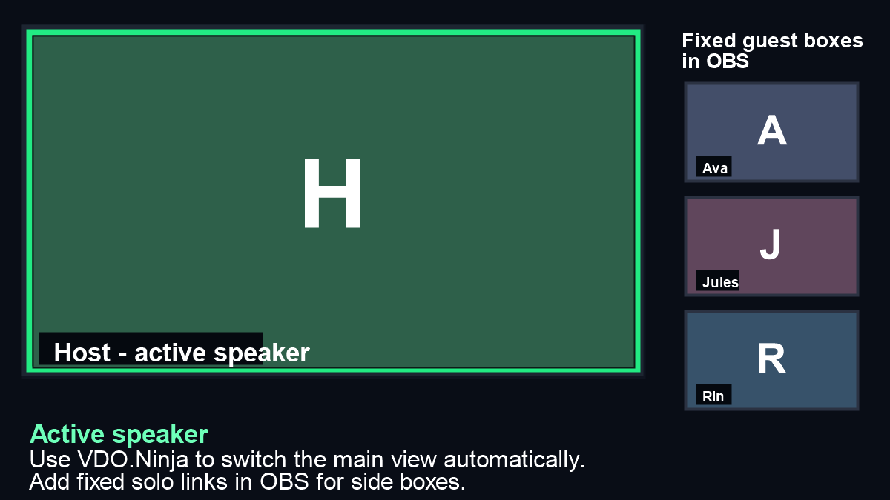
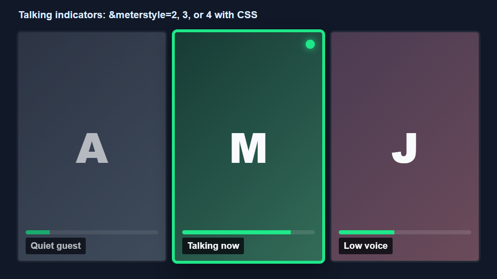

# Active speaker, Highlight, and talking indicators

## Quick choice

| Goal | Use |
| --- | --- |
| Show only the current speaker | `&activespeaker=1` or `&activespeaker=3` on a scene/view link |
| Show everyone who is talking | `&activespeaker=2` or `&activespeaker=4` |
| Make the current speaker larger while others stay visible | `&activehighlight=2` or `&activespeakerfeatured` |
| Feature one guest by hand | The director's **Highlight** button |
| Custom OBS layout with fixed guest boxes | A large `&activespeaker` source plus separate `&solo` sources |
| Green border or dot when someone talks | `&meterstyle=2` or `&meterstyle=3`; `&meterstyle=4` for your own CSS |
| Feature social chat messages | Social Stream Ninja (separate from guest video) |

## Automatic active speaker

Add `&activespeaker` (aliases `&speakerview`, `&sas`) to a viewer, room or scene link:

```text
https://vdo.ninja/?room=ROOMNAME&scene=0&activespeaker=3&cleanoutput
```

| Mode | Shows |
| --- | --- |
| `1` | One speaker at a time, including audio-only sources |
| `2` | Everyone currently talking, including audio-only sources |
| `3` | One speaker at a time, video sources only |
| `4` | Everyone currently talking, video sources only |

For most OBS layouts, use `3` or `4` so audio-only guests don't replace the video.

To stop rapid switching when people interrupt or laugh, add `&activespeakerdelay` (aliases `&speakerviewdelay`, `&sasdelay`) in milliseconds. In modes `1` and `3` it slows switching away from the current speaker; in modes `2` and `4` it keeps a speaker on screen that long after they go quiet.

```text
https://vdo.ninja/?room=ROOMNAME&scene=0&activespeaker=3&activespeakerdelay=1200
```


[activespeaker.md](../advanced-settings/view-parameters/activespeaker.md)



[and-activespeakerdelay.md](../advanced-settings/mixer-scene-parameters/and-activespeakerdelay.md)


## Automatic Highlight of the speaker

`&activehighlight=2` keeps everyone in the scene and makes the current speaker larger, using the secondary Highlight layout. `&activespeakerfeatured` is an alias.

```text
https://vdo.ninja/?room=ROOMNAME&scene=0&activehighlight=2&cleanoutput
```

`&activehighlight=1` uses normal Highlight instead, which focuses on the speaker more fully.

* On its own, `&activehighlight` doesn't hide guests who aren't talking. Combined with `&activespeaker`, the usual hide/show behavior applies.
* It follows video-capable speakers, like `&activespeaker=3`, so audio-only sources don't take over.
* `&activespeakerdelay` works here too.
* The link must receive and process guest audio, so don't add `&noaudio` or `&noap`.


[activehighlight.md](../advanced-settings/view-parameters/activehighlight.md)


## Large speaker plus smaller guests in OBS

For exact positions, crops or per-guest filters, build the layout in OBS:

1. Add one large Browser Source with the automatic speaker view:

   ```text
   https://vdo.ninja/?room=ROOMNAME&scene=0&activespeaker=3&cleanoutput
   ```
2. Add each guest as a smaller Browser Source using their solo link, with `&noaudio` so audio isn't duplicated:

   ```text
   https://vdo.ninja/?view=GUESTID&room=ROOMNAME&solo&cleanoutput&noaudio
   ```

Replace `GUESTID` with the guest's stream ID; permanent IDs make this reusable between shows. Don't add `&noaudio` to the active-speaker source, since switching needs its audio levels. To keep it out of your mix, mute it in OBS instead.

<figure><figcaption><p>Mocked example: a large active-speaker source with fixed solo sources in OBS.</p></figcaption></figure>


[active-speaker-layouts-in-obs.md](active-speaker-layouts-in-obs.md)



[and-solo.md](../advanced-settings/mixer-scene-parameters/and-solo.md)


## Manual Highlight

In the director room, press **Highlight** on a guest to feature them in scene outputs and room views that follow Highlight.

* Use a normal scene link for the OBS program: `https://vdo.ninja/?room=ROOMNAME&scene=0&cleanoutput`
* Hold `Ctrl` (Windows/Linux) or `Cmd` (macOS) while pressing **Highlight** to make the guest larger instead of replacing the layout.
* Add `&ignorehighlight` to a viewer or scene link that shouldn't follow Highlight.

### Mute follows Highlight

To make the highlighted guest the only unmuted guest, add `&highlightmute` (aliases `&hmute`, `&mutefollowhighlight`, `&mfh`) to the director link:

```text
https://vdo.ninja/?director=ROOMNAME&highlightmute
```

You can still mute and unmute by hand, but the rule applies again the next time Highlight changes.


[and-highlightmute.md](../advanced-settings/director-parameters/and-highlightmute.md)


## Talking indicators

```text
https://vdo.ninja/?room=ROOMNAME&scene=0&meterstyle=2&cleanoutput
```

| Mode | Shows |
| --- | --- |
| `&meterstyle=1` | A VU-style meter |
| `&meterstyle=2` | A green border around a talking guest |
| `&meterstyle=3` | A small green dot when a guest talks |
| `&meterstyle=4` | No built-in meter; adds `data-loudness` and `data-speaking` attributes for your CSS |
| `&meterstyle=5` | Pulses an audio-only avatar or background image while speaking |

<figure><figcaption><p>Mocked example: a green talking border, dot, and meter-style loudness feedback.</p></figcaption></figure>

For custom CSS, `data-speaking` is easier than raw `data-loudness`. `0` means quiet, `1` speaking quietly and `2` speaking loudly.

```css
video[data-speaking="2"] {
	outline: 6px solid #00ff66;
	outline-offset: -6px;
}

video[data-speaking="1"] {
	outline: 3px solid #99ffbb;
	outline-offset: -3px;
}
```


[meterstyle.md](../advanced-settings/design-parameters/meterstyle.md)


## API-driven switching

`&activehighlight=2` covers most featured layouts. For custom rules, a parent page, Companion or a script can decide who is loudest and update the layout using:

* `getLoudness` or `&pushloudness` reports guest loudness to a parent page.
* The `layout` API applies a custom layout object or switches predefined layouts.
* The `soloVideo` API action toggles Highlight for a guest.


[iframe-api-basics.md](iframe-api-documentation/iframe-api-basics.md)



[and-layouts.md](../advanced-settings/director-parameters/and-layouts.md)


## Featured chat messages

Featured YouTube, Twitch and other chat messages come from Social Stream Ninja, not from `&activespeaker` or Highlight.


[README.md](../steves-helper-apps/social-stream-ninja/README.md)


## Troubleshooting

If the active speaker never switches:

* Make sure the link receives audio, and remove `&noap`; loudness features need audio processing.
* Try `&meterstyle=2` to confirm VDO.Ninja detects who is talking.
* Use `&activespeaker=3` if audio-only sources take over the scene.

If it switches too quickly, add `&activespeakerdelay=1000` to `2000`, or use manual Highlight for full control.
