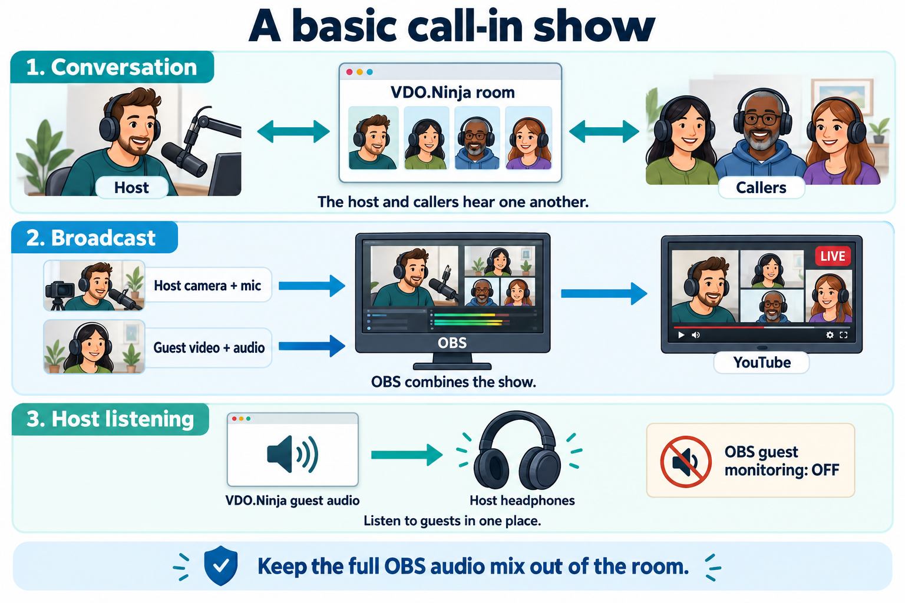

# Run a call-in show with OBS and VDO.Ninja

For one to four callers, **one OBS Browser Source can carry every selected caller**. You add and remove callers in VDO.Ninja while that source and its audio settings stay the same. Use separate sources only to position, crop, or adjust callers individually in OBS.

In this setup, OBS keeps the host's camera, microphone, and playback and streams the show to YouTube. VDO.Ninja carries the conversation.

## Basic setup: send the host and OBS playback to callers

This uses **OBS Virtual Camera** for the picture and **VB-CABLE** for audio. Device names are for Windows; [other audio-routing options](audio.md) do the same job elsewhere.

1. **Create the room.** [Create a VDO.Ninja room](../getting-started/rooms/README.md) and keep the **Director's Room** open. Callers use its guest invite; keep director and OBS links private.
2. **Bring callers into OBS once.** In **Capture a Group Scene**, turn **Auto-add guests** off and copy the scene link. Add it to OBS as a **Browser Source** named **Callers**, with **Control audio via OBS** on. Use **Add to Scene** in VDO.Ninja to put callers on air.
3. **Return the OBS picture.** Start **OBS Virtual Camera**, with **Program** selected if callers should see the broadcast. It carries video only.
4. **Send host audio into the cable.** [Install VB-CABLE](share-obs-audio-with-vdo-ninja.md#1-install-the-cable-and-keep-your-headphones-as-the-normal-output). In OBS **Settings > Audio > Advanced**, set **Monitoring Device** to **CABLE Input**. In **Advanced Audio Properties**, monitor the host microphone and any clips or music for callers, keeping their broadcast output on (**Monitor and Output** in older OBS versions). Leave **Callers** on **Monitor Off**.
5. **Select both devices in VDO.Ninja.** Click **Enable director's microphone or video**, choose **OBS Virtual Camera** as the camera and **CABLE Output** as the only audio input, and start publishing. The physical microphone already arrives through the cable.
6. **Listen through VDO.Ninja.** Send the director's audio output to headphones and keep that browser audio out of OBS. Everyone who speaks wears headphones and mutes YouTube playback.
7. **Keep the return out of Callers.** Do not add the director's feed to the scene that **Callers** shows, or OBS gets its own picture back and a second copy of the host audio. Check this if you use `&showdirector` or the Mixer.

| Source | OBS broadcast | OBS monitoring to CABLE Input |
| --- | --- | --- |
| Host microphone | On | On |
| Clips or music for callers | On | On |
| VDO.Ninja callers | On | **Off** |
| Director browser playback | Not captured | Not captured |

**Monitor Off does not mute the broadcast.** It keeps callers out of the cable so they do not hear themselves come back. Callers hear the host and playback through the director, and each other through the room. Because OBS monitoring now feeds the cable, hearing OBS-only clips locally needs a separate route. Screenshots are in [Share audio from OBS](share-obs-audio-with-vdo-ninja.md) and [Share OBS Virtual Camera and audio](share-obs-virtual-camera-and-audio.md); here, also monitor the host microphone.

### Bring the next caller on air

Admit or transfer the caller into the room and add them to the VDO.Ninja scene. Afterward, remove them from the scene and return them to the lobby or disconnect them. **OBS does not change.**

Set up a [lobby or approval workflow](#manage-waiting-callers-and-admission) before sharing a public invite, and [rehearse](#handle-reconnects-and-prepare-for-the-show) first.

## Alternative: use the host microphone directly

If callers only need the conversation, select the physical microphone in VDO.Ninja as well as in OBS, with no cable. Keep one Callers source, headphones, the director out of OBS, and caller monitoring off.

<figure><figcaption><p>The direct-microphone alternative. The host microphone is selected separately in OBS and VDO.Ninja; no audio cable is used.</p></figcaption></figure>

To send clips or music later, switch to the cable setup, or add a [separate playback-only return](room-audio-obs-meshcast-and-private-talk.md#4-return-obs-clips-and-music-to-the-main-room) that leaves out the host microphone. For doubled sound, see [Echo and duplicate monitoring](../common-errors-and-known-issues/echo-or-feedback-issues.md#control-room-plus-obs-monitoring).

## Keep OBS ready as callers change

A **VDO.Ninja scene link** shows the feeds you added to that VDO.Ninja scene. An **OBS scene** combines it with your camera, graphics, and other sources.

### Show callers together in one source

One Browser Source shows the whole caller layout with one OBS fader; VDO.Ninja provides per-guest controls.

* **Automatic:** leave **Auto-add guests** on (`&scene=0`). Every room guest appears, so use this only when everyone in the room belongs on air.
* **Manual:** turn **Auto-add guests** off and add chosen callers to a numbered scene. See [scene controls](../advanced-settings/view-parameters/scene.md).
* **Numbered seats:** the [Mixer](../steves-helper-apps/mixer-app.md) at [vdo.ninja/mixer](https://vdo.ninja/mixer) assigns callers to slots in custom layouts, with crops for phone video. Put its scene output link in OBS, not the control page.

A **slot** is a numbered seat: swapping who holds slot 1 swaps the caller without rebuilding the layout. To make arrivals wait for a seat, turn off **Assign a slot to new guests automatically** in the Mixer. Save or export its settings to reuse them.

### Give each caller their own OBS source

Separate Browser Sources let OBS position, crop, filter, and set volume per caller. Each source can follow:

| The source follows | How |
| --- | --- |
| **A numbered slot** | Assign callers with the Mixer or the director's `&slotmode`. A link with `&viewslot=1` shows whoever holds slot 1. |
| **A dedicated VDO.Ninja scene** | Give each OBS box its own scene link and keep one caller in each scene. |
| **A particular guest** | Use their solo link. A fixed, unique `&push` ID in their invite keeps it reusable. |

Slot 1 example (keep your room's password or access parameters):

```text
https://vdo.ninja/?room=YOUR_ROOM&scene&viewslot=1
```

A guest's `&slot=1` asks for that seat but does not reserve it. See [Slot viewing](../advanced-settings/mixer-scene-parameters/and-viewslot.md) and [Permanent links, scenes, and slots](how-to-get-permanent-links.md). For signed-in rooms, use generated viewing links so OBS connects without signing in.

## Manage waiting callers and admission

A public invite needs a waiting area. Removing a caller from the OBS picture does not stop the room hearing them.

| Need | Approach | Guide |
| --- | --- | --- |
| Public waiting list with admit and return-to-lobby controls | **app.invite.cam**, with anonymous or Discord sign-in guests. Choose group conversation if callers should hear each other. | [app.invite.cam](../steves-helper-apps/app-invite-cam.md) |
| Lobby made of ordinary rooms | Transfer callers from a waiting room into the live room. Rejoining callers land back in the lobby. Use matching room passwords. | [Transfer rooms](../getting-started/rooms/transfer-rooms.md) |
| Approve each entry | `&requireapproval` on the director link. New guests are not held while no director is present. | [Director approval](../advanced-settings/director-parameters/and-requireapproval.md) |
| Admit by identity | Signed-in access plus an allowlist or access requests. Sign-in alone admits any account. | [SSO and access controls](sso-and-signed-in-access.md) |

A transfer is not a ban. For queue and hold modes, see [Green rooms and waiting options](green-room-and-guest-approval-options.md).

### Screen callers without putting private talk on air

Let a helper check callers in the lobby. If the on-air host screens them, remember that VDO.Ninja's listening controls and **Solo Talk** do not mute the host microphone in OBS. With the cable setup, check the broadcast output and cable monitoring separately. See [Keep private conversations off air](room-audio-obs-meshcast-and-private-talk.md#7-keep-private-conversations-off-air).

## Keep voices audible when switching pictures

Switching to a full-screen caller, screen share, or host-only scene can drop the source carrying everyone's voices. Either add the same caller sources to every OBS scene that needs their audio, or make a shared **Room Audio** scene with an audio-only VDO.Ninja source and use video-only links for pictures. Capture each voice once, keep host sources that feed the cable active, and keep monitoring off on every caller source. See [Keep voices active when switching to a screenshare](room-audio-obs-meshcast-and-private-talk.md#3-keep-voices-active-when-switching-to-a-screenshare).

## Choose what callers see

| Callers see | Setup |
| --- | --- |
| The other participants | Normal room invites. |
| The host or one show view | Add [`&broadcast`](../advanced-settings/view-parameters/broadcast.md) to guest invites. Callers get the main director's video and still hear each other. |
| The finished OBS picture | Select **OBS Virtual Camera** as the director's camera. With `&broadcast`, callers see only that. |

`&broadcast` does not start a stream and does not belong on OBS links. Keep the returned OBS picture out of the scene OBS captures, or you get an endless mirror. See [Let guests see the finished OBS scene](let-guests-see-your-obs-scene.md).

### Direct or Meshcast distribution

Without Meshcast, `&broadcast` has the director send video to each caller directly: guests upload less, but the director's upload grows with each caller. With **Meshcast**, the director uploads once to a server that distributes it: add `&meshcast` to the director link and keep `&broadcast` on invites. The [return guide](let-guests-see-your-obs-scene.md#4-optional-send-the-return-through-meshcast-v2) also covers `&meshcast2`. Meshcast adds a server and some delay, and it does not move the guests' own feeds. See [Meshcast options](../newly-added-parameters/and-meshcast.md).

Never send the full OBS audio mix to active callers; only watch-only greenroom viewers can take it. See [Room audio, OBS, Meshcast, and private talk](room-audio-obs-meshcast-and-private-talk.md).

## Handle reconnects and prepare for the show

* **Recurring guest:** give them a unique fixed stream ID, or `&permaid` to remember one in their browser. Never let two callers share an ID.
* **Brief disconnection:** the director's [`&scenerestore`](../advanced-settings/mixer-scene-parameters/and-scenerestore.md) restores a returning guest's manual scene membership for a limited time. It does not bypass admission.
* **Caller back in the lobby:** re-admit them and check their seat and audio. Keep a host-only OBS scene ready meanwhile.

Rehearse with an OBS recording and two callers. Both should hear the host, each other, and a clip, and the recording should contain all three voices. Also test admitting, replacing and reconnecting a caller, every OBS scene you will use, private talk, and any return or Meshcast path.

## Accept telephone calls

A caller using the guest link in a phone browser is an ordinary caller. Dialing a phone number needs a bridge:

| Approach | What changes | Guide |
| --- | --- | --- |
| A phone or softphone through an audio mixer | You build return mixes so phone and browser callers hear each other but not themselves | [Phone call-ins with virtual audio cables](phone-call-ins-with-vdo-ninja-and-virtual-audio-cables.md) |
| The experimental call-in panel (SIP, SignalWire, or Twilio) | The phone caller joins the director's outgoing audio, not a guest tile | [Phone call-in provider options](phone-call-in-provider-options.md) |

The Callers source does not include a panel caller. To add them without capturing the host microphone twice, see [Get the caller into OBS](phone-call-in-provider-options.md#get-the-caller-into-obs).
