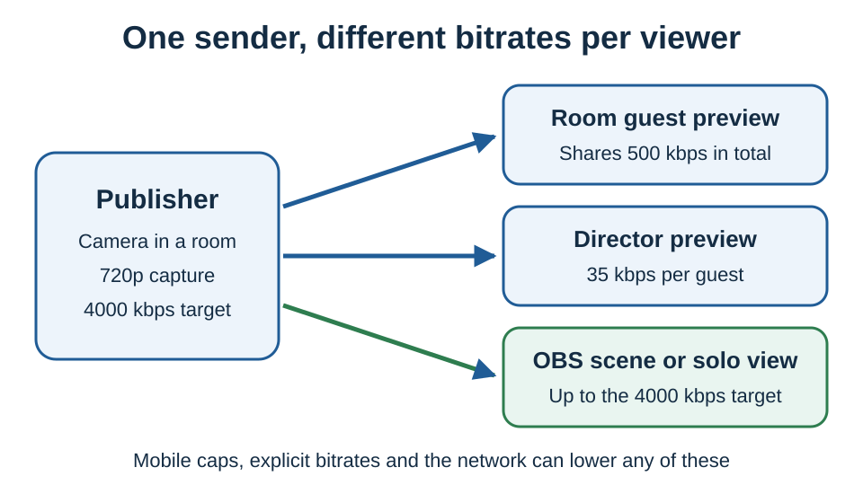

# Default resolution and bitrate by mode

Three defaults work separately: the **capture resolution** the publisher asks for, the **outbound video target** it encodes at, and the **bitrate each viewer requests**. So one publisher can send a small stream to a room preview and a full-quality stream to OBS at the same time.

These are targets and limits from the code, not guaranteed output. Audio and overhead come on top. Native apps, WHIP, Meshcast, recording and chunked mode have their own settings.

## Quick reference

Fresh session, no quality or bitrate parameters, no UI changes:

| Publishing mode | Default capture | Outbound video target |
| --- | --- | --- |
| Camera, outside a room | 1080p, 720p or 360p by device (see below) | 4000 kbps |
| Camera, in a room | 720p; 360p on weaker devices | 4000 kbps |
| Start with a screen share | 1920x1080 ideal | About 2500 kbps (fallback) |
| Camera replaced by screen share (`sstype=1`) | The camera's tier unless a screen-share quality is set | Keeps the session target, normally 4000 kbps |
| Screen share in a separate session (`sstype=2`) | 1920x1080 ideal | About 2500 kbps |
| Extra screen stream, same session (`sstype=3`) | 1920x1080 ideal | Shares the session target, normally 4000 kbps |

In a room the screen-share button uses `sstype=3` by default; outside a room it uses `sstype=1`. There is no "screen share = 6000 kbps" default.

`sstype=2` publishes through a generated link while the camera keeps running. That link copies only some parent settings and does not inherit the camera's bitrate, so set the screen bitrate on the receiving link. `screenshare2` (`ss2`) is an entry-page option, not `sstype=2`.

## Camera resolution when quality is not set

The estimate uses the CPU thread count and memory the browser reports. Rules are checked top to bottom:

| Device signal | Camera tier outside a room |
| --- | --- |
| iPhone or iPad with Safari/WebKit 17 or newer | 1080p |
| Intel Mac, fewer than 6 threads | 360p |
| Intel Mac, 6 or more threads | 720p |
| Mobile, fewer than 4 threads or at most 2 GB memory | 360p |
| Mobile, 8+ threads and memory unknown or at least 6 GB | 1080p |
| Other mobile with at least 4 threads | 720p |
| Other devices, thread count unknown | 720p |
| Other devices, fewer than 4 threads | 360p |
| Other devices, more than 8 threads | 1080p |
| Other devices, 4 to 8 threads | 720p |

In a room the camera starts at 720p, or 360p if the estimate is 360p. It does not start at 1080p, even on devices estimated at 1080p. Detection can be wrong, so test your devices.

Camera frame rate is left to the camera and browser unless you set one. Screen capture asks for an ideal 60 fps, which is not guaranteed.

## Setting quality explicitly

`quality` (`q`) sets the capture preset, for screen capture too unless `screensharequality` (`ssq`) is set. On the camera it also picks the outbound target:

| Camera setting | Requested resolution | Outbound target |
| --- | --- | --- |
| Not set | Estimate above | 4000 kbps |
| `q=0` / `1080p` | 1920x1080 | 4000 kbps |
| `q=1` / `720p` | 1280x720 | About 2500 kbps |
| `q=2` / `360p` | 640x360 | About 2500 kbps |
| `q=-1` | No preset size | 4000 kbps |
| `q=-3` / `1440p` | 2560x1440 | 6000 kbps |
| `q=-2` / `4k` | 3840x2160 | 8000 kbps |

So an automatic 720p camera targets 4000 kbps while `q=1` targets about 2500 kbps. Choosing a resolution in the UI does not change the target the way `q` does.

`ssq` uses the same numbers for screen capture. Replacing the camera (`sstype=1`) does not map `ssq=-3` or `ssq=-2` to a size; use `width` and `height` there. `width` and `height` override any preset, but the device and browser can still adjust the result.

## What each viewer requests

### Room guests

Each guest has a receive budget of **500 kbps of video in total**, split across visible incoming streams. It is not per camera, and not an upload cap on the publisher.

With budget `B`, `C` visible cameras and `S` visible screen shares:

| Visible streams | Request |
| --- | --- |
| Cameras only | `B / C` per camera |
| Cameras and screen shares | Each screen `B / (1.5 × S)`; each camera `(B − B / (1.5 × S)) / C` |
| Screen shares only | `B` per screen |

Two cameras get about 250 kbps each. One screen plus two cameras gets about 333 kbps for the screen and 83 kbps per camera. With several screen shares the total can exceed the budget. Screen shares keep detail but may lose frame rate; low-bitrate cameras may also be downscaled.

**Guest-only rooms:** when every viewer of a sender is a room guest (no director, scene, WHIP output or Meshcast), guests can use a **2000 kbps** budget. Feeds from weaker (tier 1) mobile senders are capped at `1500 / visible streams` kbps. Setting a room budget, a viewer `bitrate` or a numeric control-room budget turns this off. See [Room-only mobile bitrate tiers](room-only-mobile-bitrate-tiers.md).

### Directors, scenes and solo views

| Viewer | Default request |
| --- | --- |
| Director's room preview | 35 kbps per guest. The preview buttons set 0, 50 or 1200 kbps; `&pausepreview` starts at 0 |
| Visible solo view or scene | The publisher's target; no room cap or shared scene budget |
| Scene with `bitrate=6000` | 6000 kbps per visible feed, subject to sender caps |
| Scene with `totalscenebitrate` | That budget split across feeds |
| Hidden scene or room-preview feed | 0 |

When a `totalscenebitrate` scene shows both cameras and screen shares, the split uses the room budget instead. Set per-feed bitrates if exact numbers matter. Zooming, director controls and layout changes also change requests, and no viewer can get more resolution than the sender captures.

## Mobile senders

A mobile publisher caps what it sends to other **room guests**, not to OBS scene or solo links:

| Situation | Cap per guest connection |
| --- | --- |
| Guest-only room, tier 1 (weaker device) | 1500 kbps |
| Guest-only room, tier 2 | 2000 kbps |
| Otherwise, 4 or fewer outbound connections | 350 kbps |
| Otherwise, more than 4 outbound connections | 35 kbps |
| Otherwise, iOS/iPadOS WebKit 13 or older | 35 kbps |
| Otherwise, with `flagship` | 350 kbps in all cases |

`flagship` does not pick 1080p or raise the bitrate target. It relaxes these caps and makes low-bitrate camera downscaling less aggressive. `maxmobilebitrate` changes the 350 kbps cap, `lowmobilebitrate` the 35 kbps cap, and `nomobilebitratecap` (or a viewer using `forceios`) bypasses them.

## Which parameter controls what

| Parameter | Set on | Controls |
| --- | --- | --- |
| `quality` / `q` | Publisher | Capture preset; camera's default target |
| `screensharequality` / `ssq` | Publisher | Screen capture preset |
| `width`, `height` | Publisher | Exact capture size |
| `fps`, `maxframerate`, `screensharefps` | Publisher | Capture frame rate |
| `outboundvideobitrate` / `ovb` | Publisher | Target when the viewer has not asked for one |
| `maxvideobitrate` | Publisher | Highest bitrate the sender will send |
| `roombitrate` | Publisher | Cap on what it sends to room guests |
| `bitrate` / `videobitrate` | Solo or scene viewer | Requested bitrate per feed |
| `totalroombitrate` | Room guest | Room receive budget |
| `totalscenebitrate` | Scene viewer | Shared scene budget |
| `screensharebitrate` | Viewer | Request for streams marked as screen shares |

Check the actual numbers in the [stats panel](stats-menu/README.md); the OBS connection and the room preview will differ. For setup help, see [How to control bitrate/quality](how-do-i-control-bitrate-quality.md), [Video bitrate for push/view links](video-bitrate-for-push-view-links.md) and [Video bitrate in rooms](video-bitrate-in-rooms.md).
