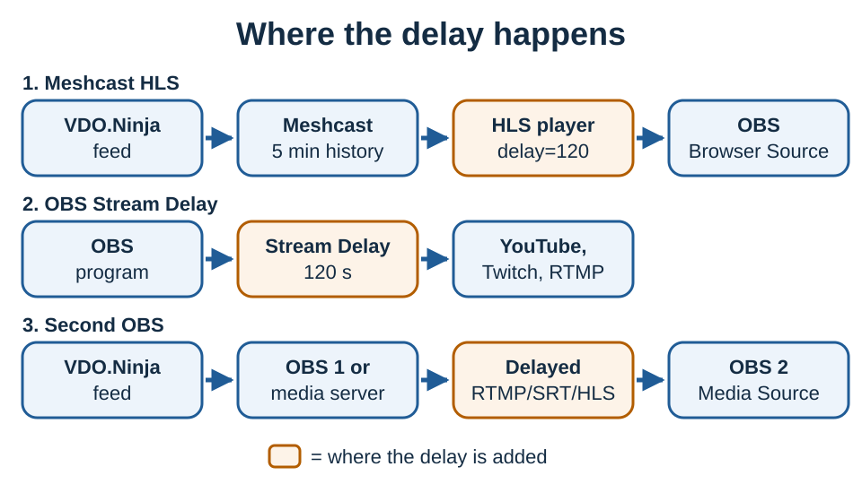

# Delay an incoming VDO.Ninja feed

A two-minute delay is far longer than a WebRTC jitter buffer can hold. Pick a method based on what you need to delay.

| Goal | Method |
| --- | --- |
| Delay one incoming audio/video feed | Meshcast HLS player |
| Delay the whole outgoing OBS broadcast | OBS Stream Delay |
| Bring a delayed program back into another production | A first OBS or media server feeding a second OBS |
| Delay only VDO.Ninja video | Experimental chunked mode |
| Keep it private and self-hosted | MediaMTX with an HLS DVR window |

Don't use `&buffer=120000` on a viewer link. Browsers limit the WebRTC buffer to roughly 3–5 seconds.



## Option 1: Meshcast HLS player

[Meshcast](https://app.meshcast.io) delays audio and video together. Its HLS output keeps about five minutes of seekable history, and its HLS player accepts a delay of up to 240 seconds. HLS playback needs a registered Meshcast account.

1. Sign in to [app.meshcast.io](https://app.meshcast.io) and create or select a stream.
2. Publish to it with Meshcast Web Studio, RTMP, SRT, WHIP or VDO.Ninja's Meshcast 2.0 integration.
3. Copy the **HLS Player URL** from the Meshcast dashboard or studio.
4. Add `delay=120` (in seconds) and `muted=0`, because the player starts muted. `controls=0` hides the player controls. Keep any `server` value already in the URL:

   ```text
   https://app.meshcast.io/hls-player/STREAM_ID?delay=120&muted=0&controls=0
   https://app.meshcast.io/hls-player/STREAM_ID?server=SERVER_ID&delay=120&muted=0&controls=0
   ```
5. Add the URL to OBS as a **Browser Source** at the feed's width and height, and check its audio reaches the right OBS track.

The player can't sit two minutes behind live until two minutes of media exist, so start the stream at least two minutes before loading or refreshing the Browser Source.

To publish from VDO.Ninja, use the publishing URL Meshcast gives for that stream:

```text
https://vdo.ninja/?push=STREAMID&meshcast2=live_...
```

Copy both URLs from the Meshcast dashboard so you don't mix up the private publishing key and the public viewing ID. See [Meshcast.io](../steves-helper-apps/meshcast.io.md) and [`&meshcast`](../newly-added-parameters/and-meshcast.md).

## Option 2: OBS Stream Delay

To delay the whole outgoing OBS program, open **Settings**, select **Advanced**, enable **Stream Delay** and set it to `120` seconds. Test starting, reconnecting and stopping before going live.

This delays the encoded stream sent to YouTube, Twitch or another RTMP endpoint. It doesn't create a delayed source inside OBS, and your preview stays live.

## Option 3: Feed a second OBS

When the delayed result must come back as a source for switching, graphics, recording or monitoring, split the roles:

```text
VDO.Ninja feed → first OBS or media server → delayed RTMP/SRT/HLS stream → second OBS
```

The second OBS receives it as a Media Source or Browser Source. This costs CPU and maybe another encode, but beats holding two minutes of uncompressed frames in an OBS filter. A local [MediaMTX](deploy-your-own-meshcast-like-service.md) server keeps the delayed leg on your network.

## Option 4: Experimental chunked video

VDO.Ninja's [`&chunked`](../newly-added-parameters/and-chunked.md) mode uses WebCodecs and its own receive queue, which can hold minutes of encoded video if the browser has enough memory.

```text
Publisher: https://vdo.ninja/?push=STREAMID&chunked=2500
Viewer:    https://vdo.ninja/?view=STREAMID&noaudio&nochunkaudio&chunkbuffer=120000&chunkbufferadaptive=0&chunkbufferceil=180000
```

Limits:

* Video only. A buffer shared by chunked audio and video is capped at 30 seconds.
* The video-only buffer is capped at 180 seconds.
* The sender needs a WebCodecs-capable browser.
* Refreshing or closing the receiving page loses the queue.
* Memory grows with bitrate and delay: two minutes at 2500 kbps is about 38 MB before browser overhead.
* Test the exact browsers, OBS version, codec and network before production.

## Option 5: Self-hosted HLS with MediaMTX

MediaMTX can keep an HLS DVR window. Keep more history than the delay you need. Two-second segments with 150 retained give about five minutes:

```yaml
hls: yes
hlsVariant: fmp4
hlsSegmentDuration: 2s
hlsSegmentCount: 150
hlsDirectory: /var/lib/mediamtx/hls
```

The history alone doesn't hold viewers behind live. Use an HLS player set to stay 120 seconds behind the live edge. H.264 video with AAC audio plays in the most HLS players; a WHIP source with Opus audio may need an AAC transcode.

See [Deploy your own Meshcast-like service](deploy-your-own-meshcast-like-service.md).

## Methods that don't work

* **`&buffer`** sets the browser's WebRTC playout target, which browsers limit to roughly 3–5 seconds. It isn't a DVR. See [`&buffer`](../advanced-settings/view-parameters/buffer.md).
* **OBS Render Delay** is for short sync fixes. Minutes of uncompressed video use too much GPU memory, and stacking hundreds of filters doesn't fix that.
* **An audio sync offset** delays only the audio, not the matching video.

## Before going live

* Start the ingest early enough to fill the whole delay.
* Measure the offset with a visible clock and a clap, and check audio stays in sync.
* Test a sender reconnect, a viewer reload, and what viewers see when the input ends.
* Watch free disk, memory and network capacity.
* Give operators a separate low-latency feed for monitoring.
