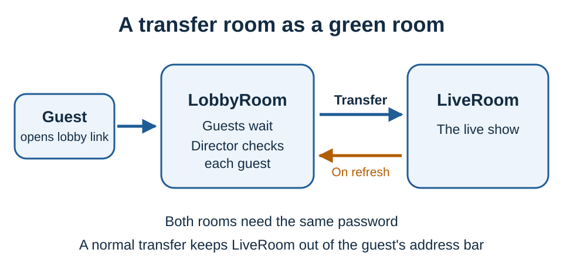

# Green rooms and guest waiting options

A green room is where guests wait before entering the live room, knowing they're in the right place. A blocked join or a blank page makes people refresh, leave or message the host at a bad moment.

In VDO.Ninja, the room-based green room is a **transfer room**. For a larger hosted lobby, put **app.invite.cam** in front of VDO.Ninja. Queue, hold, approval and room-cap options can stop interruptions, but they aren't a separate waiting room. `&scene` isn't a green room either: it controls what OBS shows, not who enters.

| Need | Use | What the guest experiences |
| --- | --- | --- |
| A real lobby room before the live room | [Transfer rooms](../getting-started/rooms/transfer-rooms.md) | Joins a lobby room; the director moves them to the live room |
| A hosted lobby with waiting lists, signed-in ownership and grant/revoke | [app.invite.cam](../steves-helper-apps/app-invite-cam.md) | Waits in the app's lobby before being sent to VDO.Ninja |
| Waiting without a separate room | [`&queue`](../general-settings/queue.md) and hold modes | Waits until the director activates them |
| A join approval gate | [`&requireapproval`](../advanced-settings/director-parameters/and-requireapproval.md) | Pending until approved; not a room |

## Transfer rooms

Guests join a lobby room. The show runs in a separate live room. The director checks the lobby and transfers each guest when they're ready.



```text
Guest:          https://vdo.ninja/?room=LobbyRoom
Lobby director: https://vdo.ninja/?director=LobbyRoom&rooms=LiveRoom
Live director:  https://vdo.ninja/?director=LiveRoom
```

`&rooms=LiveRoom` adds a quick transfer button for `LiveRoom` to the lobby director page.

Things to know:

* Director ownership is first come, first served, so keep the director tab open for every room you control. Transfers go through the main director's tab; co-directors can transfer too while **Allow co-directors to transfer guests** is on (the default).
* After a transfer, the destination room's director controls the guest.
* Both rooms must use the same password.
* A normal transfer doesn't show the guest the destination room name. If they refresh or disconnect, they return to the lobby room. To keep them in the destination after a refresh, tick **Allow the guest to rejoin the transfer room on their own** in the Transfer dialog, or use **Change URL**. Either way, the guest can then see the new room name, and with Change URL any new password too.
* If the destination room uses `&requireapproval`, the guest waits for approval there. If it uses `&roomcap` and is full, the transfer is rejected.

### Transfer helpers

All three go on the **lobby director** link.

| Option | Effect |
| --- | --- |
| [`&rooms=LiveRoom,GuestRoom`](../director-settings/rooms.md) | Adds **Arm Transfer** buttons. Press a room name, then a guest's transfer button, to send them there. The destination room's own rules still apply. |
| [`&queuetransfer`](../advanced-settings/settings-parameters/and-queuetransfer.md) (`&qt`) | Pre-ticks **Guest will arrive in the new room in queue mode** in the Transfer dialog, so the destination director activates them when ready. |
| [`&broadcasttransfer`](../advanced-settings/director-parameters/and-broadcasttransfer.md) (`&bct`) | Transferred guests arrive in broadcast mode by default. This matters most with `&rooms`, which skips the Transfer dialog. |

## app.invite.cam

[app.invite.cam](https://app.invite.cam) is a separate lobby and invite layer in front of the final VDO.Ninja room:

1. The host signs in and shares an app.invite.cam lobby link.
2. Guests wait in the lobby.
3. The host grants or revokes access, and approved guests are sent into VDO.Ninja.

It suits public lobby links, larger events and helper-managed waiting lists.

Don't confuse it with plain [invite.cam](../steves-helper-apps/invite-link-generators.md), which hides, encodes or shortens links.

## Queue and hold modes

These hold a guest until the director activates them. They aren't a separate room unless combined with transfers. Transferring a guest to another room also counts as activation.

| Links | What happens |
| --- | --- |
| `&queue` on both the director and guest links | Guests join a wait list. The director pulls them in as needed and can transfer them to another room. |
| `&queue` on the guest link only | The guest is held until the director presses **Activate Guest**. |
| [`&hold`](../advanced-settings/guest-queuing-parameters/and-hold-alpha.md) (`&queue3`) on the guest link | The guest sees a waiting message until activated. |
| [`&holdwithvideo`](../advanced-settings/guest-queuing-parameters/and-holdwithvideo-alpha.md) (`&queue4`) on the guest link | The guest sees a waiting message while the director can preview them. |
| [`&screen`](../advanced-settings/guest-queuing-parameters/and-screen-alpha.md) (`&queue2`) on the guest link | The guest can see and hear the director before activation. |

```text
https://vdo.ninja/?director=LobbyRoom&queue
https://vdo.ninja/?room=LobbyRoom&queue
```

## Approval and access controls

These stop unwanted or early joins. They're access tools, not green rooms.

* [`&requireapproval`](../advanced-settings/director-parameters/and-requireapproval.md) on the director link makes the active director approve or deny each join. Add `&approvepopup` for a popup on each pending join; it doesn't play sounds or send system notifications, so add `&beep` or `&notify` if you want those.

  ```text
  https://vdo.ninja/?director=RoomName&requireapproval&approvepopup
  ```
* [`&roomcap=NUMBER`](../advanced-settings/director-parameters/and-roomcap.md) on the director link limits how many guests a claimed room admits.
* [`&roomkey=KEY`](../advanced-settings/director-parameters/and-roomkey.md) lets selected guests bypass approval or a custom room cap. Treat it like a password.
* [`&password`](../advanced-settings/setup-parameters/and-password.md) protects a room or source link. [`&auth` and `&requireauth`](sso-and-signed-in-access.md), SSO or another identity gateway can check who someone is before they reach the room. These can sit around a green-room workflow, but don't replace it.

## Related


[transfer-rooms.md](../getting-started/rooms/transfer-rooms.md)



[app-invite-cam.md](../steves-helper-apps/app-invite-cam.md)



[rooms.md](../director-settings/rooms.md)



[and-queuetransfer.md](../advanced-settings/settings-parameters/and-queuetransfer.md)



[queue.md](../general-settings/queue.md)



[how-to-selectively-allow-access.md](how-to-selectively-allow-access.md)

