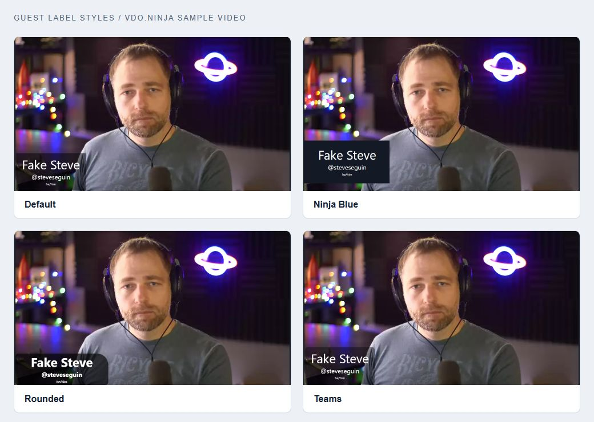
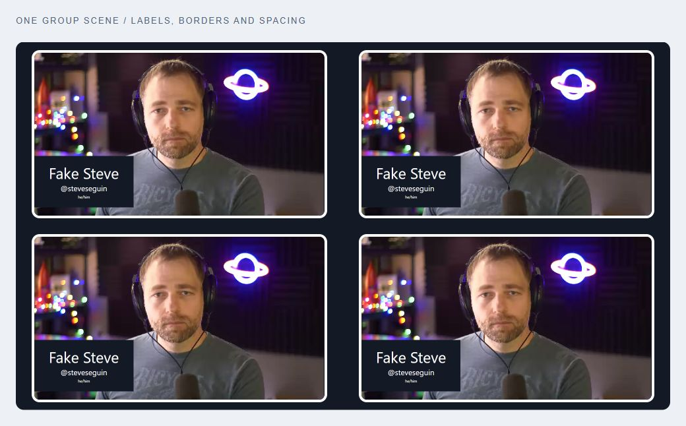

# Style your guest videos

Add a name, a border, or your show's colors to each guest. Use the [Guest video styler](https://vdo.ninja/examples/guest-styler) for a live preview and a ready-to-paste scene link, or use the link options below.

## Guide map

| Start here | What you can make |
| --- | --- |
| [Guest video styler](#use-the-visual-styler) | Choose a preset, adjust the look, and copy the finished link |
| 🟢 [Names and borders](#names-and-borders) | A styled group scene, without code |
| 🎨 [Custom CSS](custom-css.md) | Your own lower thirds, colors, and talking indicators |
| 🧩 [OBS and Mixer layouts](obs-and-mixer.md) | Fixed guest boxes, image frames, logos, and backgrounds |
| 🛠️ [A custom page with an iframe](iframe-starter.md) (advanced) | A branded show page with an embedded group scene |
| ⚡ [A dynamic stage](dynamic-stage.md) (advanced) | Your own guest cards, scores, and spotlight controls |

<figure><figcaption><p>Built-in styles on VDO.Ninja's sample video. Labels follow each guest as the scene rearranges.</p></figcaption></figure>

## Use the visual styler

1. Open the [Guest video styler](https://vdo.ninja/examples/guest-styler), choose a preset, and adjust the names, borders, spacing, and background.
2. Set **Output size** to match your OBS Browser Source: 1920 x 1080 or 1280 x 720.
3. Under **Use this look**, paste your group scene or solo view link. Its room and password options are kept; previous styling options are replaced.
4. Copy **Complete link** into the OBS Browser Source's **URL** field. The CSS is included in the link.

To keep the CSS separate, expand **Paste the CSS into OBS instead**. Copy **Browser Source URL** into the URL field and the generated CSS into **Custom CSS**.

The preview uses sample guests. Set your real guests' names with **Add a label** in the director room, as described below.

## Names and borders

### 1. Add names (lower thirds)

In the director's room, click **Add a label** under the guest and enter their name.

For a name and title on separate lines, enter `Jane Doe\nHost` in that box.

### 2. Turn on labels in the output

In the director room, find **CAPTURE A GROUP SCENE**. Copy its scene link into your OBS Browser Source, then append:

```text
&showlabels=ninjablue
```

Use `&showlabels` for the default look. Other styles include `rounded`, `teams`, `zoom`, `skype`, `toprounded`, and `fire`.

These options change the page displaying the video. Adding them to your OBS scene link does not change the guest's camera or everyone else's view.

### 3. Add a border and some space

Append:

```text
&border=4&bordercolor=white&rounded=12&margin=12
```

That gives every guest a 4-pixel white border, rounded corners, and space around the video. Change the numbers to suit your canvas.

**A complete example:**

```text
https://vdo.ninja/?room=YOUR_ROOM&scene=0&showlabels=ninjablue&border=4&bordercolor=white&rounded=12&margin=12
```

Replace `YOUR_ROOM`. If your scene link already contains a password or other options, keep them and append only the styling options. Do not add a second `?`.

[▶ Try names and borders with sample video](https://vdo.ninja/?view&fakeguests=4&showlabels=ninjablue&border=4&bordercolor=white&rounded=12&margin=12&cleanoutput)

### Optional: set names in invite links

Add `&label=Jane_Doe` to a guest's invite link, or `&label=Jane_Doe%5CnHost` for a name and title. `%5Cn` is the URL-encoded form of `\n`, which starts the second line.

## Fine-tune the picture

| Goal | Add to the scene or view link |
| --- | --- |
| Smaller labels | `&fontsize=80` (100 is the normal setting) |
| Fill each video box | `&cover` (crops the edges when needed) |
| Keep the full picture | Leave `&cover` off |
| Consistent video boxes | `&structure` (16:9 by default; combine with `&cover` to fill them) |
| Square video layout | `&square&structure&cover` |
| Green border while a guest talks | `&meterstyle=2` |
| Transparent page background | `&transparent` |
| A solid page background | `&chroma=182232` |
| An image behind the layout | `&background=` followed by an encoded image URL |

The talking indicator needs active incoming audio. For a different border or graphic for each guest, use [separate OBS sources](obs-and-mixer.md) or a custom layout.

<figure><figcaption><p>One scene link can style every guest. This preview repeats the built-in sample clip.</p></figcaption></figure>

## Keep going

**Customize:** [CSS recipes](custom-css.md) · [OBS and Mixer](obs-and-mixer.md)

**Build:** [Iframe starter](iframe-starter.md) · [Dynamic stage starter](dynamic-stage.md)

**Reference:** [Labels](../../advanced-settings/design-parameters/showlabels.md) · [Names and titles](../../general-settings/label.md) · [Borders](../../advanced-settings/design-parameters/and-border.md) · [All design options](../../advanced-settings/design-parameters/README.md)

## Quick fixes

| What you see | What to check |
| --- | --- |
| No names | Set the guest's label and add `&showlabels` to the output link. |
| Literal `\n` in another app's name list | Multiline labels are a VDO.Ninja display feature. Use one line if that app uses the label as a plain name. |
| A border is still black | Try `&bordercolor=white`; for a CSS recipe use `border-color: ... !important`. |
| Faces or screen edges are cut off | Remove `&cover`, or choose a box with the same shape as the source. |
| Styling appears in one window only | Apply it to each scene/view URL where you want that look. OBS Custom CSS affects that Browser Source only. |
| Two copies of a guest's audio | Keep one intended audio path. See [OBS layouts](obs-and-mixer.md#keep-one-audio-path). |
