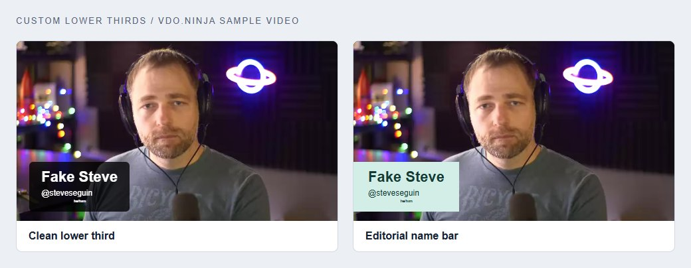

# Custom CSS for guest videos

[← Guide map](README.md) · [OBS layouts →](obs-and-mixer.md)

Use CSS to change colors, type, spacing, and the shape of a lower third. Guest names still come from their VDO.Ninja labels.

## Where to paste it

**In OBS:** Open the Browser Source's **Properties**, then paste the recipe into **Custom CSS**. Keep `&showlabels` on its URL. Use plain `&showlabels` instead of a named preset when applying these recipes.

**In another browser:** Save the CSS as a file on an HTTPS host. Add `&css=` and its URL to the scene link. For example:

```text
&css=https%3A%2F%2Fyour-site.example%2Fguest-style.css
```

**Without hosting a CSS file:** Use [VDO.Ninja's Base64 tool](https://vdo.ninja/base64) to encode the CSS, then append it with `&base64css=`. The [iframe starter](iframe-starter.md) does this for you.

Keep CSS changes in the output page. They do not need changes to `webrtc.js`.

## Recipe 1: a clean lower third

<figure><figcaption><p>Two looks using the same guest label. The second line is styled separately.</p></figcaption></figure>

```css
.video-label {
	bottom: 5%;
	left: 4%;
	background: rgba(0, 0, 0, .78);
	color: white;
	padding: 10px 18px;
	border-radius: 6px;
	font-family: Arial, sans-serif;
	font-weight: bold;
}

.video-label > span:nth-child(2) {
	display: block;
	font-size: 55%;
	text-align: left;
	font-weight: normal;
	margin-top: 4px;
}
```

Use `&fontsize=100` as a starting point. Prefer `&fontsize` for automatic sizing with the guest tiles. For a fixed size, add `font-size: 24px !important;` to `.video-label`.

## Recipe 2: an editorial name bar

Replace the first rule above with:

```css
.video-label {
	bottom: 5%;
	left: 0;
	background: #d3eee7;
	color: #153b34;
	padding: 10px 22px;
	font-family: Arial, sans-serif;
	font-weight: bold;
}
```

Keep the subtitle rule. For a full-width strip, add `width: 100%; box-sizing: border-box;` and set `bottom: 0;`.

## Match the guest borders

Start with `&border=4&rounded=12&margin=12` on the scene link. Then add:

```css
.holder, .holder > video {
	border-color: #60b6a0 !important;
}

.holder {
	box-shadow: 0 6px 18px rgba(0, 0, 0, .3);
}
```

Leave enough margin for shadows. Video containers clip content at their edges, so decorations extending far outside a tile can disappear. For a large decorative frame, use an [OBS image layer](obs-and-mixer.md).

## Give one guest a different name color

Use their stream ID, not their position in the grid:

```css
video[data-sid="GUEST_STREAM_ID"] ~ .video-label {
	background: #432553;
	color: #fff;
}
```

Replace `GUEST_STREAM_ID`. The selector targets the label beside that video inside its holder. For different complete frames, separate OBS sources or Mixer layouts are easier to manage.

## Show who is talking

The simplest option is `&meterstyle=2`. For your own color, use `&meterstyle=4` and add:

```css
video[data-speaking="1"],
video[data-speaking="2"] {
	outline: 4px solid #70e2ba;
	outline-offset: -4px;
}
```

This draws the outline inside the video. Keep incoming audio enabled so VDO.Ninja can measure speech.

## Names below the picture

For a nameplate outside the video, use [separate OBS text sources](obs-and-mixer.md) or the [dynamic stage](dynamic-stage.md). Those give the nameplate its own space without fighting the automatic video layout.

**Reference:** [Custom CSS](../../advanced-settings/design-parameters/css.md) · [Base64 CSS](../../advanced-settings/design-parameters/and-base64css.md) · [Talking indicators](../../advanced-settings/design-parameters/meterstyle.md)
