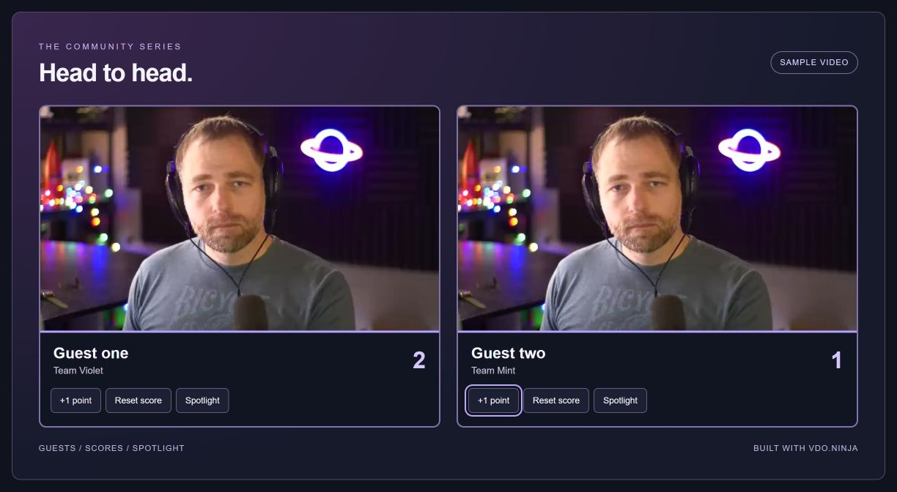

# Build a dynamic stage

[← Guide map](README.md) · [Simpler iframe starter](iframe-starter.md)

Use this approach when your page needs to own the guest cards: names below the video, scores, changing layouts, interactive elements, or canvas effects.

[Versus.cam](https://versus.cam) uses a hidden VDO.Ninja iframe for the connection, then displays the media in its own elements. The visible layout is independent of the iframe. This starter follows that idea with canvases and ordinary HTML.

<figure><figcaption><p>The dynamic stage starter. The page owns the cards and controls. Sample video is repeated for the two guests.</p></figcaption></figure>

## Try it


Download both starters and their MIT license


1. Extract the ZIP. Serve the folder with the [local server command](iframe-starter.md#put-the-finished-page-into-obs), or host it on HTTPS.
2. Open `dynamic-stage.html` in a recent Chrome or Edge.
3. Try **+1 point**, **Reset score**, **Spotlight**, and **Hide names** with the sample video.
4. Paste your scene or view link and click **Connect**.
5. Enable sound if this page should play guest audio.

The sample preview needs no camera or room. Live frame delivery needs browser video-frame processing support; use the [iframe starter](iframe-starter.md) when that feature is unavailable.

[View the HTML source](https://github.com/steveseguin/vdo.ninja/blob/gitbook/.gitbook/assets/guest-video-styling/dynamic-stage.html) · [Versus.cam source](https://github.com/steveseguin/versus) · [360-degree canvas example](https://vdo.ninja/examples/360.html)

## What goes where

| Part | Responsibility |
| --- | --- |
| Official VDO.Ninja iframe | Room access, password handling, receiving video, and playing audio |
| `sendframes` / `iframetarget` | Send video frames and events to this page's origin |
| One canvas per guest | Draw received video frames |
| HTML around each canvas | Names, subtitles, scores, and buttons |
| Your page's CSS | Card shape, colors, spacing, and layout |

The code listens for `view-connection-info` to update names and `view-connection` to remove disconnected guests. It uses the connection UUID to keep guest cards distinct.

A live card accepts either a transferred `VideoFrame` or the existing encoded-image fallback. It keeps only the latest pending frame and closes frames after use. **Disconnect** clears the cards, stops drawing, and unloads the connection iframe.

## Make it your own

| Change | Start here in the HTML file |
| --- | --- |
| Brand, colors, and spacing | `.stage`, `.nameplate`, and `.stage-head` |
| Add a guest's title or team | `setLabel()` and the second `\n`-separated label line |
| Change the scoreboard | `.score` and the point/reset button handlers |
| Feature a guest differently | `.card.featured` and the spotlight button handler |
| Add a graphic over video | Put an HTML element inside `.picture` and position it with CSS |
| Draw a video effect | `draw()` |

Keep the event source and origin checks. Put guest text into `textContent`, and use the existing room and viewer links for access.

## Capture and control it

For interactive operation, capture the page window in OBS or [Electron Capture](../../steves-helper-apps/electron-capture.md). The buttons control that window.

For a clean Browser Source, use the same encoded `source` and `output=1` URL options as the iframe starter. Scores and spotlight choices are local to each page; opening a second copy does not remotely control the OBS copy. Add a deliberate control channel only if your interface needs one.

Audio still plays through the iframe, not the canvases. Keep one audio path. Canvas drawing adds work, so start with two guests and moderate video resolution; use a normal scene for large groups that do not need custom drawing.

## A useful build request

Give Claude or Codex the downloaded HTML and a sketch of the desired stage:

```text
Adapt dynamic-stage.html into my show interface.
Keep the official VDO.Ninja iframe as the media connection.
Keep its origin checks, guest identity handling and frame cleanup.
Build the visible cards and controls with HTML, CSS and canvas.
Preserve guest names as text and the existing password/scene options.
Add [describe the layout, scores or graphics here].
Keep sample mode, and check joining, leaving and reconnecting guests.
Use feature checks for optional browser APIs and keep the simpler iframe
approach available for browsers without video-frame processing.
```

For a truly iframe-free client, use an appropriate supported SDK and its service terms. That is a separate integration; replacing VDO.Ninja's signaling is not a styling step.
