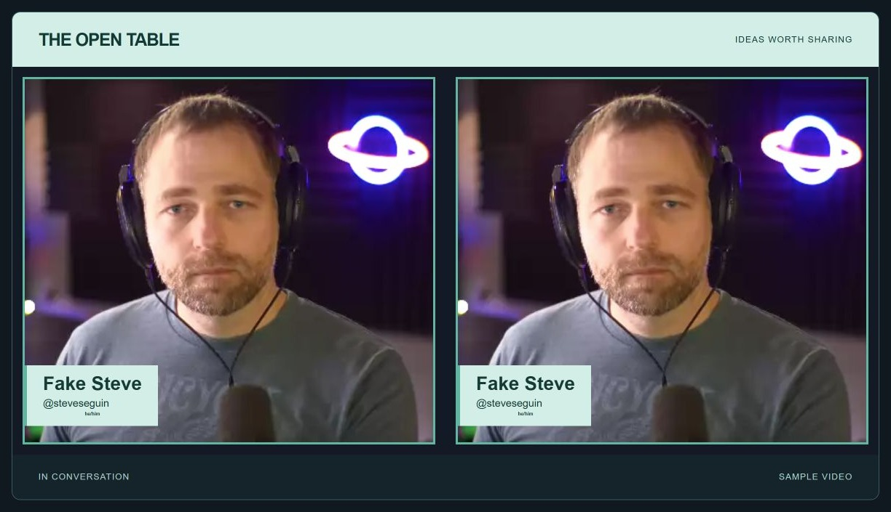

# Make a custom page with an iframe

[← Guide map](README.md) · [Dynamic stage →](dynamic-stage.md)

An iframe puts a VDO.Ninja scene inside your own page. Your page adds the show title, logos, background, and controls. VDO.Ninja manages the guest videos and audio.

<figure><figcaption><p>The downloadable starter: a page banner around a VDO.Ninja scene, with custom CSS inside it. Sample video is repeated for the two guests.</p></figcaption></figure>

## Open the starter


Download both starters and their MIT license


1. Extract the ZIP into a folder.
2. Open `styled-scene.html` in your browser. It starts with sample video.
3. Choose **Editorial**, **Minimal**, or **Esports**, then **Apply style**.
4. Paste your VDO.Ninja **scene or view link** and click **Load scene**.
5. Expand **Edit CSS** to change the guest styles.

**Apply style reloads the embedded view.** Use it during setup; connected guests can take a moment to reappear. Sound starts muted; use **Enable sound** to listen.

[View the HTML source](https://github.com/steveseguin/vdo.ninja/blob/gitbook/.gitbook/assets/guest-video-styling/styled-scene.html) · [CSS recipes](custom-css.md) · [Existing example gallery](https://vdo.ninja/examples/)

## How CSS reaches the guest videos

CSS on the outer page does not style a cross-origin iframe. This starter passes CSS through VDO.Ninja's existing `base64css` option:

```javascript
var url = new URL(sceneLink);
url.searchParams.set("showlabels", "");
url.searchParams.set("base64css", btoa(encodeURIComponent(cssText)));
iframe.src = url.href;
```

You can also use the existing IFRAME API after the iframe is ready:

```javascript
iframe.contentWindow.postMessage({
	style: ".video-label { color: white; background: #153b34; }"
}, "https://vdo.ninja");
```

Each `style` command adds a stylesheet. For a simple starter, reloading with one complete `base64css` value keeps the styling easy to follow.

## Put the finished page into OBS

Host the HTML on HTTPS, or serve the folder locally. With Python installed, run this command **from the extracted folder**:

```sh
python -m http.server 8080 --bind 127.0.0.1
```

Then open `http://localhost:8080/styled-scene.html`.

For a repeatable OBS Browser Source, set the page's `source` parameter to the encoded full scene URL. Add `output=1` to hide setup controls, and optionally `preset=minimal` or `preset=esports`:

```javascript
var page = new URL("https://your-site.example/styled-scene.html");
page.searchParams.set("source", "https://vdo.ninja/?room=YOUR_ROOM&scene=0");
page.searchParams.set("output", "1");
page.searchParams.set("preset", "editorial");
```

Use `page.href` as the Browser Source URL. If your scene link contains a password, the resulting page URL contains it too; share it only with intended viewers. Edit the starter's default `sound` value if this output should provide audio.

**Open styled scene** opens the guest scene alone. It includes the guest CSS, but not the outer page's banner and footer.

## Adapt it with Claude or Codex

Give the assistant `styled-scene.html`, a reference image, and this request:

```text
Customize this VDO.Ninja starter for my show.
Keep its existing scene-link handling and use the official VDO.Ninja iframe.
Change the outer HTML/CSS and the CSS passed through base64css.
Use local assets and readable procedural JavaScript. Keep the sample preview.
Preserve room, scene, view and password options from my viewer link.
Check the layout at 1920x1080 and on a narrow browser window.
Do not change VDO.Ninja's connection code.
```

**Reference:** [IFRAME API](../../guides/iframe-api-documentation.md) · [API source guide](https://github.com/steveseguin/vdo.ninja/blob/develop/examples/iframeapi.md) · [Labels-only example](https://vdo.ninja/examples/labelonly.html) · [Overlay example](https://vdo.ninja/examples/overlay.html)
