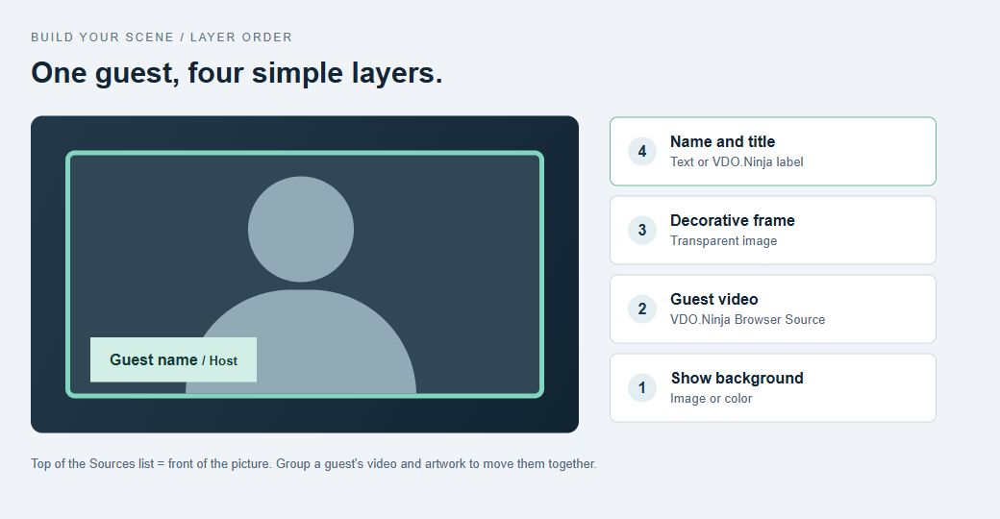

# Build the layout in OBS or Mixer

[← Guide map](README.md) · [Custom page →](iframe-starter.md)

Choose a group scene when guests should rearrange automatically. Choose individual sources when every guest needs a fixed place or a different frame.

## One Browser Source for the group

1. In the director room, find **CAPTURE A GROUP SCENE** and copy its scene link into an OBS **Browser Source**.
2. Set its width and height to your output size, such as 1920 × 1080.
3. Add [labels and borders](README.md#names-and-borders), or paste a [CSS recipe](custom-css.md) into Custom CSS.
4. Add your logo or show title above the Browser Source in OBS's Sources list.

VDO.Ninja keeps each label attached to its guest. A separate graphic placed over the whole group does not automatically follow a guest when the grid changes.

## A separate source for each guest

1. Copy each guest's **solo link** from the director room.
2. Add one OBS Browser Source per guest. Preserve its room and password options.
3. Resize each source and crop it with **Alt-drag** on Windows, or **Option-drag** on macOS.
4. Add an **Image** source for a decorative border, and a **Text** source for a name or title.
5. Group each guest's video and artwork so they move together.

[OBS source and cropping guide](https://obsproject.com/kb/sources-guide) · [Browser Source settings](https://obsproject.com/kb/browser-source)

<figure><figcaption>
Layer order: background at the bottom, then guest video, frame, and name. The illustration shows the composition, not OBS controls.
</figcaption></figure>

To keep the text automatic, use `&showlabels` on the solo link instead of an OBS Text source. To keep fixed places while guests reconnect, see [permanent links and slots](../how-to-get-permanent-links.md).

For logos, decorative PNG frames, animated lower thirds, and sponsor graphics, OBS can combine these with the video just like other sources. Use images with transparent openings where the guest should appear.

## Keep one audio path

If a group scene and solo sources show the same guests, both can play their audio. Decide which source provides sound. Add `&noaudio` to the duplicate visual-only sources, or mute the duplicates in OBS.

If the visual-only source needs a talking indicator, it must still receive audio for speech detection. Mute its playback in OBS instead of removing its incoming audio.

## Use VDO.Ninja's Mixer App

Use the [Mixer App](https://vdo.ninja/mixer) when you want to place guests in slots and control the scene inside VDO.Ninja.

1. Open your room in Mixer.
2. Choose or arrange the layout and assign guests to its slots.
3. Use the mixer's output scene in OBS.
4. Add labels and styling to that output link.

The layout system can control each slot's size, crop, border, and placement. Keep reusable artwork in the layout or in OBS. See the [Mixer guide](../../steves-helper-apps/mixer-app.md) for its controls and versions.

## Other useful looks

| Look | Approach |
| --- | --- |
| Background image behind all guests | OBS Image source below a transparent group scene, or VDO.Ninja's `&background` |
| Portraits or avatars for audio guests | [Audio-reactive avatars](../audio-reactive-avatars.md) and [`&bgimage`](../../advanced-settings/design-parameters/and-bgimage.md) |
| A guest over a game or presentation | A solo source above the content, cropped or masked in OBS |
| One large guest with smaller guests beside them | [Active speaker layouts](../active-speaker-layouts-in-obs.md) |
| A transparent person or character | [Transparent video guide](../how-to-stream-transparent-video.md) |
| Blur or replace the room behind a guest | Apply [video effects](../../source-settings/effects.md) on the guest's sending page |

**Next:** [Build a branded page around the scene](iframe-starter.md).
