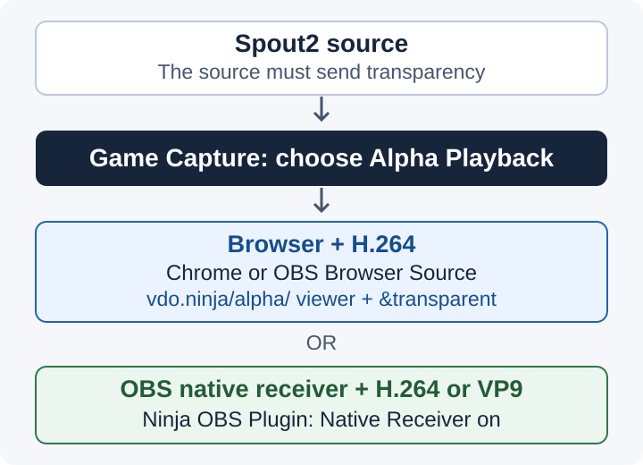

# How to stream transparent video

For a transparent avatar or graphics feed on Windows, send the source app's Spout2 output through **Game Capture**. You can receive transparency in **Chrome**, an **OBS Browser Source**, or the **Ninja OBS Plugin**.

The source app must supply an alpha channel. Turning on alpha in Game Capture cannot restore transparency that was lost in a window capture or virtual camera.

## Spout2 through Game Capture (Windows)

Use [Game Capture 0.2.68 or later](https://github.com/steveseguin/game-capture/releases/latest). Enable Spout2 output with transparency in your avatar or graphics app, then select that sender in Game Capture.

### Browser or OBS Browser Source

1. Stop streaming and capture if they are running. Enable **Show advanced settings** and set **Video Codec** to **H.264 (Compatibility)**.
2. Set **Alpha Playback** to **Browser / OBS Browser Source (H.264)** and turn on **Enable browser alpha (H.264)**.
3. Select **GO LIVE**, then **Copy Link**. Send this link to the receiving computer.
4. Change its base to `https://vdo.ninja/alpha/`, preserving the full query after `?`, and add `&transparent`.
5. In OBS on the receiving computer, select **Sources > + > Browser**, paste the link into **URL**, and select **OK**. You can also open the link in Chrome.

**Check in OBS:** add a **Color Source** and drag it below the Browser Source. Its color should show through the transparent areas, without a black box around the avatar.

For example:

`https://vdo.ninja/alpha/?view=YOUR_STREAM_ID&transparent`

Keep the password and any other parameters from your generated link. Start at **720p30**; browser alpha supports even output dimensions up to **1920x1080 at 60 fps**. Clear custom FFmpeg options for this mode. Stop streaming and capture before changing alpha modes.

The [`&transparent`](../advanced-settings/design-parameters/and-transparent.md) option clears the page background. It does not create video transparency. You do not need an `&alpha` viewer flag for Game Capture.

### Ninja OBS Plugin

1. Set **Alpha Playback** to **OBS native receiver**.
2. Choose **H.264** or **VP9**, enable the alpha workflow, and publish.
3. In OBS, add the plugin's **VDO.Ninja Source** and enable **Use Native Receiver (Experimental)**.

This mode sends a separate VP9 transparency mask. Browser viewers of this mode receive color video only; use the Browser mode above for browser transparency.

Spout2 carries video only, so select audio separately in Game Capture. For detailed settings, recording advice, and fixes for black backgrounds or missing video, see [Using Game Capture and Spout2 with VDO.Ninja](using-game-capture-with-vdo.ninja.md).

## Webp-mode supports transparency

For a transparent local video file or a browser background-removal effect, [`&webp`](../advanced-settings/view-parameters/webp.md) sends a series of images with transparency. It uses substantial CPU and bandwidth, so start with a low resolution and frame rate.

### Sending a video file via webp-mode

1. Open this [WebP file sender](https://vdo.ninja/alpha/?webp&push=YOUR_STREAM_ID&fileshare&alpha) with your own stream ID.
2. Select a video file with transparency, such as a WebM file with an alpha channel.
3. Open the [matching WebP viewer](https://vdo.ninja/alpha/?view=YOUR_STREAM_ID&codec=webp&transparent), using the same stream ID.

Here, `&alpha` on the sender preserves transparency and `&codec=webp` on the viewer selects image playback. These are WebP settings, separate from Game Capture's Browser alpha mode.

### Transparent webcam background via webp-mode

Use background removal with a transparent replacement image, then send the result as WebP images:

1. Open the [webcam background-removal sender](https://vdo.ninja/alpha/?webp\&push=rPJ5bEb\&effects=5\&alpha\&webcam\&imagelist=data%3Aimage%2Fpng%3Bbase64%2CiVBORw0KGgoAAAANSUhEUgAAAAEAAAABCAQAAAC1HAwCAAAAC0lEQVR42mNkYAAAAAYAAjCB0C8AAAAASUVORK5CYII%3D) and replace the example stream ID with your own.
2. Open the [WebP viewer](https://vdo.ninja/alpha/?view=YOUR_STREAM_ID&codec=webp&transparent) with that same ID.

The sender combines [`&effects=5`](../source-settings/effects.md), `&alpha`, and `&webp` with a transparent pixel as the replacement background. Background removal and image encoding both use CPU; lower the resolution and frame rate if playback struggles.

## Green screening

Chroma key is useful when the sender or receiver cannot preserve an alpha channel.

1. Use a physical green screen, VDO.Ninja's [`&effects=4`](../source-settings/effects.md) green background, or Game Capture's **Alpha Background -> Chroma background** with alpha off.
2. Send the video normally.
3. Add a chroma-key filter in OBS or the receiving app to remove the green.

This works with ordinary video receivers, although fine edges may show green fringing.

<figure><figcaption>
Before: send a green background.
</figcaption></figure>

<figure><figcaption>
After: remove green with the OBS Chroma Key filter.
</figcaption></figure>

## Chunked mode - partially working

[`&chunked`](../newly-added-parameters/and-chunked.md) with `&alpha` requests an alpha-capable recording codec from the browser. Support depends on the browser's encoder. If it cannot preserve alpha, use Game Capture, WebP, or chroma key instead.

### Browser capture limitations

Virtual cameras and browser screen sharing normally do not include alpha channels. Screen sharing the [Electron Capture app](../steves-helper-apps/electron-capture.md), for example, may turn transparent areas black. Use direct Spout2 output from the source app on Windows to preserve those pixels.

Game Capture's Browser alpha mode needs a compatible VDO.Ninja viewer to reconstruct transparency. An ordinary OBS WHIP output or raw forwarded video does not gain this behavior by adding `&transparent`.
