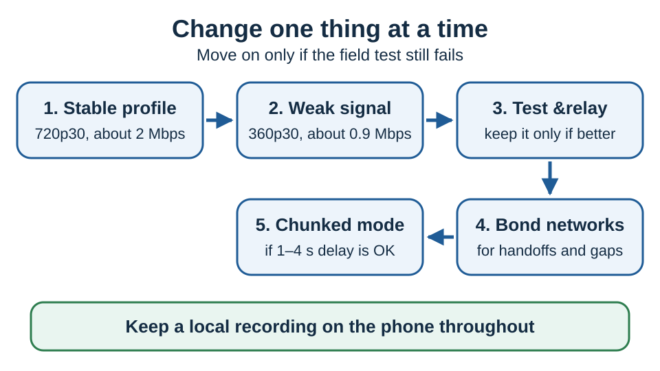

# Stable IRL streaming with VDO.Ninja

Start with 720p30 at about 2 Mbps. A 6000 kbps target does not reserve bandwidth or make a cellular path more reliable. It asks for larger frames, which can make packet loss, recovery bursts, and phone heat worse.

For the experimental adaptive `&connectionprofile=irl` and the slideshow-like `&connectionprofile=talkinghead`, see [Low-bandwidth video and connection profiles](low-bandwidth-video-and-connection-profiles.md). When you test one, leave `&degrade=maintain-framerate` off the view link so it does not override the profile.

## 1. Start with this profile

Replace `STREAMID` with a unique stream ID.

```text
Phone:    https://vdo.ninja/?push=STREAMID&quality=1&fps=30&outboundvideobitrate=2000&maxvideobitrate=2500
OBS/view: https://vdo.ninja/?view=STREAMID&codec=h264&videobitrate=2000&buffer=1000&retry=10&degrade=maintain-framerate
```

This sends 720p30 at 2000 kbps, capped at 2500. The view link requests H.264, which phones often encode in hardware, adds a 1-second jitter buffer, and with `&retry=10` checks for the stream every 10 seconds if it goes missing.

If it still freezes while moving, try the 360p30 weak-signal profile before raising the bitrate. Smaller frames recover faster after loss.

```text
Phone:    https://vdo.ninja/?push=STREAMID&quality=2&fps=30&outboundvideobitrate=900&maxvideobitrate=1200
OBS/view: https://vdo.ninja/?view=STREAMID&codec=h264&videobitrate=900&buffer=1500&retry=10&degrade=maintain-framerate
```



## 2. Prepare the phone

1. Update the OS, browser, and VDO.Ninja app before the event.
2. Keep browser capture in the foreground, the screen awake, and interruptions off.
3. Keep the phone shaded and ventilated. Avoid 1080p60, direct sun, and insulating cases. Charging while encoding adds heat.
4. Test with the same device, mount, power, carriers, route, and time of day you will use live.

Test both the browser and the [native VDO.Ninja app](../steves-helper-apps/native-mobile-app-versions.md), which adds local recording, better external audio, and background options. On iPhone, Chrome and Firefox commonly use Safari's WebKit engine, so try the native app if Safari is unstable. On Android, turn off battery optimization for the app and confirm the OS keeps camera, microphone, and background network access during a long test.

## 3. Find what is failing

| Symptom | Likely cause | First test |
| --- | --- | --- |
| Bitrate falls and the image goes soft | Congestion control | Lower bitrate or resolution. A relay does not add radio capacity. |
| Audio and video freeze together while moving | Cellular loss or handoff | Test a bonded path. Keep the stream open through brief drops. |
| Audio continues but remote video freezes or goes black | Video encoder or decoder recovery | Add `&keyframe=2000` to the view link and compare the phone's own preview. |
| The phone's own preview also freezes | Capture, heat, or app lifecycle | Cool the phone and test 360p30 in the native app. |
| The app or page closes or reloads | Memory, heat, or app failure | Lower the capture load, close other apps, and keep a local recording. |

`&keyframe=2000` asks for a keyframe every two seconds. Remove it if it causes bitrate bursts or more loss.

## 4. Choose the network path

| Path | Best use | Main tradeoff |
| --- | --- | --- |
| Direct WebRTC | Low-latency IRL on a usable cellular path | Short outages are visible |
| Forced TURN relay | Carrier NAT or a poor direct route | Adds a server hop; does not fix weak coverage |
| Bonded connection | Handoffs, moving coverage, critical streams | More data, battery, and equipment |
| Chunked/WebCodecs | Supported devices; 1–4 seconds of delay is fine | Browser-dependent; cannot bridge a full outage |

### Test forced relay

VDO.Ninja tries direct connections first and can use TURN when no direct path works. `&relay` forces TURN from the start, so treat it as an A/B test: run the stable profile for 10 minutes on the real route, then add `&relay` to both links and repeat. Keep it only if it gives fewer failures at an acceptable delay. TURN cannot combine connections, restore coverage, or add upload capacity, and sustained high-bitrate relay use needs a properly sized TURN service.

### Bond separate networks

Bonding helps most with handoffs and brief coverage holes. Use independent paths, such as cellular plus Wi-Fi from a second carrier's hotspot, a vehicle router, or Starlink. Most dual-SIM phones use one cellular data path at a time, so they cannot bond two SIMs.

* **Speedify:** confirm both links show as connected, start with Speed mode plus Enhance Streaming, and pick a nearby server. Redundant mode helps a critical stream with packet loss but uses more data and battery. Leave transport on Auto, then A/B test UDP.
* **Peplink/SpeedFusion:** prioritize Smoothing and Hot Failover for WebRTC, with separate carrier modems and a nearby endpoint.

See [Mobile uplinks with Starlink, cellular, and bonded networks](mobile-uplink-starlink-cellular-bonding.md) for details.

### Treat chunked mode as an experiment

Chunked mode adds VDO.Ninja-controlled buffering, NACK resends, parity repair, and adaptation. It absorbs more loss than plain WebRTC, but it is not bonding. Chromium-based browsers are the main target. Firefox cannot publish chunked, and Safari can only when its complete WebCodecs stack and worker track-processing APIs are present.

```text
Phone:    https://vdo.ninja/?push=STREAMID&quality=1&fps=30&chunked=1400&chunkbitrate=1400&chunkprofile=mobile&chunkedbuffer=2000
OBS/view: https://vdo.ninja/?view=STREAMID&chunkbuffer=1500&chunkbufferfloor=1000&chunkbufferceil=3500&chunkjitterslack=500&retry=10
```

Expect extra delay. If VDO.Ninja says chunked mode is unsupported, or the phone overheats or crashes, go back to the 720p30 profile.

## 5. Field test before going live

1. Record 10 minutes parked and 10 minutes moving with each profile. Test forced relay separately.
2. At the receiver, note bitrate, packet loss, RTT, jitter, decoded FPS, candidate type, and recovery time.
3. Test under the real heat, movement, and charging conditions.
4. Choose the lowest profile that completes the route without a black screen or manual reconnect.

For critical work, record locally on the phone while streaming. No setting can recover media that was never sent.

## Related guides and references


[mobile-uplink-starlink-cellular-bonding.md](mobile-uplink-starlink-cellular-bonding.md)



[video-bitrate-for-push-view-links.md](video-bitrate-for-push-view-links.md)



[and-relay.md](../general-settings/and-relay.md)



[and-chunked.md](../newly-added-parameters/and-chunked.md)


* [Speedify supported connection types](https://support.speedify.com/article/56-what-internet-connections-can-i-use-with-speedify)
* [Speedify bonding modes](https://support.speedify.com/article/870-bonding-mode)
* [Speedify transport modes](https://support.speedify.com/article/882-transport-mode)
* [Peplink SpeedFusion bonding, smoothing, and hot failover](https://www.peplink.com/technology/speedfusion-bonding-technology/)
* [WebKit features in Safari 26](https://webkit.org/blog/17333/webkit-features-in-safari-26-0/)
