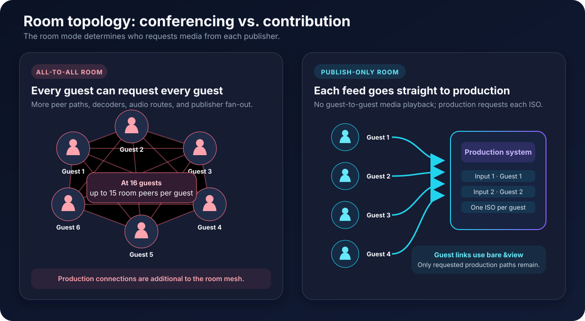
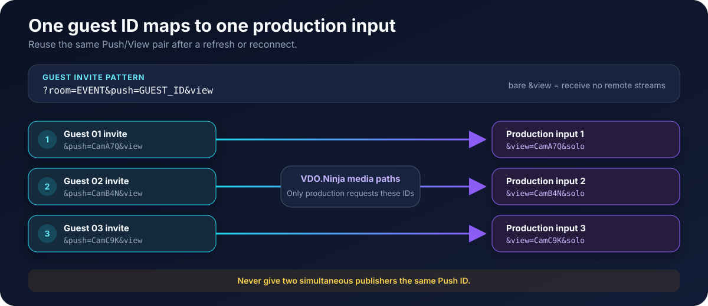

# Large production rooms with isolated guest feeds

When remote guests are **contributors to a production** rather than conference participants, give each one a unique Push ID and add a bare [`&view`](../advanced-settings/view-parameters/view.md) to their invite:

```text
https://vdo.ninja/?room=EVENT_ROOM&push=GUEST_01&label=Guest%2001&view
```

The guest still publishes camera and microphone, but downloads no room streams. The production system pulls that guest with the matching View ID:

```text
https://vdo.ninja/?view=GUEST_01&solo&room=EVENT_ROOM
```

Use this as the starting point when each guest must arrive as a separate browser or web input in vMix, OBS or similar software.


The `&view` in the guest invite has **no value**. `&view=GUEST_01` would request a stream instead of making the guest publish-only.


## Why a normal room gets heavy

A normal room is peer-to-peer. If every guest sees and hears every other guest, each browser opens guest-to-guest media paths on top of the director and production connections. With 16 guests, each guest has up to 15 room peers.

When a director or scene is connected, VDO.Ninja caps each guest's combined view of other guests at 500 kbps by default ([`&totalroombitrate`](../advanced-settings/video-bitrate-parameters/totalroombitrate.md)). A larger mesh still adds connections, audio routes, decoders and upload fan-out. A weak device or a saturated connection then drops frames, adds latency, or lowers the quality of its production feed.

The guest's self-preview is local and downloads nothing, so hiding it with [`&nopreview`](../source-settings/and-nopreview.md) saves little.

<figure><figcaption><p>Contribution mode removes unnecessary guest-to-guest playback while keeping independently addressable production feeds.</p></figcaption></figure>

## Build stable guest and production links

1. **Pick one Push ID per position or guest.** Use hard-to-guess IDs if links may leak, such as `CamA7Q`, `CamB4N`, `CamC9K`. IDs are case sensitive. Never use one Push ID on two devices at once. Use [`&label`](../general-settings/label.md) for the display name.
2. **Send each guest a publish-only invite:**

   ```text
   https://vdo.ninja/?room=EVENT_ROOM&push=CamA7Q&label=Guest%2001&view
   https://vdo.ninja/?room=EVENT_ROOM&push=CamB4N&label=Guest%2002&view
   ```

   Keep any shared room access parameters the same on guest, director and production links. Read [How to selectively allow access](how-to-selectively-allow-access.md) before sharing links publicly.
3. **Add one matching input per guest** in the production system:

   ```text
   https://vdo.ninja/?view=CamA7Q&solo&room=EVENT_ROOM
   https://vdo.ninja/?view=CamB4N&solo&room=EVENT_ROOM
   ```

`push=CamA7Q` maps to `view=CamA7Q`. Keeping that pair fixed lets the production input pick the same guest back up after a refresh or reconnect.

<figure><figcaption><p>Each unique Push ID has one matching production View link.</p></figcaption></figure>

For more on permanent links, scenes and slots, see [Permanent links, reusable invites, and stream IDs](how-to-get-permanent-links.md).

## Choose what guests receive

Use the smallest return path the event needs.

<figure><figcaption><p>The guest invite determines whether the participant receives nothing, the directors, or director video plus room audio.</p></figcaption></figure>

| Guest needs to | Add to each guest invite | Result |
| --- | --- | --- |
| Send a feed and receive nothing | bare [`&view`](../advanced-settings/view-parameters/view.md) | Publish only; lightest for the guest |
| See and hear the director, not other guests | [`&directoronly`](../advanced-settings/video-parameters/and-directoronly.md) | Private talkback or confidence video from directors and co-directors |
| See director video and keep group conversation audio | [`&broadcast`](../advanced-settings/view-parameters/broadcast.md) | Other guests' video is blocked; guest-to-guest audio stays on |

Examples:

```text
https://vdo.ninja/?room=EVENT_ROOM&push=GUEST_ID&view
https://vdo.ninja/?room=EVENT_ROOM&push=GUEST_ID&directoronly
https://vdo.ninja/?room=EVENT_ROOM&push=GUEST_ID&broadcast
```

With `&directoronly` or `&broadcast`, the director uploads a separate copy of their return to every guest, so their upload grows with the guest count. For a return from the production mix, see [Send an OBS return feed to guests](send-an-obs-return-feed-to-guests.md). With `&broadcast`, have guests wear headphones and test echo before the event.

## What not to use as the main fix

* [`&roombitrate=0`](../advanced-settings/video-bitrate-parameters/roombitrate.md) stops other guests from pulling that publisher's video, while the director and scenes still get it. It helps a single weak guest, but that guest still pulls other feeds and keeps guest-to-guest audio.
* Raising [`&totalroombitrate`](../advanced-settings/video-bitrate-parameters/totalroombitrate.md) makes room previews sharper but adds network and decoding load. See [Video bitrate in rooms](video-bitrate-in-rooms.md) if the room really needs conference-style video.

## Pre-event checklist

1. Every guest has a different `&push` value.
2. Publish-only invites end in a bare `&view`, not `&view=SOMETHING`.
3. Each production View link is open and its input labeled.
4. Reconnect one guest and confirm the same input recovers on its own.
5. Guests receive only the return path meant for their mode.
6. Test the full guest count while watching guest upload, production download and CPU/GPU load.
7. Leave network headroom; do not plan around one speed-test peak.

## Troubleshooting

**A guest sees or hears other guests.** Check the invite really has a bare `&view`. With `&broadcast`, other guests' audio still plays; use `&directoronly` or bare `&view` instead.

**The production input does not find the guest.** Compare the Push and View IDs exactly, including capitalization. Confirm the guest finished device selection and is publishing, and that no other device uses the same Push ID.

**Quality drops as more inputs open.** The production machine still receives and decodes every feed it requests. Check its download bandwidth, browser-input limits, hardware decoding and CPU/GPU load. Close unused inputs, request a lower bitrate, or split inputs across machines.

**Guests need to see the final program.** Use `&directoronly` or `&broadcast` with a deliberate return feed. Larger shows may need a relay; see [Send an OBS return feed to guests](send-an-obs-return-feed-to-guests.md).

## Related guides

* [Permanent links, reusable invites, and stream IDs](how-to-get-permanent-links.md)
* [Video bitrate in rooms](video-bitrate-in-rooms.md)
* [Send an OBS return feed to guests](send-an-obs-return-feed-to-guests.md)
* [`&view`](../advanced-settings/view-parameters/view.md)
* [`&directoronly`](../advanced-settings/video-parameters/and-directoronly.md)
* [`&broadcast`](../advanced-settings/view-parameters/broadcast.md)

## Search words

Large room, many guests, isolated guest feeds, contribution mode, publish only, publish-only guest, vMix guest inputs, OBS guest inputs, one input per guest, bandwidth, guest mesh, guests see each other, disable guest video, remote production, permanent guest links, unique Push ID.
