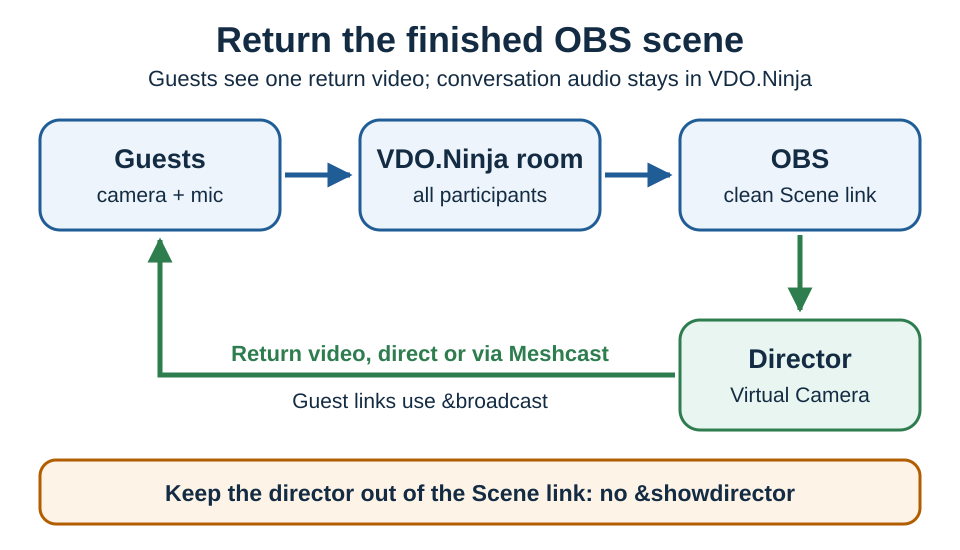
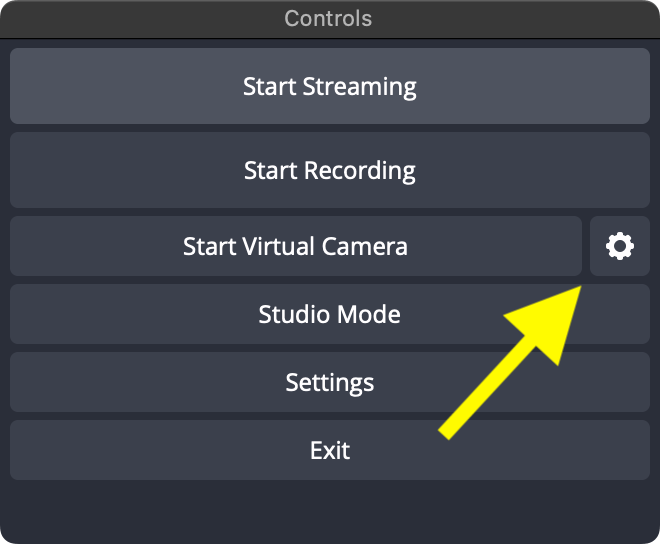

# Let guests see your finished OBS scene

Use this when you bring guests into OBS with VDO.Ninja and want them to watch the finished scene in their room.


**The short version:** Put the clean VDO.Ninja Scene link in OBS, send the OBS picture back as the director's camera, and give guests a link containing `&broadcast`.




## What you need

* A VDO.Ninja room and its Director's Room
* OBS with the guests added as a Browser Source
* OBS Virtual Camera
* Headphones for everyone who speaks

## 1. Use the clean Scene link in OBS

The OBS Browser Source should use the room's **Scene** link, not a guest link or the Director's Room:

```text
https://vdo.ninja/?scene&room=YOUR_ROOM
```

Scene links leave the director out by default. Keep it that way: do not add `&showdirector`, leave **The director will be performing as well, appearing in group scenes** unchecked when you create the room, and do not add the director's return to the layout OBS captures. Otherwise OBS captures its own picture over and over.

## 2. Choose what the guests should see

In OBS, click the **gear beside Start Virtual Camera**.

<figure><figcaption><p>Use this gear to choose the return picture. Image: <a href="https://obsproject.com/kb/virtual-camera-guide">OBS Project</a>.</p></figcaption></figure>

Choose **Program** for the live output, or **Scene** and a dedicated **Guest Return** scene without private producer notes. Click **OK**, then **Start Virtual Camera** before you select it in VDO.Ninja.

## 3. Use the director as the return video

1. Open the Director's Room: `https://vdo.ninja/?director=YOUR_ROOM`
2. Click **enable director's microphone or video**.
3. Select **OBS Virtual Camera** as the camera.
4. Select your normal microphone, or no microphone for a video-only return.

Give guests a room link containing `&broadcast`:

```text
https://vdo.ninja/?room=YOUR_ROOM&broadcast
```

Guests then see the main director's video instead of every guest's video. They still hear one another.


Do not send the full OBS audio mix back to guests; they would hear themselves with a delay. Let VDO.Ninja carry the microphones and use Virtual Camera for the picture.


## 4. Optional: send the return through Meshcast v2

In a small room, the direct return has the least delay. But the director uploads one copy of the return per guest, so upload and CPU load grow as guests join. Meshcast takes one copy and sends it to everyone. Add `&meshcast` to the director link:

```text
https://vdo.ninja/?director=YOUR_ROOM&meshcast
```

The guest and OBS links stay the same, and VDO.Ninja connects to Meshcast for you. `&meshcast` uses the current Meshcast service (v2); older links with `&meshcast2` still work. Meshcast adds a little delay.

## Link sets

| Link | Small room, direct | Larger room, through Meshcast |
| --- | --- | --- |
| Director | `?director=YOUR_ROOM` | `?director=YOUR_ROOM&meshcast` |
| Guest | `?room=YOUR_ROOM&broadcast` | `?room=YOUR_ROOM&broadcast` |
| OBS | `?scene&room=YOUR_ROOM` | `?scene&room=YOUR_ROOM` |

Each link starts with `https://vdo.ninja/`. If the room has a password or other options, use them on all three links.

## Prevent echo and feedback

* Every speaker wears headphones.
* VDO.Ninja carries the conversation microphones; Virtual Camera carries the picture.
* Only one path carries music, clips or other program sound.

If guests must hear sound from OBS, send them a return that leaves out their microphones (a mix-minus). See [Return OBS clips and music to the main room](room-audio-obs-meshcast-and-private-talk.md#4-return-obs-clips-and-music-to-the-main-room). Make a test recording and ask each guest to confirm they do not hear a delayed copy of themselves.

## Other ways to share the return

[Send an OBS return feed to guests](send-an-obs-return-feed-to-guests.md) covers:

* a separate return publisher that guests select with `&broadcast=RETURN_ID`, which keeps the director's own camera separate;
* your own WHIP/WHEP server, or a stream that is already on one;
* a YouTube, Twitch or Meshcast player shared with **Share Website** (mute it, because its audio bypasses echo cancellation);
* screen-sharing an OBS projector window.

## Quick fixes

| Problem | What to check |
| --- | --- |
| The picture repeats inside itself | Remove the director's return from the layout OBS captures. Make sure the Browser Source uses a `?scene&room=` link without `&showdirector`. |
| Guests still see individual cameras | Their invite must contain `&broadcast`, or `&broadcast=RETURN_ID` for a separate return publisher. |
| Guests see no OBS return | Start OBS Virtual Camera, enable the director's video, and select OBS Virtual Camera in VDO.Ninja. |
| Guests hear themselves delayed | Stop sending the full OBS audio mix. Use headphones and keep one audio return path. |
| A shared webpage causes echo | Mute the webpage player or use headphones. Prefer the director or Meshcast return. |
| The return has too much delay | In a small room, remove `&meshcast` and test the direct return. |

## Related guides

* [Publish from OBS into VDO.Ninja](publish-from-obs-into-vdo.ninja.md)
* [`&broadcast`](../advanced-settings/view-parameters/broadcast.md)
* [`&meshcast`](../newly-added-parameters/and-meshcast.md)
* [How to capture an application's audio](audio.md)
