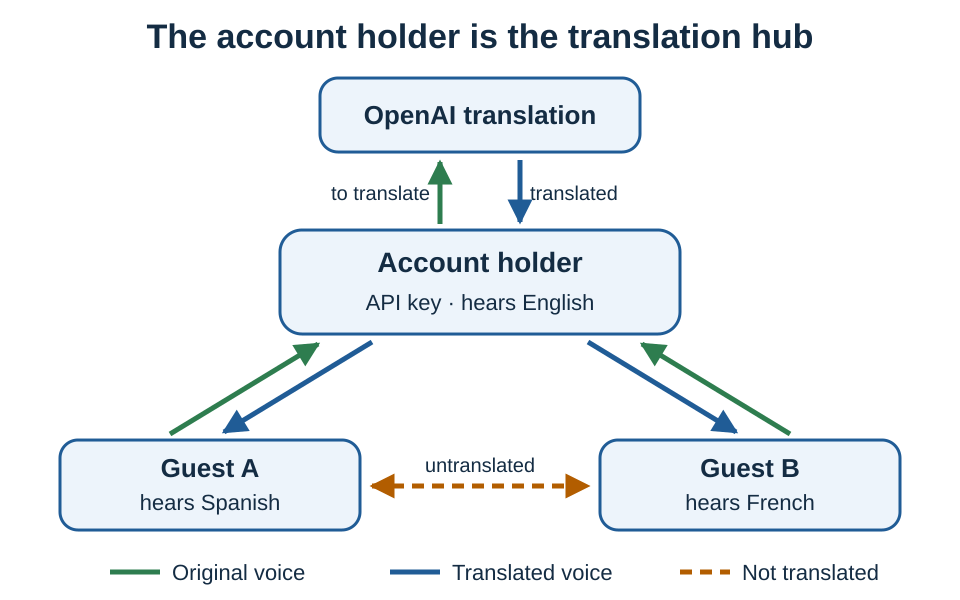
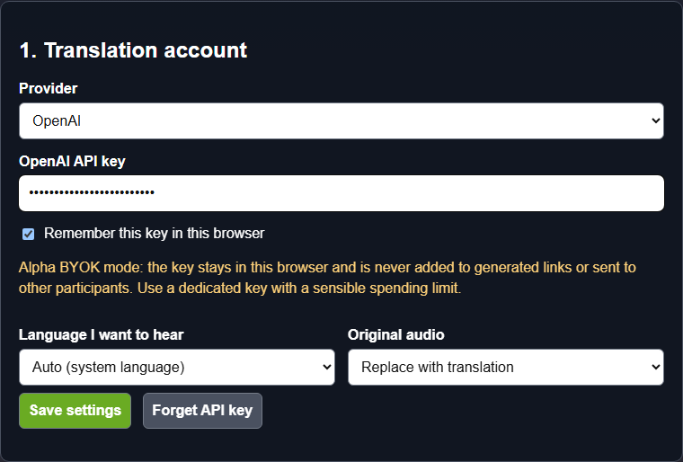
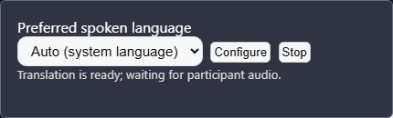

# Live audio translation

VDO.Ninja can translate live speech into another spoken language. One person, the **account holder**, supplies an OpenAI API key. Everyone else joins with a normal VDO.Ninja link and picks the language they want to hear.

This is an alpha feature. It uses OpenAI's `gpt-realtime-translate` model.


Tell everyone in the call before you turn on translation. The account holder's browser sends the audio it translates to OpenAI. Check OpenAI's privacy, retention and billing terms before using it for private, medical, legal, financial or confidential conversations.


## How it works

* The account holder's voice is translated into each participant's chosen language. Participants who want the same language share one translation.
* Each participant's voice is translated for the account holder.
* Guests are not translated for each other. In a group room, they hear each other's original audio.
* If both people want the same language, nothing is translated.

## What you need

* An [OpenAI API account](https://platform.openai.com/) with billing turned on and access to `gpt-realtime-translate`. A ChatGPT subscription is not the same as API billing.
* An API key from the [API keys page](https://platform.openai.com/api-keys).
* A current browser. Chrome or Edge is the safest choice for this alpha.

Only the account holder needs these. Participants need nothing extra.

## Set it up

### 1. Enter the account details

1. Open [vdo.ninja/translate.html](https://vdo.ninja/translate.html). If you are already in the call as the account holder, open **Settings** → **User** and click **Configure**; the setup page opens in a new tab.
2. Under **1. Translation account**, choose **OpenAI**, paste the **OpenAI API key** and pick **Language I want to hear**.
3. Choose **Original audio**:
   * **Replace with translation**: you hear only the translation (default).
   * **Keep quietly underneath**: the original voice plays quietly under the translation.
   * **Play both**: the original and the translation play at full volume.
4. Leave **Remember credentials across reloads (not recommended)** unchecked, then click **Save settings**.

<figure><figcaption>
Earlier alpha interface. Some labels and defaults have changed.
</figcaption></figure>

### 2. Make the account-holder link

1. Under **2. Make the account-holder link**, paste the link you normally use (director, room or push link) into **Normal account-holder link**.
2. Click **Save and open**. The translation-enabled link opens in the same tab and picks up your key.

The **Translation-enabled account-holder link** never contains the API key. Another browser needs its own setup. So does another tab, unless you chose **Remember credentials across reloads**. If you came from **Configure**, close the old tab so the same link is not open twice.

### 3. Make the participant link

1. Under **3. Make the participant link**, choose **Participant language**. Leave it on **Auto (system language)** to use each participant's browser language.
2. Paste the normal guest invite into **Normal participant link**.
3. Copy the **Translation-ready participant link** and send it. You can reuse it.

### 4. Test

Use headphones. Have each person say a short sentence, then pause; translation lags behind the speaker. Before a real event, test names, numbers, technical terms, accents and every language pair you plan to use.

## How credentials are stored

| Choice | What happens |
| --- | --- |
| Default | **Save settings** keeps the key in this tab's session storage. The account-holder page takes it once and then holds it only in memory. Reloading that page means entering the key again. |
| **Remember credentials across reloads** | The key is saved in the browser's local storage for this site. Use only on a computer you trust. |
| **Forget credentials** | Removes saved keys and broker tokens from this browser. It does not stop translation already running in another tab, and does not revoke the key at OpenAI. |

The browser sends the key only to OpenAI, to create short-lived translation credentials. It never goes to VDO.Ninja's servers, other participants or generated links. Saved credentials belong to one site (scheme, hostname and port), so a key saved on vdo.ninja is not available on localhost or a self-hosted copy.


In API-key mode, the key is exposed to the account-holder page while translation runs. Use a dedicated API project and key with spending limits, never an administrator key, and click **Forget credentials** on computers you do not control.


### Optional: self-hosted token broker

To keep the OpenAI key off the browser, expand **Optional self-hosted token broker** and enter:

* **Broker session URL**: your broker's HTTPS session endpoint. Plain HTTP is allowed only for `localhost`, `127.0.0.1` or `::1`. Do not put credentials or a `#` fragment in this URL.
* **Broker access token**: a separate secret that protects the broker. It is not your OpenAI key.

A broker URL replaces API-key mode; clear it to switch back. The token is stored like the API key. See the [self-hosted broker example](https://github.com/steveseguin/vdo.ninja/tree/develop/examples/realtime-translation-broker). VDO.Ninja does not run a shared broker.

## Choose a language in the call

Anyone can change their language without the setup page: open **Settings** → **User** and change **Preferred spoken language**. The default, **Auto**, uses the browser's language. Participants see only the language menu and **Stop**; **Configure** appears only for the account holder.

<figure><figcaption>
The in-call translation controls under Settings → User.
</figcaption></figure>

Supported languages: English, Spanish, Portuguese, French, Japanese, Russian, Chinese, German, Korean, Hindi, Indonesian, Vietnamese and Italian.

## URL parameters

The setup page writes these for you. You cannot put an API key in a URL.

| Parameter | Purpose |
| --- | --- |
| `&translate` | Makes this browser the account holder. `&translate=es` also sets the language; `&translate=0` turns the account-holder role off. |
| `&translatelang=` | Language this person wants to hear, such as `es`, or `auto`. Alias: `&translationlanguage`. |
| `&translationprovider=` | Translation provider. Only `openai` is available. |
| `&translateaudio=` | Original audio: `replace` (default), `duck` or `mix`. |
| `&translationbroker=` | Optional broker session URL. Its access token is entered on the setup page. |

Account holder:

`https://vdo.ninja/?director=ROOMNAME&translate=1&translatelang=en&translationprovider=openai&translateaudio=replace`

Participant:

`https://vdo.ninja/?room=ROOMNAME&translatelang=es`

## Cost

OpenAI bills the account that owns the key; check the current [model pricing](https://developers.openai.com/api/docs/models/gpt-realtime-translate) before a long event. The account holder's voice needs one translation session per requested language, and each translated participant needs their own session. Five participants translated into the account holder's language means five sessions.

## Audio, recording and lip sync

* Translated audio uses the normal VDO.Ninja audio path, so per-guest volume, speaker mute, loudness meters and active-speaker detection still work.
* Muting your microphone also mutes your translated outgoing audio.
* A local recording of a guest captures the audio playing at the time. Start recording after translation is active. VDO.Ninja will not swap audio or change language while a local recording runs.
* Translation always arrives after the original speech. In **Replace** mode the voice trails the video. **Duck** and **Mix** can sound like an echo. Video is not delayed to match.

## Stop or recover

Click **Stop** in **Settings** → **User** to end translation and restore original audio.

If a translation session drops, VDO.Ninja plays the original audio and retries up to five times, waiting longer each time (2 to 30 seconds, with some randomness). A connection that stays up for 60 seconds resets the count. A rejected key or request is not retried; fix it under **Configure**.

## Troubleshooting

| Problem | Fix |
| --- | --- |
| "Translation needs an API key" | Open **Configure**, enter the key and use **Save and open** in that tab. A reload or a copied link does not carry the key. |
| "Credentials cannot be passed to another site" | Open `translate.html` on the same site as the account-holder link. `localhost` and `127.0.0.1` are different sites, as are HTTP and HTTPS. |
| Broker does not connect | Check the URL, its access token and the broker's allowed origins. Use HTTPS unless testing on localhost. |
| Generated link is empty or will not copy | The pasted link must be a valid HTTP or HTTPS link without a username or password, and the broker URL must be valid. If clipboard access is blocked, select the link and copy it manually. |
| Guest hears the original voice | The account holder's link needs `&translate=1`, the guest's link needs `&translatelang=`, the two languages must differ, and the API account needs billing and model access. |

For how OpenAI's model and browser connection work, see OpenAI's [Realtime translation guide](https://developers.openai.com/api/docs/guides/realtime-translation).
