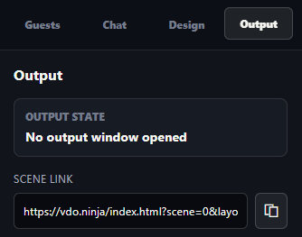
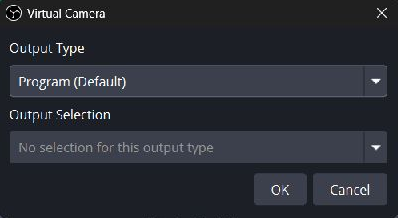
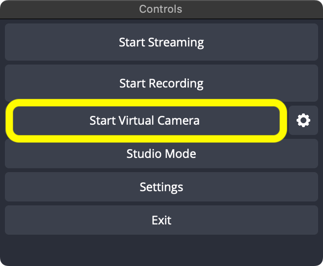
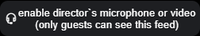
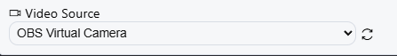
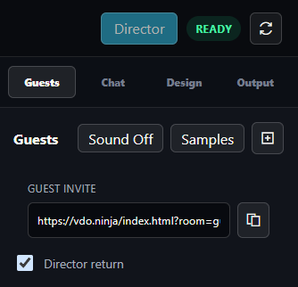

# Return OBS video to guests in Live Studio

Use [Live Studio](https://vdo.ninja/studio/) to manage guests while they watch the finished picture from OBS. The **Director** button at the top right opens the director controls inside Studio.

The video path is: **Guest cameras -> OBS -> OBS Virtual Camera -> Live Studio's director camera -> guests.**

## 1. Bring the guests into OBS

If OBS already receives your guests, keep that setup. Otherwise, enter your room in Live Studio, open **Output**, and copy the **Scene link** into an OBS **Browser Source**.

<figure><figcaption>
Use the Scene link for OBS. Keep the Live Studio page open in your browser.
</figcaption></figure>

Keep the director's return camera out of the OBS scene. Do not add `&showdirector` to this setup or capture the Studio window inside OBS: that can create a repeating picture.

## 2. Start OBS Virtual Camera

In OBS's **Controls** dock, open the **gear beside Start Virtual Camera**. Set **Output Type** to **Program (Default)** and click **OK**. This sends the picture OBS is publishing. If OBS is in Studio Mode, use **Transition** to send changes from Preview to Program.

<figure><figcaption>
Choose Program for the live picture. Preview would show your edits before they go live.
</figcaption></figure>

Click **Start Virtual Camera**. You do not need to start streaming or recording just to send this return.

<figure><figcaption>
Start the camera before selecting it in Live Studio. Screenshot: <a href="https://obsproject.com/kb/virtual-camera-guide">OBS Project</a>.
</figcaption></figure>

## 3. Select OBS Virtual Camera in Live Studio

1. Click **Director** at the top right of Live Studio.
2. Click the headset button to enable the director's microphone or video.
3. Click the **Settings** gear in the director's bottom toolbar.
4. Under **Video Source**, select **OBS Virtual Camera**.

<figure><figcaption>
Enable the director's feed to access its camera settings.
</figcaption></figure>

<figure><figcaption>
The director's camera sends the OBS picture back to guests.
</figcaption></figure>

For a video-only return, mute the director's microphone with the microphone button. **OBS Virtual Camera carries video only.** Guests can keep talking through their normal VDO.Ninja microphones. Use headphones; do not send their voices back to them through OBS audio.

Click **Director** again to return to the layout editor. The camera stays active.

## 4. Send the return invite

In the **Guests** tab, tick **Director return**, then copy **Guest invite** and send that updated link to your guests. Guests who already joined must reopen the updated invite.

<figure><figcaption>
Tick Director return before copying the guest link.
</figcaption></figure>

This adds [`&broadcast`](../advanced-settings/view-parameters/broadcast.md) to guest links. Guests see the director's OBS video instead of the other guests' individual videos, while still hearing each other. Their own camera preview can remain visible.

Keep OBS Virtual Camera and Live Studio running. Change the OBS Program picture and ask a guest to confirm that their return picture changes too.

## Quick checks

| What you see | What to do |
| --- | --- |
| OBS Virtual Camera is missing | Start it in OBS, then use the refresh icon beside Video Source. |
| An OBS logo or no camera picture | Check that OBS Virtual Camera is running and Program contains the picture you want. |
| Guests still see separate cameras | Copy the invite after enabling Director return; have guests reopen that link. |
| The picture repeats inside itself | Keep the director return out of the OBS scene and use the clean Scene link for its Browser Source. |
| Guests hear a delayed copy of themselves | Mute the duplicated audio path. Keep the return video-only, or build an audio return that excludes guest voices. |

For program audio or other return arrangements, see [Let guests see your finished OBS scene](let-guests-see-your-obs-scene.md#prevent-echo-and-feedback).
