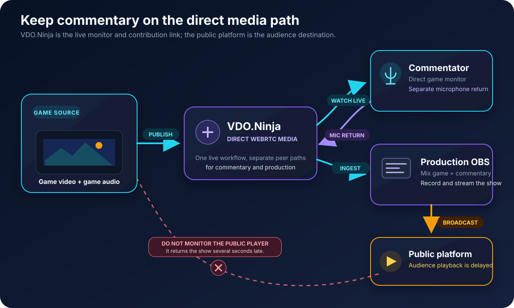
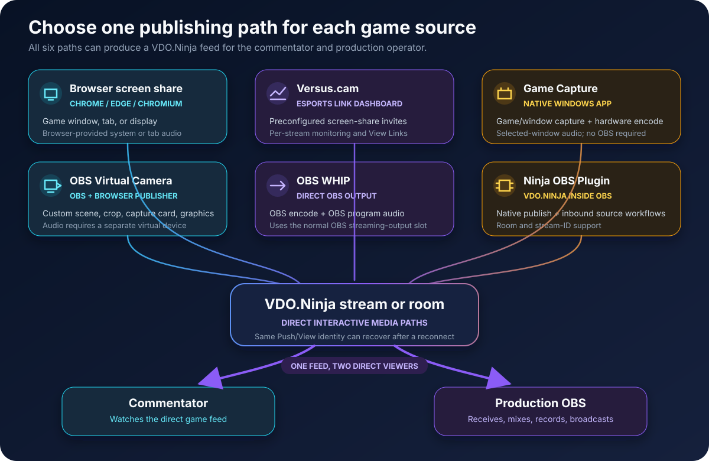

# Low-latency game streaming for esports commentary

Commentators should watch gameplay through a direct VDO.Ninja feed, not the public Twitch or YouTube player, which runs many seconds behind. OBS then combines the game and commentary for the audience.


No Internet video path has zero latency. Capture, encoding, network, decoding and the display all add some delay. The goal is a direct feed the commentator can react to.


<figure><figcaption><p>The commentator follows the direct feed. Only the audience watches the public platform output.</p></figcaption></figure>

## The signal flow

1. A game, observer or console-capture computer publishes gameplay and game audio.
2. The commentator watches that direct feed and publishes their microphone as a separate source, so OBS controls each one's level, mute and sync.
3. The production computer receives both in OBS and streams the show to the public platform.

## Quick start: a room

1. On [VDO.Ninja](https://vdo.ninja/), create a private room and open its director Control Center.
2. Send a guest invite to the game sender. They select **Share your Screen**, choose the game window or display, and turn on audio sharing if the browser offers it.
3. Send a guest invite to the commentator. They pick their microphone, wear headphones, and watch the gameplay in the room.
4. In the director view, add the game share and commentator to a scene, or copy their solo links.
5. Add the scene or solo links to OBS as Browser Sources. Enable **Control audio via OBS** on sources whose audio OBS must mix.

Chromium-based desktop browsers offer the widest screen and system-audio choices. The sender must always confirm what is shared; a link cannot capture a screen silently.

## Quick start: Versus.cam

[Versus.cam](https://versus.cam/) is a VDO.Ninja interface for esports contribution. It makes one-way screen-share invites with game-oriented settings and gives the operator a View Link for each stream.

1. Enter a private room name and password at [Versus.cam](https://versus.cam/).
2. Select **Copy Invite Link** and send it to each game sender.
3. Each sender opens it in Chrome or Edge, selects the game window or display, and shares its audio.
4. Copy each stream's **View Link** into OBS, and give the commentator the View Link they need.
5. Carry the commentator microphone and producer talkback in a normal VDO.Ninja room or [Comms](../steves-helper-apps/comms.md).

## Choose a publishing method

Each row is a complete way to get one game source into VDO.Ninja. Pick one per source.

| Method | What the sender does | Game audio | Main constraints |
| --- | --- | --- | --- |
| Browser screen share | Opens a VDO.Ninja link and shares a window, tab or display | Browser's tab or system-audio option | No install; capture and audio vary by browser, OS and game |
| [Versus.cam](https://versus.cam/) | Opens an esports invite in Chrome or Edge | Browser's screen-share audio | Adds an operator dashboard; commentary stays separate |
| [Game Capture](using-game-capture-with-vdo.ninja.md) | Selects a game, window, camera or Spout2 source and goes live | The selected window's audio, no virtual cable | Windows; the Mac version is an experimental beta. [Download](https://github.com/steveseguin/game-capture/releases/latest) |
| OBS Virtual Camera | Starts Virtual Camera in OBS and selects it in a VDO.Ninja link | Video only; route audio through a virtual audio device | Leaves OBS's streaming output free |
| OBS WHIP output | Publishes from OBS's WHIP service | OBS program audio | Uses OBS's streaming output; test NAT and multiple viewers |
| [Ninja OBS Plugin](using-ninja-obs-plugin-with-vdo.ninja.md) | Publishes OBS output with VDO.Ninja room and stream support | OBS mix | Install the release that matches your OBS version; uses OBS's streaming output |
| HDMI capture card | Selects the card in VDO.Ninja, Game Capture or OBS | Depends on card and path | Play from the card's passthrough, not the delayed preview |

<figure><figcaption><p>Choose one publishing path for each game source. The resulting VDO.Ninja feed can serve both commentary and production.</p></figcaption></figure>

**Browser screen share tips.** Sharing **Entire Screen** can give a steadier frame rate on some systems; sharing a window exposes less of the desktop. Anti-cheat, exclusive fullscreen and GPU selection can cause black or low-frame-rate capture, so test the exact game. If there is no audio checkbox, use [application-audio routing](audio.md), Game Capture or OBS. See [How to screen share in 1080p](how-to-screen-share-in-1080p.md).

**OBS Virtual Camera** suits cropping the game or adding graphics. Keep the contribution scene from capturing its own VDO.Ninja return. See [Publish from OBS into VDO.Ninja](publish-from-obs-into-vdo.ninja.md).

**OBS WHIP:**

1. In OBS, open **Settings -> Stream** and select **WHIP**.
2. Set the server to `https://whip.vdo.ninja`.
3. Enter a private, unique stream token as the Stream Key.
4. Open `https://vdo.ninja/?whip=YOUR_STREAM_TOKEN` on the receiving side.
5. Start streaming in OBS.

A computer that also streams the finished show needs a tested second output or a separate contribution OBS. See [From OBS to VDO.Ninja using WHIP](from-obs-to-vdo.ninja-using-whip.md) and [OBS WHIP output settings](obs-whip-output-settings.md). The [Ninja OBS Plugin](using-ninja-obs-plugin-with-vdo.ninja.md) differs from WHIP: it publishes with VDO.Ninja room and multi-viewer support.

## Reusable standalone links

For a small setup without a room, use one game stream ID and one commentator stream ID. Replace every example value.

Game sender (browser screen share):

```text
https://vdo.ninja/?push=GAME01&screenshare&quality=0&stereo#p=STRONGPASSWORD
```

Game view for the commentator and the production Browser Source:

```text
https://vdo.ninja/?view=GAME01&videobitrate=10000&scale=100&stereo#p=STRONGPASSWORD
```

Commentator microphone:

```text
https://vdo.ninja/?push=CASTER01&miconly#p=STRONGPASSWORD
```

Commentator audio for OBS:

```text
https://vdo.ninja/?view=CASTER01&solo#p=STRONGPASSWORD
```

[`&stereo`](../general-settings/stereo.md) on both game links sends game audio in stereo at a higher bitrate, without echo cancellation or noise reduction. Use unique, hard-to-guess IDs and a strong password, and never run two publishers with the same Push ID.

## Prevent echo and doubled audio

* The game source carries game audio only, not Discord, Comms or the commentator's returned voice.
* The commentator wears headphones and publishes their microphone once.
* OBS captures each game and voice source once. Mute duplicate room, desktop or public-player audio.
* Producer talkback stays out of the show mix unless it is meant to be on air.
* The commentator keeps the public Twitch or YouTube player muted or closed.
* For two-way talk between sender and commentator, use a normal room; for a larger crew with private channels, use [Comms](../steves-helper-apps/comms.md).

## Keep delay low

* Use wired Ethernet where practical, and leave upload headroom above the video bitrate.
* Leave GPU headroom for capture and encoding; capping the game's frame rate helps an overloaded system.
* Do not add `&buffer` to the commentator's view unless smoother playback matters more than delay. Buffered or chunked modes trade delay for resilience.
* A publisher sends a separate stream to each viewer. Count the commentator, production OBS, monitors and backups when checking upload.
* For 1080p60 gameplay, plan for the [12-20 Mbps upload described in the 1080p guide](how-to-screen-share-in-1080p.md#bandwidth-requirements), then check the route with [VDO.Ninja's speed test](https://vdo.ninja/speedtest).

The commentator and production can request different bitrates. Production can take full quality while a commentator on a weaker connection uses a lighter view.

## Show-day checklist

1. Test the exact game and capture mode; menus do not reveal every fullscreen or anti-cheat problem.
2. Confirm the sender shares the right source and game audio reaches OBS.
3. Confirm the commentator watches only the direct feed and hears no delayed copy.
4. Confirm the commentator microphone reaches OBS as its own source.
5. Record a local OBS sample and check sync, frame rate, clarity and levels.
6. Disconnect and reconnect each sender; permanent IDs should return to the same OBS inputs.
7. Test with every planned viewer open at once, so upload fan-out is realistic.
8. Keep a second capture method ready in case the first cannot capture the game.

## Related guides

* [How to screen share in 1080p](how-to-screen-share-in-1080p.md)
* [Using Game Capture and Spout2 with VDO.Ninja](using-game-capture-with-vdo.ninja.md)
* [Using the Ninja OBS Plugin with VDO.Ninja](using-ninja-obs-plugin-with-vdo.ninja.md)
* [Publish from OBS into VDO.Ninja](publish-from-obs-into-vdo.ninja.md)
* [From OBS to VDO.Ninja using WHIP](from-obs-to-vdo.ninja-using-whip.md)
* [PlayStation or Xbox to VDO.Ninja](playstation-or-xbox-to-vdo.ninja.md)
* [How to capture application audio](audio.md)
* [Send an OBS return feed to guests](send-an-obs-return-feed-to-guests.md)
