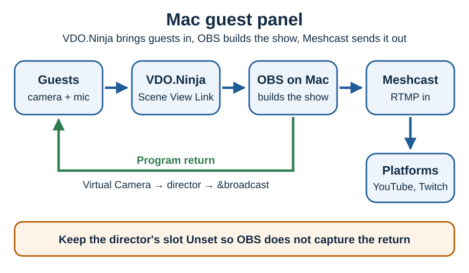

# Host a guest panel on a Mac with OBS and Meshcast

Bring remote guests into OBS on a Mac, arrange them as a panel, let them see the finished program, and stream the show. VDO.Ninja brings in the guests, OBS builds the show, and Meshcast or your usual streaming service sends it to the audience.



## Before you start

You need:

* A Mac with current OBS Studio. For the most compatible Virtual Camera, use **OBS 30 or newer on macOS 13 or newer**.
* A [VDO.Ninja room](../getting-started/rooms/README.md) for the guests.
* A Meshcast account if you want RTMP ingest or multi-destination restreaming.
* Headphones for everyone who speaks.

| Mac | Starting point |
| --- | --- |
| Apple silicon (M1 or newer) | Apple VT H.264 hardware encoder, 1080p30 or 720p30 |
| Intel Mac | x264 at 720p30, 2,500–3,500 Kbps, preset `veryfast` |

On an Intel Mac with encoding lag, try `superfast` or `ultrafast`: less CPU, lower quality. For WHIP, OBS may switch only the **audio** encoder to FFmpeg Opus. See [OBS WHIP output settings](obs-whip-output-settings.md) and [hardware-accelerated video encoding](hardware-accelerated-video-encoding.md).

## 1. Create the room and guest links

Create a room and open the Director's Room. Give each guest a separate invite with a unique preferred slot and `&broadcast`, and ask them to wear headphones:

```text
Guest 1: https://vdo.ninja/?room=YOUR_ROOM&slot=1&broadcast
Guest 2: https://vdo.ninja/?room=YOUR_ROOM&slot=2&broadcast
Guest 3: https://vdo.ninja/?room=YOUR_ROOM&slot=3&broadcast
```

* [`&slot`](../advanced-settings/settings-parameters/and-slot.md) gives a regular guest the same seat every show. Keep **Assign a slot to new guests automatically** on in the [Mixer](../steves-helper-apps/mixer-app.md), or add `&slotmode` to the director link. One slot holds one guest, so never reuse a slot link.
* [`&broadcast`](../advanced-settings/view-parameters/broadcast.md) shows guests only the director's video, which becomes the OBS program in step 4. Mixer invite links include it unless you tick **Guest can see other guests and the active layout**.

## 2. Build the panel layout

Open the Mixer from the Director's Room and build your layout. Use the numbered slots as permanent seats for regular guests.

For a mix of landscape cameras and vertical phones:

* Make the portrait slot taller or slightly wider.
* Turn on **Media fully cover area** when filling the frame matters more than showing every edge.
* Use the slot's **Crop** settings to remove empty space.
* Test with a real phone before the show.

## 3. Add the panel to OBS

In the Mixer, copy the **Scene View Link**, not the Mixer page's own address. Then in OBS:

1. Add a **Browser Source** and paste the link.
2. Match its width and height to the OBS canvas, normally 1920 × 1080 or 1280 × 720.
3. Enable **Control audio via OBS** if shown.
4. Check that the source moves an OBS audio meter, then make and play back a short recording.

One Scene source is simpler than a source per guest, and loading a guest twice creates extra connections. For reusable links, see [How to get permanent links](how-to-get-permanent-links.md).

## 4. Return the finished program to guests

1. In the OBS Virtual Camera settings, choose **Program**, then click **Start Virtual Camera**.
2. Enable the director's camera and select **OBS Virtual Camera**.
3. Keep the director's slot **Unset** in the Mixer, so the return never appears in the Scene that OBS captures. You can also turn off the Mixer setting that lets the director appear in scenes.

<figure><figcaption><p>Choose Program to return the finished output. Image: <a href="https://obsproject.com/kb/virtual-camera-guide">OBS Project</a>.</p></figcaption></figure>

Guests whose links contain `&broadcast` now see the Program instead of every guest's camera.

<figure><figcaption><p>This room-creation option adds &#x26;broadcast to guest invites.</p></figcaption></figure>

Virtual Camera carries video only. Let VDO.Ninja carry the conversation and never send the full Program mix back into the room. If guests must hear clips or music, send a media-only return that leaves out **all** microphones: see [Return OBS clips and music to the main room](room-audio-obs-meshcast-and-private-talk.md#4-return-obs-clips-and-music-to-the-main-room). For other return options, see [Send an OBS return feed to guests](send-an-obs-return-feed-to-guests.md).

## 5. Send OBS to Meshcast

RTMP is the simplest Mac workflow.

1. In the Meshcast dashboard, copy the complete RTMP URL. It looks like `rtmp://host:1935/live/pk_example`.
2. In OBS, open **Settings → Stream** and choose **Custom**.
3. In **Server**, enter the URL up to `/live`, such as `rtmp://host:1935/live`.
4. In **Stream Key**, enter the private `pk_...` Publishing Key.
5. Use H.264 video, AAC audio, CBR rate control and a two-second keyframe interval.
6. Start streaming.


Never share a private `pk_...` Publishing Key. Public watch links use the public `st_...` Stream ID.


For several platforms, set up the destinations in Meshcast **before** you start OBS. For Restream.io or another provider, add a custom destination with its RTMP or RTMPS URL and key. Available destinations depend on your Meshcast account tier. You can also stream from OBS to your usual provider instead; the guest panel does not need Meshcast.

## Rehearsal checklist

* [ ] Every speaker wears headphones, and nobody hears a delayed copy of their own voice.
* [ ] Each guest lands in the expected slot, and portrait guests are not awkwardly cropped.
* [ ] Guests see the OBS Program return, and it is not a tile in the OBS Scene.
* [ ] **View → Stats** in OBS shows no encoding lag or dropped network frames.
* [ ] A private or unlisted destination receives both picture and sound.

## Quick fixes

| Problem | Fix |
| --- | --- |
| The picture repeats inside itself | Set the director's Mixer slot to **Unset** so the return leaves the captured Scene. |
| The Mac runs hot or OBS reports encoding lag | Close unused browser sources, use 720p30, lower the bitrate, and use Apple VT H.264 or a faster x264 preset. |
| OBS rejects the Meshcast WHIP URL | Set the OBS **Service** to WHIP, not Custom RTMP, and use the private Publishing Key as the Bearer Token. |
