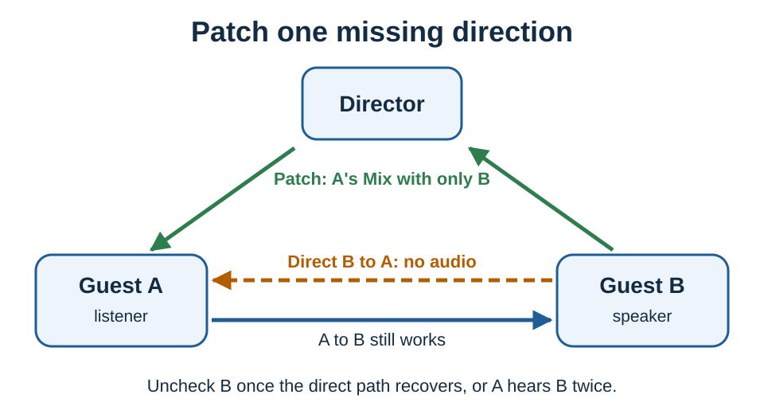
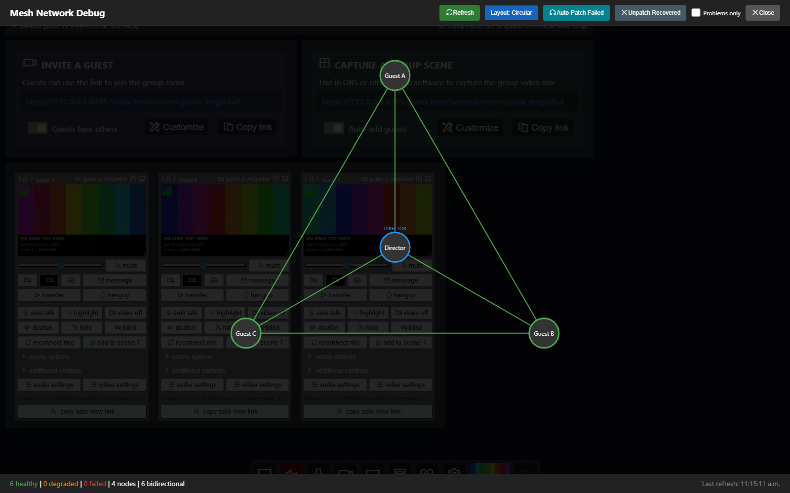
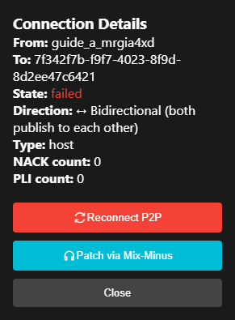
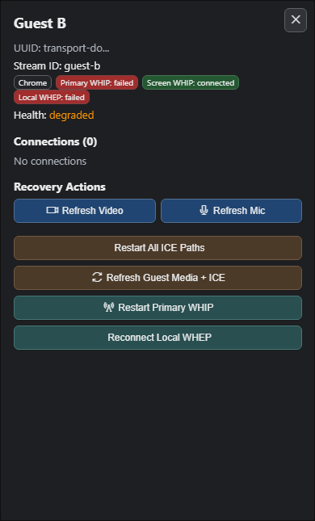

# Recover Missing Guest-to-Guest Audio

In a VDO.Ninja room, each pair of participants has its own peer-to-peer path in each direction, and one direction can fail while the others keep working. This guide shows directors how to find that case, restart the path, and patch the audio through a custom mix.

## Quick diagnosis: A cannot hear B, but C can

If C hears B and A hears C, then B's mic and A's speakers both work. The fault is in the **B to A path**, or in how A plays B's audio, so refreshing B's mic is unlikely to help.

If moving A from shared Wi-Fi to a hotspot fixes it, suspect the local network: client isolation, a guest Wi-Fi or VLAN rule, a local firewall or an unusable LAN route. A VPN is not a clear test, because WebRTC may still pick the LAN route.



## Live-show recovery order

1. Ask B to speak, open **Mesh Network Debug**, and click **Refresh**.
2. Select the **B -> A** arrow. If audio was sent but not received, click **Restart This ICE Path**. Wait 5 to 10 seconds, then refresh while B speaks.
3. If it is still broken, select B's node and click **Restart All ICE Paths**. This can briefly disturb B's other connections.
4. If the show must continue, send B to A through A's **Mix** control (below).
5. After the show, reload B, then A. If the problem returns, add `&relay` to both guest links.

Use **Refresh Mic** only if nobody hears B or B's mic meter has stopped. Do not use **Hangup** to reconnect; it removes the guest.

## Open Mesh Network Debug

In the director control center, click the connected-nodes icon beside the room name. The full-screen view asks each guest for a connection map. Click **Refresh** after guests finish joining and after any recovery action.

<figure><figcaption><p>The Mesh Network Debug icon.</p></figcaption></figure>

<figure><figcaption><p>B to A is orange: B sent audio but A received none. A to B stays green.</p></figcaption></figure>

### Read the diagram

| Display | Meaning |
| --- | --- |
| Blue-outlined circle | Director |
| Green-outlined circle | Guest with no detected problem |
| Orange-outlined circle | Guest with a degraded connection, or an expected incoming stream that stalled |
| Red-outlined circle | Guest with a failed connection |
| Gray-outlined circle | Guest whose report is pending or unavailable, or who reported no connections |
| Purple square | Scene or view-only connection |
| Solid green arrow | Connected, and expected media reached the listener (or no media was expected) |
| Dashed orange arrow | Not fully connected, or the publisher sent expected media and the listener received none |
| Dashed red arrow | Failed |
| Dashed gray arrow | Media flow could not be verified during the sample |
| Cyan double-dashed arrows | Pair patched through the director's mix-minus |
| Arrow direction | Publisher -> listener; A -> B and B -> A are separate paths |

Select a guest node to see its browser, its connections (relayed ones are tagged **TURN**) and guest-wide controls. Select an arrow to see sent and received packet counts, candidate path, track state and **Restart This ICE Path**, which calls `restartIce()` on only that one publisher-to-listener connection without closing it.


The tool samples RTP for about one second, so ask the publisher to speak while you click **Refresh**. A quiet sender shows as unverified, not stalled. A green arrow means packets reached the listener's browser, not that the listener can hear them.


<figure><figcaption><p>ICE is connected, but the listener's audio has stalled.</p></figcaption></figure>

After a recovery, select the arrow again. **ICE state: connected** means it recovered. **Candidate path: relay** means it is really using TURN; a host or server-reflexive path means it recovered directly, which is also fine.

### Node recovery controls

| Action | What it does | Use when |
| --- | --- | --- |
| **Refresh Mic** | Re-captures the guest's microphone | Nobody hears the guest, or their mic stopped |
| **Refresh Video** | Re-captures the guest's camera | Camera is frozen or missing |
| **Restart All ICE Paths** | Restarts ICE on all the guest's connections | A single-path restart failed |
| **Refresh Guest Media + ICE** | Refreshes mic, camera and every path | Narrower actions failed |
| **Restart Primary WHIP** | Asks the guest to rebuild its primary WHIP publisher | Shown only when the guest's primary WHIP is enabled and restartable |
| **Reconnect Local WHEP** | Rebuilds this director browser's WHEP playback | The guest's **Local WHEP** status is failed or disconnected |

<figure><figcaption><p>Primary WHIP, Screen WHIP and Local WHEP are reported separately.</p></figcaption></figure>

The guest owns WHIP publishing; the director's browser owns WHEP playback. **Restart Primary WHIP** does not restart the separate **Screen WHIP** publisher. An explicit `&whepplay=` source has no guest to command, so only its local WHEP playback can be reconnected.

## Emergency audio patch: send B to A with Mix

A's **Mix** control relays only the missing source, which makes it the most targeted fallback. It works only if the director already sends audio to A, even though the control may appear without it. Test it before relying on it live.

1. On **A's** guest card (A is the listener), expand **Additional Controls**.
2. Under **PGM / Mic**, click **Mix**.
3. Under **Guests**, select **B**. Turn off **Director Mix** and leave other guests off.
4. Ask A to confirm B is audible.

<figure><figcaption><p>Guest A's Mix with only Guest B selected.</p></figcaption></figure>

A is always left out of their own mix.


The direct track is not removed. If the B to A path recovers while B is still selected, A hears B twice. Uncheck B, then check A's audio, because the control does not reliably restore the director's original outbound track.


Opening the Mix menu turns on the custom mix and may immediately replace the director's outbound audio. Closing the menu only hides it. If routing becomes unclear, reload the affected guest or the director after the show.

### Whole-room `&mixminus`

For a planned director-hosted N-1 setup, add `&mixminus` (or `&mm`) to the **director link before joining**:

```text
https://vdo.ninja/?director=ROOM&mixminus
```

The director then sends each guest a mix of the director and the other guests, minus that guest. It needs an active director audio context and an outbound audio sender for each guest, and it does nothing on guest links. The normal guest-to-guest paths stay, so test for doubled audio.

### Patch via Mix-Minus in the mesh view

Selecting an unhealthy guest-to-guest arrow shows **Patch Peer Pair via Mix-Minus**. The toolbar's **Patch Audio Problems** patches every guest pair with a failed, disconnected or stalled-audio arrow. A patch relays **both** directions through the director, leaves the direct tracks in place, and turns both arrows cyan without confirming audio arrived. **Remove Mix-Minus Patch** may not restore the director's original outbound audio. **Unpatch Recovered** removes patches only where both arrows report healthy, so have both guests speak and refresh first. For a one-way failure, A's **Mix** panel with only B selected is the better choice.

## Bypass a bad local path

Apply these to the **affected guest links**, not only the director link.

VDO.Ninja reconnects automatically and can use TURN when no direct route works. If the same pair keeps failing, force TURN on both guest links with `&relay`, for example `https://vdo.ninja/?room=ROOM&relay`. TURN adds some latency, but avoids the direct A to B LAN route, and an audio-only room uses little relay bandwidth. If UDP seems blocked, try `&relay&tcp` as a fallback. Use [`&turn=0`](../general-settings/turn.md) only to disable TURN entirely.

Other checks:

* Test `&ipv6=0` on A and B if the router's IPv6 is unreliable (VDO.Ninja already prefers IPv4).
* Turn off client isolation on the access point, and check that A and B are not split by a VLAN, extender guest mode or second router.
* Mark the network as private in the OS firewall, or briefly test with security software off.
* Try another browser without extensions, or one device on Ethernet.

## What to record for a bug report

Record each direction (A hears B, B hears A, and so on for every pair), not just "audio failed". Also note each guest's browser and OS; whether the guests share a router, access point or VLAN; the arrow's candidate path (host, server-reflexive or relay); which of **Restart This ICE Path**, **Restart All ICE Paths**, a reload, `&relay` or `&relay&tcp` changed anything; and, if possible, a `chrome://webrtc-internals` dump from the listener.

If A's inbound audio bytes from B keep rising while B stays silent, check A's playback, output device and mute state. If they do not rise, check the B to A connection, B's sender track and the ICE route.

## Related


[audio-over-vdo.ninja-isnt-working.md](../common-errors-and-known-issues/audio-over-vdo.ninja-isnt-working.md)



[and-relay.md](../general-settings/and-relay.md)



[handling-guest-disconnects-and-connection-recovery.md](handling-guest-disconnects-and-connection-recovery.md)

