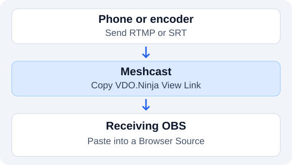

# Bring RTMP or SRT into OBS with Meshcast

Send a camera feed to Meshcast, then receive it in OBS. The sender and OBS can be on different networks.

For a phone camera, start with the **VDO.Ninja native app**: follow the illustrated [SRT setup](mobile-app/srt-to-meshcast.md) or [RTMP setup](mobile-app/rtmp-to-meshcast.md). The steps below also work with compatible hardware encoders and a sending copy of OBS.

## 1. Create a Meshcast stream

1. Sign in at [app.meshcast.io](https://app.meshcast.io/). RTMP and SRT need a registered account, including a free account.
2. Open **Studio**. Under **Stream**, select a stream or choose **+ Create New Stream**.
3. Give it a recognizable name, such as `Remote camera`.

See [Meshcast account setup](meshcast-setup.md#set-up-an-account-for-srt-or-rtmp) for screenshots. Check [current plans](https://app.meshcast.io/pricing) for bandwidth and viewer limits.

## 2. Start the sender

Copy publishing details from Studio into the phone or encoder:

| Sending with | Copy from Meshcast | Set on the sender |
| --- | --- | --- |
| RTMP | **RTMP Server** and **Publish Key** | Server and stream key in separate fields |
| SRT | Complete **SRT URL (Caller Mode)** | SRT caller mode; keep the full URL and query string |

Use **H.264 video**, **AAC audio**, and **0 B-frames** for the Browser Source path below. If the encoder calls the option **Use B-Frames**, turn it off. Restart the output after changing encoder settings.

In a sending copy of OBS, these settings belong under **Settings > Stream** and **Settings > Output**. For SRT, paste the full publishing URL into **Server** and leave **Stream Key** empty.

Start the phone or encoder and confirm Meshcast receives the stream. Studio's **Go Live** button starts its browser camera or screen; you do not need it for an external encoder. Keep publishing keys private.

## 3. Add the feed to the receiving OBS

1. In Meshcast Studio, open **Watch Links** for the same stream.
2. Copy **VDO.Ninja View Link**, including its `whep` parameter and any server options.
3. In the receiving OBS, choose **Sources > + > Browser** and paste that link into **URL**.
4. Enable **Control audio via OBS**, then check the picture and audio meter.
5. Make a short recording and play it back to check both sound and motion.

You do not need to press **Start Streaming** in the receiving OBS. That button sends OBS's finished program to another service.

## Prefer an SRT Media Source?

Meshcast can also send the feed to an OBS **Media Source** over SRT. This is useful when you want to receive without a browser player.

Follow [Meshcast's SRT receive guide](https://app.meshcast.io/docs/srt-to-obs). It uses the stream's media server and public Stream ID in a `read:` URL. The SRT publishing URL contains credentials and belongs on the sender, not in the receiving source.

## Quick fixes

| Problem | Check |
| --- | --- |
| Nothing in OBS | Start the sender first. Copy the view link for the same Meshcast stream; do not use a publish URL. |
| Browser playback fails | Use H.264 with B-frames disabled. Restart the sender after changing this. |
| No sound | Enable sender audio and **Control audio via OBS**; unmute the source in OBS. |
| Breakup or growing delay | Lower the sending bitrate. For SRT, allow more recovery time in its latency setting. |
| Several viewers overload the phone | Give them the Meshcast viewing link and close unused direct phone previews. |

To send the finished show to several platforms, use [multistreaming with Meshcast](multistream-with-meshcast.md).
