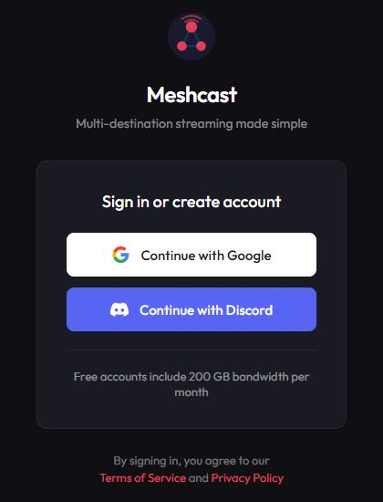
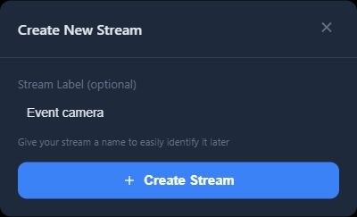

# Set up Meshcast for a phone camera

Meshcast receives one upload and distributes it to viewers. Use it when several production viewers need a camera feed, or as a bridge from a phone's SRT/RTMP output into VDO.Ninja. For a single phone-to-OBS feed, start with [normal VDO.Ninja](streaming-sports-and-events.md).

Meshcast does not increase the phone's upload capacity. SRT adds packet-recovery buffering; RTMP is an alternative for services that expect a server address and stream key.

## Use the built-in Meshcast option

For simple server distribution, open **Additional outputs > Meshcast** in the [native app](../steves-helper-apps/native-mobile-app.md), enable **Use this destination**, and tap **Save**. Start the camera stream and use the app's viewing link, which now uses Meshcast. This uses WHIP and can work with an anonymous session, without manually setting up SRT or RTMP.

Browser publishers can use [`&meshcast`](../newly-added-parameters/and-meshcast.md). Check [Meshcast's current limits](https://app.meshcast.io/pricing) when planning viewer counts and event length.

## Set up an account for SRT or RTMP

1. Open [app.meshcast.io](https://app.meshcast.io/) and select **Sign In** or **Get Started**.
2. Choose **Continue with Google** or **Continue with Discord**. Use the same account on later visits. Review the site's terms and complete the provider's sign-in prompts.
3. Open **Studio** from the dashboard. Under **Stream**, select an existing stream, or choose **+ Create New Stream**, enter a label such as `Event camera`, and click **Create Stream**.

<figure><figcaption>
The same page handles sign-in and account creation.
</figcaption></figure>

<figure><figcaption>
Give the stream a recognizable label, then select it for publishing and viewing.
</figcaption></figure>

A registered free account supports SRT and RTMP. If Studio shows **Anonymous Mode** and asks you to sign in for those tabs, complete sign-in first.

## Copy publishing details to the phone

Select the stream in Studio before copying its settings. Keep publishing URLs and keys private.

| Studio tab | Copy to the app | Phone instructions |
| --- | --- | --- |
| **SRT** | The complete **SRT URL (Caller Mode)**, including its query string | [SRT setup with screenshots](mobile-app/srt-to-meshcast.md) |
| **RTMP** | **RTMP Server** and the secret **Publish Key** | [RTMP setup with screenshots](mobile-app/rtmp-to-meshcast.md) |
| **WHIP** | The publishing URL for **Custom WHIP** | [WHIP settings](../steves-helper-apps/native-mobile-app.md#whip-publishing) |

Start publishing from the phone. Studio's **Go Live** button is for its own browser camera/screen source; you do not need to start a second browser publisher for the phone's SRT or RTMP feed.

## Bring the stream into OBS

1. In Studio, open **Watch Links** for the same stream.
2. Copy the complete **VDO.Ninja View Link**. Keep its `whep` parameter and any server options; a bare `?view=...` link does not identify the Meshcast playback endpoint.
3. In OBS, add **Sources > + > Browser** and paste the link into **URL**. Set your layout dimensions and enable **Control audio via OBS**.
4. Check moving video and audio, then record and play back a sample.

Give production viewers this Meshcast-backed link too. Opening the phone's original direct viewer link creates another upload from the phone. Keep only the outputs and previews you need.

[Compare the phone's output modes](mobile-app/choose-an-output.md) or return to the [sports and events guide](streaming-sports-and-events.md).
