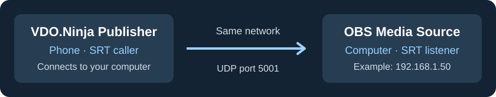
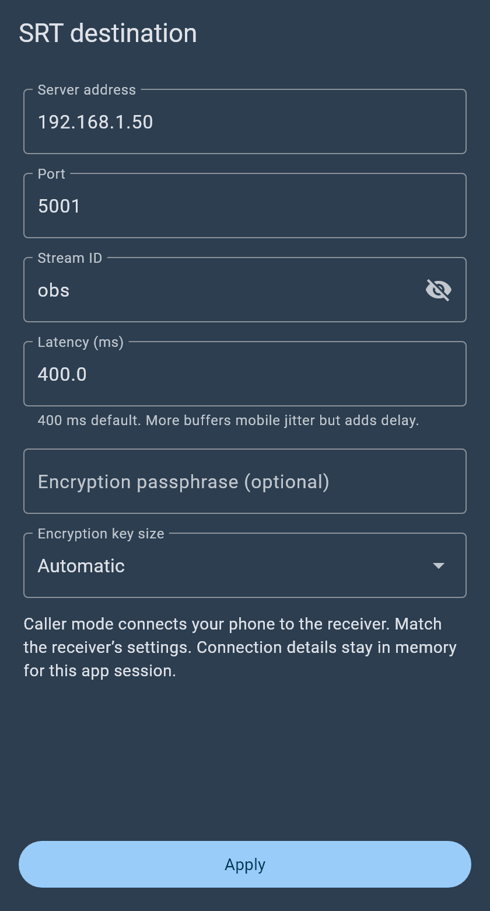

# Send Android video to OBS with SRT

Stream your camera and microphone from **VDO.Ninja Publisher** to OBS on the same network. No OBS plugin or relay account needed.

[Using iPhone? Open its guide.](iphone-srt-to-obs.md)



## 1. Find your computer's IP address

Connect the phone and computer to the same network. Ethernet on the computer is fine.

- **Windows:** run `ipconfig` in Command Prompt; find **IPv4 Address** for your connected adapter.
- **Mac:** open **System Settings → Network → your connection → Details → TCP/IP**.

Below, **`192.168.1.50` means your computer's IP**. Replace it with yours.

## 2. Set up OBS

1. Under **Sources**, click **+ → Media Source**.
2. Uncheck **Local File**.
3. Paste this into **Input**:

   ```text
   srt://0.0.0.0:5001?mode=listener&latency=400000
   ```

4. Set **Input Format** to `mpegts`, then click **OK**.

Keep `0.0.0.0` as shown in OBS: it listens on your computer. Keep the source visible in the active scene. You do not need to press **Start Streaming** in OBS.

## 3. Set up the Android app

1. Choose **BACK CAMERA** or **FRONT CAMERA**. Allow camera and microphone access.
2. On **Ready to stream**, open **Additional outputs → SRT → Configure SRT**.
3. Enter:

   | Setting | Value |
   | --- | --- |
   | Server address | Your computer's IP, e.g. `192.168.1.50` |
   | Port | `5001` |
   | Stream ID | `obs` |
   | Latency (ms) | `400` |
   | Encryption passphrase | Leave empty for this local setup |
   | Encryption key size | Automatic |

<figure><figcaption><p>Use your computer's IP address in Server address.</p></figcaption></figure>

4. Tap **Apply** and keep **Use this destination** enabled.
5. Under **Output quality**, choose **Apply a preset → IRL balanced**.
6. Tap **Save**, return to **Ready to stream**, and tap **START STREAM**.

Your picture should appear in OBS. Speak into the phone and check the OBS audio meter. The app requires Stream ID `obs` here; OBS does not need a matching stream key.

## Stop or reconnect

In the app, open **More → Additional outputs → SRT** for **Stop output**, **Start output**, or **Retry output**. Ending the stream stops SRT too. Closing its settings leaves it running. Re-enter the destination after fully closing the app.

## Quick fixes

- **No picture:** check the computer IP and matching port. Allow OBS through the computer firewall on your private network, including **UDP 5001**. Avoid guest Wi-Fi.
- **No audio:** unmute the phone microphone and OBS source; check that audio is enabled under **Output quality**.
- **Different menus:** on older layouts, enable **Advanced settings → External publishing controls**, start the camera stream, then open **More → Advanced external output**. Use the URL below.

<details>
<summary>Paste a URL instead of filling in the app form</summary>

Open **Paste a publishing URL**, replace the IP below with your computer's address, and tap **Use URL**:

```text
srt://192.168.1.50:5001?mode=caller&streamid=obs&latency=400000&pkt_size=1316
```

URL latency is in microseconds: `400000` equals `400 ms`.

</details>

**Away from home?** Local addresses will not work over mobile data or another network. Use a reachable SRT receiver or relay for remote publishing.

[OBS SRT reference](https://obsproject.com/kb/srt-protocol-streaming-guide)
