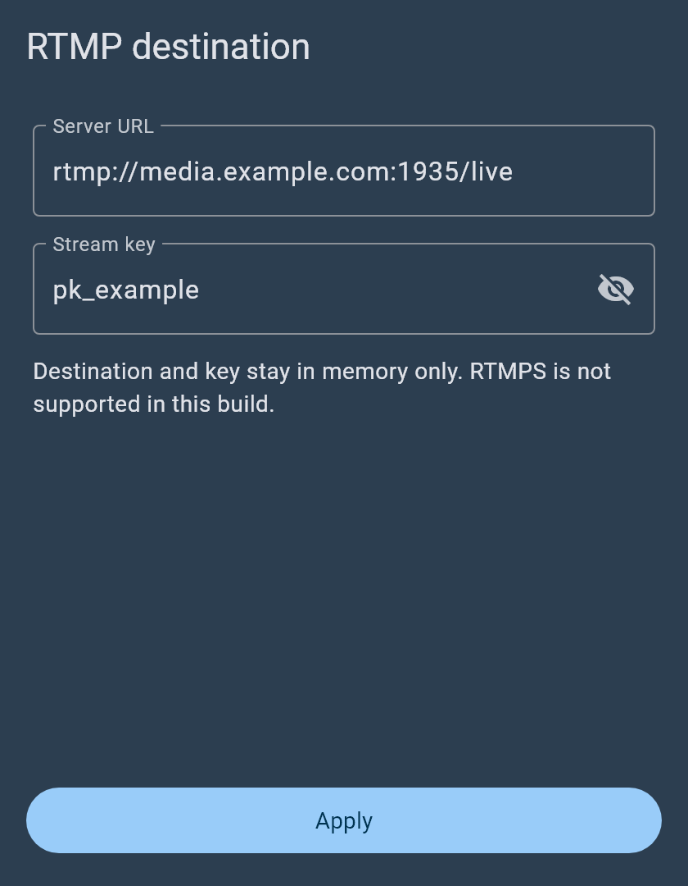

# Send phone video through Meshcast with RTMP

Send your phone's camera to Meshcast, then use its VDO.Ninja viewing link in OBS. RTMP is useful for services that accept a server URL and stream key. For packet loss on mobile networks, also consider [SRT](srt-to-meshcast.md).

**Phone app (RTMP) → Meshcast → VDO.Ninja → OBS Browser Source**

You need the [VDO.Ninja Android or iPhone app](../../steves-helper-apps/native-mobile-app-versions.md), OBS, and a registered account at [app.meshcast.io](https://app.meshcast.io/). A free account supports RTMP publishing. On iPhone, use a single camera; RTMP is unavailable for screen sharing, dual camera, and microphone-only capture.

## 1. Copy the Meshcast settings

Follow [Meshcast account and stream setup](../meshcast-setup.md#set-up-an-account-for-srt-or-rtmp), then select **RTMP** in Studio. Copy **RTMP Server** and **Publish Key**. The publishing key is private; do not replace it with the public `st_...` stream ID.

## 2. Set up the phone

1. Open the app and choose **BACK CAMERA** or **FRONT CAMERA**. Allow camera and microphone access.
2. On **Ready to stream**, open **Additional outputs > RTMP > Configure RTMP**.
3. Paste **RTMP Server** into **Server URL**, and **Publish Key** into **Stream key**. Tap **Apply**.

<figure><figcaption>
Use the server and key from your own Meshcast Studio.
</figcaption></figure>

4. Keep **Use this destination** enabled. Under **Output quality**, choose **Apply a preset > IRL balanced**. For a horizontal broadcast, select **Output orientation > Landscape 16:9**.
5. Tap **Save**, return to **Ready to stream**, and tap **START STREAM**.

The app sends H.264 video and AAC audio with B-frames off, suitable for Meshcast's browser playback path. **IRL balanced** targets 720p30 at 2500 kbps video. If the upload cannot sustain that, try **IRL data saver** or lower the video bitrate.

## 3. Bring the feed into OBS

1. In Meshcast Studio, open **Watch Links** and copy the complete **VDO.Ninja View Link** for the same stream, including its `whep` parameter.
2. In OBS, choose **Sources > + > Browser**, then paste the link into **URL**.
3. Check moving video and the OBS audio meter. Make a short recording to confirm picture and sound.

Give other viewers this Meshcast-backed link too. Viewing the phone's original direct link adds another upload from the phone.

## Quick fixes

* **Cannot connect:** use the complete RTMP server address and publishing key from Studio. The app's external output supports `rtmp://`; it does not support `rtmps://`.
* **Stalls or growing delay:** lower the video bitrate. On iPhone, **Adaptive bitrate (RTMP only)** is an optional control under **Output quality**; it lowers the target during congestion. It does not bond networks or reconnect for you.
* **Video but no sound:** check **Include audio**, microphone mute, and the OBS mixer. Browser playback needs Meshcast's AAC-to-Opus conversion. If it remains silent, use [SRT reception in OBS](https://app.meshcast.io/docs/srt-to-obs) or switch the phone to [Meshcast/WHIP](choose-an-output.md).
* **Restart:** open **More > Additional outputs > RTMP** to stop, start, or retry. Stop the output before changing its quality settings. Re-enter the destination after fully closing the app.
* **Different menus:** older app layouts use **Advanced Settings > External publishing controls**, then **More > Advanced external output** while streaming.

[Compare output modes](choose-an-output.md) · [SRT setup](srt-to-meshcast.md) · [Packet loss troubleshooting](../../common-errors-and-known-issues/packet-loss.md)
