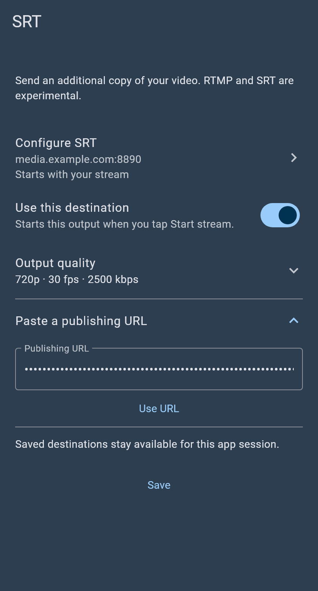
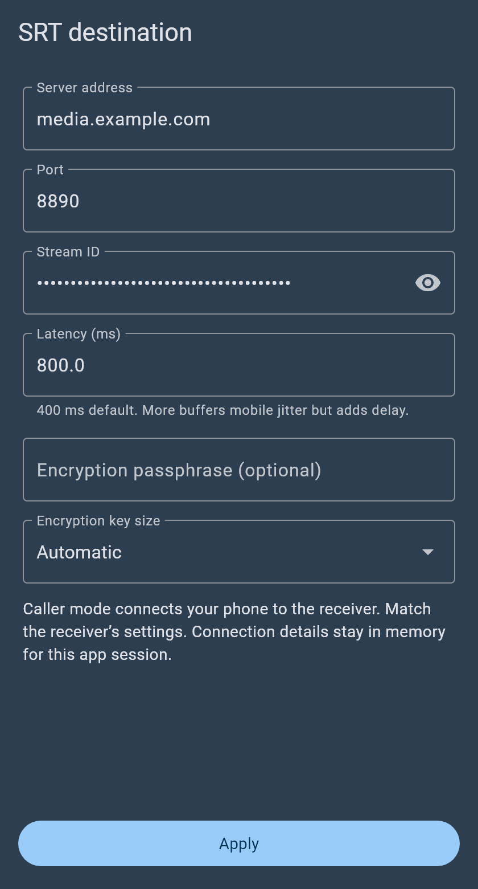

# Send phone video through Meshcast with SRT

Use this setup when the phone and OBS are on different networks. SRT adds a buffer for recovering lost packets; Meshcast distributes the feed to viewers.

**Phone app (SRT) → Meshcast → VDO.Ninja → OBS Browser Source**

You need the [VDO.Ninja Android or iPhone app](../../steves-helper-apps/native-mobile-app-versions.md), OBS, and a registered account at [app.meshcast.io](https://app.meshcast.io/). A free account supports SRT publishing. On iPhone, choose a single camera; SRT is unavailable for screen sharing, dual camera, and microphone-only capture.

## 1. Copy the Meshcast publishing URL

Sign in to Meshcast, open **Studio** for your stream, and select **SRT**. Copy **SRT URL (Caller Mode)** in full. It includes the server, port, stream identifier, and private publishing key. Keep it private; viewers use a different link.

## 2. Set up the phone

1. Open the app and choose **BACK CAMERA** or **FRONT CAMERA**. Allow camera and microphone access.
2. On **Ready to stream**, open **Additional outputs > SRT**.
3. Expand **Paste a publishing URL**, paste the Meshcast URL, and tap **Use URL**.
4. Keep **Use this destination** enabled. Under **Output quality**, choose **Apply a preset > IRL balanced**. For a horizontal broadcast, set **Output orientation** to **Landscape 16:9**.
5. Tap **Save**, return to **Ready to stream**, and tap **START STREAM**.

<figure><figcaption>
Paste your complete Meshcast publishing URL, then tap Use URL and Save.
</figcaption></figure>

**IRL balanced** uses 720p30 at a 2500 kbps video target. If the connection cannot sustain it, try **IRL data saver** or lower the video bitrate. Leave room for audio and retransmissions.

## 3. Bring the feed into OBS

1. In Meshcast Studio, copy **VDO.Ninja View Link** for the same stream.
2. In OBS, choose **Sources > + > Browser**, then paste that link into **URL**.
3. Check moving video and the OBS audio meter. Make a short recording to confirm picture and sound.

Use this Meshcast-backed link for other viewers too. The phone app's original direct viewer link creates a separate connection to the phone.

## Adjust buffering or reconnect

To change SRT buffering, stop the SRT output and open **Configure SRT**. Start with **Latency (ms)** at **400**; try **800** for a lossy mobile connection, then restart the output. More buffering adds delay. If it still stalls, lower the bitrate.

<figure><figcaption>
Example values. Keep your own server and stream ID; adjust Latency (ms).
</figcaption></figure>

* **Disconnected:** open **More > Additional outputs > SRT** and tap **Retry output** or **Start output**. Re-enter the destination after fully closing the app.
* **Video but no sound:** check **Include audio**, microphone mute, and the OBS mixer. Browser playback needs Meshcast to convert the app's AAC audio. If it remains silent, use [SRT directly into an OBS Media Source](https://app.meshcast.io/docs/srt-to-obs), or switch to [Meshcast/WHIP](choose-an-output.md).
* **Different menus:** older app layouts use **Advanced Settings > External publishing controls**, then **More > Advanced external output** while streaming.

[Compare output modes](choose-an-output.md) · [RTMP setup](rtmp-to-meshcast.md) · [Packet loss troubleshooting](../../common-errors-and-known-issues/packet-loss.md)
