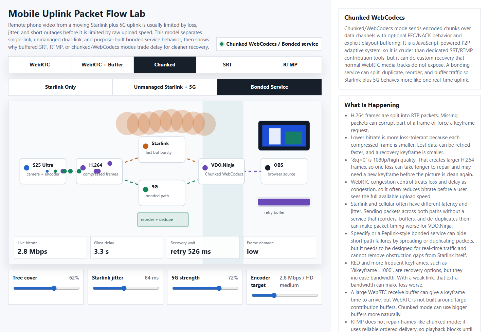
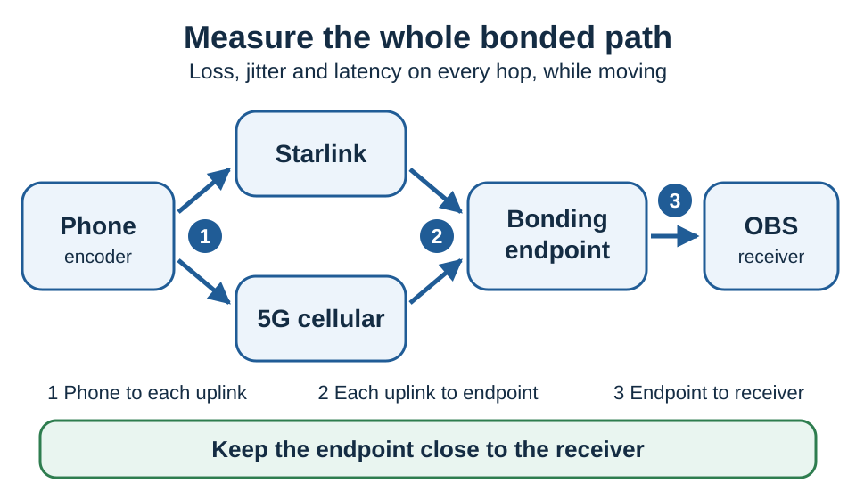

# Mobile uplinks with Starlink, cellular, and bonded networks

This guide covers a phone camera on a moving uplink, such as Starlink Roam plus 5G, received in OBS through a VDO.Ninja browser source.

On a moving link, the usual problem is packet timing, packet loss, and short outages, more than upload speed. VDO.Ninja normally uses WebRTC, which is built for low latency and reacts fast to late or missing packets. That suits conversation, but quality can collapse under tree cover, Starlink jitter, or cellular handoffs.

* The [Mobile Uplink Packet Flow Lab](https://vdo.ninja/misc/mobile-uplink-packet-flow.html) compares plain WebRTC, buffered WebRTC, chunked/WebCodecs, SRT, RTMP, and bonded paths.
* The [Unstable Connection Builder](https://vdo.ninja/misc/unstable-connection-builder.html) creates matching push and view links for normal WebRTC, chunked mode, audio recovery, Meshcast, relay tests, and local iframe simulation.



## Why a high bitrate can still look bad

* `&outboundvideobitrate=7000` sets a sender target. WebRTC congestion control still cuts the bitrate when it sees loss, jitter, or congestion, even if a speed test shows enough upload.
* `&quality=0` (or `&q=0`) targets 1080p. Larger frames need more packets, so one burst of loss damages more of the picture and takes longer to recover.

Smaller frames survive lossy links better: resends are faster, recovery keyframes are smaller, and congestion control has more headroom. Over a moving Starlink path, 720p30 at 2500–4000 kbps can look better than 1080p at 7000 kbps.

## Lingering H.264 damage

H.264 builds most frames from earlier ones, so damage can last until a clean keyframe arrives. WebRTC requests a keyframe when it detects loss and usually recovers by itself, but packets that arrive too late can still leave damaged frames.

If damage lingers for several seconds after a dropout, add `&keyframe=2000` to the **view** (OBS) link. It asks the phone for a keyframe every 2 seconds.

Use it only for that problem. Keyframes are the largest frames, so frequent ones add bursts that can make a weak link worse. Try `&keyframe=1000` only if 2000 is not enough and the link has spare bandwidth. Below about 1000 ms, quality drops steeply, and very low values may not work at all.

## Types of bonding

| Mode | What it does |
| --- | --- |
| Load balancing | Puts each connection on one path |
| Failover | Uses one path and switches after it fails |
| Throughput bonding | Splits packets across links; a server reassembles them |
| Redundant bonding | Duplicates packets over links; the first good copy is used |
| Smoothing or FEC | Spends extra bandwidth to reduce loss, jitter, and short gaps |

**RTMP** usually runs over TCP, which waits for lost data. That protects the picture but causes stalls and delay. Throughput bonding works well for RTMP when the tunnel is stable.

**WebRTC** is timing-sensitive: a late packet is nearly as useless as a lost one. Starlink and 5G have different latency and jitter, so splitting packets across them can make timing worse unless the service reorders, buffers, and removes duplicates. For WebRTC, choose the bond with the lowest loss, stable jitter, and a nearby endpoint, not the highest speed-test result.

### Peplink SpeedFusion

SpeedFusion has separate bandwidth bonding (packet-level aggregation), smoothing (redundant packets against loss and jitter), and hot failover (keeps sessions alive when a link drops). For WebRTC, smoothing, failover, traffic rules, and endpoint location matter most. For RTMP or SRT, throughput and stable failover matter more. A generic failover setup is not a real-time bonded tunnel.

### Speedify

* **Speed** mode aims for aggregate throughput.
* **Redundant** mode sends packets over several links and uses the first copy. It costs more data and battery.
* **Streaming** and Enhanced Streaming prioritize real-time streams.
* **UDP** transport usually suits live media better than TCP.

A distant Speedify server, or a large latency gap between Starlink and 5G, adds delay.

### Bonding endpoint location

Bonding needs a reassembly point: a Speedify server, SpeedFusion Connect or Cloud, your own FusionHub, or a broadcast provider's cloud receiver. For WebRTC, an endpoint far from the receiver, TURN server, or ingest adds round-trip time and slows keyframe requests, resends, and congestion control.



Measure loss, jitter, and latency on each hop while moving: phone to each uplink, each uplink to the endpoint, and endpoint to the receiver (office, relay, Meshcast, SRT/RTMP ingest, or OBS).

Dedicated broadcast bonding systems, with a managed receiver and a fixed latency budget, often give a cleaner program feed than a VPN-style bond. They cost more and usually add latency.

## Settings to test in VDO.Ninja

Replace `STREAMID` with a unique stream ID. `&codec` is a viewer-side option, so it goes on the view link.

### Option 1: Stable low-latency WebRTC

For interaction over an imperfect uplink. It trades some sharpness for headroom.

```text
Phone:    https://vdo.ninja/?push=STREAMID&q=1&fps=30&outboundvideobitrate=2500
OBS/view: https://vdo.ninja/?view=STREAMID&codec=h264&bitrate=2500&buffer=500
```

### Option 2: Higher-quality WebRTC on a clean bond

Only when packet loss is low and the bond is stable.

```text
Phone:    https://vdo.ninja/?push=STREAMID&q=0&fps=30&outboundvideobitrate=4000
OBS/view: https://vdo.ninja/?view=STREAMID&codec=h264&bitrate=4000&buffer=1000
```

If the stream smears, freezes, or drops to a very low bitrate, lower the target. For both options, add `&keyframe=2000` to the view link only if damage is slow to clear.

### Option 3: More receive buffer

When extra delay is acceptable, use `&buffer=1000` or `&buffer=3000` on the view link. It gives WebRTC more time to absorb jitter and receive a recovery keyframe. VDO.Ninja caps this WebRTC buffer hint at 4000 ms, so it is not a contribution-grade buffer.

### Option 4: Normal-WebRTC reliability settings

For short random loss or jitter on the normal WebRTC path. These cannot hide multi-second outages.

```text
Phone:    https://vdo.ninja/?push=STREAMID&q=1&fps=24&width=1280&height=720&outboundvideobitrate=2500&maxvideobitrate=2500&maxbandwidth=70&contenthint=motion
OBS/view: https://vdo.ninja/?view=STREAMID&codec=vp8&vred&videobitrate=2500&buffer=500&audiobuffer=120&degrade=maintain-framerate&keyframe=3000
```

| Setting | What it does |
| --- | --- |
| `&buffer=500` or `1000` | The first thing to try for jitter or reordering |
| `&codec=vp8&vred` | Prefers VP8 with RED. The browser still decides whether to send redundancy; VDO.Ninja cannot force an FEC percentage. |
| `&maxbandwidth=70` | Targets about 70% of the estimated available upload (Chromium-based browsers) |
| `&degrade=maintain-framerate` | Lowers resolution before frame rate. For screens or text, try `maintain-resolution`. |
| `&keyframe=3000` | Recovery aid only. Remove it if the link becomes bursty. |

* Keep NACK, PLI, and congestion control on. Do not add `&nonack`, `&nopli`, or `&noremb`.
* Test RED with VP8. Chromium disables some RED+ULPFEC combinations, including H.264 with NACK enabled. On a hot phone, H.264 at a lower bitrate can still be the better choice.
* RED and FEC support depends on the browser. Older OBS Browser Source (CEF) builds and old mobile browsers can lag behind current Chrome or Firefox.
* VDO.Ninja uses `jitterBufferTarget` (capped at 4000 ms) when the browser supports it, and the older playout-delay hint otherwise.
* For burst loss or handoffs, use a bond with smoothing or redundancy, or move to chunked, SRT, or RTMP with more latency.


[vred.md](../advanced-settings/view-parameters/vred.md)


### Option 5: Chunked/WebCodecs mode

When OBS can tolerate more delay and you want VDO.Ninja to control buffering and recovery.

```text
Phone:    https://vdo.ninja/?push=STREAMID&chunked=2500&chunkprofile=balanced&chunkedbuffer=6000
OBS/view: https://vdo.ninja/?view=STREAMID&chunkbuffer=1500&chunkbufferfloor=1000&chunkbufferceil=4000&chunkjitterslack=500
```

Chunked mode sends encoded chunks over data channels. It is cruder than SRT or RTMP systems, but it exposes buffering and recovery controls that normal WebRTC tracks do not. `&chunkprofile=balanced` also sets `hybrid` sender adaptation. Chromium-based browsers are the main target; Firefox cannot publish chunked, and Safari can only when its full WebCodecs stack is available.

### Option 6: SRT or RTMP through a relay

When a clean program feed matters more than sub-second latency. SRT's latency setting is a recovery window: more latency gives more time to repair lost packets. RTMP waits for missing data, which avoids corrupted frames but adds delay. [Meshcast](../steves-helper-apps/meshcast.io.md) can accept RTMP or SRT.

## Phone and encoder notes

* Watch heat, battery, and background app behavior. A high bitrate target does not help once the phone throttles.
* `&h264profile` (view link) changes H.264 profile behavior. It is not a packet-loss fix; test it separately from network changes.
* `&nomobilebitratecap` removes VDO.Ninja's mobile bitrate cap. That cap only applies to video a phone sends to other guests in a room, so it does not limit a plain `&view` link into OBS.

## Field test checklist

Test while moving, not only while parked. For each test, record:

* Starlink-only, cellular-only, and bonded results;
* bonding mode and endpoint region;
* phone and OBS/view link parameters;
* OBS browser-source latency;
* bitrate collapse, smearing, freezes, audio drops, or long delay.

Judge by packet loss, jitter, recovery time, and the OBS recording, not by a speed test.

## Related VDO.Ninja settings


[video-bitrate-for-push-view-links.md](video-bitrate-for-push-view-links.md)



[how-do-i-control-bitrate-quality.md](how-do-i-control-bitrate-quality.md)



[and-outboundvideobitrate.md](../advanced-settings/video-bitrate-parameters/and-outboundvideobitrate.md)



[and-maxvideobitrate.md](../advanced-settings/video-bitrate-parameters/and-maxvideobitrate.md)



[and-maxbandwidth.md](../advanced-settings/video-bitrate-parameters/and-maxbandwidth.md)



[codec.md](../advanced-settings/view-parameters/codec.md)



[buffer.md](../advanced-settings/view-parameters/buffer.md)



[keyframerate.md](../advanced-settings/view-parameters/keyframerate.md)



[and-chunked.md](../newly-added-parameters/and-chunked.md)



[and-chunkedbuffer.md](../advanced-settings/newly-added-parameters/and-chunkedbuffer.md)



[packet-loss.md](../common-errors-and-known-issues/packet-loss.md)



[handling-guest-disconnects-and-connection-recovery.md](handling-guest-disconnects-and-connection-recovery.md)


## External references

* [Speedify Bonding Mode Overview](https://support.speedify.com/article/870-bonding-mode)
* [Speedify Transport Mode Overview](https://support.speedify.com/article/882-transport-mode)
* [Speedify Streaming Prioritization Overview](https://support.speedify.com/article/1010-speedify-streaming-prioritization-overview)
* [Peplink SpeedFusion Bonding & Failover Technology](https://www.peplink.com/technology/speedfusion-bonding-technology/)
* [Haivision SRT introduction](https://doc.haivision.com/SRT/1.5.3/Haivision/introduction-to-srt)
* [Adobe RTMP Chunk Stream specification](https://ossrs.net/lts/en-us/assets/files/rtmp_specification_1.0-25a467618b92a3115bc97d4b0038b0ff.pdf)
* [W3C WebRTC RTP parameters and capabilities](https://www.w3.org/TR/webrtc/#rtcrtpparameters)
* [MDN RTCRtpTransceiver.setCodecPreferences](https://developer.mozilla.org/en-US/docs/Web/API/RTCRtpTransceiver/setCodecPreferences)
* [MDN RTCRtpReceiver.jitterBufferTarget](https://developer.mozilla.org/en-US/docs/Web/API/RTCRtpReceiver/jitterBufferTarget)
* [WebRTC RFC 8854: Forward Error Correction Requirements](https://www.rfc-editor.org/info/rfc8854/)
* [Chromium WebRTC RED/ULPFEC sender logic](https://chromium.googlesource.com/external/webrtc/+/master/call/rtp_video_sender.cc)
