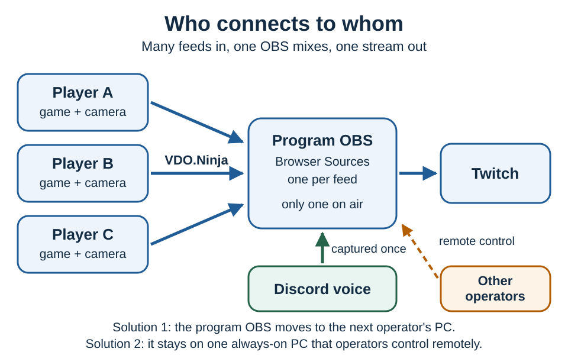

# Multi-operator Twitch production with VDO.Ninja and OBS

Use this setup when any authorized member can start the show, three to five members add game and camera feeds without the current operator editing OBS, another member can take over when the operator leaves, and Discord carries the voice chat.

VDO.Ninja carries each member's feeds. One OBS at a time combines them and streams the program to Twitch. VDO.Ninja does not pick the operator or keep the Twitch connection alive during a handoff. That takes a coordinated stop and start, or an encoder that stays online while control changes hands.



## Pick a design

| Priority | Design |
| --- | --- |
| Use equipment everyone already owns | Solution 1: the same OBS scene collection on every operator's PC, with a short handoff |
| Least load on gaming PCs, cleanest handoff | Solution 2: one always-on production OBS that members control remotely |
| Highest uptime, automatic failover | Solution 3: a standby encoder or private relay with an on-air lock |

For a Windows gaming group, start with Game Capture for each game feed, a VDO.Ninja browser link for each camera, and OBS Browser Sources for the mix.

## Choose the contribution tool

| Tool | Use it for | Limitation |
| --- | --- | --- |
| VDO.Ninja in a browser | Webcams, phone cameras, occasional screen sharing | The sender picks the screen or window each time; game capture can be less consistent |
| [Game Capture](using-game-capture-with-vdo.ninja.md) | Game window video with only that window's audio, hardware encoded | Windows (the Mac version is an experimental beta); send the webcam separately |
| [Ninja OBS Plugin](using-ninja-obs-plugin-with-vdo.ninja.md), receiving | VDO.Ninja sources inside OBS; can auto-add room feeds | The native receiver is experimental; the default mode is browser-backed |
| Ninja OBS Plugin, publishing | A contribution-only OBS | It uses OBS's streaming output, so that OBS cannot also stream to Twitch |
| OBS Browser Sources | Receiving feeds in the program OBS | Every live feed is decoded and composited |

## Solution 1: every operator runs the same OBS scene

No server is needed, but each handoff can cause a short slate, cut or stream restart.

### 1. Give each operator their own Twitch access

Do not share the owner's password or main stream key. In the Twitch Creator Dashboard, open **Settings -> Stream -> Permissions -> People who can stream to your channel** and authorize each operator by email. Each gets their own guest stream key, and removing a person invalidates only their key. See Twitch's [Stream Key FAQ](https://help.twitch.tv/s/article/twitch-stream-key-faq?language=en_US).

Share the OBS scene collection, but have each person enter their key in a local OBS profile. [Profiles](https://obsproject.com/kb/profiles) store stream settings; [scene collections](https://obsproject.com/kb/scene-collections) store scenes and sources.

Turn on [Twitch Disconnect Protection](https://help.twitch.tv/s/article/Disconnect-Protection?language=en_US). It can show a slate for up to 90 seconds when a supported encoder disconnects, but it does not make a handoff seamless.

### 2. Assign permanent VDO.Ninja IDs

Choose a private room name, a strong room password, and two IDs per person, such as `alicegame` and `alicecam`, `bobgame` and `bobcam`.

Use only letters, numbers and underscores. VDO.Ninja replaces other characters, such as `-`, with `_` when publishing, so a view link with the original ID will not match. Never open the same ID on two devices at once.

Camera link:

```text
https://vdo.ninja/?room=TEAMROOM&push=alicecam&webcam&audiodevice=0&autostart&view#p=ROOMPASSWORD
```

`&audiodevice=0` turns off the microphone, because voice comes from Discord. `&webcam` and `&autostart` skip most of the setup screen. The bare `&view` stops the page from downloading the other room feeds. The browser still asks for camera permission.

Browser game capture link:

```text
https://vdo.ninja/?room=TEAMROOM&push=alicegame&screenshare&autostart&view#p=ROOMPASSWORD
```

The browser always asks the sender to choose a screen or window. Game Capture avoids that: save the room, `alicegame` and the password in the app, and select the game window and only its audio. Never send a desktop mix that includes Discord.

The password after `#` stays out of normal web requests and server logs. Treat saved links as private anyway.

### 3. Build the OBS scene once

**Fastest: one automatic layout.** Add one Browser Source:

```text
https://vdo.ninja/?room=TEAMROOM&scene=0&slots=10#p=ROOMPASSWORD
```

`&scene=0` adds every live room feed automatically. [`&slots`](../newly-added-parameters/and-slots.md) fixes the grid at that many tiles; set it to the most feeds you expect at once. Game and camera feeds become separate tiles.

**Branded: one Browser Source per feed.** Add and position a source for every expected feed:

```text
https://vdo.ninja/?room=TEAMROOM&view=alicegame&solo#p=ROOMPASSWORD
https://vdo.ninja/?room=TEAMROOM&view=alicecam&solo&noaudio#p=ROOMPASSWORD
```

An offline source waits in place and shows the feed when that ID goes live. For each Browser Source:

* enable **Control audio via OBS** for game sources and keep camera sources silent;
* leave **Refresh browser when scene becomes active** and **Shutdown source when not visible** off; and
* do not load the same feed through both a Browser Source and the plugin.

Export the scene collection, import it on each operator's OBS, and have each operator test it once. The collection contains the private room links, so share it only with trusted operators and change the room password to revoke access.

**One combined feed per member.** To keep a member's camera overlaid on their game, build a **Contribution** scene in their OBS, set [OBS Virtual Camera](https://obsproject.com/kb/virtual-camera-guide) to output that **Scene**, and select OBS Virtual Camera in a VDO.Ninja browser publisher. Virtual Camera is video only, so route game audio through a virtual audio device. This halves the feeds the program OBS decodes but adds work on each gaming PC. It leaves OBS's streaming output free for Twitch.

### 4. Route Discord and game audio once

Doubled audio is the most common failure here.

* Everyone wears headphones, and camera links carry no microphone.
* Game Capture sends only the game window's audio.
* The active OBS captures Discord's app audio once, plus the active operator's own microphone, which Discord's output does not include.
* For the active operator's own game, use the local source or its VDO.Ninja feed, never both.
* Leave OBS monitoring off unless you have tested a mix-minus.

Record a short local test with everyone talking and playing. Each voice and game should be heard once.

### 5. Hand off: stop first, then start

Use a private Discord text channel as the on-air lock. Only one person owns it.

1. The incoming operator opens OBS, loads the scene, and checks video and meters.
2. The incoming operator writes `READY`.
3. The outgoing operator stops only their Twitch output and writes `OFF AIR`. Their own feeds stay live.
4. The incoming operator starts streaming with their own key.
5. Confirm the channel is live from the Twitch dashboard or another device.
6. The old operator closes their program scene unless they stay on as standby.

Never run two Twitch outputs at once. Expect a short gap. If the operator drops out unexpectedly, another member starts their output; viewers may see the disconnect slate or a restart.

## Solution 2: keep one production OBS online

An always-on production PC owns the Twitch connection, overlays, Browser Sources and audio. Members take control of it instead of replacing the encoder, so a member leaving does not end the stream, gaming PCs only publish their own feeds, and the Twitch key lives on one machine. It can be a spare desktop at a member's home or hosted hardware.

Join the production PC to the Discord call with its microphone off and capture Discord's output in OBS. All voices arrive in that one mix.

OBS 28 and newer include obs-websocket for remote control. Keep its authentication on, use a strong password, and reach it only over a private VPN or similar trusted network, never the public Internet. Remote desktop also works with strong authentication and restricted access.

Give the production PC wired networking, a hardware H.264 encoder and enough GPU to decode every feed. A UPS and automatic OBS launch help if nobody is on site. The PC is still a single point of failure.

## Solution 3: active/standby or a private relay

**Active/standby OBS.** The standby keeps the same scene ready but streams only when the primary fails. Twitch still sees an encoder reconnect. Keep the standby's VDO.Ninja feeds closed until needed, because each extra viewer adds upload load on every contributor.

**Stable relay output.** A relay keeps one session connected to Twitch and switches between private inputs:

```text
Operator A program --\
Operator B program ----> authenticated switch/relay -> one Twitch output
Fallback slate -------/
```

The control layer needs one active lease, a visible owner, a **Take over** action, a heartbeat and a fallback slate, and it must refuse two owners at once. Failover can then be nearly invisible, at the cost of a server to run, added latency and possibly another encode. Match resolution, frame rate, keyframe interval and audio layout on every input first.

## Performance

* Send game feeds at 720p30 or 720p60 before trying 1080p60 from every player, and webcams at 360p30 or 720p30.
* Use a phone as the webcam when you can, so the gaming PC only encodes the game.
* Use a [hardware encoder in OBS](https://obsproject.com/kb/hardware-encoding), and cap the game's frame rate to leave GPU headroom.
* Keep contributor links publish-only with the bare `&view`.
* Let only the active program OBS (and briefly a standby) receive every feed. VDO.Ninja is peer-to-peer, so each extra viewer adds upload load on the contributor.
* Use wired Ethernet for the operator or production PC.
* Watch OBS **Stats** for rendering lag, encoding lag and dropped network frames.

## Rehearsal checklist

* Join every ID in different orders and confirm late arrivals appear without OBS changes.
* Confirm each voice and game is heard exactly once.
* Leave and rejoin one contributor.
* Do a planned handoff, then close the operator's OBS unexpectedly and recover.
* Make sure two operators cannot both believe they are on air.
* Check the Twitch dashboard and public player after each change.
* Record the test locally and review audio and dropped frames.

Start with Solution 1. If the handoff gap or gaming-PC load becomes a problem, move the same scene collection to an always-on PC; the contribution links stay the same.

## Related guides

* [Using Game Capture and Spout2 with VDO.Ninja](using-game-capture-with-vdo.ninja.md)
* [Using the Ninja OBS Plugin with VDO.Ninja](using-ninja-obs-plugin-with-vdo.ninja.md)
* [How to send the output of one OBS to another](how-to-send-the-audio-video-output-of-one-obs-to-another-obs-using-vdo.ninja.md)
* [Permanent VDO.Ninja links and stream IDs](how-to-get-permanent-links.md)
* [System requirements for streaming](system-requirements-for-streaming.md)
* [Enabling WebRTC sources in OBS](enabling-webrtc-sources-in-obs.md)
