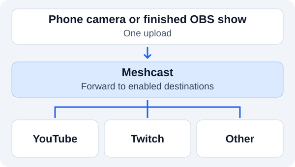
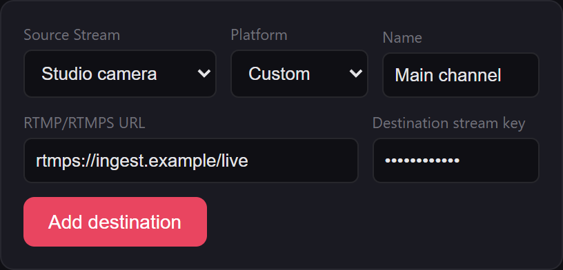

# Stream to multiple platforms with Meshcast

Upload one feed to Meshcast and forward it to several destinations, such as YouTube and Twitch. This is called multistreaming or restreaming.

## 1. Choose what viewers should see

| Your show | Send this to Meshcast |
| --- | --- |
| One phone camera | The [VDO.Ninja native app's RTMP](mobile-app/rtmp-to-meshcast.md) or [SRT output](mobile-app/srt-to-meshcast.md) |
| Guests, overlays, and scene changes | The finished program from OBS |

For a mixed show, bring the cameras into OBS first, then send OBS's finished program to Meshcast. Forwarding a raw camera stream will not include your OBS scenes or overlays.

Sign in to [Meshcast](https://app.meshcast.io/dashboard) and create a source under **Stream Keys**, or reuse one. A registered free account includes restream destinations; see [current plans](https://app.meshcast.io/pricing) for your account's limits.

## 2. Add destinations

1. Open **Restream / Forward** in the Meshcast dashboard.
2. Select the **Source Stream** you will publish to.
3. Choose the destination platform, or **Custom**.
4. Enter a name, the destination's **RTMP/RTMPS URL**, and its **Destination stream key**. Copy these from that platform's broadcast settings.
5. Select **Add destination** and leave it enabled. Repeat for each platform, using the same source stream.

<figure><figcaption>
Example values. Select your source first, then add the receiving platform's details.
</figcaption></figure>

Your **Meshcast Publish Key** lets the encoder upload to Meshcast. Each **destination stream key** lets Meshcast publish to that platform. Use each key only in its matching settings.

## 3. Publish once

1. In **Stream Links** or **Studio**, select the same Meshcast source and copy its publishing settings.
2. Configure the phone or OBS with those settings. For OBS RTMP output, use **Settings > Stream > Service: Custom**, then fill in **Server** and **Stream Key**.
3. Start the publisher. Meshcast forwards the feed to its enabled destinations.
4. Check picture and sound in each platform's preview. If the platform has a separate **Go Live** step, complete it there when ready.

Use **H.264 video and AAC audio** for a straightforward RTMP setup. If you also want Meshcast browser or VDO.Ninja playback, set **B-frames to 0** in the encoder.

Meshcast normally copies the video as received. It can convert WHIP's Opus audio to AAC for RTMP, but ordinary forwarding does not change video codec, resolution, or layout. For a different video format, use a separate [Cloud Transcoding session](https://app.meshcast.io/docs/transcoding) and check its displayed price before starting it.

## Stop and reuse the setup

Stop the publisher to stop the outgoing feeds. You can also disable an individual destination in Meshcast. Check each platform's broadcast page and end the event there if needed.

Destinations stay saved for the next broadcast. Reuse the same Meshcast source, check the destination keys, and confirm picture and sound again. Disabled destinations still count toward the account limit; delete one when you no longer need it.

## Quick fixes

| Problem | Check |
| --- | --- |
| No destinations receive video | Confirm the publisher uses the **Source Stream** selected in Restream. |
| Only one platform fails | Check its URL, key, enabled state, and broadcast preview. |
| Meshcast says **Forwarding**, but the platform is not live | Check the platform's preview and any separate **Go Live** step. |
| Wrong layout reaches viewers | Publish the finished OBS program instead of the raw camera feed. |
| Unsupported video codec | Set the source to H.264, or configure a separate transcoding session. |

For status details and optional reconnect protection, see [Meshcast's forwarding guide](https://app.meshcast.io/docs/restreaming).
