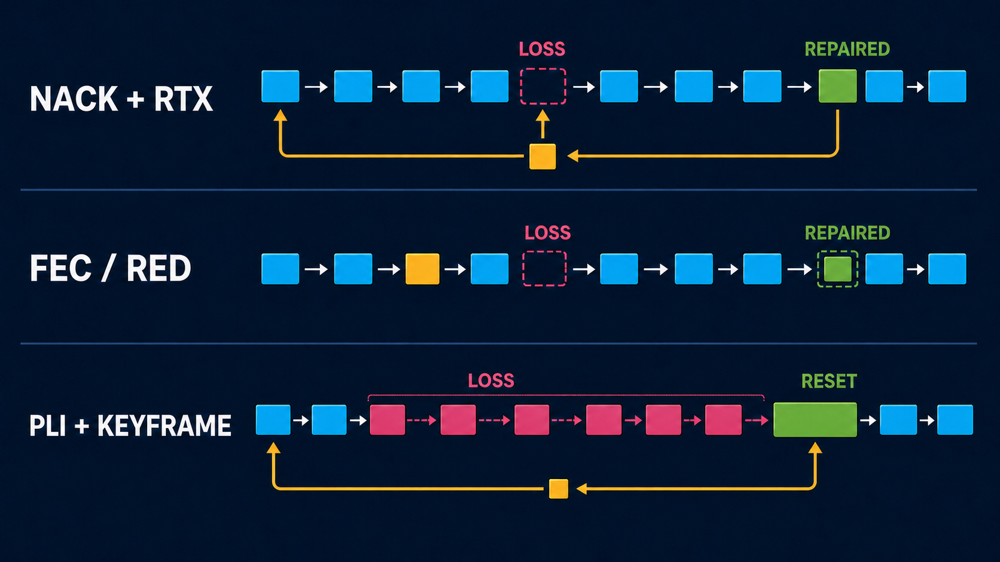
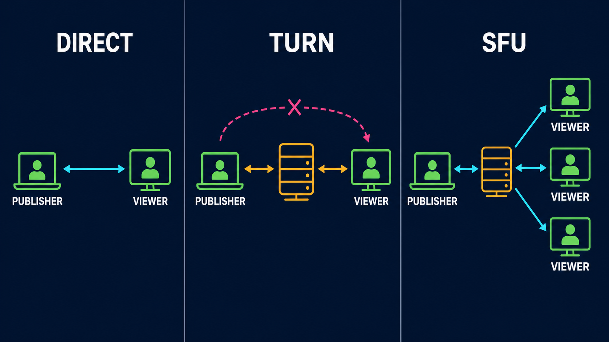
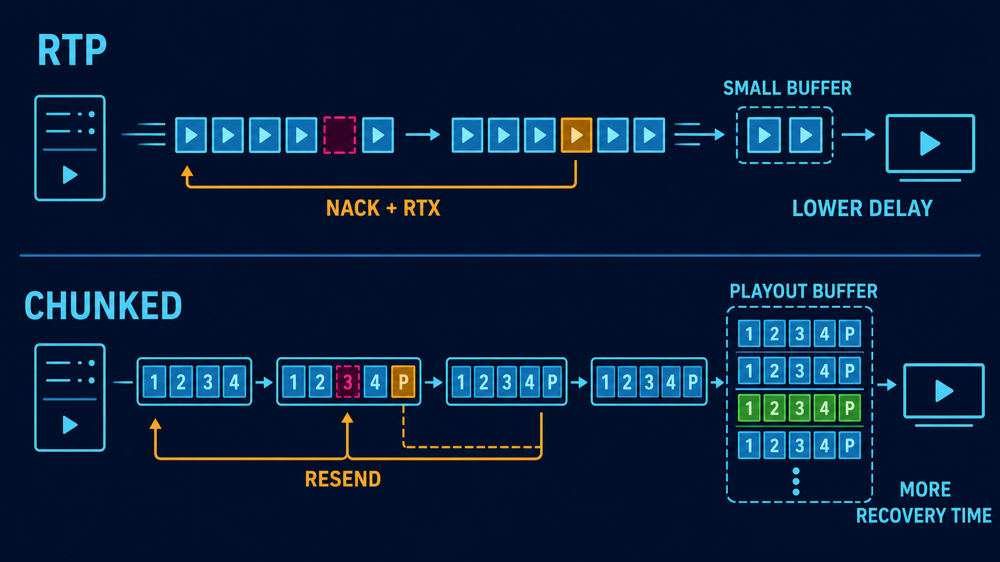

# Packet-loss recovery and resilient media

Packet loss can show up as a brief soft frame, a frozen picture, green or rainbow corruption, missing audio or a full disconnect. No single switch fixes all of these. First work out which layer failed:

| Layer | What went wrong |
| --- | --- |
| Capacity | The encoder produces more data than the path can carry. |
| Delivery | Individual RTP packets are missing, late or out of order. |
| Decode state | A lost reference frame damaged the frames that depend on it. |
| Route | The direct path or NAT traversal is failing. |
| Fan-out | One publisher encodes or uploads separately for too many viewers. |
| Application | Capture, encoder, decoder, audio clock or CPU is overloaded. |

## Start here

For fast gameplay where player names must stay readable, start with:

* 1280x720 at 30 fps, H.264 for the widest native-tool support, and no B-frames;
* a bitrate below your **sustained** upload rate, not the speed-test peak, with 25–40% spare for audio, resends and keyframes;
* a keyframe every one to two seconds;
* NACK and PLI left on.

```text
https://vdo.ninja/?push=STREAMID&quality=1&fps=30&prefervideocodec=h264&outboundvideobitrate=2500&maxvideobitrate=3000
https://vdo.ninja/?view=STREAMID&codec=h264&videobitrate=2500&buffer=500&keyframe=1000
```

Treat these as starting values. If the picture is sharp on a clean path but turns rainbow-coloured only during loss, the problem is damaged decoder references. If it is always soft, look at bitrate, resolution, capture scaling or encoder quality instead.

For text-heavy 1080p gameplay, drop from 60 to 30 fps before pushing the bitrate very low; 1080p30 can keep small names clearer than 720p60 at the same rate. No recovery method can restore detail the encoder already threw away. An encoder profile or CPU preset is not loss protection either: use a faster preset if a slow one overloads the CPU, and use H.264 High only if every receiver supports it.

## What each mechanism does

| Mechanism | Layer | On by default in VDO.Ninja RTP? | Benefit | Cost or limit |
| --- | --- | --- | --- | --- |
| Congestion control | Capacity | Yes, browser controlled | Lowers the rate before queues collapse | Quality or frame rate can drop sharply |
| Jitter buffer and concealment | Playback | Yes, browser controlled | Hides small timing variation and isolated audio loss | Adds delay; cannot rebuild missing video |
| NACK | Feedback | Yes, when negotiated | Asks for specific missing RTP packets | Needs at least one round trip |
| RTX | Retransmission | Normally, for browser video | Resends only what was requested, on a separate repair stream | Uses burst bandwidth; can arrive too late |
| PLI and keyframes | Decoder reset | Yes | Clears lasting reference-frame corruption | Does not restore the lost interval; keyframes are large |
| Opus in-band FEC | Audio repair | Normally, where supported | Repairs an earlier audio frame with no round trip | Extra audio overhead; covers limited loss patterns |
| RTP RED | Redundancy | No | Can carry earlier payload data in a later packet | Extra bandwidth; actual use is up to the browser |
| Video ULPFEC | Parity | No | Can rebuild some lost video packets without a resend | Extra bandwidth; little control from JavaScript |
| Forced TURN | Route | No | Replaces a blocked or poor direct route | Adds a server hop; does not repair packets |
| SFU / Meshcast | Topology | No | Publisher uploads once; the server fans out | Adds a server dependency and a hop |
| Chunked mode | Buffered alternate path | No | Explicit buffering, indexed frames, parity, selective resend, pacing and adaptation | More latency; narrower compatibility |

<figure><figcaption><p>Reactive retransmission waits for feedback. Proactive redundancy spends bandwidth before loss. A PLI and keyframe reset the decoder, but do not restore the damaged interval.</p></figcaption></figure>

RED is an RTP container that can carry an earlier payload alongside the current one; the sender decides what to include. Audio RED usually carries the previous Opus frame and can nearly double the audio bitrate. For video, browsers may pair RED with parity data, send little redundancy, or send none at all after negotiating it. VDO.Ninja's video RED flags only change negotiation preference; they do not force a duplicate stream or a repair percentage. By contrast, RTX resends only after a NACK, TURN forwards the same connection through a relay, and an SFU distributes one upload to many viewers.

## Normal VDO.Ninja RTP mode

Browser-managed RTP is the default and has the widest browser, room, OBS Browser Source and native-peer compatibility. By default you get:

* browser congestion control, bitrate estimation and jitter buffering;
* video NACK, RTX and PLI where both peers negotiate them;
* Opus loss concealment, and Opus in-band FEC where the browser enables it;
* direct connections first, with TURN servers offered so the browser can use a relayed route when no direct route works;
* no forced video RED, no forced TURN, no SFU and no chunked path.

The browser owns most of this. VDO.Ninja can keep, remove or reorder SDP feedback and payload preferences, but it cannot force a browser to use a particular repair rate.

### NACK and RTX

A NACK names missing RTP sequence numbers. Browsers normally answer with RTX, a separate repair stream that the receiver maps back to the original packet. It costs little on a clean path and repairs only what was missing. But a resend is useless if it arrives after the frame's playout deadline, it can worsen the congestion that caused the loss, and a long outage can outlast the sender's resend history.

There is no `&rtx=1` switch; compatible browsers negotiate RTX themselves when NACK is on. `&nonack` (alias `&nonacks`) removes NACK feedback and is for diagnostics only. A viewer buffer gives late packets and resends more time, at the cost of about that much added latency:

```text
https://vdo.ninja/?view=STREAMID&buffer=1000
```

### PLI, keyframes and rainbow corruption

Most codecs predict each frame from earlier ones. If a lost packet damages a reference frame, later packets can arrive perfectly and still decode as green blocks, rainbow smears or a frozen image. A Picture Loss Indication (PLI) asks the sender for a new keyframe, which starts a clean prediction chain. PLI is on by default; `&nopli` turns it off for diagnostics and usually makes recovery worse.

A viewer can also request periodic keyframes, in milliseconds. `&keyframe`, `&keyframerate`, `&keyframeinterval` and `&fki` are aliases:

```text
https://vdo.ninja/?view=STREAMID&keyframe=1000
```

A shorter interval limits how long corruption stays visible and helps decoders that missed a keyframe. But keyframes are much larger than other frames, can cause fresh loss on a nearly full uplink, and take bitrate away from motion detail. One second is a useful gameplay and WHIP test; two seconds is a safer general setting.

### Opus FEC and audio RED

Opus can conceal a missing packet from nearby audio, and with in-band FEC a later packet can carry a lower-rate copy of an earlier frame. This works best for isolated loss; it cannot cover a long burst. `&nofec` disables Opus in-band FEC for comparison tests.

Audio RED is the most direct RED test. Set the preference on the publisher and select it on the viewer:

```text
https://vdo.ninja/?push=STREAMID&preferaudiocodec=red
https://vdo.ninja/?view=STREAMID&audiocodec=red
```

Both ends must support RED with Opus; confirm the negotiated codec and audio bitrate in stats. The earlier audio arrives with the current packet, so it depends less on round-trip time than NACK and keeps speech intelligible through isolated loss. It can nearly double audio bandwidth, which can hurt a saturated uplink, and support varies by browser. With `&audiocodec=red`, VDO.Ninja lowers its stereo/pro-audio default from 256 to 216 kbps, because higher rates were unstable with RED.

`&redaudio` and `&fecaudio` (viewer, with `&audiocodec`) and `&predaudio` and `&pfecaudio` (publisher, with `&preferaudiocodec`) only change where RED or ULPFEC payloads sit in the audio codec order. They create no repair data if the browser does not send it.

On a lossy network, compressed Opus with FEC or RED is usually safer than PCM, which has no concealment and uses far more bandwidth.

### Video RED and ULPFEC

`&vred` on the viewer works together with `&codec`; `&pvred` on the publisher works together with `&prefervideocodec`. VP8 is the best first test:

```text
https://vdo.ninja/?push=STREAMID&prefervideocodec=vp8&pvred
https://vdo.ninja/?view=STREAMID&codec=vp8&vred&buffer=500
```

These flags move RED and ULPFEC up the SDP preference list when the browser offers them. The browser still decides whether to send repair traffic, and how much. Repair data can arrive without a NACK round trip and help with short random loss when there is spare upload. But the flags do not force a protection rate, H.264 and some browser pairs may not use the repair payloads, and the overhead competes with picture quality. Run an A/B test with the same codec, resolution, bitrate, route and loss; negotiating RED does not prove useful repair packets were sent.

### Codec choice

A different codec can improve compression, hardware use or decoding, but it does not replace loss recovery. H.264 is the safest common choice for OBS WHIP, Game Capture, the Ninja plugin and browsers. VP8 is a good browser baseline and the first choice for video RED tests. VP9 and AV1 can keep more detail at the same bitrate, but cost more to encode and have narrower native support. If names are unreadable on a clean link, try a more efficient codec, a lower frame rate or more bitrate within measured headroom. If only damaged frames are unreadable, focus on loss, resends and keyframes.

## TURN changes the route, not the repair

TURN relays the same encrypted peer connection when a direct route is blocked or worse. The endpoints still handle NACK, RTX, PLI, FEC, congestion control and decoding. VDO.Ninja prefers direct routes but includes TURN servers, so the browser can relay when no direct route works. If a direct route works but performs poorly, force TURN on both links to compare:

```text
https://vdo.ninja/?push=STREAMID&relay
https://vdo.ninja/?view=STREAMID&relay
```

`&relay`, `&private` and `&privacy` are aliases. Forced relay caps video at 4000 kbps (6000 kbps in speed-test mode). To use only TCP/TLS TURN candidates, add `&tcp` as well; `&tcp` on its own does not force TURN.

TURN can help when a strict NAT or firewall blocks direct connections, when the relay takes a cleaner route than a faulty direct one, or when peers must not see each other's addresses. It cannot repair local Wi-Fi loss before the relay, create upload capacity, combine two connections, fan one upload out to many peers, or transcode. It adds relay cost and usually latency. Over TURN/TCP or TLS, loss becomes head-of-line delay rather than a missing packet.

## Meshcast and SFUs change the topology

An SFU receives one upstream and forwards it to each viewer, usually handling feedback separately on each leg. In VDO.Ninja, add `&meshcast` to the publishing guest or director link:

```text
https://vdo.ninja/?room=ROOM&push=STREAMID&meshcast
```

The publisher then uploads and encodes once, and one slow viewer is less likely to slow the others. But the publisher-to-server uplink is still a single point of loss, the server adds a hop and a dependency, its location affects latency, and it cannot make a too-high source bitrate fit the publisher's uplink. Use an SFU when fan-out is the problem and TURN when the route is the problem. See [`&meshcast`](../newly-added-parameters/and-meshcast.md).

<figure><figcaption><p>Direct media stays between peers. TURN changes the route for the same one-to-one connection. An SFU accepts one publisher upload and distributes it to multiple viewers.</p></figcaption></figure>

WHIP and WHEP only set up the session with an HTTP endpoint; the media is still RTP. A WHIP endpoint may be an SFU and may supply TURN servers, but WHIP itself promises no RTX, RED, FEC, packet cache or downstream repair. Check what the actual server and client implement.

## Chunked mode: more buffer, frame-aware repair

[Chunked mode](../newly-added-parameters/and-chunked.md) is opt-in. It replaces RTP video with encoded frames sent over an ordered, reliable data channel.

<figure><figcaption><p>Normal RTP favors lower delay and has less time to repair a packet before playback. Chunked mode deliberately holds more media so parity and selective resend have a larger recovery window.</p></figcaption></figure>

```text
https://vdo.ninja/?push=STREAMID&chunked=2500&chunkbitrate=2500
https://vdo.ninja/?view=STREAMID&chunkbuffer=1500
```

* `&chunked=2500` enables chunked mode at 2500 kbps; it is **not** a 2500 ms buffer. With no number it uses 2500 kbps. `&chunkbitrate` sets the bitrate explicitly.
* `&chunkedbuffer` (publisher) is the sender backlog window: 500 ms by default, 5000 ms if given with no number.
* `&chunkbuffer` (viewer) is the playout target: 3000 ms by default.
* `&chunkcodec=h264`, `vp8`, `vp9` or `av1` picks the chunked encoder; `&codec` does not.

Plain chunked mode has no parity or selective resend. A robust manual setup:

```text
https://vdo.ninja/?push=STREAMID&quality=1&fps=30&chunked=2500&chunkbitrate=2500&chunkindex=1&chunkfec=4&chunknack=1&chunkedbuffer=1500&chunkadapt=hybrid&chunkadaptfloor=700&chunkadaptceil=2500
https://vdo.ninja/?view=STREAMID&chunkbuffer=1500&chunkbufferfloor=1000&chunkbufferceil=3000&chunkjitterslack=300&chunknackattempts=8&chunknackdelay=250
```

Or use a preset with `&chunkprofile` on both links. The publisher takes the parity, NACK and adaptation values; the viewer takes the buffer values.

| Selection | Indexed framing | Parity | Selective NACK | Starting playout target | Adaptation |
| --- | --- | --- | --- | --- | --- |
| Plain `&chunked` | Off unless parity or NACK is on | Off | Off | 3000 ms | Bitrate |
| `chunkprofile=mobile` | On | `chunkfec=3` | On | 900 ms | Frame rate |
| `chunkprofile=balanced` | On | `chunkfec=4` | On | 750 ms | Hybrid |
| `chunkprofile=desktop` | On | `chunkfec=5` | On | 620 ms | Bitrate |

Explicit values are better when a production needs a known latency budget. To keep talkback snappy, add `&nochunkaudio` to the viewer: video uses the chunked path while audio stays on normal low-latency Opus RTP.

**Parity and resend.** `&chunkfec=N` adds one XOR parity chunk for each group of up to N data chunks in a frame, and can repair one missing chunk per group. A frame with fewer than N chunks still gets a full parity chunk, so overhead is often well above 1/N, and near 100% when each frame fits in one chunk. `&chunknack=1` lets the viewer request a missing chunk from the publisher's resend cache (`&chunkcache`); the viewer sets retry timing with `&chunknackattempts` and `&chunknackdelay`. Both turn on indexed framing (`&chunkindex`) automatically.

The data channel is already ordered and reliable, so on a direct path UDP loss usually appears as resend delay and head-of-line blocking, not a missing chunk. Parity and selective resend add frame awareness for incomplete, trimmed or relayed payloads; they do not remove the channel's ordering delay.

**Pacing and adaptation.** Chunked mode also applies per-viewer backpressure, trims its queue on decodable boundaries instead of sending a broken group of pictures, resets with a keyframe after trimming, skips a stale incomplete frame rather than stalling, and lowers bitrate, frame rate or both before the buffer empties. Examples:

```text
&chunkadapt=bitrate&chunkadaptfloor=600&chunkadaptceil=2500
&chunkadapt=framerate&chunkadaptmaxdrop=10
&chunkadapt=hybrid&chunkadaptresolution=1
```

You can watch `buffer_level`, `buffer_delta`, `fec_repairs` and `nacks_sent` in stats. The costs: more latency, ordered delivery can stall behind one loss, parity uses steady bandwidth and resends use bursts, and encoder support depends on the browser. OBS WHIP, Game Capture and the Ninja native publisher and receiver do not support this format, and SFU or WHIP routes do not carry it. Add `&nochunked` to a browser viewer that must stay on normal RTP.

## Troubleshooting by symptom

**Rainbow, green or smeared video** usually means a damaged prediction chain.

1. Check whether packet loss or PLI rises at the same time.
2. Leave NACK and PLI on, and test a one-to-two-second keyframe interval.
3. Lower the bitrate enough to leave room for repairs and keyframes.
4. Compare direct and forced TURN routes.
5. If fan-out overloads the source, move distribution to an SFU.
6. If extra delay is acceptable, test chunked mode.
7. If only one decoder shows it, compare H.264, VP8 and VP9 on that receiver.

Do not raise bitrate, add redundancy and shorten keyframes all at once; each adds traffic.

**Frozen video while audio continues.** The decoder may be waiting for a keyframe, a resend may have arrived too late, a sender queue may be blocked, the video encoder or GPU may have failed, or the viewer may have requested a codec it cannot decode reliably. Check the publisher's local preview, encoder overload, outbound FPS, keyframe cadence, viewer decoded FPS, PLI count and selected candidate path.

**Soft video with no corruption** is usually rate adaptation or too small an encoder budget. Lower the frame rate before giving up the resolution names need. Use `&degrade=maintain-resolution` on the viewer for text and UI, or `&degrade=maintain-framerate` for motion. Keep the target below sustained capacity.

**Audio pops, gaps or robotic speech.** Check audio loss, jitter, RTT and CPU at the same moment. Use Opus rather than PCM, leave in-band FEC on, test audio RED if there is spare bandwidth, add a modest viewer buffer, and check that the capture device is not clipping or changing format. RED and FEC cannot fix clipping already in the local recording.

**Audio and video freeze together.** This points to route failure, a large queue, CPU starvation or the app pausing. Check ICE state, candidate type, queue growth, signalling reconnects, system load and whether local capture stopped.

**Encoder overload.** Network settings cannot repair frames that were never encoded. Use a faster preset, lower FPS or resolution, use stable hardware encoding, avoid unsupported H.264 profiles, and leave the GPU room for capture. For many viewers, use one shared encode and an SFU.

## Native tools compared

These notes describe the source code of each tool at the time of review. The tools are narrower than the browser app and change over time.

| Feature | VDO.Ninja browser RTP | OBS native WHIP output | Game Capture | Ninja OBS Plugin publisher | Ninja native receiver |
| --- | --- | --- | --- | --- | --- |
| Role | Publish and receive | WHIP publish only | VDO.Ninja publish | VDO.Ninja publish | VDO.Ninja receive |
| Default video | Browser negotiated | OBS H.264 or AV1; HEVC in some builds | H.264, 1080p60, 12 Mbps | H.264, 4 Mbps | H.264 or VP9 |
| Audio | Opus and alternatives | Opus | Opus | Opus | Opus |
| Video NACK | Yes | Yes | H.264/H.265/AV1 paths | Yes, with paced repair in newer builds | Does not send NACK |
| Separate RTX stream | Normally yes | No | No | No | Accepts offered RTX |
| PLI recovery | Yes | Advertised; no encoder keyframe on request | Requests encoder keyframe on H.264/H.265/AV1 | Waits for the next scheduled keyframe (two seconds or less) | Sends PLI on connect and decoder errors |
| Video RED/FEC | Browser dependent | No | No | No; opt-in packet duplication in v1.1.60+ | Uses only the primary RED payload |
| Opus FEC | Browser controlled | Requested; OBS encoder loss settings not configured | Advertised but not enabled in the encoder | Depends on the OBS Opus encoder | Decodes Opus only |
| Audio RED | Browser dependent | No | No | Opt-in in v1.1.60+, plain Opus fallback per viewer | No |
| TURN | Offered automatically; force with `&relay` | ICE servers from the WHIP endpoint | UI modes; fetches VDO.Ninja TURN list | Custom TURN only | Same custom ICE settings |
| SFU | `&meshcast` | Endpoint may be an SFU | No | No | Not applicable |
| Chunked media | Opt-in | No | No | No | No |
| Rate adaptation | Browser controlled | Fixed OBS rate | Mostly fixed, with warnings | Fixed; opt-in REMB adaptation in newer builds | Requests a REMB target |

None of these native publishers send a separate RTX stream. OBS WHIP and Game Capture use libdatachannel's NACK responder to resend the original packet with its original sequence number; newer Ninja plugin builds use their own bounded cache. Receivers that accept a late duplicate handle this, but it is not the RTX repair stream browsers use with each other.

### OBS Studio native WHIP output

OBS's WHIP output sends the program feed to a WHIP endpoint, which may pass it to VDO.Ninja viewers or an SFU. It fragments video at about 1200 bytes, keeps a 4000-packet video NACK cache (about three seconds at 8.5 Mbps, per the source), resends original packets on NACK, paces at roughly ten times the bitrate to smooth bursts, disables B-frames, repeats headers, and takes STUN/TURN servers from the endpoint's `Link` headers.

It has no RTX stream, no video RED or FEC, no chunked mode, and no congestion control that lowers the OBS encoder rate. SDP advertises PLI, but no handler forces an immediate keyframe, so unrepairable video waits for OBS's next scheduled keyframe. Audio does not advertise NACK and relies on Opus concealment and FEC.

1. In OBS, open **Settings > Stream** and select **WHIP**.
2. Enter the VDO.Ninja WHIP endpoint and stream token.
3. Use H.264 unless the whole path is verified with AV1 or HEVC.
4. Set the keyframe interval to one or two seconds, and keep B-frames at zero.
5. Start below your measured sustained upload rate. For complex 1080p30 gameplay, test 4.5–6 Mbps only on an uplink that can sustain much more; on a weaker link, try 720p30 at 2.5–4 Mbps.
6. Turn on OBS automatic reconnect, so a stopped output starts a fresh WHIP session.

TURN depends on the endpoint's ICE server response; there are no `&relay` or `&tcp` equivalents in the OBS UI. VDO.Ninja URL flags for video RED, chunked mode, relay or Meshcast do not change OBS's native output. See [Recommended OBS WHIP settings](obs-whip-output-settings.md).

### Game Capture

Game Capture is a native Windows publisher that uses VDO.Ninja signalling and direct peer connections, not WHIP. Its UI defaults are 1920x1080 at 60 fps, H.264, 12000 kbps, **Direct STUN (Recommended)**, ten viewers and a 640x360 lower-quality room tier. Other ICE modes are **Auto with TURN fallback**, **Relay Only** and **Host Only (LAN)**; bitrate presets are 20000, 12000, 6000 and 3000 kbps.

* **Video:** H.264, H.265 and AV1 have a 512-packet NACK cache (much smaller than OBS WHIP's), PLI-to-keyframe handling, a GOP of 60, no B-frames, and a keyframe request about every 2.5 seconds. The VP9 path skips that NACK/PLI chain and defaults to all-keyframe encoding, which recovers on the next frame but costs much more bitrate and CPU.
* **Audio:** 10 ms Opus frames. FEC is advertised but not enabled in the encoder; there is no audio RED or NACK.
* **Connection:** signalling reconnects with delays from one to ten seconds. A director refresh or ICE-restart request rebuilds the peer. A hard-failed peer is removed; if a Direct STUN peer fails, the app fetches TURN servers and switches *later* connections to Auto.

The defaults suit a strong machine and network. For remote gameplay on Wi-Fi, cellular or an older CPU, start with H.264 at 720p30 and 3000–6000 kbps, use Direct STUN for the lowest latency, switch to Auto when strict networks block connections, and use the 640x360 tier for monitoring. After a failed peer switches the app to Auto, refresh the connection. See [Using Game Capture and Spout2](using-game-capture-with-vdo.ninja.md).

### Ninja OBS Plugin

The plugin has a native VDO.Ninja publisher output and a VDO.Ninja source. The source's default receive mode is a browser source, which inherits all browser behaviour, including NACK/RTX, PLI and chunked receive. An experimental native receiver is also available. See [Using the Ninja OBS Plugin](using-ninja-obs-plugin-with-vdo.ninja.md).

**Publisher defaults:** H.264, Opus, 4000 kbps, ten viewers, data channel on, automatic signalling reconnect, Google and Cloudflare STUN, no TURN unless you add custom ICE servers, and **Force TURN** off. The service disables B-frames, repeats headers and clamps the keyframe interval to two seconds or less. Custom ICE settings replace the built-in STUN servers; enable **Force TURN** only when that list includes a working TURN server.

**Always active:** video NACK with paced resends of original packets (a cache of up to 2048 packets, 4 MiB or two seconds, with a 500 ms deadline), a frame-aware pacer at about twice the encoder rate, whole-frame queue relief instead of sending partial frames, and PLI/FIR handling with the two-second keyframe limit. OBS offers no on-demand keyframe, so a viewer that sends PLI waits for the next scheduled keyframe. After a known local frame loss, the plugin holds dependent frames until a complete keyframe is sent, so the picture freezes briefly instead of corrupting. The publisher sends no RTX stream and no video RED, ULPFEC or FlexFEC.

**Opt-in, v1.1.60 and later:**

| Setting | What it does | Extra traffic |
| --- | --- | --- |
| **Packet Duplication: Off** (default) | No duplicate traffic. NACK, pacing and PLI still run. | None |
| **Packet Duplication: Low** | Sends every keyframe packet twice | Up to 20% of video |
| **Packet Duplication: Medium** | Keyframe packets plus every fourth delta packet | Up to 50% |
| **Packet Duplication: High** | Every video packet can get one copy | Up to 100% |
| **Audio RED** | RFC 2198 RED with the current and previous Opus frame, for viewers that accept it; others get plain Opus | Up to about double audio |
| **Adaptive Bitrate from REMB** | Lowers a supported OBS encoder and the pacer to the lowest viewer REMB estimate, with a floor; restores the bitrate when publishing stops | Not applicable |

Copies keep the original packet's sequence number, become eligible 15 ms after it and expire after 250 ms. They use only idle capacity and rank below NACK repairs. This is best-effort duplication, not RTX, RED or FEC. The limits are on top of the video target, and direct fan-out multiplies them: a 4 Mbps publisher with three viewers already uploads about 12 Mbps of video, and High duplication can add nearly 12 Mbps more. Audio RED wraps already-encoded frames and does not turn on Opus in-band FEC, which depends on the OBS encoder. Browser flags such as `&vred` and `&pvred` do not affect the plugin.

The plugin does not offer video RED or ULPFEC because it has no parity generator; advertising those payloads would negotiate labels without real repair packets. libwebrtc also disables RED/ULPFEC for H.264 when NACK is on. FlexFEC is a possible future option.

Newer builds log a `Publish:` summary every 30 seconds. Pacer or queue drops point to publisher-side loss. Rising NACK, cache misses or late repairs with no local drops point to transport loss or too little recovery time. REMB staying below your bitrate suggests lowering it, reducing fan-out or testing adaptive mode. Compare protection off and on over the same route and viewer count, and turn it down if loss, delay or pacer pressure rises.

**Experimental native receiver:** supports H.264 or VP9, Opus, optional VP9 alpha, receiver reports and REMB requests, hardware decode with software fallback, and reconnect backoff. It does not send NACK, uses only the primary payload of video RED, has no reorder or jitter buffer of its own, and relies on PLI and decoder resets after loss. Use H.264, keep NACK and PLI on the browser publisher with a one-to-two-second keyframe interval, and use the browser-backed source on lossy routes or when you need video RED or chunked mode.

## Test one change at a time

1. Record a clean RTP baseline.
2. Add random loss without changing the bitrate.
3. Test a lower bitrate, then a shorter keyframe interval.
4. Test RED or FEC on its own.
5. Test forced TURN on the same route.
6. Test SFU fan-out separately from direct peers.
7. Test chunked mode at a recorded playout delay.

On a disposable Linux test host, add 50 ms of delay and 10% random loss on one interface's outgoing traffic, then remove it afterwards. Replace `IFACE` with the exact interface; shaping both directions changes the resulting round-trip time.

```bash
sudo tc qdisc replace dev IFACE root netem delay 50ms loss random 10%
sudo tc qdisc del dev IFACE root
```

| Test | Loss | Added delay | Purpose |
| --- | --- | --- | --- |
| Clean | 0% | 0 ms | Encoder and baseline quality |
| Mild random | 2% | 50 ms | Normal NACK/RTX behaviour |
| Severe random | 10% | 50 ms | Repair overhead and decoder stability |
| High RTT | 10% | 300 ms | Resend deadlines and buffering |
| Burst | 20–30% for 2–5 s | 250–400 ms RTT | Queue relief, keyframes and reconnects |

Record the push and view URLs; codec, resolution, FPS and bitrate; loss, jitter, RTT, NACK, retransmission, PLI and keyframe counters; the selected candidate pair (the source of truth for direct or relayed); encoder overload and dropped frames; time until a clean frame returns; audio gaps; and, for chunked mode, buffer target and level, parity repairs, NACKs and rebuffers.

| Result | Likely meaning |
| --- | --- |
| A lower bitrate fixes loss and corruption | The path was congested; redundancy would have made it worse |
| Forced TURN fixes it | The direct route or NAT path was the problem |
| Forced TURN is worse | The relay added latency, congestion or a poorer route |
| NACK rises, but resends arrive in time | Reactive repair is working |
| NACK rises and PLI still rises | Resends are late, missing or outside the cache |
| Audio RED helps and total traffic stays stable | Audio redundancy fits your headroom |
| RED negotiation changes but nothing else does | The browser probably sent no useful repair data |
| Short keyframes clear corruption but cause new loss | Not enough headroom for keyframe bursts |
| An SFU fixes multi-viewer instability | Publisher fan-out was the bottleneck |
| Chunked mode is smooth only with a larger buffer | The route needs more recovery time than low-latency RTP allows |
| The local recording is damaged too | Capture or encoder problem, not transport |

## Decision order

1. Fix encoder overload.
2. Keep the bitrate below sustained capacity.
3. Leave NACK, RTX, PLI and Opus FEC on.
4. Set a sensible keyframe interval.
5. Add a modest viewer buffer if latency allows.
6. A/B test a TURN route.
7. Use an SFU when publisher fan-out is the limit.
8. A/B test audio RED, browser video RED or plugin packet duplication within a set total-traffic budget.
9. Use chunked mode when you can accept more latency and narrower compatibility.
10. Keep a local recording for outages no live transport can cross.

## Related guides

* [Low-bandwidth video and connection profiles](low-bandwidth-video-and-connection-profiles.md)
* [Video bitrate for push/view links](video-bitrate-for-push-view-links.md)
* [Diagnosing problems with the stats panel](stats-menu/troubleshooting.md)
* [Stable IRL streaming](irl-streaming-stability.md)
* [Chunked-mode parameter guide](../newly-added-parameters/and-chunked.md)
* [Video RED parameter guide](../advanced-settings/view-parameters/vred.md)

## Protocol references

* [RFC 4585: RTP feedback, NACK and PLI](https://www.rfc-editor.org/rfc/rfc4585)
* [RFC 4588: RTP retransmission payload format](https://www.rfc-editor.org/rfc/rfc4588)
* [RFC 2198: RTP redundant payloads](https://www.rfc-editor.org/rfc/rfc2198)
* [RFC 5109: Generic RTP forward error correction](https://www.rfc-editor.org/rfc/rfc5109)
* [RFC 6716: Opus](https://www.rfc-editor.org/rfc/rfc6716)
* [RFC 8656: TURN](https://www.rfc-editor.org/rfc/rfc8656)
* [RFC 9725: WHIP](https://www.rfc-editor.org/rfc/rfc9725)
* [libwebrtc video sender RED/ULPFEC and FlexFEC selection](https://chromium.googlesource.com/external/webrtc/+/master/call/rtp_video_sender.cc)
* [libwebrtc video receiver RED/ULPFEC path](https://chromium.googlesource.com/external/webrtc/+/master/video/rtp_video_stream_receiver.cc)
