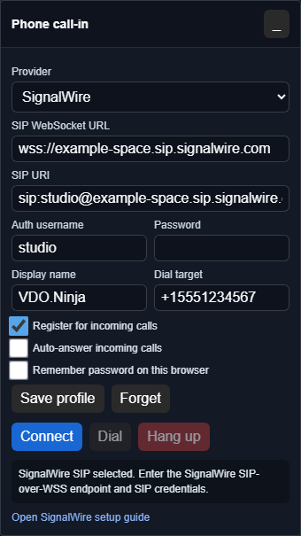
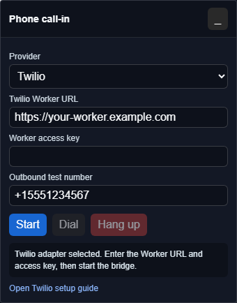

# Phone call-in provider options


The call-in panel is experimental. A phone caller is mixed into the audio of the page running the panel. Callers do not get a guest tile, scene membership, per-guest volume, or other director controls.


The `&callin` panel answers phone calls inside VDO.Ninja. You bring the phone number and minutes from a provider or your own PBX. To use any phone with an external mixer instead, see [Phone call-ins with virtual audio cables](phone-call-ins-with-vdo-ninja-and-virtual-audio-cables.md).


## Choose a provider

| Option | Panel mode | What you need | Setup guide |
| --- | --- | --- | --- |
| SignalWire | `&callin=signalwire` | A SignalWire number routed to a SIP endpoint. No server of your own. | [SignalWire SIP call-in setup](signalwire-sip-call-in-setup.md) |
| Twilio | `&callin=twilio` | A Twilio number and a backend you run to issue browser tokens and PINs. | [Twilio phone call-in setup](twilio-phone-call-in-setup.md) |
| Your own PBX | `&callin=sip` | Asterisk, FreePBX, FreeSWITCH, or similar, with a WebRTC extension. Add a number from any SIP trunk (VoIP.ms, IPComms, Telnyx, and others), or none for an existing SIP or AoIP system. | [Use your own PBX](signalwire-sip-call-in-setup.md#use-your-own-pbx-or-sip-server) |
| Telnyx | Not available | Listed in the panel but not connected: Telnyx browser calling needs its own SDK and tokens. Use Telnyx as a SIP trunk behind your own PBX. | |

Prices change. Check [SignalWire](https://signalwire.com/pricing/voice), [Twilio](https://www.twilio.com/en-us/voice/pricing/us), [Telnyx](https://telnyx.com/pricing/elastic-sip), or [VoIP.ms](https://voip.ms/pricing) before buying a number.

## Open the panel

Add `&callin` to the director link, or to any VDO.Ninja page that sends audio:

```
https://vdo.ninja/?director=YourRoomName&callin=signalwire
```

`&callin` with no value opens SIP mode, or the provider saved in this browser. You can drag and minimize the **Phone call-in** panel, and switch **Provider** inside it. It handles one audio-only call at a time and rejects a second incoming call. Keep the page open while you take calls.

<figure><figcaption><p>SignalWire and SIP modes register the browser as a SIP endpoint.</p></figcaption></figure>

<figure><figcaption><p>Twilio mode talks to your token backend.</p></figcaption></figure>

## How the panel mixes audio

The panel builds the same mix-minus returns as an external mixer:

* **The room hears the caller** through this page's outgoing audio. On a director page, click **Enable director's microphone or video** so guests receive it.
* **The caller hears** this page's microphone plus every participant whose audio this page receives, but not themselves.
* **You hear the caller** on this page's normal audio output, or on another device set with `&callinoutput`.

Everyone should wear headphones. A caller played through speakers can reach a microphone and echo back to the caller.

### Microphone mute and private conversations

* Muting your microphone silences only you. The caller still hears guests, and the room still hears the caller.
* Muting your speakers only stops your local monitoring and ringtone.
* During **Solo Talk** on the director page, or private-chat isolation on a guest page, the caller's whole return feed pauses so the private conversation is not sent to them. It resumes when the private conversation ends. The caller stays on air; hang up to remove them.

### Get the caller into OBS

The caller is not a guest, so a guest-only scene link does not include them. Either:

* include the director's feed in the scene OBS captures (for example with `&showdirector`), if OBS does not already capture the host microphone; or
* add `&callinoutput=DeviceName` to play the caller into a spare virtual cable, and add that cable to OBS. You then need another way to listen to the caller.

The [OBS call-in show](call-in-show-with-obs.md) setup keeps the director out of OBS's caller source, so use the second option there.

## Incoming ringtone

The bell button picks **Classic ring**, **Bell**, **Chime**, **Custom upload**, or **Silent**, with preview and volume. The setting stays in this browser, and the ringtone plays only on your computer, never to the room or caller. Auto-answered calls do not ring.

**Upload** opens `fileuploads.vdo.ninja`, which hosts the file as public media; the panel stores only its HTTPS address.

## Credentials

Put only scoped, short-lived credentials in the browser:

| Credential | In the browser? |
| --- | --- |
| SIP extension username and password | Yes, typed into the panel. Use a dedicated extension. |
| Short-lived Twilio browser token | Yes. Your backend issues it. |
| Twilio Auth Token or API Key Secret, SignalWire or Telnyx project tokens | No. Backend or provider dashboard only. |

Never put a password in a URL. `&sippass` and `&callinpass` are ignored and removed from the address bar. To store a SIP profile in the browser, see [Saved profiles and passwords](signalwire-sip-call-in-setup.md#saved-profiles-and-passwords).

## URL parameters

| Parameter | Alias | Purpose |
| --- | --- | --- |
| `&callin=sip` | | SIP / PBX mode. Default when `&callin` has no value. |
| `&callin=signalwire` | | SIP mode with SignalWire hints. |
| `&callin=twilio` | | Twilio mode. |
| `&callinapi=https://...` | `&twilioapi` | Twilio backend URL. |
| `&twiliotarget=+15551234567` | `&callintarget` | Twilio outbound test number. |
| `&sipwss=wss://pbx.example.com:8089/ws` | `&callinwss` | SIP WebSocket URL. |
| `&signalwirespace=your-space` | `&swspace`, `&callinspace` | SignalWire mode: sets the WebSocket URL to `wss://your-space.sip.signalwire.com` if `&sipwss` is absent. |
| `&sipuri=sip:1001@example.com` | `&callinuri` | SIP URI. |
| `&sipuser=1001` | `&callinuser` | Auth username, if different from the SIP URI user. |
| `&sipdisplay=Studio` | `&callindisplay` | Display name. Default `VDO.Ninja`. |
| `&siptarget=sip:1002@example.com` | `&callintarget` | Outbound dial target. A phone number becomes `sip:number@` your SIP domain. |
| `&sipregister=0` | `&callinregister` | Do not register for incoming calls (on by default). |
| `&sipauto` | `&callinauto` | Connect SIP or SignalWire mode on page load. Twilio always needs **Start**. |
| `&sipautodial` | `&callinautodial` | Dial the target once connected. Use with `&sipauto`. |
| `&sipautoanswer` | `&callinautoanswer` | Answer incoming calls automatically, including in Twilio mode. |
| `&callinoutput=DeviceName` | `&sipoutput` | Output device for the caller monitor and ringtone. Matches part of the device name, where the browser supports it. |

Switches accept `0`, `false`, `off`, or `no` to turn them off.

## Test before going live

1. Join the room as a guest from a second device, connect the panel, and call from a regular phone.
2. The guest hears the caller, and the caller hears you and the guest.
3. The caller hears no delayed copy of themselves.
4. With your microphone muted, the caller still hears the guest. During Solo Talk, the caller's return goes silent, then resumes.
5. After hanging up, the panel clears the call.

## Provider references

* [SignalWire SIP over WebSockets](https://signalwire.com/blogs/product/webrtc-using-sip-over-websockets)
* [Twilio Access Tokens](https://www.twilio.com/docs/iam/access-tokens)
* [Telnyx WebRTC browser calling](https://developers.telnyx.com/docs/voice/webrtc/make-a-call-to-a-web-browser)
