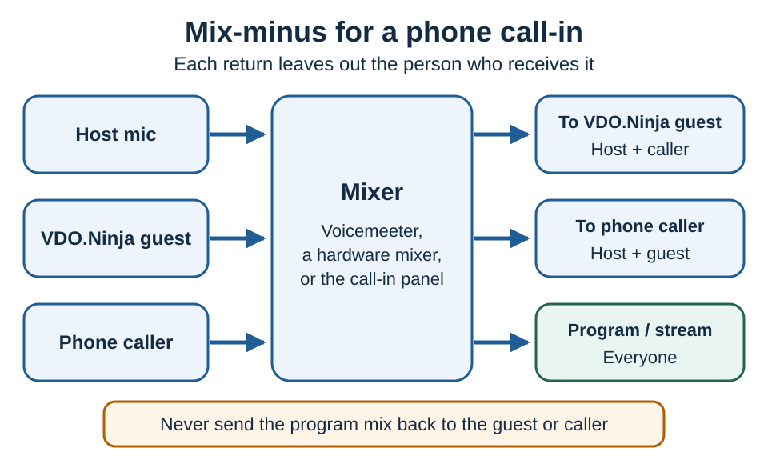

# Phone call-ins with VDO.Ninja and virtual audio cables

This setup brings a phone caller into a VDO.Ninja show through an external mixer. It works with any phone, softphone, or calling app. To answer calls inside VDO.Ninja instead, see the experimental [call-in panel and provider options](phone-call-in-provider-options.md).



## The rule: two separate returns

Everyone needs to hear the other talkers, but never a delayed copy of themselves. That takes two **mix-minus** returns plus your program mix:

| Mix | Contains | Leaves out | Send it to |
| --- | --- | --- | --- |
| Guest return | Host + phone caller | VDO.Ninja guest | VDO.Ninja, selected as the host's microphone |
| Caller return | Host + VDO.Ninja guest | Phone caller | The phone app, softphone, or phone interface |
| Program | Everyone | Nobody | OBS, your stream, or your recorder |

The most common mistake is sending the program mix back to a guest or caller. That causes echo.

## What you need

* A way to get the call into the computer or mixer: a phone on a mixer input, a softphone or browser calling app, or a USB phone interface.
* The VDO.Ninja guest's audio on the host computer, for example from a view link in Chrome or [Electron Capture](../steves-helper-apps/electron-capture.md).
* A mixer with at least two output buses: Voicemeeter Banana or Potato on Windows, a hardware mixer with custom routing (such as a RØDECaster Pro or Duo), or virtual cables between apps (VB-CABLE, Virtual Audio Cable, Loopback, BlackHole).

## Voicemeeter example

Device names vary by system.

1. Install Voicemeeter Banana or Potato and at least one virtual audio cable.
2. Put the host microphone on a hardware input.
3. Play the VDO.Ninja guest into a virtual cable, then add that cable as a Voicemeeter input. You can set the output in the browser, in Electron Capture, or with [`&audiooutput`](../advanced-settings/setup-parameters/and-audiooutput.md) on the view link.
4. Bring the phone caller in on another input, such as a softphone output, a USB phone channel, or another cable.
5. Make a **guest return** bus with the host mic and caller only. Select it as the microphone on the host's VDO.Ninja page.
6. Make a **caller return** bus with the host mic and guest only. Select it as the microphone in the phone app, or send it to the phone interface.
7. Make a **program** bus with all three and send it to OBS or your recorder.

Because the host's VDO.Ninja microphone is now a finished mix, you can add [`&proaudio`](../advanced-settings/audio-parameters/and-proaudio.md) to the host link. It turns off the browser's echo cancellation, noise suppression and auto-gain. Use it only with headphones and correct mix-minus routing, because echo cancellation will no longer hide a bad loop.

```
https://vdo.ninja/?room=YourRoomName&label=Host&proaudio
```

## Hardware mixer example

1. Connect the host computer to the mixer over USB.
2. Connect the phone over USB, Bluetooth, or the mixer's phone or TRRS input.
3. Bring the VDO.Ninja guest audio from the computer into its own mixer channel.
4. In the mixer's routing matrix, set the **phone send** to host + guest, the **computer send** (VDO.Ninja) to host + caller, and the **stream send** to everything.

The brand does not matter. What matters is that the phone return and the VDO.Ninja return are different mixes.

## Using OBS for routing

An OBS Browser Source can capture the VDO.Ninja guest for the stream, but OBS has a single audio monitoring device. Two independent returns usually need Voicemeeter, a hardware mixer, or a per-source monitoring plugin. For sending OBS audio into VDO.Ninja through a cable, see [Share audio from OBS](share-obs-audio-with-vdo-ninja.md).

## Useful VDO.Ninja parameters

| Parameter | Use |
| --- | --- |
| [`&audiooutput`](../advanced-settings/setup-parameters/and-audiooutput.md) (alias `&od`) | Plays VDO.Ninja audio to a named output device, such as a virtual cable, in browsers that support it. |
| [`&proaudio`](../advanced-settings/audio-parameters/and-proaudio.md) | Sends a pre-mixed feed at higher quality without browser processing. |
| [`&aec=0`](../source-settings/aec.md), [`&denoise=0`](../source-settings/and-denoise.md), [`&autogain=0`](../source-settings/autogain.md) | Turn off single processing steps when a mixer already handles them. Keep echo cancellation on if anyone listens on speakers. |
| [`&miconly`](../source-settings/miconly.md) | Audio-only host or utility connection. |

## Test before going live

Connect all three parties, then check:

1. When the host speaks, the guest and caller both hear it.
2. When the guest speaks, the host and caller hear it, and the guest hears no delayed copy.
3. When the caller speaks, the host and guest hear it, and the caller hears no delayed copy.
4. The stream or recording contains all three voices.
5. Muting one source removes only that source.

## Troubleshooting

| Symptom | Likely cause |
| --- | --- |
| The guest hears the caller, but the caller can't hear the guest | The caller return is missing the guest. |
| The caller hears the guest, but the guest can't hear the caller | The host's VDO.Ninja microphone is missing the caller. |
| Echo | A return includes the person receiving it, or a microphone picks up a speaker. |
| Crackling or distortion | Virtual cable buffer or sample-rate mismatch. Use 48 kHz where possible and raise the buffer size. |
| Audio works in OBS but not in VDO.Ninja | The wrong side of the cable is selected. On Windows, apps play to **CABLE Input** and record from **CABLE Output**. |
