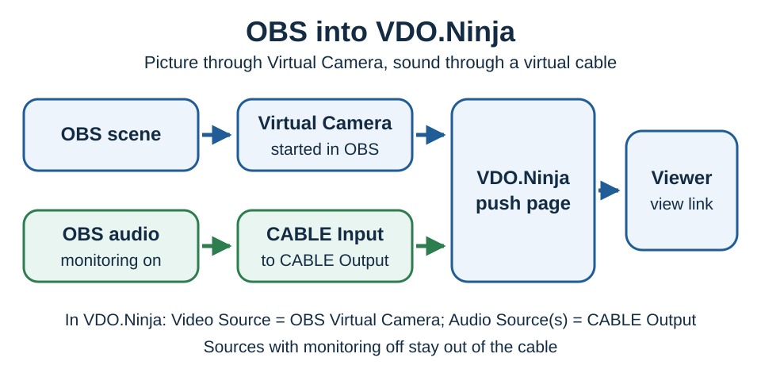
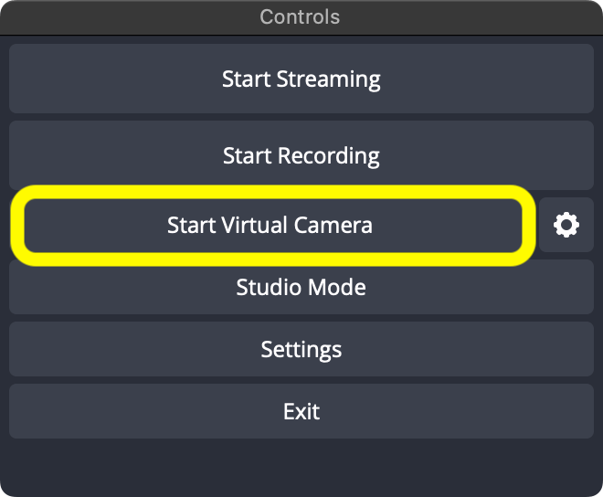
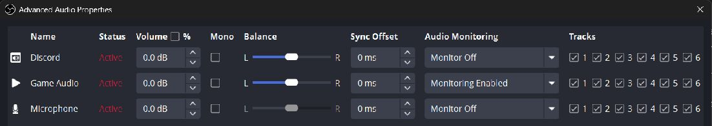
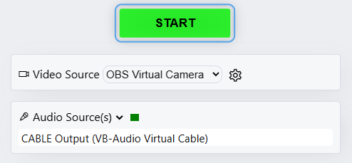

# Publish from OBS into VDO.Ninja

Use **OBS Virtual Camera** for the picture and a **virtual audio cable** for sound. You can keep streaming or recording in OBS while sharing this feed.

You need [OBS Studio](https://obsproject.com/download), a browser such as Chrome, and [VB-CABLE](https://vb-audio.com/Cable/) if you want OBS audio. The audio screenshots below use Windows; see [macOS audio options](../platform-specific-issues/macos.md#capturing-audio) for Mac.

## Step 1: Build the shot you want in OBS

Select the OBS scene containing your camera, game, graphics, or other sources. Check the Program picture: this is what the default Virtual Camera sends.

## Step 2: Start OBS Virtual Camera

Click **Start Virtual Camera** in OBS's **Controls** dock. Start it before selecting it in VDO.Ninja.

<figure><figcaption>
Start Virtual Camera; streaming and recording can stay off. Image: <a href="https://obsproject.com/kb/virtual-camera-guide">OBS Project</a>.
</figcaption></figure>

To keep one scene on the camera while switching your main output, open the **gear beside the button**, choose **Scene**, then choose that scene under **Output Selection**. See [Program versus a fixed scene](share-obs-virtual-camera-and-audio.md#2-choose-what-virtual-camera-shows).

## Step 3: Route audio from OBS to a virtual audio cable

Skip this step if you only need video or will use your microphone directly in VDO.Ninja.

In **Settings → Audio → Advanced**, set **Monitoring Device** to **CABLE Input** and click **Apply**.

<figure><figcaption>
OBS sends monitored sound into CABLE Input.
</figcaption></figure>

Right-click the **Audio Mixer → Advanced Audio Properties**. Enable monitoring for the sources you want to send. OBS 32.2 uses **Monitoring Enabled**; older versions use **Monitor and Output**.

<figure><figcaption>
This example sends Game Audio only. Leave guests' return audio on Monitor Off so they do not hear themselves.
</figcaption></figure>

For help choosing individual applications, see [Share audio from OBS](share-obs-audio-with-vdo-ninja.md).

## Step 4: Open a VDO.Ninja push link

Open your guest/push link, or visit [VDO.Ninja](https://vdo.ninja/) and click **Add your Camera to OBS**. Choose the two devices below, check the preview and audio meter, then click **START**.

<figure><figcaption>
Video: OBS Virtual Camera. Audio: CABLE Output, or your microphone if you skipped the cable.
</figcaption></figure>

Leave OBS and the publishing tab open. Share the resulting **view link** with the receiver, or add it as an OBS Browser Source on the receiving computer.

## Step 5: Tune resolution and frame rate when needed

If the picture is stretched or the frame rate is wrong, restart the camera before reopening the publishing page. You can also add these options to your push link:

| Desired capture | Add to the push link |
| --- | --- |
| 60 fps | `&fps=60` |
| 1080p landscape | `&width=1920&height=1080` |
| 720p portrait | `&width=720&height=1280` |

Match these values to the OBS output. For missing sound, check **CABLE Input → source monitoring → CABLE Output** in steps 3–4.

## Related guides

* [Receive the feed in another OBS](how-to-send-the-audio-video-output-of-one-obs-to-another-obs-using-vdo.ninja.md)
* [Choose a fixed scene and switch between players](share-obs-virtual-camera-and-audio.md)
* [Send an OBS return feed to guests](send-an-obs-return-feed-to-guests.md)
* [Publish directly from OBS using WHIP](from-obs-to-vdo.ninja-using-whip.md) and [WHIP settings](obs-whip-output-settings.md)
* [Share a webcam from inside OBS](share-webcam-from-inside-obs.md)
* [Camera already in use](../common-errors-and-known-issues/cant-load-camera-both-in-obs-and-vdon.md)
