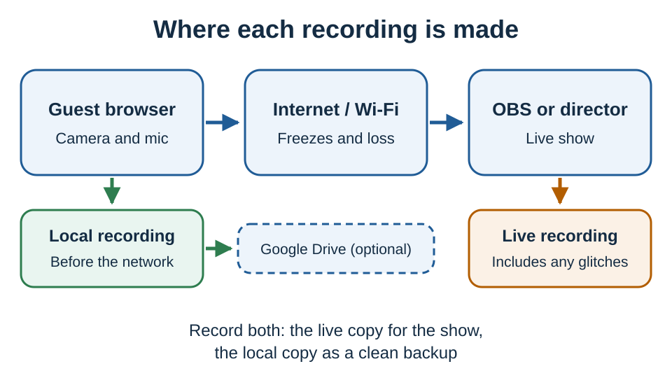

# Recording video with consistent results

A recording is only as clean as the path it was made on. If you record a guest after their video has crossed weak Wi-Fi, the recording keeps the same freezes and audio jumps you saw live. A local recording in the guest's own browser is made before the network, so it can stay clean.



For anything that matters, keep a live recording **and** at least one backup.

## Recommended setup

1. Record the live show in OBS or your production software.
2. Add a small buffer to each VDO.Ninja source in OBS.
3. Have each guest make a local browser recording as a safety copy.
4. Optionally, have those recordings upload to Google Drive.
5. Test the whole setup before the real session.

You get a finished show right away, plus clean guest files if the live connection has a bad moment.

## 1. Network

Wi-Fi is one of the most common causes of short freezes, audio skips and sudden quality drops. Ask guests to use an Ethernet cable if they can; it is often the biggest single improvement.

If a guest must use Wi-Fi, ask them to:

* sit close to the router and avoid busy public Wi-Fi;
* turn off VPNs unless required;
* close cloud backup apps, game launchers and large downloads;
* keep the laptop plugged in;
* use Chrome or Edge, which have the most predictable recording support.

VDO.Ninja tries to connect guests directly, peer to peer. Some office, school, hotel and corporate networks block that and force traffic through a relay server, which keeps the call up but can add delay and lower quality. If one guest is always unstable, test them on a different network before changing cameras or settings.

Related:

* [Packet loss](../common-errors-and-known-issues/packet-loss.md)
* [Video freezes mid-stream](../common-errors-and-known-issues/video-freezes-mid-stream.md)
* [Relay candidate being selected](../common-errors-and-known-issues/relay-candidate-being-selected.md)
* [Enterprise firewall checklist](../common-errors-and-known-issues/enterprise-firewall-checklist.md)
* [Handling guest disconnects and connection recovery](handling-guest-disconnects-and-connection-recovery.md)
* [Mesh network debug](mesh-network-debug.md)

## 2. Buffer

A buffer holds video and audio briefly so small network bumps can be smoothed out. More buffer means steadier playback but more delay. For live conversation, keep it small. For recording in OBS, a little delay is usually worth it.

### Regular buffer

If an OBS source shows small freezes or sync jumps, add this to the **view link in OBS** (not the guest's invite link):

```text
&buffer=200
```

If that is not enough, try `&buffer=500`. Buffer helps with normal Wi-Fi jitter; it cannot fix a very bad connection.

```text
https://vdo.ninja/?view=GUESTID&room=ROOMNAME&scale=100&buffer=500
```

See [`&buffer`](../advanced-settings/view-parameters/buffer.md).

### Chunked mode

Chunked mode sends video a different way and favors steady quality over the lowest delay. Consider it when:

* you are recording in OBS and 1 to 3 seconds of delay is fine;
* you care more about avoiding visible damage than about instant video.

It is not a good fit when guests need natural, low-delay conversation. It does not work in Firefox; Safari needs full WebCodecs support. Chrome or Edge is the safe choice.

On the guest link:

```text
&chunked=2500&chunkprofile=balanced
```

On the OBS view link, set how much buffer to allow (about one second here):

```text
&chunkbuffer=1000
```

For rougher Wi-Fi, allow more, at the cost of more delay:

```text
&chunkbuffer=1500&chunkbufferfloor=1000&chunkbufferceil=3000&chunkjitterslack=500&chunkadapt=hybrid
```

You can keep chunked mode for the recording source and give a monitor or guest-view link normal low-delay WebRTC with `&nochunked`. A chunked stream can also be recorded to disk without re-encoding the video.

See [`&chunked`](../newly-added-parameters/and-chunked.md), [`&chunkedbuffer`](../advanced-settings/newly-added-parameters/and-chunkedbuffer.md) and [`&nochunked`](../advanced-settings/settings-parameters/and-nochunked.md).

## 3. Recording method

| Method | Where it records | Good for | Watch out for |
| --- | --- | --- | --- |
| OBS recording | After the network | The finished live show | Records any freezes the guest's connection had |
| Guest local recording | Guest's browser, before the network | The cleanest backup | Uses the guest's CPU and disk; they must not close the tab early |
| Google Drive upload | Guest's local recording, uploaded | Getting guest files without manual transfers | Needs upload speed; uploading adds load to the guest's connection |
| Dropbox upload or host disk | The host's own recordings | An extra safety layer | A host recording of a remote guest still includes network glitches |
| Director remote recording | What the director receives | Convenience | Includes any freezes on that connection |

For an overview of recording options and formats, see [Options to record streams](options-to-record-streams.md) and [Recording format options and settings](recording-format-options-and-settings.md).

### Guest local recording

Add to the guest invite link:

| Parameter | What it does |
| --- | --- |
| `&record=6000` | Shows a record button; records at 6000 kbps |
| `&autorecordlocal=6000` | Starts recording automatically at 6000 kbps |
| `&splitrecording=5` | Splits the recording into 5-minute parts |

Splitting limits how much is lost if the browser crashes. Each part saved to disk is a separate playable file. If the recording also uploads to Google Drive or Dropbox, the upload stays one continuous file, and the local parts are pieces of it rather than separate playable files. On Safari, `&record` splits automatically even without `&splitrecording`: every 5 minutes on iPhone and iPad (shorter if needed to keep parts near 100 MB), and every 10 minutes on a Mac. Test with real saved files on the guest's device.

Tips:

* Test local recording before an important session.
* Chrome or Edge is the most predictable; Safari and mobile browsers are less so.
* The guest must keep the tab open until the recording is saved or uploaded.

See [`&record`](../advanced-settings/recording-parameters/and-record.md), [`&autorecordlocal`](../advanced-settings/recording-parameters/and-autorecordlocal.md), [`&splitrecording`](../advanced-settings/recording-parameters/and-splitrecording.md) and [Cloud sync with Google Drive and Dropbox](cloud-sync-google-drive-and-dropbox.md).

### Other publishing paths

If a browser publisher is not steady enough, these replace the browser's capture and encoding with a steadier feed. Test them before a real recording.

* **OBS WHIP output:** OBS captures and encodes, then publishes over WHIP. See [WHIP and WHEP tooling](../steves-helper-apps/whip-and-whep-tooling.md).
* **Game Capture:** a Windows app for publishing game, window or screen captures. See [Game Capture](../steves-helper-apps/game-capture.md) and [Using Game Capture with VDO.Ninja](using-game-capture-with-vdo.ninja.md), or [github.com/steveseguin/Game-capture](https://github.com/steveseguin/Game-capture).
* **Ninja OBS Plugin:** publish and receive VDO.Ninja streams inside OBS without separate browser tabs. See [Ninja OBS Plugin](../steves-helper-apps/ninja-obs-plugin.md) and [Using the Ninja OBS Plugin](using-ninja-obs-plugin-with-vdo.ninja.md), or [the plugin site](https://steveseguin.github.io/ninja-obs-plugin/).
* **Meshcast:** a server-based companion service, useful when pure peer to peer is not the right fit, or when you want RTMP, SRT, WHIP and WebRTC in one workflow. See [Meshcast](../steves-helper-apps/meshcast.io.md) or [app.meshcast.io](https://app.meshcast.io).

## Example setups

### Simple interview

Guest link:

```text
https://vdo.ninja/?room=ROOMNAME&push=GUESTID&ovb=2200&maxframerate=30&contenthint=detail&record=6000&splitrecording=5
```

OBS view link:

```text
https://vdo.ninja/?view=GUESTID&room=ROOMNAME&scale=100&buffer=500
```

### Podcast with clean guest backups

Same OBS view link as above. Guest link starts recording automatically:

```text
https://vdo.ninja/?room=ROOMNAME&push=GUESTID&ovb=2200&maxframerate=30&contenthint=detail&autorecordlocal=6000&splitrecording=5
```

Ask every guest to use Ethernet, and link Google Drive in the studio if you want the guest files uploaded.

### Steadier OBS feed with chunked mode

Adds delay; use only after testing, never for the first time in a paid session.

Guest link:

```text
https://vdo.ninja/?room=ROOMNAME&push=GUESTID&maxframerate=30&contenthint=detail&chunked=2500&chunkprofile=balanced&autorecordlocal=6000&splitrecording=5
```

OBS view link:

```text
https://vdo.ninja/?view=GUESTID&room=ROOMNAME&scale=100&chunkbuffer=1000
```

For worse Wi-Fi, use the larger chunk buffer settings shown earlier.

## Bitrate and frame rate

Higher is not always better. On a weak connection, asking for more quality can make the recording worse.

Unless you set one, the camera and browser choose the frame rate. To reduce load, cap it at 30 fps with [`&maxframerate`](../source-settings/and-maxframerate.md):

```text
&ovb=2200&maxframerate=30
```

For unstable Wi-Fi, lower the bitrate first. It looks a little softer but is steadier:

```text
&ovb=1800&maxframerate=30
```

On strong wired connections you can test higher values. See [Video bitrate for push/view links](video-bitrate-for-push-view-links.md).

## Checklist

**Before:**

* Guests on Ethernet if possible, browser restarted, downloads and other video apps closed.
* Camera and microphone checked.
* Short test recording made and opened.
* Guests know not to close the tab until their recording is saved or uploaded.
* OBS recording and backup recording both running.

**During:**

* Avoid changing many settings live.
* If one guest is unstable, lower their bitrate or frame rate.
* If OBS shows small jumps, add buffer.
* If the whole connection is bad and the recording matters, stop and fix the network.

**After:**

* Wait for local recordings to save and cloud uploads to finish.
* Check that the files open before guests leave.
