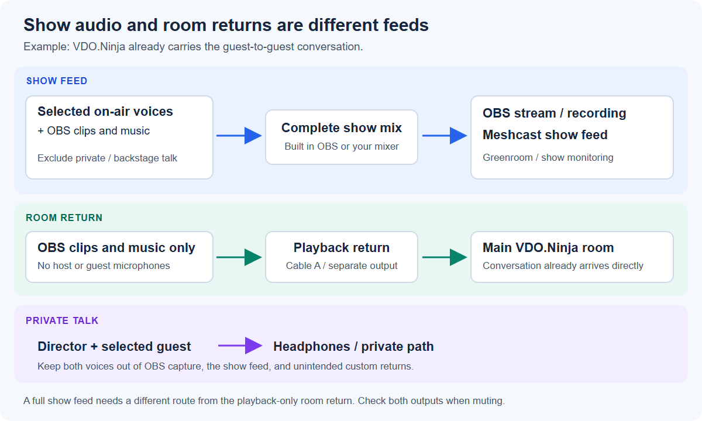
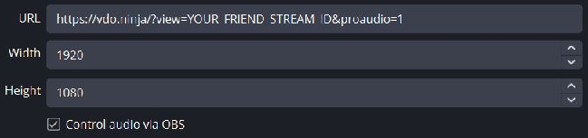
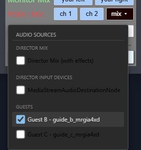

# Room audio, OBS, Meshcast, and private talk

Guest voices, OBS clips and music, a complete show feed and private talk each need their own audio route. The room steps work in both the **Director's Room** and the **Mixer app**. Cable names are the Windows VB-Audio ones; a software audio router or a hardware mixer with separate outputs does the same job elsewhere.

## 1. Decide what each destination should hear

| Destination | Include | Leave out |
| --- | --- | --- |
| OBS stream or recording | On-air guest microphones, on-air host microphone, clips and music | Private conversations and backstage guests |
| Main-room guests using normal room audio | Other guests through VDO.Ninja, plus a separate OBS clips/music return | Their own voices returned through OBS; a second copy of other guests |
| Meshcast show feed for a greenroom or co-director | The complete on-air show | Private conversations |
| Director headphones | Room conversation and private talk | An unnecessary delayed copy from the show feed |

**Mix-minus** means leaving a source out of the mix sent back to that source. You can do it two ways:

* **Room-wide OBS return** ([step 4](#4-return-obs-clips-and-music-to-the-main-room)): VDO.Ninja already carries the conversation, so OBS sends back only clips and music.
* **Individual guest returns** ([step 6](#6-option-use-the-directormixer-custom-guest-mixes)): each guest gets everyone except themselves. You must also control the direct room audio, or guests hear duplicates.

A complete Program mix suits people who only watch. Once voices and playback share one track, VDO.Ninja cannot separate them again.

<figure><figcaption><p>The show feed and the room return carry different sounds. Private talk needs its own path.</p></figcaption></figure>

## 2. Keep the director's listening audio separate

1. In the Director's Room, select the microphone you use to talk to guests, and set **Audio Output Destination** to your headphones.
2. In the Mixer, use **Director View** for the same controls. Enable **Show the advanced director control options** if some are hidden. The Mixer does not set up OBS devices.
3. Bring guest audio into OBS through dedicated VDO.Ninja sources (step 3), never by capturing the director's browser, which also plays private talk.
4. Check any **Desktop Audio**, browser, microphone and cable captures already in OBS. Any of them can put private talk on air.

## 3. Keep voices active when switching to a screenshare

An OBS scene change can remove the source carrying a guest's microphone, and a screenshare can be a separate stream from their camera and mic. Put the voices in one shared OBS scene instead:

1. Create an OBS scene named **Room Audio** with a VDO.Ninja **Browser Source** using an audio-only room scene link:

   ```text
   https://vdo.ninja/?room=YOUR_ROOM&scene=1&novideo&excludeaudio=OBS_RETURN_ID
   ```
2. In the director controls, add the on-air guests to **Scene 1**. Use that scene number only for audio, so layout changes do not affect it.
3. Enable **Control audio via OBS**. Check that the meter moves and the source is on your stream or recording track.
4. Add the **Room Audio** scene as a source in every scene that needs voices. Reuse it; do not add new Browser Sources.
5. Add `&noaudio` to the VDO.Ninja links used for pictures, so they do not play the audio again.
6. On the audio Browser Source, leave **Shutdown source when not visible** and **Refresh browser when scene becomes active** unchecked ([OBS Browser Source settings](https://obsproject.com/kb/browser-source)).

`OBS_RETURN_ID` is the playback publisher from step 4. `&excludeaudio` keeps it out of this mix, because OBS already has the original clips. Do not use `&noaudio=OBS_RETURN_ID` instead: that plays **only** that stream's audio. Keep your room password on the link.

<figure><figcaption><p>Enable Control audio via OBS. This screenshot uses a single-viewer URL; use your room audio scene link instead.</p></figcaption></figure>

Alternatives: guest links with `&novideo` give each guest their own OBS fader. `&scene=0&novideo` includes everyone in the room, not only those on air. If a screenshare carries wanted sound, include it once before muting its picture source, and do not use **Mute Guest** to remove a duplicate if that guest must still be heard.

## 4. Return OBS clips and music to the main room

Guests keep talking through VDO.Ninja. This extra return carries **playback only**. This guide calls its virtual audio device **Cable A**.

1. Open a separate publishing tab:

   ```text
   https://vdo.ninja/?room=YOUR_ROOM&push=OBS_RETURN_ID&webcam&vd=0&novideo&noaudio&label=OBS_Playback
   ```
2. Under **Audio Source(s)**, select only Cable A's output end (**CABLE Output** on VB-Audio), not your microphone, and start publishing. Keep the tab open: `&novideo&noaudio` stop it playing the room, but it still sends.
3. In OBS, open **Settings → Audio → Advanced** and set **Monitoring Device** to Cable A's input end (**CABLE Input**).
4. In **Advanced Audio Properties**, enable monitoring only for the clips and music guests should hear, and keep them on the broadcast output. Leave monitoring off for voices, the host mic, private talk and anything that captures the cable.
5. Test: play a clip, then have a guest speak. The clip reaches them; their voice does not come back.

<figure><figcaption><p>OBS has one monitoring destination: Cable A for a playback-only return, or Cable B in the two-cable option below.</p></figcaption></figure>

**Monitor Off** keeps a source out of the cable, not out of the stream. For OBS 32.2 monitoring controls and stereo settings, see [Share audio from OBS to VDO.Ninja](share-obs-audio-with-vdo-ninja.md).

## 5. Send the full show to Meshcast and the greenroom

Both options need the complete on-air mix, never the director's private listening output.

### Option A: publish the OBS program directly

Add an OBS output with Meshcast's ingest details (RTMP, or WHIP where available; see [OBS WHIP settings](obs-whip-output-settings.md)). Check that its audio track has the complete show, then share the watch link with the greenroom. Video and audio travel together, so no second cable is needed. If OBS already streams elsewhere, a second output needs an extra-output plugin or a restreaming service.

### Option B: OBS Virtual Camera plus two audio cables

Use this when a browser publisher takes **OBS Virtual Camera** plus a separate audio device.

| Route | Sources sent to it | Receiver |
| --- | --- | --- |
| Cable A: room return | Clips and music only | VDO.Ninja OBS Playback tab |
| Cable B: show feed | On-air guest voices, on-air host mic, clips and music | Meshcast publisher's audio input |
| Headphones | Director's room listening and private talk | Director only |

1. Set OBS's **Monitoring Device** to Cable B's input end, and enable monitoring for every on-air source.
2. Send clips and music to Cable A with a second routing tool. With the [Audio Monitor plugin](https://github.com/exeldro/obs-audio-monitor), add an **Audio Monitor** filter to each playback source and select Cable A. Never add it to microphones or private talk.
3. In the Meshcast browser publisher, select **OBS Virtual Camera** for video and Cable B's output end for audio, then publish.
4. Listen to the Meshcast watch link on another device. Check a guest voice, a clip and the host separately.

Monitor and plugin outputs are not copies of the streaming track: after adding sources or changing levels or mutes, check the broadcast, Cable A and Cable B. Never capture Cable B back into the mix that feeds it.

### Who should listen to the Meshcast audio?

* **Greenroom viewers** outside the main room: the complete show audio.
* **Main-room guests:** mute the show player or use a video-only return; they already hear the voices.
* **Co-director:** the show, the room, or a deliberate mix, but not both full feeds, which gives delayed double voices.

With **Share Website**, check that the embedded player's own mute works. Meshcast sends one mix to everyone; it cannot make a mix-minus per viewer.

## 6. Option: use the Director/Mixer custom guest mixes

The director's **Mix** control changes what one guest receives. It does not create an OBS bus or copy OBS clips into VDO.Ninja.

1. Keep the director's audio input enabled and connected to that guest.
2. In the Director's Room, open the guest's **Additional Controls** and find **PGM / Mic → Mix**. In the Mixer, enable the advanced director controls and use **Director View**.
3. Select only what that guest should hear: **Director Mix**, individual director input devices, or other guests (an OBS playback publisher appears as a guest). The guest is never listed in their own mix. Avoid selecting a raw microphone together with the Director Mix that already contains it.
4. Listen at the guest. Audio they already receive directly arrives twice if you also add it to Mix.

<figure><figcaption><p>The custom Mix menu. This example sends Guest B to the selected listener; it is not an OBS output selector.</p></figcaption></figure>

For a planned director-hosted mix-minus, add `&mixminus` to the director or Mixer link, and give guests [`&directoronly`](../advanced-settings/video-parameters/and-directoronly.md) so they receive the directors instead of one another (this also changes their video). The director then mixes every source, which adds load and makes conversation depend on the director's connection. [`&broadcast`](../advanced-settings/view-parameters/broadcast.md) alone does **not** remove direct guest audio, and `&mixminus` alone does not turn off direct room paths.

Limitations:

* Opening the Mix menu turns the custom mix on; closing it does not turn it off.
* An outbound audio sender must already exist, and there is no reliable one-click way back to the original director track.
* Custom mixes use direct peer audio, not a shared Meshcast stream.

See [Guest Audio Recovery and Mesh Debug](mesh-network-debug.md#emergency-audio-patch-send-b-to-a-with-mix).

## 7. Keep private conversations off air

Mix-minus stops unwanted return audio. It does not make a conversation private.

**Guest-controlled:** alpha guest links can add [`&scenemutebutton`](../advanced-settings/buttons-and-control-bar-parameters/and-scenemutebutton.md). Its **Mute in scenes** button mutes the guest's microphone and shared audio on updated scene pages, including Meshcast and WHEP playback, while the room still hears them. Plain view links and audio mixed through another source are not covered.

**Director-led:**

1. Keep the director's listening output on headphones, outside the broadcast capture.
2. Take the guest out of the broadcast audio selection or mute their OBS audio source, and mute any separate OBS capture of the host's mic. Leave both VDO.Ninja microphones on.
3. On the main director's guest card, hold **Ctrl** (Windows or Linux) or **Cmd** (macOS) while you click **Solo Talk** for two-way private talk. A plain click is one-way. If the Mixer does not show it, use the Director's Room.
4. Confirm neither voice reaches the broadcast output or the Meshcast feed, including through monitor or filter routes.
5. End Solo Talk, then restore the on-air sources.

Hearing the guest in your own headphones proves nothing about privacy. Check custom guest mixes separately. Solo Talk has limits with Meshcast and embedded sources; see [Solo Talk not working](../common-errors-and-known-issues/solo-talk-not-working.md). A separate communication room or intercom also works.

## 8. Check each route before the show

Make a short OBS recording, and listen separately to the room return and the Meshcast watch link:

| Test | Expected result |
| --- | --- |
| Guest speaks; no clip playing | The show hears them. Cable A stays silent. The guest hears no delayed copy of themselves. |
| Play an OBS clip | The room and the show each hear it once. |
| Switch panel → fullscreen screenshare → panel | Microphone audio continues. |
| Start private two-way talk | The guest and director hear each other; neither voice reaches the recording or Meshcast. |
| End private talk; guest leaves and rejoins | Normal audio returns; recheck the audio scene and any custom mixes. |
| Add or mute an OBS source | The room return, broadcast track and Meshcast route each change as intended. |

If audio stops, find which meter stops first: guest microphone, VDO.Ninja audio viewer, OBS source, cable publisher or Meshcast player.

## Related guides

* [Share OBS Virtual Camera and audio](share-obs-virtual-camera-and-audio.md)
* [Send an OBS return feed to guests](send-an-obs-return-feed-to-guests.md)
* [Mixer app](../steves-helper-apps/mixer-app.md)
* [Green rooms and guest waiting options](green-room-and-guest-approval-options.md)
