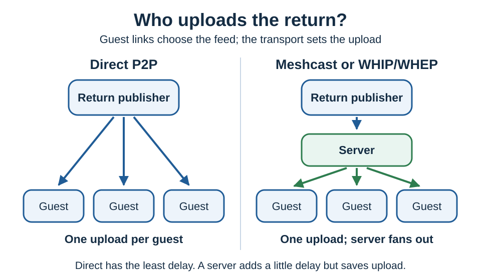
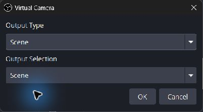
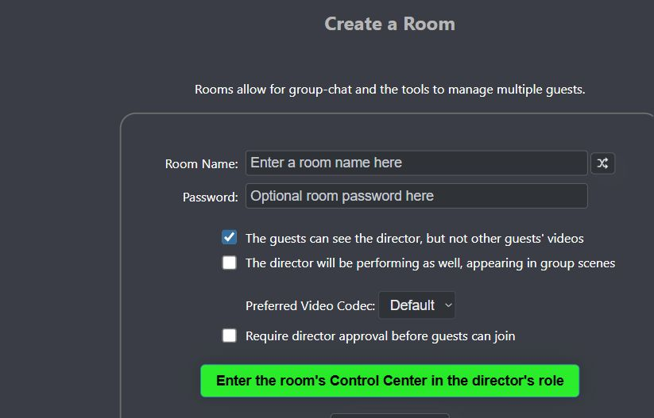
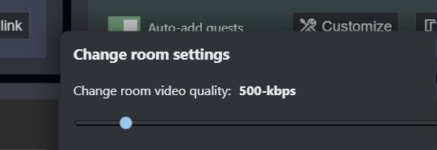
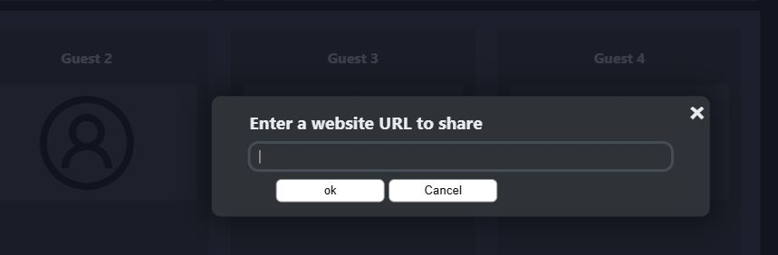

# Send an OBS return feed to guests

A **return feed** is the video you send back so remote guests can follow the show. OBS can return its Program output, its Preview, a dedicated scene, or one source.


For the basic setup, start with [Let guests see your finished OBS scene](let-guests-see-your-obs-scene.md). For audio returns, mix-minus and private talk, see [Room audio, OBS, Meshcast, and private talk](room-audio-obs-meshcast-and-private-talk.md).


You make three separate choices:

1. **Content:** what OBS sends back.
2. **Routing:** which guests receive it. Set this on the guest links with [`&broadcast`](../advanced-settings/view-parameters/broadcast.md) or [`&directoronly`](../advanced-settings/video-parameters/and-directoronly.md).
3. **Distribution:** how it reaches them: directly, through [`&meshcast`](../newly-added-parameters/and-meshcast.md), through your own WHIP/WHEP server, or through an embedded website player.



## Choose a distribution method

| Method | Delay | Upload from the return publisher | Best fit |
| --- | --- | --- | --- |
| Direct VDO.Ninja | Lowest | One copy per guest | Small interactive rooms |
| Meshcast | Slightly higher | One copy to the server | Larger rooms with little setup |
| MediaMTX or another WHIP/WHEP service | Depends on the server and region | One copy to the server | Self-hosting, your own capacity or access control |
| YouTube, Twitch or another website player | Usually several seconds | Handled by the platform | Large audiences that do not talk back |

For a small room, start with [Option A](#option-a-the-director-publishes-the-return) at about 2500 kbps for 720p30. Move the same return to Meshcast or WHIP/WHEP when upload or CPU runs out. TURN does not help here: it relays connections, it does not fan out one stream.

## Build the return in OBS

1. Create a scene with what guests need, such as a clean program, timers, scores or instructions. Leave out private producer notes.
2. Click the gear beside **Start Virtual Camera** and choose the output: Program, Preview, Scene or Source. A Scene or Source output stays the same when you switch Program.
3. Click **Start Virtual Camera** before you select **OBS Virtual Camera** in VDO.Ninja. Keep the OBS output and the VDO.Ninja capture at matching resolutions and frame rates.

<figure><figcaption><p>OBS Virtual Camera can return a selected scene instead of Program.</p></figcaption></figure>

OBS Virtual Camera carries video only. For sound, use the director's microphone, or a virtual audio cable carrying an OBS mix that leaves out the guests' own voices (a mix-minus). Never put the return inside the scene it returns.

## Route the return to guests

Replace `ROOM` and `RETURN_ID` with your own values. Keep any room password the same on every link.

### Option A: the director publishes the return

```text
Director: https://vdo.ninja/?director=ROOM&push=RETURN_ID&trb=2500
Guest:    https://vdo.ninja/?room=ROOM&broadcast
```

In the director's device settings, select **OBS Virtual Camera** and the microphone or virtual cable you want. Guests see only the main director's video, and they still hear one another.

Put `&broadcast` on the **guest** link, not on the director or OBS link. In the Director's Room, the invite option **Only see the director's video** adds it. On the room-creation page, the same setting is **The guests can see the director, but not other guests' videos**.

<figure><figcaption><p>This room-creation option adds &#x26;broadcast to the guest invite.</p></figcaption></figure>


Configure a broadcast-mode room, bring guests into OBS, and return OBS to those guests


The interface in the video is older, but the workflow still applies. Jump to [returning OBS through Virtual Camera](https://www.youtube.com/watch?v=QcFKI9q0yFs&t=600s), [an OBS mix-minus through a virtual cable](https://www.youtube.com/watch?v=QcFKI9q0yFs&t=840s), or [switching to Meshcast](https://www.youtube.com/watch?v=QcFKI9q0yFs&t=1162s).

### Option B: a dedicated return publisher

```text
Return publisher: https://vdo.ninja/?room=ROOM&push=RETURN_ID&novideo&noaudio
Guest:            https://vdo.ninja/?room=ROOM&broadcast=RETURN_ID
```

Select OBS Virtual Camera on the return publisher. `&novideo&noaudio` stops that tab from playing the room; it still sends the return. This keeps the return separate from the director's own camera, and you can run it on another computer to spread the load.

### Option C: guests hear and see only directors

```text
Guest: https://vdo.ninja/?room=ROOM&directoronly
```

Use this when the director or a co-director publishes the return and guests should not see or hear one another.

| Guest link | Video the guest receives | Audio the guest receives |
| --- | --- | --- |
| Normal room link | Other participants | Other participants |
| `&broadcast` | Main director only | Director and other guests |
| `&broadcast=RETURN_ID` | That stream only | Director and other guests |
| `&directoronly` | Directors and co-directors | Directors and co-directors |

## Set the return quality

The room video quality setting is a **combined receive budget** for each guest, not a fixed bitrate per feed. Its URL version is [`&totalroombitrate`](../advanced-settings/video-bitrate-parameters/totalroombitrate.md) (`&trb`), and the default is 500 kbps.

<figure><figcaption><p>The director can change the room's combined video budget live.</p></figcaption></figure>

With `&broadcast`, the return is the only video a guest receives, so `&trb=2500` lets it use about 2500 kbps. In a normal room the budget is split across all visible feeds. Starting points:

| Return format | Video bitrate to start with |
| --- | --- |
| 720p30 | 2500–4000 kbps |
| 1080p30 | 4000–6000 kbps |

Fast motion, detailed graphics or 60 fps may need more. Test on the real networks.


To the browser, OBS Virtual Camera is a camera. [`&screensharebitrate`](../newly-added-parameters/and-screensharebitrate.md) does not affect it; use the room bitrate controls.


### Direct upload grows with every guest

With direct delivery, the return publisher sends a separate copy to each guest. A 2.5 Mbps return to eight guests needs about 20 Mbps of upload plus overhead, on top of receiving and decoding the guest feeds. To keep it stable:

* Keep only the guest feeds you need active; hold the rest in a [green room or approval queue](green-room-and-guest-approval-options.md).
* Leave upload headroom, and watch CPU and GPU load as well as bitrate.
* Use [`&limittotalbitrate`](../advanced-settings/video-bitrate-parameters/limittotalbitrate.md) as an outbound cap; quality drops when the cap is below demand.
* When fan-out is the limit, move the return to Meshcast or WHIP/WHEP.

## Relay the return with Meshcast

Add `&meshcast` to the link that publishes the return:

```text
https://vdo.ninja/?director=ROOM&push=RETURN_ID&meshcast&meshcastbitrate=2500
```

Guest links stay the same. `&broadcast` and `&directoronly` decide **what** guests receive; Meshcast changes **how** it reaches them.

* [`&meshcastbitrate`](../meshcast-settings/and-meshcastbitrate.md) sets the camera bitrate sent to Meshcast. `&trb` does not change it.
* For a real VDO.Ninja screen share, use [`&mcscreensharebitrate`](../meshcast-settings/and-mcscreensharebitrate.md).
* Meshcast adds a little delay and sends the media through a hosted service.


Understand P2P rooms, broadcast mode, and Meshcast server distribution


This 2021 overview still explains the network layout. Its interface, servers and limits may have changed; [the server-relayed return](https://www.youtube.com/watch?v=YxduINMXw1M&t=360s) is the most relevant part.

## Use your own WHIP/WHEP server

WHIP sends one stream into a server; WHEP plays it back. This scales like Meshcast, and you choose the host, region, capacity and access controls.

**MediaMTX:** add your server to the return publisher. VDO.Ninja publishes by WHIP and tells room peers the matching WHEP address. Use HTTPS and authentication in production. Setup is in [Deploy your own Meshcast-like service](deploy-your-own-meshcast-like-service.md).

```text
https://vdo.ninja/?room=ROOM&push=RETURN_ID&mediamtx=media.example.com
```

**Cloudflare Stream or another provider:** give the publisher a URL-encoded WHIP endpoint and let VDO.Ninja work out the playback address:

```text
https://vdo.ninja/?room=ROOM&push=RETURN_ID&whipout=ENCODED_WHIP_URL&autowhep
```

[`&autowhep`](../advanced-settings/whip-parameters/and-autowhep.md) recognizes common URL patterns, including Cloudflare Stream's. Use [`&whepshare`](../advanced-settings/whip-parameters/and-whepshare.md) to set the WHEP playback URL yourself; it takes priority. `&whepshare` can also share a stream that is already on a WHEP server. [`&cftoken`](../advanced-settings/whip-parameters/and-cftoken-alpha.md) is an alpha shortcut; test it first.


Keep WHIP URLs and tokens only on the publisher link. Never put a publishing credential in a guest invite.


**Publish straight from OBS:** OBS can send WHIP itself, without Virtual Camera or a browser. It is more advanced, with its own codec, firewall and server limits. See [From OBS to VDO.Ninja using WHIP](from-obs-to-vdo.ninja-using-whip.md) and [Recommended OBS WHIP settings](obs-whip-output-settings.md).

## Share a website player instead

In the Director's Room, select **Share Website**, paste an embeddable player URL, and send it to the guests. See [`&website`](../source-settings/and-website.md).

<figure><figcaption><p>The director can share an embeddable player with every guest.</p></figcaption></figure>

The platform carries the load, but the player is often several seconds behind the room, autoplay, cookie or embed rules can block it, and its audio bypasses the room's echo cancellation. Keep conversation audio in VDO.Ninja and mute the player, so nobody hears the same audio twice.

## Share an OBS window instead

Virtual Camera is more predictable, but you can screen-share an OBS projector window. Try:

| Parameter | Where | Effect |
| --- | --- | --- |
| `&screensharequality=1` | Publisher | 720p capture target |
| `&screensharefps=30` | Publisher | 30 fps target |
| `&screensharecontenthint=motion` | Publisher | Favors frame rate over resolution (`detail` does the opposite) |
| `&screensharebitrate=2500` | Guest links | Requested screen-share bitrate |

## Troubleshooting

| Problem | What to do |
| --- | --- |
| Quality drops as guests join | `&broadcast` reduces what guests receive, not what a direct publisher sends. See [Direct upload grows with every guest](#direct-upload-grows-with-every-guest). |
| The return is smooth but delayed | A website player or buffered server is too slow for conversation. Use direct, Meshcast or low-latency WHIP/WHEP. |
| Motion is choppy | Match OBS and VDO.Ninja frame rates, start Virtual Camera before selecting it, and check bitrate and encoder load. |
| The return contains itself | Remove the return from the OBS scene being sent, or return a specific scene or source. |

## Related guides

* [Publish from OBS into VDO.Ninja](publish-from-obs-into-vdo.ninja.md)
* [Video bitrate in rooms](video-bitrate-in-rooms.md)
* [How to capture an application's audio](audio.md)
* [WHIP and WHEP tooling](../steves-helper-apps/whip-and-whep-tooling.md)
