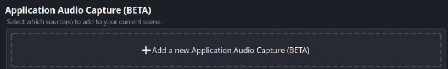
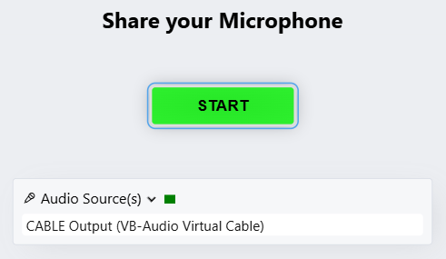

# Share audio from OBS to VDO.Ninja

Use OBS to choose the sounds you send, then **VB-CABLE** to carry them into VDO.Ninja. For video too, see [Share OBS Virtual Camera and audio](share-obs-virtual-camera-and-audio.md).

These screenshots show **Windows and OBS 32.2**. Older versions use **Monitor and Output** where the screenshots show **Monitoring Enabled**. For other systems, see the [application audio guide](audio.md).

## 1. Install the cable and keep your headphones as the normal output

Install [VB-CABLE](https://vb-audio.com/Cable/) and restart Windows as instructed. Keep your game and Discord playing through headphones, with Discord using your normal microphone. VoiceMeeter is not required.

| Where | Choose |
| --- | --- |
| OBS Monitoring Device | **CABLE Input** — sends sound into the cable |
| VDO.Ninja Audio Source(s) | **CABLE Output** — receives sound from the cable |
| Normal playback | Your headphones |

## 2. Get the wanted audio into OBS

If the sound already moves an OBS meter, use that source. Otherwise, start the game and choose **Sources → + → Application Audio Capture (BETA)**.

<figure><figcaption><p>Name the source Game Audio, select the game's window, and check its mixer meter.</p></figcaption></figure>

Alternatively, use **Capture Audio (BETA)** on a supported Game or Window Capture source. Capture each application once. When using separate application sources, disable global **Desktop Audio** after adding all sounds you need, so OBS does not capture them twice. See [OBS's application audio guide](https://obsproject.com/kb/application-audio-capture-guide).

## 3. Point OBS monitoring at the cable

Open **Settings → Audio**, scroll to **Advanced**, and select **CABLE Input**. Click **Apply**, then **OK**.

<figure><figcaption><p>All monitored sources now use this destination. Choose which ones to send next.</p></figcaption></figure>

## 4. Choose exactly which sources enter the cable

Right-click the **Audio Mixer → Advanced Audio Properties**. Enable monitoring only for the sources to share.

<figure><figcaption><p>For game audio without voices: monitor Game Audio and leave Discord and Microphone on Monitor Off.</p></figcaption></figure>

**Monitor Off keeps a source out of the cable; it does not mute OBS's stream or recording.** Keep the game's monitoring level audible. OBS 32.2 has independent output mute and monitoring controls, so muting the main output may not silence the cable.

The **Tracks** checkboxes control streaming/recording tracks, not cable channels. OBS 32.2 removed the older **Monitor Only (mute output)** choice; see the [release notes](https://github.com/obsproject/obs-studio/releases/tag/32.2.0).

## 5. Select the cable in VDO.Ninja

For audio only, open this link with your own unique, unguessable stream ID:

```text
https://vdo.ninja/?push=YOUR_UNIQUE_STREAM_ID&webcam&vd=0&proaudio=1
```

Allow microphone access, select **CABLE Output**, check the audio meter, and click **START**. Leave the publishing tab open.

<figure><figcaption><p>Select only the cable if voices should stay out of this feed. The cable acts as the microphone input.</p></figcaption></figure>

`&vd=0` disables video. [`&proaudio=1`](../advanced-settings/audio-parameters/and-proaudio.md) preserves stereo and disables voice processing when used on both ends. Use headphones and avoid feeding speaker sound back into the microphone.

Give the receiver this matching **view** link, using the same password if you add one:

```text
https://vdo.ninja/?view=YOUR_UNIQUE_STREAM_ID&proaudio=1
```

## 6. Receive the audio in another OBS

Add a **Browser Source**, paste the view link, and check **Control audio via OBS**.

<figure><figcaption><p>The feed gets its own OBS mixer entry. Width and Height do not affect audio-only feeds.</p></figcaption></figure>

Monitor to headphones if you need to listen locally. Otherwise leave monitoring off; the source can still feed your stream/recording. Never monitor the received feed back into the sender's cable.

## Change the audio being sent

| Change | What to do |
| --- | --- |
| Different game/application | Select it in the OBS capture source's Properties |
| Different OBS audio source | Turn monitoring off for the old source and on for the new one |
| Follow scene changes | Keep scene-specific audio only in its intended scene; global or shared sources may continue |
| Different VDO.Ninja input device | Open the bottom gear and change Audio Source(s) |

<figure><figcaption><p>For changes inside OBS, keep VDO.Ninja's input on CABLE Output.</p></figcaption></figure>

## Check the route before going live

Make a short recording at the receiver. Play the game, stop it and speak on the microphone/Discord, then switch scenes. Confirm the game arrives once, excluded voices stay out, and the correct sound follows each change.

| Problem | Check |
| --- | --- |
| OBS meter moves but VDO.Ninja is silent | CABLE Input in OBS, active source monitoring, CABLE Output in VDO.Ninja |
| Voices leak into the game feed | Use application-specific capture and monitor only the game |
| Sound doubles | Remove duplicate captures and any extra viewer playing into Desktop Audio |
| Sound stops after a scene switch | Check whether the monitored source is still active |
| Cable is missing | Finish installation/restart, then reopen OBS and the browser |

Do not capture CABLE Output back into the sending OBS and monitor it to CABLE Input: that creates a loop. For room returns and private talk, see [Room audio, OBS, Meshcast, and private talk](room-audio-obs-meshcast-and-private-talk.md).
