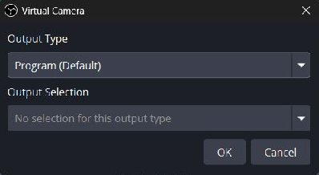
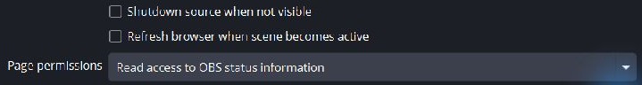
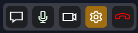
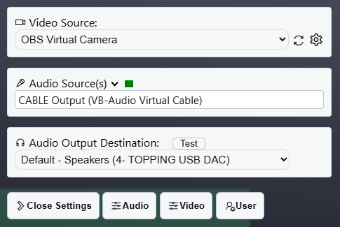

# Share OBS Virtual Camera and audio

Send **OBS Virtual Camera** for video and **VB-CABLE** for audio. This Windows walkthrough also covers fixed scenes and switching between two players. For the basic setup, see [Publish from OBS into VDO.Ninja](publish-from-obs-into-vdo.ninja.md).

## 1. Prepare the sending OBS scene and audio

Select the scene you want to share. Avoid capturing the VDO.Ninja preview inside that scene.

Follow the [audio setup](share-obs-audio-with-vdo-ninja.md#1-install-the-cable-and-keep-your-headphones-as-the-normal-output): install VB-CABLE, set OBS's **Monitoring Device** to **CABLE Input**, then enable monitoring for the sources to send.

<figure><figcaption><p>Example: send game audio while keeping voices out of the cable. Monitor Off does not remove voices from OBS's own stream or recording.</p></figcaption></figure>

OBS 32.2 calls this **Monitoring Enabled**; older versions use **Monitor and Output**.

## 2. Choose what Virtual Camera shows

Click the **gear beside Start Virtual Camera** in OBS's Controls dock.

<figure><figcaption><p>Use this gear to choose the camera picture. Image: <a href="https://obsproject.com/kb/virtual-camera-guide">OBS Project</a>.</p></figcaption></figure>

| Output Type | What viewers see |
| --- | --- |
| **Program (Default)** | The current Program output; follows scene switches |
| **Preview** | Your Studio Mode preview, including edits before Transition |
| **Scene** | The scene chosen in Output Selection, independent of Program |
| **Source** | Only the source chosen in Output Selection |

<figure><figcaption><p>Program follows normal scene changes. In Studio Mode, click Transition to change Program.</p></figcaption></figure>

### Keep one scene on the camera

Set **Output Type → Scene**, then choose your scene in **Output Selection** and click **OK**. Use **Source** for a single camera or capture instead.

**The camera mode does not choose the audio.** The cable receives active, monitored sources; changing Program can stop a scene's audio even when Virtual Camera still shows its picture. Keep the required audio sources active and check the receiver after switching.

Choose the mode before the session: a change may require restarting Virtual Camera.

## 3. Start Virtual Camera and select both devices in VDO.Ninja

Click **Start Virtual Camera**. Open this publishing link with your own unique, unguessable stream ID:

```text
https://vdo.ninja/?push=YOUR_UNIQUE_STREAM_ID&webcam&proaudio=1
```

Select the devices shown, check the preview and audio meter, then click **START**.

<figure><figcaption><p>For game audio only, select CABLE Output without also selecting your microphone.</p></figcaption></figure>

Keep OBS and the publishing tab open. Give the receiver the matching link:

```text
https://vdo.ninja/?view=YOUR_UNIQUE_STREAM_ID&proaudio=1
```

Use the same password on both links if you add one. [`&proaudio=1`](../advanced-settings/audio-parameters/and-proaudio.md) preserves stereo and avoids voice processing; use headphones for conversation.

## 4. Add the feed to the receiving OBS

Create a **Friend Game** scene. Add a **Browser Source**, paste the view link, and enable **Control audio via OBS**.

<figure><figcaption><p>Use your own view link. Width and Height size the browser canvas, not the incoming capture.</p></figcaption></figure>

Leave these two options unchecked to keep the feed connected between scenes:

<figure><figcaption><p>Keep the page loaded. Page permissions can stay at their normal read-access setting.</p></figcaption></figure>

Click **OK** and use **Transform → Fit to Screen** if needed. For local listening, monitor this source to headphones on the receiving computer. Do not also play a second copy through captured desktop audio.

## 5. Switch between your game and your friend's game

Have your friend send **game audio only**. On the receiving computer, capture your microphone and Discord separately, and build these scenes:

| Source | My Game | Friend Game |
| --- | --- | --- |
| Your game capture and application audio | Include | Exclude |
| Friend's VDO.Ninja Browser Source | Exclude | Include |
| Your microphone | Include | Add Existing |
| Discord application audio | Include | Add Existing |

Use the same existing voice sources in both scenes, or nest a shared **Voices** scene in both. After adding separate application captures, disable global **Desktop Audio** to avoid duplicate or unwanted game sound.

Switch scenes to change games; in Studio Mode, use **Transition**. Use **Cut** for an immediate handover rather than briefly mixing both games during a fade.

Keep the unwanted game out of the active scene, including nested scenes. Covering it with an image does not silence it. Make a short recording while speaking and switching both ways: only the selected game and both voices should remain audible.

## Change a camera or cable while publishing

Open VDO.Ninja's bottom **gear**:

<figure><figcaption><p>Change devices without making a new stream link.</p></figcaption></figure>

<figure><figcaption><p>Video Source and Audio Source(s) choose what you send. Audio Output Destination chooses where you listen.</p></figcaption></figure>

For a scene or game change, keep VDO.Ninja on **OBS Virtual Camera + CABLE Output** and make the change in OBS.

## Troubleshooting

| Problem | Check |
| --- | --- |
| Picture works but sound is missing | Follow the [audio route](share-obs-audio-with-vdo-ninja.md): CABLE Input, monitoring, CABLE Output |
| Camera is missing or shows the wrong picture | Start it before opening VDO.Ninja; check the gear's Output Type and Output Selection |
| Both games are audible | Remove duplicate captures, global Desktop Audio, and unwanted nested game sources |
| Voices disappear or double | Reuse voice sources in both receiving scenes; exclude voices from the friend's cable feed |
| Returning to a scene reloads the feed | Disable Browser Source shutdown and refresh-on-activation |

For direct publishing through OBS's streaming output, see the [Ninja OBS Plugin](using-ninja-obs-plugin-with-vdo.ninja.md).
