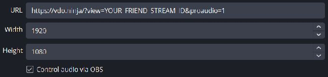

# Smooth playback with a buffer

A playback buffer gives late-arriving media more time before it is shown. Try it for uneven delivery when a little extra delay is acceptable. First check the [connection](choose-a-network-for-live-events.md) and [bitrate](how-do-i-control-bitrate-quality.md); buffering cannot sustain a stream that needs more upload than is available.

## Normal VDO.Ninja video

1. In OBS, right-click the camera's **Browser Source > Properties**.
2. Add `&buffer=200` to the end of its existing **URL**, then click **OK**. Keep the stream ID, password, room, and other settings. If `buffer` is already present, change its value instead of adding it again.
3. Check moving video and sound together. Compare with no added buffer; try a larger value only if it helps enough to justify the delay.

```text
https://vdo.ninja/?view=YOURID&buffer=200
```

<figure><figcaption><p>Edit the URL in the existing source. Buffer settings belong on the receiving link.</p></figcaption></figure>

| Setting | Meaning |
| --- | --- |
| No buffer parameter | Let VDO.Ninja and the browser use their normal behavior. |
| `&buffer=0` | Request minimal buffering. This does not disable network delay or the browser's own buffering, and may make uneven delivery more visible. |
| `&buffer=200` | Request a 200 ms target. |
| `&buffer=1000` or `&buffer=3000` | Request a one- or three-second target. Actual delay can differ. |

Normal WebRTC buffer requests are clamped to **0-4000 ms** and are hints to the browser. `&buffer=3000` does not guarantee exactly three seconds of added delay. Check audio sync, especially with larger values. If audio and video separate while adjusting the buffer, add [`&sync=0`](../advanced-settings/view-parameters/sync.md) before reconnecting.

Remove the parameter to undo the change. If you also added `sync`, remove that too to restore the previous link.

## Other buffer modes

Use one buffer mode at a time:

* [`&buffer2`](../advanced-settings/video-parameters/and-buffer2.md) also accounts for estimated network transit time. It is an advanced timing option, not a stronger packet-loss fix.
* [`&buffer3`](../advanced-settings/video-parameters/and-buffer3.md) adds experimental audio compensation with brief fades during corrections. It can produce audible dips; leave it off unless you need that behavior.
* [Chunked mode](try-chunked-video.md) has its own playout buffer, controlled by `&chunkbuffer`. If `&buffer` is also present, it takes precedence.
* [SRT latency](mobile-app/srt-to-meshcast.md#adjust-buffering-or-reconnect) is set in the sending app. An OBS Browser Source buffer does not change that phone-to-Meshcast connection.

For deliberate broadcast delays measured in minutes, use [Delay an incoming feed](delay-an-incoming-feed.md). See the [`&buffer` reference](../advanced-settings/view-parameters/buffer.md) for runtime support and detailed behavior.
