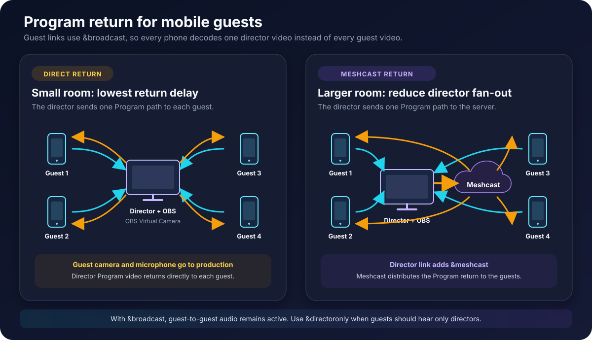
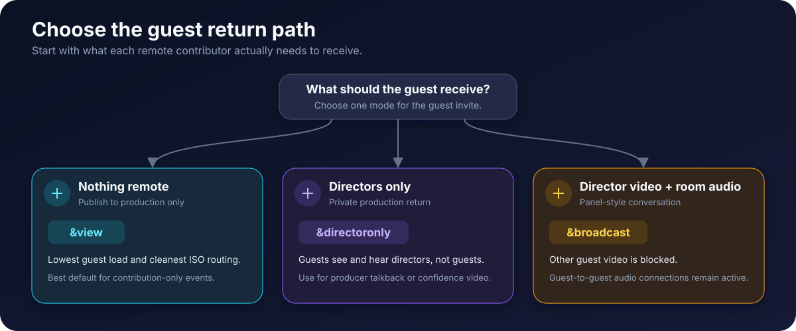
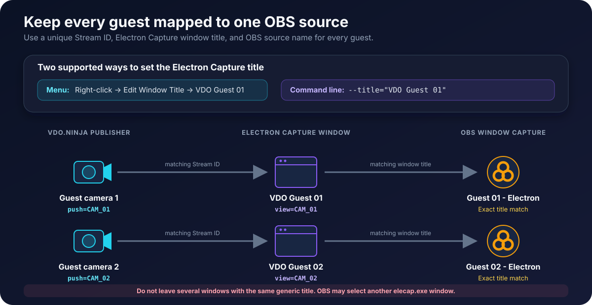

# Stable mobile guest production with OBS and Electron Capture

This guide is for several remote phone guests, one isolated OBS source per guest, and the OBS Program video sent back to the guests. Start with this design:

1. Each guest publishes with a unique Push ID and [`&broadcast`](../advanced-settings/view-parameters/broadcast.md), so each phone receives only the director's video.
2. The director publishes an OBS Virtual Camera return.
3. OBS or Electron Capture opens one fixed View link per guest, and every Electron Capture window has a unique title.
4. Conversation audio uses one path, and every speaker wears headphones.

This reduces phone heat and keeps OBS sources predictable. If the director computer or its upload becomes overloaded, add [`&meshcast`](../newly-added-parameters/and-meshcast.md) to the director's link.

<figure><figcaption><p>Broadcast mode reduces the video received by each phone. Meshcast can also reduce the number of return copies sent by the director.</p></figcaption></figure>

## Recommended setup

Replace `ROOM_NAME`, `CAM_01`, and `PROGRAM_RETURN` with your own values. Stream IDs are case-sensitive. Use the same room password and access options on every room link.

### 1. Give each guest a unique link

```text
https://vdo.ninja/?room=ROOM_NAME&push=CAM_01&label=Guest%2001&broadcast&quality=1&maxframerate=30
https://vdo.ninja/?room=ROOM_NAME&push=CAM_02&label=Guest%2002&broadcast&quality=1&maxframerate=30
```

* `&push=CAM_01` gives the camera a permanent Stream ID. Never give two active guests the same value, and do not pass a guest's address-bar URL to another guest after they join.
* `&broadcast` plays only the director's video on the phone. Other guests are still heard.
* `&quality=1` targets about 1280 × 720. `&maxframerate=30` caps the frame rate but allows lower rates.

If the phones are already stable, you can leave out the quality options. Add them when a device gets hot. For an emergency low-load test, `&quality=2` targets about 640 × 360.


VDO.Ninja ignores [`&nopreview`](../source-settings/and-nopreview.md) on iPhone and iPad and keeps a small preview, because iOS needs one to publish reliably.


### 2. Publish the OBS return from the director

```text
https://vdo.ninja/?director=ROOM_NAME&push=PROGRAM_RETURN
```

1. In OBS, create a dedicated return scene, or use Program output.
2. In the OBS Virtual Camera settings, pick Program, Preview, a scene, or a source, then start the Virtual Camera.
3. In the director's VDO.Ninja device settings, select **OBS Virtual Camera** as the camera.

<figure><figcaption><p>A dedicated return scene can stay independent from changes to the public Program output.</p></figcaption></figure>

Keep the director or `PROGRAM_RETURN` source out of the scene that feeds the Virtual Camera, or the return captures itself.

When you create a room, **The guests can see the director, but not other guests' videos** adds broadcast mode to the guest invite links.

<figure><figcaption><p>This room option adds broadcast behavior to the guest links.</p></figcaption></figure>

### 3. Open one isolated View link per guest

```text
https://vdo.ninja/?view=CAM_01&solo&room=ROOM_NAME&forceviewerlandscape
https://vdo.ninja/?view=CAM_02&solo&room=ROOM_NAME&forceviewerlandscape
```

Keep the same mapping for every rehearsal and show. A guest who reconnects with the same Push ID returns to the same OBS input.

| Phone publisher | Production viewer | Electron Capture title | OBS source name |
| --- | --- | --- | --- |
| `push=CAM_01` | `view=CAM_01` | `VDO Guest 01` | `Guest 01 - Electron` |
| `push=CAM_02` | `view=CAM_02` | `VDO Guest 02` | `Guest 02 - Electron` |

## Choose what each guest receives

Give each phone the smallest return that supports the production.

<figure><figcaption><p>The guest invite controls the return path.</p></figcaption></figure>

| Mode | Add to guest link | Video received | Audio received | Trade-off |
| --- | --- | --- | --- | --- |
| Normal room | Nothing | Other guests and directors | Other guests and directors | Highest phone load; older phones heat quickly |
| Broadcast | `&broadcast` | Main director only | Director and other guests | Recommended for a panel with one Program return |
| Selected broadcast source | `&broadcast=PROGRAM_RETURN` | One named return source | Director and other guests | Keeps the return separate from the director |
| Directors only | `&directoronly` | Directors and co-directors | Directors and co-directors | Private producer return; guests cannot hear one another |
| Publish only | `&view` with no value | Nothing | Nothing | Lowest phone load; use a phone call or intercom for talkback |

For example, a publish-only guest link is `https://vdo.ninja/?room=ROOM_NAME&push=CAM_01&view`. Add these options to guest links only, not to the director or OBS View links.

### Separate Program return publisher

Use this when the director needs a normal camera that is separate from the OBS return:

```text
Return publisher: https://vdo.ninja/?room=ROOM_NAME&push=PROGRAM_RETURN&novideo&noaudio
Guest:            https://vdo.ninja/?room=ROOM_NAME&push=CAM_01&broadcast=PROGRAM_RETURN
```

Open the return-publisher link on the production computer and select OBS Virtual Camera. `&novideo&noaudio` stops that page from receiving the room. It does not turn off its outgoing camera and microphone.

## Add Meshcast when direct distribution is too demanding

In broadcast mode the director normally sends a separate return copy to each guest. If the director's CPU or upload cannot keep up, add `&meshcast` to the director link. Guest links keep `&broadcast`:

```text
https://vdo.ninja/?director=ROOM_NAME&push=PROGRAM_RETURN&meshcast
```

Meshcast receives the director's outgoing media and distributes it to the guests. If several production pages request each phone camera, guest links can also add `&meshcast`. Add [`&nomeshcast`](../advanced-settings/meshcast-parameters/and-nomeshcast.md) to a View link that needs a direct peer-to-peer stream from a Meshcast-enabled publisher.

Meshcast normally adds some latency, routes media through a server, and depends on that server's load. It reduces sender upload, but OBS still decodes every guest video. Add it only after the direct setup works, and rehearse it.

## Native mobile app option

The [VDO.Ninja native mobile app](../steves-helper-apps/native-mobile-app.md) helps when Safari cannot capture reliably, or when you need local recording, USB audio, background operation, or more camera controls.

<figure><figcaption><p>Use the same stable Stream ID and Room name planned for the browser guest link.</p></figcaption></figure>

Enter a unique **Stream ID**, such as `CAM_01`, and the **Room name** if the director must manage the source. Open the matching `&view=CAM_01` link in Electron Capture, OBS, or the Ninja OBS Plugin. For producer talkback, use the app's Remote Audio Stream.

The app may not show guests or the Program return the way a browser guest with `&broadcast` does. It does not guarantee a cooler phone: high resolution, high frame rate, recording, screen sharing, and dual-camera capture still create heat.

## iPhone and iPad heat, rotation, and disconnection

Capture, encoding, decoding incoming videos, a bright screen, radio use, and charging all create heat. A hot iPhone or iPad may slow down, causing low frame rate, audio dropouts, frozen video, or a dropped connection. Older iOS devices and releases also show sporadic orientation errors. Rotation can appear alongside heat problems, but it does not prove heat caused them, and VDO.Ninja's orientation options do not disconnect a guest.

### Reduce heat first

1. Use broadcast, directors-only, or publish-only mode instead of a full gallery.
2. Start around 720p30 (`&quality=1&maxframerate=30`); use `&quality=2` (360p) as a fallback test.
3. Use current iOS or iPadOS and Safari releases, and close unused tabs and camera apps.
4. Remove a thick case when safe, lower the brightness, and stay out of direct sun.
5. Start with a charged battery; charging a hot phone adds heat. Use a strong Wi-Fi or cellular signal.
6. Do not request the same phone camera from extra director tabs, OBS sources, Electron Capture windows, Scene links, or test devices.

If a phone still gets hot, cap each outgoing stream, for example with `&maxvideobitrate=1500`. Very low caps, such as 600 kbps, can also reduce resolution.

### Keep incoming video in landscape

Add [`&forceviewerlandscape`](../advanced-settings/mixer-scene-parameters/and-forceviewerlandscape.md) to the link that **receives** the phone, such as the Electron Capture or OBS View link shown above. When the video turns portrait, it rotates it 270 degrees. If that is the wrong way, use `&forceviewerlandscape=90`. It does not cool the phone or prevent a disconnect.

The sender-side [`&forcelandscape`](../advanced-settings/mobile-parameters/and-forcelandscape.md) keeps the phone's outgoing video at 16:9:

```text
https://vdo.ninja/?room=ROOM_NAME&push=CAM_01&broadcast&forcelandscape
```

Test one change at a time so you know which option helped.

## Configure Electron Capture so OBS does not switch guests

Every Electron Capture window needs a different title. If windows share a title, OBS may attach a Window Capture source to the wrong window after a reconnect, reload, restart, or scene change.

<figure><figcaption><p>Keep the Stream ID, Electron Capture title, and OBS source name unique and consistent.</p></figcaption></figure>

**From the menu:** right-click inside the window, select **Edit Window Title**, and enter a unique title such as `VDO Guest 01`. This changes only the current window, so a command line is easier to repeat after a restart.

**From the command line:** the portable Windows build is `elecap.exe`. Use an equals sign, and put quotation marks around the URL and title so Windows does not treat each `&` as a command separator:

```text
elecap.exe --width=1280 --height=720 --url="https://vdo.ninja/?view=CAM_01&solo&room=ROOM_NAME&forceviewerlandscape" --title="VDO Guest 01"
```

For a repeatable setup, use a batch file with the short aliases and a pause between launches:

```batch
start elecap.exe -w=1280 -h=720 -u="https://vdo.ninja/?view=CAM_01&solo&room=ROOM_NAME&forceviewerlandscape" -t="VDO Guest 01"
timeout /T 1 /NOBREAK
start elecap.exe -w=1280 -h=720 -u="https://vdo.ninja/?view=CAM_02&solo&room=ROOM_NAME&forceviewerlandscape" -t="VDO Guest 02"
timeout /T 1 /NOBREAK
start elecap.exe -w=1280 -h=720 -u="https://vdo.ninja/?view=CAM_03&solo&room=ROOM_NAME&forceviewerlandscape" -t="VDO Guest 03"
timeout /T 1 /NOBREAK
start elecap.exe -w=1280 -h=720 -u="https://vdo.ninja/?view=CAM_04&solo&room=ROOM_NAME&forceviewerlandscape" -t="VDO Guest 04"
```

Run `elecap.exe --help` for the options your version supports, or see the [Electron Capture command-line reference](https://electroncapture.app/command-line.html).

### Match each window in OBS

1. Add one **Window Capture** source per guest and name it clearly, such as `Guest 01 - Electron`.
2. Select the window titled `VDO Guest 01`.
3. Choose the strictest title matching your OBS version offers. Avoid a fallback that can pick any window from the same `elecap.exe` process.
4. Confirm the mapping before you clone the source or add it to other scenes.

Do not rename a window during the show; it can break the OBS match.

To show a guest in several scenes, reuse one tested base source with **Add Existing** or a clone tool. Do not open another Electron Capture window or browser page per scene. If every clone shows the wrong guest, fix the base source first. Clones do not reduce phone load if several View pages still request the same stream.

### Other capture methods

| Capture method | Advantage | Caution |
| --- | --- | --- |
| One VDO.Ninja Scene in OBS | Fewest inputs; simple mixed layout | No independent source per guest |
| One OBS Browser Source per guest | Fixed URL; no window-title matching | Reuse sources across scenes to avoid duplicate viewers |
| Electron Capture plus OBS Window Capture | Recent Chromium, flexible window and audio routing, survives OBS restarts | Needs unique titles and careful window matching |
| [Ninja OBS Plugin](../steves-helper-apps/ninja-obs-plugin.md) | Purpose-built OBS integration without a Browser Source | Rehearse it before replacing a working setup |

A different capture method can fix an OBS or Electron Capture problem, but not a phone that has stopped publishing.

## Prevent echo and duplicated audio

`&broadcast` blocks other guests' video but not their audio, so a panel can talk naturally. Keep audio simple: every speaker wears headphones, VDO.Ninja carries the conversation, and each guest's audio reaches the OBS mix through one path only.

OBS Virtual Camera carries no audio. If guests must hear music or clips, build a controlled return with a virtual audio device. Do not send the full OBS mix, including guest microphones, back to the guests, or they will hear delayed copies of themselves.

Common duplicate paths: a guest active in both the director room and an isolated capture, a Browser Source and an Electron Capture window receiving the same guest, a clone and its base source both in the mix, or OBS monitoring feeding back into its own virtual audio input. Record privately and listen to every channel before the event.

## Diagnose rotation, source switching, and disconnection separately

| Observation | Next check |
| --- | --- |
| The director room shows the right guest, but OBS shows another | Electron Capture titles and OBS Window Capture matching |
| Electron Capture shows the right guest, but OBS shows another window | The OBS source mapping, not the phone |
| The guest disappears from Electron Capture, OBS, and the director room | The phone, iOS version, heat, network, permissions, and connection |
| Video rotates but audio and the connection stay stable | `&forceviewerlandscape` on the receiving View link |
| Rotation, low frame rate, stutter, and disconnection follow heat | Less incoming video, lower resolution and frame rate, fewer viewers |
| Audio stops after a call or notification on iOS | [iOS audio stops during phone calls](../common-errors-and-known-issues/ios-audio-stops-during-phone-calls.md) |
| The director computer overloads as more guests get the return | Add Meshcast to the director return. It does not reduce OBS decoding. |

**Isolation test:** start with two guests and no clones. Add `&broadcast` and confirm each phone shows only the director return. Add the other guests one at a time while watching phone temperature, connection state, OBS CPU and GPU, and bandwidth. If a source changes identity, compare the director room, Electron Capture, and OBS at the same moment. Add Meshcast, then clones and extra scenes, only after every base input stays stable.

To see connection statistics, `Ctrl` + click a video on Windows, or `Command` + click on macOS. Note packet loss, available bitrate, candidate type, and connection state near the failure.

## Rehearsal checklist

* [ ] Every guest has a unique Push ID, and each View link requests the matching Stream ID.
* [ ] Every Electron Capture window has a unique title, matched strictly in OBS.
* [ ] Sources are reused across scenes, and no extra page requests a duplicate feed.
* [ ] Each phone receives the intended return mode, and the return does not capture itself.
* [ ] Every speaker uses headphones, each microphone reaches OBS once, and nobody hears a delayed copy of their own voice.
* [ ] The full guest count has run for 20 to 30 minutes with acceptable phone heat, CPU/GPU load, and network headroom.
* [ ] Meshcast has been rehearsed if it will be used.

## Information to collect when a problem remains

Remove passwords and private tokens first. Collect the exact guest, director, and View links; phone model and OS version; browser or app, Electron Capture, and OBS versions and capture method; the number of guests and duplicate viewers; Wi-Fi or cellular; whether the guest stayed in the director room after OBS lost it; the failure time and time zone; a short recording of the phone, Electron Capture, and OBS; and connection statistics from around the failure.

## Related guides

* [Large production rooms with isolated guest feeds](large-production-rooms-with-isolated-guest-feeds.md)
* [Send an OBS return feed to guests](send-an-obs-return-feed-to-guests.md)
* [Electron Capture](../steves-helper-apps/electron-capture.md)
* [Overheating](../common-errors-and-known-issues/overheating.md)
* [iOS-specific guidance](../platform-specific-issues/ios.md)
* [Guest appears but no video or audio connects](../common-errors-and-known-issues/appearing-then-disappearing-guest.md)
* [`&broadcast`](../advanced-settings/view-parameters/broadcast.md)
* [`&meshcast`](../newly-added-parameters/and-meshcast.md)
* [`&forceviewerlandscape`](../advanced-settings/mixer-scene-parameters/and-forceviewerlandscape.md)

## Search words

Multiple phone guests, iPhone overheating, iPhone video rotates, upside-down video, guest disconnects, Electron Capture title, Electron Capture switches windows, wrong guest in OBS, OBS Window Capture matching, Source Clone, Program return, broadcast mode, Meshcast, isolated guest feeds, audio feedback.
