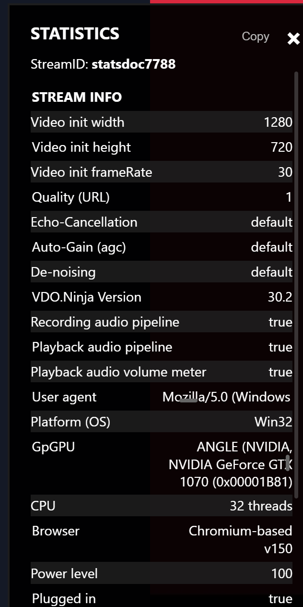
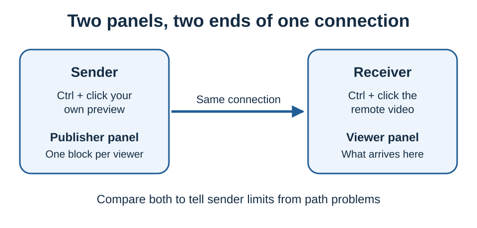

# The stats panel

Every VDO.Ninja video has a live statistics panel. Use it to see whether a problem comes from the network or the encoder, whether audio is being sent, and whether you are getting the bitrate you asked for.

<figure><figcaption><p>The stats panel on the viewing side. The header stays fixed while the list below it scrolls.</p></figcaption></figure>

## Opening it

**Ctrl + click** any video (**Cmd + click** on macOS). Ctrl + click the same video again to close it.

Other ways in:

* **Right-click a video** and choose **Show Stats**.
* **Click the connection readout** at the top right of the page header while publishing. This opens your own outbound stats.
* **On a phone or tablet**, tap the video five times quickly, each tap within half a second of the last.

<figure><figcaption><p>The header readout on a publishing page: connections, outbound audio streams, outbound video streams, and total upload bitrate. Click it to open your stats.</p></figcaption></figure>

Press **Escape** or click **×** in the panel's top-right corner to close it.

## Two different panels

The panel you get depends on which video you click:

| You click | You get | It shows |
| --- | --- | --- |
| A remote guest's video | [The viewer panel](viewer-stats.md) | What arrives at **your** computer, plus what the sender reports about their own setup |
| Your own camera preview | [The publisher panel](publisher-stats.md) | What **you** send, with one block per connected viewer |



If a guest looks bad to you, their publisher panel and your viewer panel describe the same connection from opposite ends. Comparing them can separate a capture or encoder limit from a problem on the path. It cannot prove whether loss happened on the sender's uplink, the receiver's downlink or in between.

## Panel controls

* **Copy** puts the whole panel on your clipboard as readable text. Use it when asking for help; see [asking an AI to read your stats](llm-prompt.md).
* The numbers refresh every 3 seconds by default.
* Refreshing pauses while you drag a slider or have text selected in the panel, so you can copy a single value.

Only one panel is open at a time. Ctrl + clicking another video replaces it, so to compare two guests, **Copy** the first before switching.

## URL parameters

| Parameter | Effect |
| --- | --- |
| `&stats` | Opens the panel automatically when a connection is made |
| `&nostats`, or `&stats=0` / `false` / `off` | Disables the panel and removes it from the right-click menu |
| `&statsinterval=1000` | Refresh interval in milliseconds (minimum 250) |

Consider `&nostats` for kiosk or public-facing scenes, since the panel shows details about the other person's computer.

## The 60-second triage

Open the panel on the **receiving** side and check these four:

| What you see | What it usually means | Next |
| --- | --- | --- |
| **Packet Loss** above about 1% | Congestion or a weak link on the path | [Video is blocky, soft, or keeps freezing](troubleshooting.md#video-is-blocky-soft-or-keeps-freezing) |
| **Bitrate** far below what you asked for | The sender cannot send more, or is being asked not to | [The bitrate is far lower than I asked for](troubleshooting.md#the-bitrate-is-far-lower-than-i-asked-for) |
| **Candidate type** shows `💸 relay server` | Traffic goes through a TURN relay, which can add delay or hit relay limits | [The connection is using a relay](troubleshooting.md#the-connection-is-using-a-relay) |
| **Quality limited by** says `cpu` | The sender's computer cannot encode fast enough | [CPU is the bottleneck](troubleshooting.md#cpu-is-the-bottleneck-on-the-sending-side) |

Read the fields around them before treating any single number as the diagnosis.

## What "good" looks like

A healthy 1080p30 connection between two well-connected computers:

```text
Packet Loss           0 %
Round Trip Time       under 100 ms
Candidate type        stable path; direct when available
Quality limited by    none
FPS                   within 1-2 of the sender's capture rate
Jitter Buffer Delay   under ~100 ms
Bitrate               enough for the quality you want
```

These are not hard limits. A 200 ms round trip is normal between continents, and 1% loss on a cellular uplink can be a good result. An encoder may also stay below its target on a static scene because it does not need the bits. Compare against the same stream when it was working well.

## Pages in this guide

* [Reading the viewer panel](viewer-stats.md): every field on the receiving side
* [Reading the publisher panel](publisher-stats.md): every field on the sending side
* [Diagnosing problems](troubleshooting.md): symptom-first recipes
* [Asking an AI to read your stats](llm-prompt.md): a copy-paste prompt that explains these fields to an LLM

## Related reading

* [How to control bitrate/quality](../how-do-i-control-bitrate-quality.md)
* [Default resolution and bitrate by mode](../default-resolution-and-bitrate.md)
* [Stable IRL streaming](../irl-streaming-stability.md)
* [Video bitrate for push/view links](../video-bitrate-for-push-view-links.md)
* [Handling guest disconnects and connection recovery](../handling-guest-disconnects-and-connection-recovery.md)
* [`&showconnections`](../../advanced-settings/settings-parameters/and-showconnections.md): shows the viewer count on the video without opening the panel
* [`&maxconnections`](../../source-settings/and-maxconnections.md): caps how many viewers a source accepts
