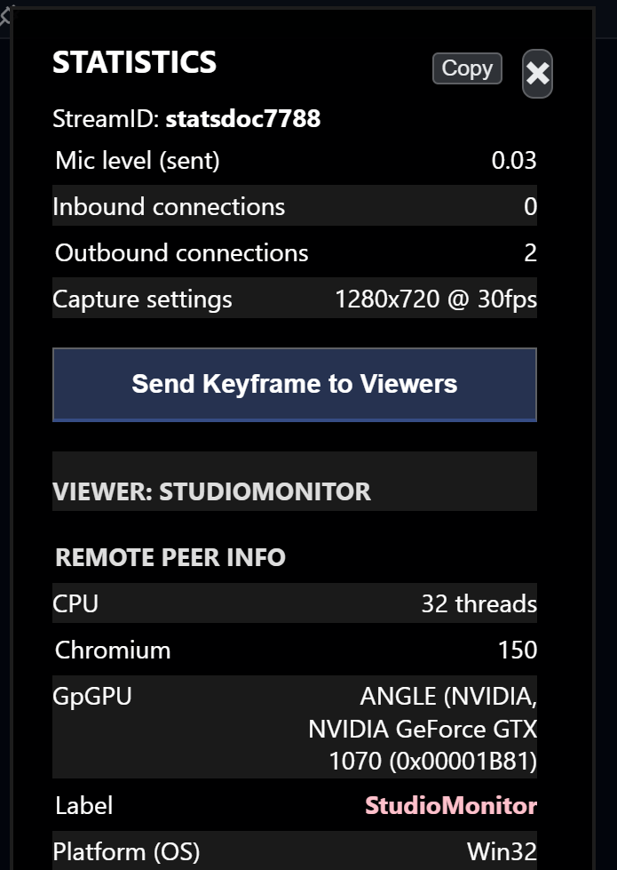
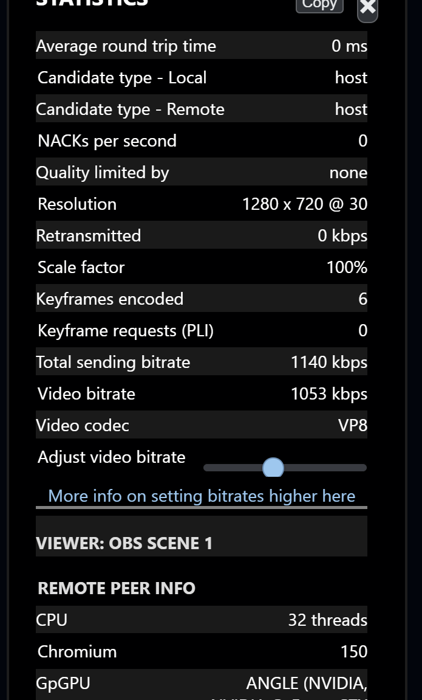
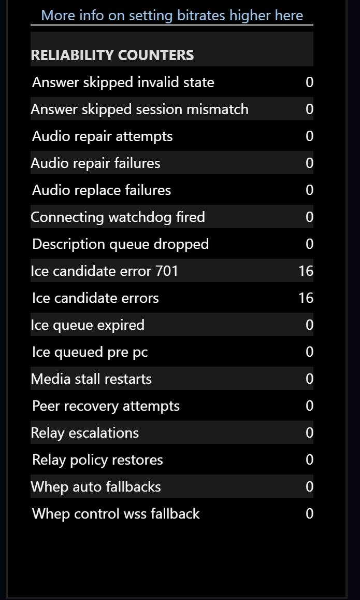

# Reading the publisher panel

You get this panel when you Ctrl + click **your own camera preview**, or click the connection readout in the page header. It shows what you are sending.

Unlike the viewer panel, it repeats a **whole block for each connected viewer**. In normal peer-to-peer use, each viewer has its own connection and its own encode, and each can be limited differently.

## The top block

<figure><figcaption>
Session-wide information, then the first viewer's block.
</figcaption></figure>

| Field | Meaning |
| --- | --- |
| `StreamID` | Your stream ID. Screen shares add `:s` |
| `Mic level (sent)` | The audio level actually reaching the encoder, 0 to 1. If it stays at 0 while you speak (shown with ⚠️), viewers hear silence, whatever your local meter shows |
| `Inbound connections` | How many streams you are receiving |
| `Outbound connections` | How many viewers are connected to you |
| `Capture settings` | What your camera is actually producing, such as `1280x720 @ 30fps`. Compare it with `Resolution` in each viewer block |

`Mic level (sent)` is read after VDO.Ninja's audio processing. It catches cases where the on-screen meter looks fine but nothing is sent: the wrong device, a virtual cable with no input, or a closed noise gate.

**Send Keyframe to Viewers** sends a fresh keyframe to everyone. Try it when a viewer or OBS shows a corrupted or frozen picture but the connection otherwise looks healthy.

## One block per viewer

Each viewer's block starts with a `Viewer:` heading showing their `&label`, or else their stream ID or a short ID. Then come their own details and the stats for *your connection to them*.

<figure><figcaption>
The per-viewer block, ending with the bitrate slider and the start of the next viewer's block.
</figcaption></figure>

### Remote Peer Info

What the viewer reports about themselves: `CPU`, `GpGPU`, `Platform (OS)`, `User agent`, `VDO.Ninja Version` and their `Label` (in pink). Useful when a problem may affect only one viewer. These are not live measurements of the viewer's CPU or GPU load.

### Your connection to that viewer

| Field | Meaning | What to look for |
| --- | --- | --- |
| `Video bitrate` | Video you are sending them | Compare with your target. ⚠️ at 0 means no video is reaching them |
| `Audio bitrate` | Audio you are sending them | ⚠️ at 0 means no audio data is reaching them |
| `Total sending bitrate` | Everything on this connection, including overhead and retransmissions | A little above video plus audio |
| `Available outgoing bitrate` | The browser's estimate of what this path can carry right now | If it stays close to the actual bitrate while `Quality limited by` says `bandwidth`, the path is probably congested. It is an estimate, not a measured limit |
| `Quality limited by` | Why the browser is lowering resolution or frame rate | `none`, `bandwidth`, `cpu` or `other` |
| `Resolution` | What you are encoding for this viewer, with fps | Often lower than `Capture settings` because of `Scale factor` |
| `Scale factor` | How much the picture is downscaled for this viewer | `100%` means full size |
| `Video encoder` | The encoder the browser is using | VDO.Ninja treats `ExternalEncoder` and `MediaFoundationVideoEncodeAccelerator` as hardware encoders |
| `Average round trip time` | Latency to that viewer | |
| `NACKs per second` | How often the viewer asks you to resend lost packets | Sustained non-zero means loss on the path to them |
| `Retransmitted` | Bandwidth spent resending lost packets | Large values mean you are sending the same data twice |
| `Keyframes encoded` | Total keyframes produced | |
| `Keyframe requests (PLI)` | How many times the viewer asked for a fresh keyframe | A climbing count means they keep losing the picture |
| `Candidate type - Local` / `Remote` | How this connection was made | `relay` (shown as `💸 relay server`) on either side means TURN is carrying it |
| `Audio codec`, `Video codec`, `Audio clock rate / channels` | What was negotiated | |

Because each viewer has a block, you can compare paths. If one viewer shows `bandwidth` and heavy NACKs while three others are clean, the problem is on that viewer's path, though the stats cannot say which part of it. If every viewer shows `bandwidth` at once, a shared limit such as your upload is more likely.

### Controls in each block

* **Trigger an ICE restart** renegotiates the network path for that viewer. Try it when a connection has degraded but not dropped, for example after a network change.
* **Disconnect this viewer** appears only when you use access approval: [`&prompt`](../../advanced-settings/settings-parameters/and-prompt.md), `&validate` or `&approve`.
* **Adjust video bitrate** is a live slider for that viewer's target. It shows by default outside rooms; `&slider` or `&showslider` adds it in rooms. The change applies when you release the slider.

You may also see `max bandwidth target`, `init bitrate target` and `current bitrate target` when those values are set. Clicking `init bitrate target` lets you type a new target.

## Reliability counters

<figure><figcaption>
Internal recovery counters, at the bottom of the panel.
</figcaption></figure>

The last section counts VDO.Ninja's own connection-recovery actions. Normally almost everything reads `0` and you can ignore it. It helps when chasing an intermittent fault, or when someone helping you asks for it.

| Counter | If it keeps climbing |
| --- | --- |
| `Peer recovery attempts` | Connections are being rebuilt repeatedly; the session is unstable |
| `Media stall restarts` | Media stopped flowing and had to be restarted |
| `Relay escalations` | Reserved; currently always 0 because nothing increments it |
| `Connecting watchdog fired` | Connections are timing out during setup |
| `Ice candidate errors` | Some network candidates failed to gather. A non-zero count on its own is common and harmless |
| `Audio repair attempts` / `Audio repair failures` | The audio track needed help to keep running |

A few `Ice candidate error 701` entries are normal. Steady growth in `Peer recovery attempts` or `Media stall restarts` during a session is not.

## Next

* [Reading the viewer panel](viewer-stats.md): the other end of the same connection
* [Diagnosing problems](troubleshooting.md): symptom-first recipes
