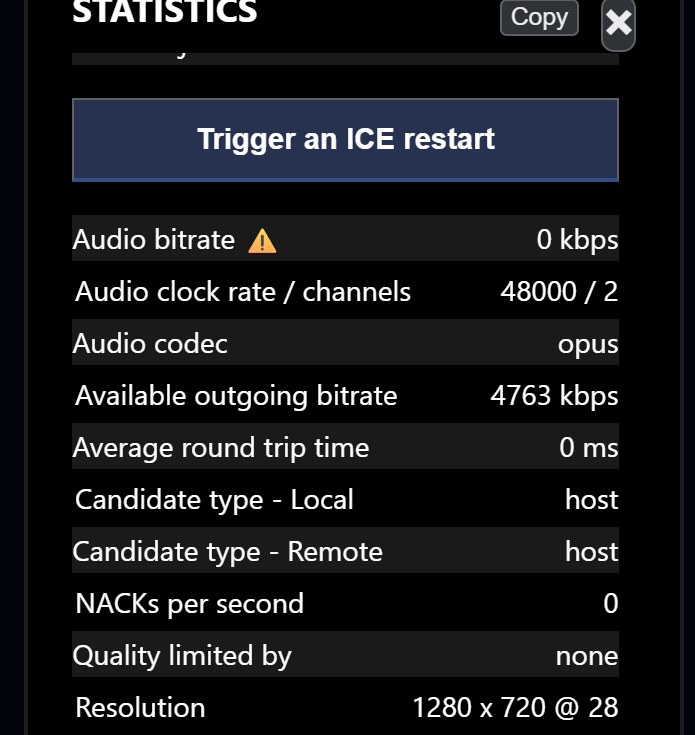

# Diagnosing problems with the stats panel

Start from what you see, read the listed numbers, then make the change. Open the panel on **both** ends when you can; most wrong diagnoses come from looking at one side only.

## Video is blocky, soft, or keeps freezing

**Read on the receiving side:** `Packet Loss`, `NACKs sent`, `Keyframes requested (PLI)`, `Jitter Buffer Delay`.

| Reading | Likely cause | What to do |
| --- | --- | --- |
| Loss 0% now, PLI climbing | The decoder keeps asking for refreshes | Have the sender click **Send Keyframe to Viewers** once and see if PLI keeps climbing |
| Loss under 1%, occasional NACKs | Resends are recovering the odd lost packet | Watch it; act only if counters climb with visible freezes |
| Loss 1–5%, PLI climbing | Resends cannot keep up | Lower the bitrate, add `&buffer=500`, or lower resolution or frame rate |
| Loss above 5% | The path drops much of the stream | Use a much lower profile; see [stable IRL streaming](../irl-streaming-stability.md) |
| Loss 0% now, jitter buffer climbing | Packets arrive unevenly | Try a wired connection or add buffer |

**Raising the bitrate when there is packet loss makes it worse.** More data on a lossy path means more resends and more loss. Go down, not up.

## The bitrate is far lower than I asked for

**Read on the sending side**, in this order:

1. **`Quality limited by` = `bandwidth`:** if `Video bitrate` stays close to `Available outgoing bitrate`, the path is full. A higher target will not help.
2. **`Quality limited by` = `cpu`:** see [below](#cpu-is-the-bottleneck-on-the-sending-side).
3. **`Quality limited by` = `none`:** the browser is not holding back. Check `&videobitrate`, `&maxvideobitrate` and room bitrate rules. A static scene may also need fewer bits.
4. **`Scale factor` below 100%:** the viewer is drawing the video small and asked for less.

On the receiving side, a small `Requested resolution` means the sender is doing what it was asked. Use `&scale` on the view link to force it larger. See [how to control bitrate/quality](../how-do-i-control-bitrate-quality.md) and [default resolution and bitrate by mode](../default-resolution-and-bitrate.md).

## Nobody can hear me, or a guest has no audio

**On the sending side**, read `Mic level (sent)` and each viewer's `Audio bitrate`:

| Reading | Cause |
| --- | --- |
| `Mic level (sent)` stays at 0 (⚠️) while speaking | The mic is feeding silence. Check the device, OS mute, noise gate or virtual cable |
| Mic level moves, `Audio bitrate` at 0 ⚠️ | Audio is captured but not reaching that viewer |
| Both healthy | You are sending audio; look at the receiving end |
| No `Audio bitrate` row for a viewer | No audio was set up with them; check whether they used `&noaudio` |

<figure><figcaption>
A ⚠️ next to a bitrate means the track exists but nothing is moving through it. Hover it for the explanation.
</figcaption></figure>

**On the receiving side**, check the *Audio track* section:

* **Missing:** nothing is arriving. Go back to the sender.
* **`Bitrate` healthy, `Audio Level` at 0:** the sender is sending silence.
* **`Audio Level` moving:** audio arrives fine. Check your output device, volume, or whether the stream is muted in your scene.

## The connection is using a relay

**Read on either side:** `Candidate type - Local` and `Candidate type - Remote`.

`💸 relay server` means a TURN server carries the connection. It can add delay and uses shared capacity, but it is not a fault by itself. `⚠️ You're blocking` or `⚠️ They're blocking` means a browser or system setting at that end blocks direct connections, often a VPN, privacy extension or corporate policy.

Try, in order:

1. Turn off VPNs and WebRTC-blocking extensions at both ends.
2. Move one end off the restrictive network; a phone hotspot is a quick test.
3. If the relay is unavoidable and the stats show congestion, lower the bitrate.

`host` is a local network interface and `srflx` a public address found through STUN. Both can connect directly without TURN.

## CPU is the bottleneck on the sending side

**Read:** `Quality limited by` = `cpu`, plus the sender's `CPU`, `GpGPU` and `Power level`. On a director page or outside a room, the sender's header also shows **🔥 CPU Overloaded**.

More bitrate will not help. Roughly in order of effect:

1. Lower the frame rate or resolution.
2. Switch to H.264, which often has hardware encoding; check `Video encoder` in the publisher panel. See [hardware-accelerated video encoding](../hardware-accelerated-video-encoding.md).
3. Reduce how many viewers connect directly; each one is a separate encode.
4. Close other apps. For phones, check `Plugged in` and `Power level`; heat or power saving can slow them down.

## The connection keeps dropping and reconnecting

**Read:** `Time active` on the receiving side, and `Peer recovery attempts` and `Media stall restarts` in the sender's reliability counters.

If `Time active` keeps resetting or those counters climb, the connection is dropping, not merely slow. Lower the bitrate and fix the network before changing quality settings. See [handling guest disconnects](../handling-guest-disconnects-and-connection-recovery.md).

## Video is fine but out of sync with audio

**Read:** `Jitter Buffer Delay` on both tracks, and `Total Playout Delay` if you use `&buffer`.

A large gap between the audio and video jitter buffers is the usual cause. [`&buffer`](../../advanced-settings/view-parameters/buffer.md) on the viewer sets a target delay for both; [`&bufferaudio`](../../advanced-settings/audio-parameters/and-bufferaudio.md) sets one for audio alone. `Total Playout Delay` excludes Bluetooth, monitor and capture-card delay, so if the numbers look right, suspect that hardware.

## When none of this helps

Click **Copy** in both panels and share the text.

* [Asking an AI to read your stats](llm-prompt.md): a prompt that explains the fields to an LLM
* The [VDO.Ninja Discord](https://discord.vdo.ninja): share both stats dumps and your full links, with sensitive parts removed
