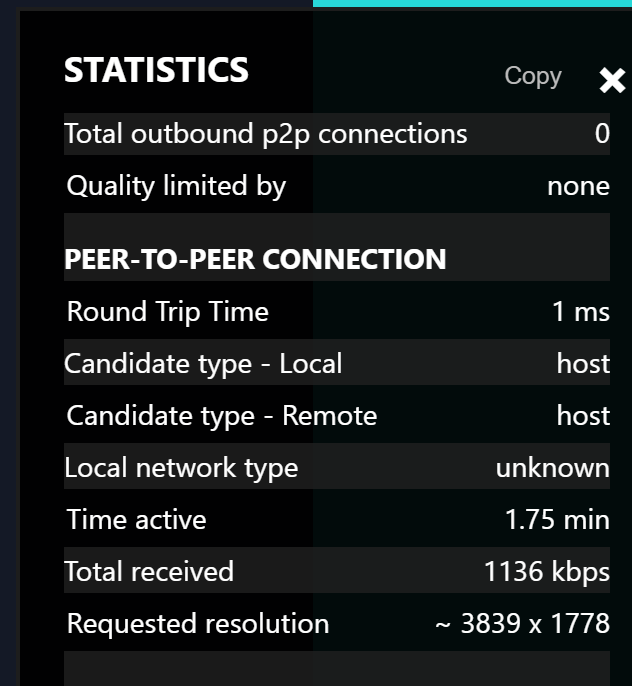
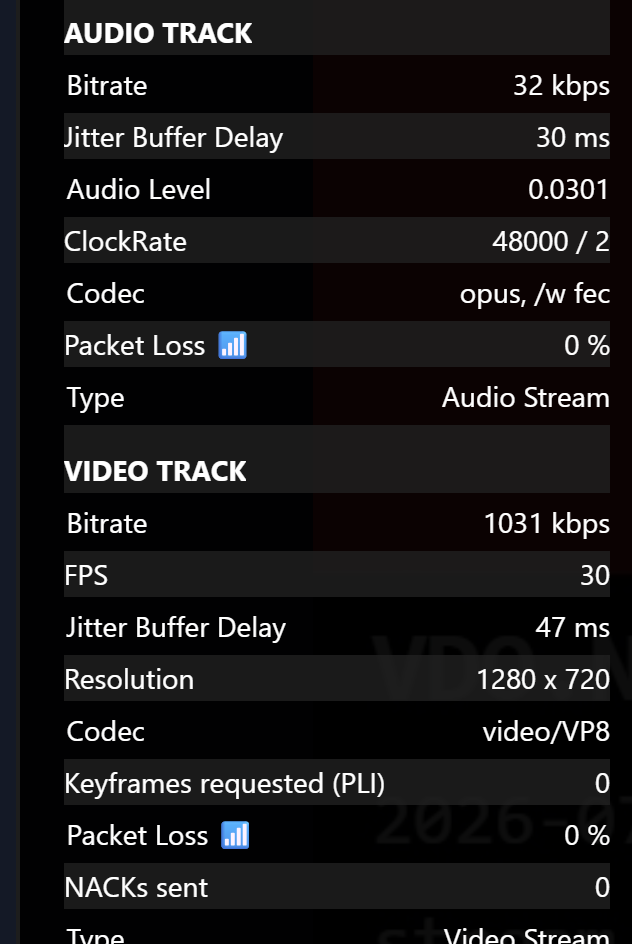

# Reading the viewer panel

You get this panel when you Ctrl + click a **remote** video, such as a guest in your room or a stream in OBS. It shows what arrives at your computer, and starts with `StreamID:` so you know which stream it is.

## Stream info

<figure><figcaption>
Stream info describes the <em>sender's</em> computer and settings, not yours.
</figcaption></figure>

Everything here is **reported by the sender**, not measured by you. `CPU`, `GpGPU`, `Platform (OS)` and `Power level` describe the guest's device, not yours.

| Field | Meaning |
| --- | --- |
| `Video init width` / `height` / `frameRate` | What the sender asked their camera for, not what is sent now |
| `Quality (URL)` | The sender's `&quality` setting |
| `Echo-Cancellation`, `Auto-Gain (agc)`, `De-noising` | The sender's audio processing. `default` means the browser decides, which is not the same as off |
| `Pro-Audio (Stereo-mode)` | Shown only if the sender used `&stereo` |
| `VDO.Ninja Version`, `User agent`, `Platform (OS)`, `Browser` | The sender's software. Click the user agent to copy it |
| `GpGPU`, `CPU` | The sender's graphics adapter and core count, not current load |
| `Hardware video encoder` | Whether the sender's browser reported a hardware encoder |
| `Power level`, `Plugged in` | The sender's battery state |
| `Quality limited by` | Why the sender's browser is lowering quality: `none`, `bandwidth`, `cpu` or `other` |
| `Total outbound p2p connections` | How many viewers the sender has. [`&showconnections`](../../advanced-settings/settings-parameters/and-showconnections.md) shows this as a 🔗 badge on the video |

If a guest looks soft and `Quality limited by` says `cpu`, raising the bitrate on your side will not help.

## Peer-to-peer connection

<figure><figcaption>
The transport between you and the sender.
</figcaption></figure>

| Field | Meaning |
| --- | --- |
| `Round Trip Time` | Latency there and back. Steady matters more than low; a swinging value means congestion |
| `Candidate type - Local` / `Remote` | How each end connects: `host` = local network interface, `srflx` = public address found through STUN, `💸 relay server` = TURN relay. `host` at both ends often means a LAN path |
| `Local network type` | Your interface type, if the browser shares it (often `unknown`) |
| `Time active` | How long this connection has been up. If it keeps resetting, the connection is dropping |
| `Total received` | All incoming bitrate, including overhead |

`Requested resolution` is the size your side asked the sender for: how large the video is drawn on your screen, in **device pixels**. On a HiDPI screen it looks larger than the window. A leading `~` lets the sender round to a nearby standard size. Small tiles request small video on purpose; use [`&scale`](../../advanced-settings/view-parameters/scale.md) to override.

## Audio track and Video track

<figure><figcaption>
One section per incoming track. If a section is missing, that track is not being received at all.
</figcaption></figure>

Each incoming track has a section. **A missing section is a finding:** with no *Audio track* section, no audio is arriving, so check the sender, not your speakers.

| Field | Track | Meaning |
| --- | --- | --- |
| `Bitrate` | both | Received bitrate. ⚠️ if it drops to 0 while the track exists |
| `FPS`, `Resolution` | video | Frames decoded per second, and the size arriving |
| `DecodeLatencyMs` | video | Average time to decode a frame. High values point to a slow receiving computer |
| `Jitter Buffer Delay` | both | Delay added to smooth uneven arrival. A rising value means uneven arrival, even with low loss |
| `Audio Level` | audio | Loudness, 0 to 1. Exactly 0 with a healthy bitrate means the sender is sending silence |
| `ClockRate`, `Codec` | audio/both | Sample rate and channels (such as `48000 / 2`), and codec. `opus, /w fec` means audio error correction is on |
| `Packet Loss 📶` | both | Percentage of packets lost in the latest sample |
| `Keyframes requested (PLI)` | video | Requests for a fresh keyframe. Steady climbing means the decoder keeps losing the picture |
| `NACKs sent` | video | Requests to resend a lost packet |

**How they connect:** a lost packet triggers a NACK. If the decoder still cannot continue, it sends a PLI, and the larger keyframe briefly raises bandwidth. That is the familiar "freeze, then snap back". A PLI alone does not prove loss, since startup and decoder resets also request keyframes. Look for counters climbing while you see the problem.

## Rows that appear only sometimes

| Field | When |
| --- | --- |
| `Added Buffer Delay`, `Total Playout Delay` | You use [`&buffer`](../../advanced-settings/view-parameters/buffer.md) or [`&bufferaudio`](../../advanced-settings/audio-parameters/and-bufferaudio.md). Total Playout Delay excludes Bluetooth, monitor and capture delay |
| `Video Buffer: Target / Current`, `Audio Buffer`, `Video Repairs: FEC / NACK` | Chunked mode. A red `(rebuffering)` means playback stalled while the buffer refills |
| `⚠️ You're blocking` / `⚠️ They're blocking` | A browser or system setting is preventing a direct connection; see [relay connections](troubleshooting.md#the-connection-is-using-a-relay) |
| A map with coordinates | The sender is sharing location |

## Next

* [Reading the publisher panel](publisher-stats.md): the other end of the same connection
* [Diagnosing problems](troubleshooting.md): what to do about these numbers
