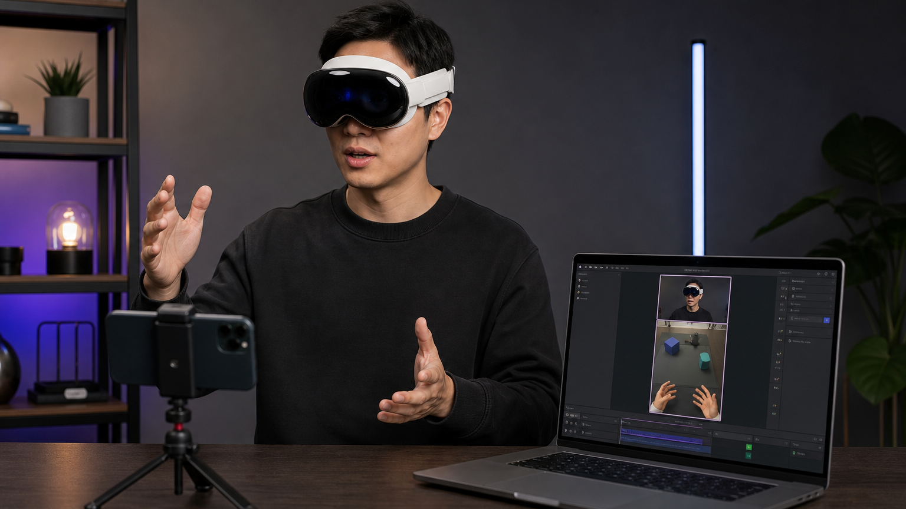
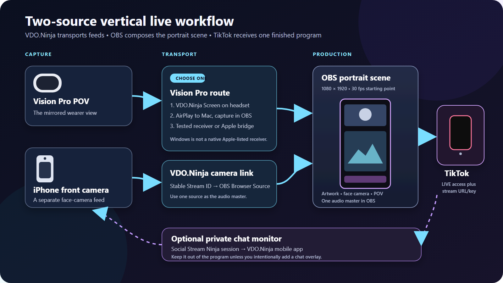

# Stream Apple Vision Pro POV and an iPhone camera to TikTok with OBS

This workflow combines the view mirrored from an Apple Vision Pro and a separate iPhone front camera into one portrait program, with an optional custom overlay and private TikTok chat monitoring through Social Stream Ninja. VDO.Ninja carries the live feeds into OBS. OBS crops, mixes, records and encodes them, and TikTok receives only the finished program.

<figure><figcaption><p>Conceptual hardware layout. The generated interface shown on the laptop is illustrative, not an exact OBS screenshot.</p></figcaption></figure>


This guide streams from OBS, which needs a stream server URL and stream key from TikTok. TikTok controls LIVE access, and requirements vary by account and region. If your account only has TikTok LIVE Studio, the capture and layout steps still apply, but the final publishing step differs.


<figure><figcaption><p>Choose one Vision Pro route. The iPhone face camera remains a separate source. Social Stream Ninja can return chat privately without placing it in the public program.</p></figcaption></figure>

## What you need

* Apple Vision Pro and an iPhone for the face camera.
* The [VDO.Ninja native mobile app](../steves-helper-apps/native-mobile-app.md) on each Apple device that publishes through VDO.Ninja.
* OBS Studio on a Mac, Windows PC or Linux computer, ideally wired to the router.
* TikTok LIVE access with a stream server URL and stream key.
* A portrait overlay design, ideally `1080x1920`.
* Headphones if you monitor any audio in the room.

Apple documents [Vision Pro mirroring](https://support.apple.com/en-us/119944) to an iPhone, iPad, supported Mac, Apple TV 4K or AirPlay-compatible TV, at up to 1080p. Test these on your exact devices and OS versions before going live:

* screen publishing from the VDO.Ninja app running on Vision Pro (the App Store listing shows the app is compatible with Vision Pro; that alone does not prove screen publishing works on every visionOS release);
* any third-party Windows AirPlay receiver (Windows is not an Apple-supported mirroring destination);
* audio from the mirrored content; and
* latency and heat over the full stream length.


One iPhone cannot send two independent VDO.Ninja streams at once. The app sends either a camera or the screen. Its **FRONT + REAR MIX** mode is one combined camera stream, not a Vision Pro screen plus a face camera.


## Step 1: Choose one Vision Pro route

### Route A: Publish the Vision Pro screen through VDO.Ninja

This has the fewest hops, if it works on your Vision Pro and visionOS version.

1. Install the VDO.Ninja app on Vision Pro and choose **SCREEN**.
2. Enter a private Stream ID, such as `VISIONPOV7F3K`. IDs are case sensitive; use only letters and numbers.
3. Tap **START STREAM** (**CONNECT** in older app versions), then start the VDO.Ninja broadcast when the system picker appears.
4. Open the view link on the OBS computer and check motion, orientation and audio.

```text
https://vdo.ninja/?view=VISIONPOV7F3K&cleanoutput&noaudio&videobitrate=6000
```

[`&cleanoutput`](../advanced-settings/design-parameters/cleanoutput.md) hides the interface. [`&noaudio`](../advanced-settings/view-parameters/noaudio.md) makes the source video only, for when another microphone is the audio source. [`&videobitrate=6000`](../advanced-settings/video-bitrate-parameters/bitrate.md) is a request, not a guarantee; lower it if the network or computer struggles. Replace every example Stream ID with your own.

If screen publishing is unavailable, unstable, or does not show the wearer's view, use Route B or C.

### Route B: Mirror Vision Pro to a Mac

This uses Apple's AirPlay path and does not need VDO.Ninja for the Vision Pro picture.

1. Put the Vision Pro and Mac on the same network with Wi-Fi and Bluetooth on.
2. On the Mac, open **System Settings -> General -> AirDrop & Handoff** and turn on **AirPlay Receiver**.
3. On Vision Pro, open Control Center, choose **Mirror My View**, and select the Mac.
4. In OBS, add **macOS Screen Capture** and select the mirrored view.
5. Crop away receiver controls and borders.

Protected movies and TV shows can appear black in the mirror ([Apple](https://support.apple.com/en-us/119944)).

### Route C: Bridge through an iPhone or iPad to Windows

```text
Vision Pro -> AirPlay to iPhone or iPad -> VDO.Ninja SCREEN -> OBS on Windows
```

1. On the bridge iPhone or iPad, choose **SCREEN** in the VDO.Ninja app, set a Stream ID, and start the broadcast.
2. Return to the Apple Vision Pro app, turn on **AirPlay Receiver**, and leave that app in the foreground.
3. On Vision Pro, choose **Mirror My View** and select the bridge device.
4. Add the bridge device's view link to OBS (Step 3).

Test this exact chain first. In the European Union, Apple says the Apple Vision Pro app must be in the foreground for the iPhone or iPad to appear as a mirroring destination. If the bridge is your only iPhone, use another device or a webcam for the face camera. A third-party Windows AirPlay receiver is not Apple-supported; test it thoroughly before a show.

## Step 2: Publish the iPhone front camera

1. Mount the iPhone securely; use landscape if your design has a wide face window.
2. In the VDO.Ninja app, choose **FRONT CAMERA** and set a different Stream ID, such as `PHONECAM8R2M`.
3. Select the microphone only if this phone is the program's audio source.
4. Tap **START STREAM** and allow camera and microphone access.
5. Keep the phone on power, and run a heat test as long as the planned LIVE.

```text
https://vdo.ninja/?view=PHONECAM8R2M&cleanoutput&videobitrate=4000
```

If a USB microphone or another OBS source carries the voice, add `&noaudio` to this link. Use private, hard-to-guess Stream IDs and a password where appropriate; see [stream IDs](../getting-started/stream-ids.md) and [permanent links](how-to-get-permanent-links.md).

## Step 3: Add the VDO.Ninja feeds to OBS

For each feed:

1. In OBS, select **Sources -> + -> Browser Source** and give it a clear name, such as `Vision Pro POV`.
2. Paste the view link.
3. Set the viewport to `1280x720` at 30 fps for a landscape source, or `720x1280` for a portrait phone.
4. Leave **Shutdown source when not visible** and **Refresh browser when scene becomes active** off.
5. Enable **Control audio via OBS** only on sources OBS should mix.

The viewport sets the [Browser Source's](https://obsproject.com/kb/browser-source) render size, separate from its size on the canvas. If a link works in Chrome but not OBS, see [Enabling WebRTC Sources in OBS](enabling-webrtc-sources-in-obs.md).

## Step 4: Build the portrait scene

In **Settings -> Video**:

| Setting | Normal | Lower load |
| --- | --- | --- |
| Base (Canvas) Resolution | `1080x1920` | `1080x1920` |
| Output (Scaled) Resolution | `1080x1920` | `720x1280` |
| Common FPS Value | `30` | `30` |

The canvas is where you arrange sources; the output is the encoded size. 60 fps needs much more processing than 30 ([OBS video settings](https://obsproject.com/kb/obs-studio-overview#video)).

**Source order.** OBS draws the bottom of the Sources list first, so higher sources cover lower ones ([OBS Sources Guide](https://obsproject.com/kb/sources-guide)).

| Overlay with transparent openings (top to bottom) | Flattened artwork with solid openings (top to bottom) |
| --- | --- |
| Labels or public chat graphics | Labels |
| Transparent overlay PNG | iPhone face camera |
| iPhone face camera | Vision Pro POV |
| Vision Pro POV | Flattened artwork or background |
| Background | |

A `.png` file is not always transparent. Transparent openings show a checkerboard in an image editor. If they are solid black, put the image below the videos or re-export it with transparency.

**Crop, do not stretch.** Scale each video proportionally to fill its window, then crop the excess: hold `Alt` (Windows, Linux) or `Option` (macOS) while dragging an edge, or use **Transform -> Edit Transform** for exact values ([OBS aspect-ratio guide](https://obsproject.com/kb/aspect-ratio-guide)). Designing both openings at `16:9` avoids most cropping.

## Step 5: Use one audio source for your voice

Use either the iPhone microphone or a microphone on the OBS computer, not both, and add `&noaudio` to every view link that should be video only. If the Vision Pro content needs sound, add it as its own OBS mixer source. **Control audio via OBS** gives each Browser Source its own volume and filters.

Record five minutes locally and listen back for one clean voice with no delayed copy, no hiss or clipping, and good lip sync on a hand clap. If noise appears only after opening TikTok on a capture iPhone, keep TikTok off that phone.

## Step 6 (optional): Watch TikTok chat privately

Social Stream Ninja can send TikTok LIVE chat to the VDO.Ninja mobile app without putting it in the OBS scene.

1. Install the Social Stream Ninja extension or standalone app from its [repository](https://github.com/steveseguin/social_stream).
2. Open the TikTok LIVE page while signed in. With the extension, keep the chat open and visible.
3. Turn on chat streaming in Social Stream Ninja and note its session ID.
4. In the VDO.Ninja app's **Social Stream Ninja** settings, turn on **Enable Social Stream**, enter the same **Social Stream Session ID**, and choose a **Connection Mode** (**Peer-to-Peer** or **Server**).
5. Turn off chat text-to-speech unless you want it in the audio.

Do not add a Social Stream dock or featured-chat URL to the OBS scene unless viewers should see the chat.

## Step 7: Stream the OBS program to TikTok

1. Open **Settings -> Stream** in OBS and select **Custom**.
2. Enter the server URL and stream key from TikTok. Keep the key out of screenshots, scene collections and support messages.
3. Use TikTok's current LIVE recommendations for bitrate, encoder and keyframe interval.
4. Start with a private or limited test if your account allows it, or record locally first.

TikTok's [LIVE access requirements](https://www.tiktok.com/live/studio/help/article/Before-you-go-LIVE/Apply-for-LIVE-access?lang=en) vary by region and can change.

## Performance tuning

Each extra hop adds delay, so the most complex route is rarely the best. On an older or lagging computer, output `720x1280` at 30 fps, keep Browser Sources at `1280x720`, lower `&videobitrate` in steps (`6000`, `4000`, `2500`), use a hardware encoder, and remove unneeded sources, animated overlays and filters. Watch **View -> Stats** for rendering lag, encoding lag and dropped network frames. See [OBS encoding performance troubleshooting](https://obsproject.com/kb/encoding-performance-troubleshooting).

## Common problems

| Symptom | Likely cause | Fix |
| --- | --- | --- |
| Artwork looks tiny with black areas | Canvas is still landscape | Set the canvas to `1080x1920` and realign sources |
| Only one of POV or face camera works | One iPhone is both bridge and camera | Publish from Vision Pro, mirror to a Mac, or add a second device |
| Smooth in a browser, delayed in OBS | Browser Source settings, load or network route | Match the viewport to the source, reduce load, check OBS stats |
| Echo or hiss | More than one audio path | Keep one voice source and add `&noaudio` to video-only links |
| TikTok chat stops | Chat closed or hidden, or session IDs differ | Keep TikTok chat visible with the extension; match the session IDs |

## Pre-LIVE checklist

* Both VDO.Ninja links reconnect after a refresh.
* The canvas is portrait and video is cropped, not stretched.
* Exactly one voice path reaches the program, confirmed in a full local test recording.
* The Vision Pro route and OBS stats stay stable for the full session length.
* Both devices are powered, cool and on the right network.
* Notifications, private information and the TikTok stream key are hidden.

## Related guides

* [VDO.Ninja native mobile app guide](../steves-helper-apps/native-mobile-app.md)
* [How to screen share your iPhone or iPad](screen-share-your-iphone-ipad.md)
* [Video bitrate for push/view links](video-bitrate-for-push-view-links.md)
* [How to control bitrate and quality](how-do-i-control-bitrate-quality.md)
* [Enabling WebRTC Sources in OBS](enabling-webrtc-sources-in-obs.md)
* [Social Stream Ninja](../steves-helper-apps/social-stream-ninja/README.md)
