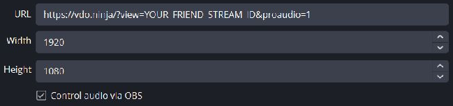

# Stream sports and events from a phone

Use a normal VDO.Ninja camera connection to OBS for sports, school events, conferences, and conventions. Test from your filming position while the venue is busy, then change only what needs improving.

If you only need a recording to upload later, recording directly on the phone avoids dependence on venue internet.

## Get the camera into OBS

1. On the phone, open [VDO.Ninja](https://vdo.ninja/) and choose **Add your Camera to OBS**. Select the rear camera and microphone, then start sharing. Alternatively, use the [native app's normal camera output](../steves-helper-apps/native-mobile-app.md#quick-start).
2. In OBS, select **Sources > + > Browser** and paste the camera's **view link** into **URL**. For a room, use its solo view link from the director.
3. Use landscape **16:9**. Set Browser Source dimensions to your layout, such as **1920 x 1080**, and enable **Control audio via OBS**. Layout dimensions do not upgrade the camera's resolution.
4. Check picture and audio, then record and play back a short sample.

<figure><figcaption>
Use your own camera's view link in the OBS Browser Source.
</figcaption></figure>

Use OBS to record and broadcast to YouTube or another service. Give the audience that platform's link. Each direct VDO.Ninja camera viewer adds upload work for the phone.

## Prepare for a full event

* Mount the phone, clean the lens, and check focus under the venue's lighting. Avoid heavy digital zoom and rapid panning.
* Arrange power, ventilation, and shade. Lower screen brightness; keep the browser camera page in the foreground and phone unlocked. Test for call interruptions.
* Rehearse long enough to reveal heat or battery problems. Include moving action and a busy period with the crowd present.

## Choose the connection before lowering quality

Ask for venue production internet or Ethernet. Otherwise, compare Wi-Fi with cellular **from the filming position**. Try a better reception spot where filming is still practical.

**5G is not a quality guarantee.** Compare it with 4G/LTE if unstable. Another carrier or hotspot may work better, but a hotspot on the same congested network may not help.

Follow the [Wi-Fi, 5G, 4G, and hotspot comparison](choose-a-network-for-live-events.md). Stop competing uploads and backups. Check OBS's connection too, including its outgoing broadcast.

## Match picture quality to the connection

Start with normal settings. If the phone struggles, try **720p at 30 fps**. Leave upload capacity for audio, recovery traffic, and fluctuations.

| What you see | What to try first |
| --- | --- |
| Smooth video, but players become blocky when moving | Raise the video bitrate gradually if the connection has spare capacity. More resolution alone will not fix compression. |
| Freezes, missing frames, or broken audio | Improve the network or lower the bitrate. Follow the [packet loss guide](../common-errors-and-known-issues/packet-loss.md). |
| Blur on the phone's own preview | Check lens, focus, lighting, zoom, and camera movement. Network settings cannot restore detail the camera did not capture. |
| Good initially, worse after several minutes | Check [overheating](../common-errors-and-known-issues/overheating.md), power, and background activity. |
| Only the director's small preview looks poor | Check the actual OBS source. Room previews deliberately use less bandwidth. |

Browser camera: add `&quality=1&fps=30` to the filming link for 720p30. Native app: use its capture settings. For a normal direct feed, `&bitrate=4000` on the OBS view link requests 4 Mbps, without guaranteeing it. See [where quality settings go](how-do-i-control-bitrate-quality.md).

Test 60 fps or higher resolution only after the current setup is stable. More frames need more resources; a stable 720p feed can be more useful than struggling 1080p.

## Reduce extra work and keep a backup

Close duplicate views. Keep the director for controls with [`&pausepreview`](../advanced-settings/director-parameters/and-pausepreview.md) on its link to pause guest video previews. OBS still counts as a viewer; muting tab audio does not stop video downloads.

Record in OBS, and test a camera-side backup: the native app's [Local Recording](../steves-helper-apps/native-mobile-app.md#recording), [browser recording](options-to-record-streams.md#local-remote-recording-in-vdo.ninja), or a separate camera. Check storage and play back a saved sample. OBS recordings include interruptions in the incoming feed.

## If the ordinary setup still struggles

Try one change at a time before the event:

* [Add a small playback buffer](smooth-playback-with-a-buffer.md) for uneven delivery, when some extra delay is acceptable.
* [Use Meshcast](meshcast-setup.md) when several production viewers need the same phone feed. It distributes one upload through a server.
* For persistent packet loss, compare [SRT from the phone app through Meshcast](mobile-app/srt-to-meshcast.md) or experimental [browser chunked mode](try-chunked-video.md). Both add complexity and can add delay; neither creates missing bandwidth.

Use the [stats panel](stats-menu/README.md) to check bitrate, frame rate, and loss. Keep a tested fallback network and recording plan ready.
